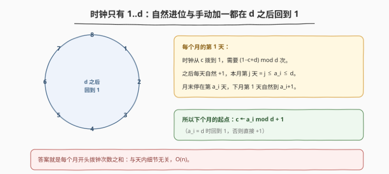
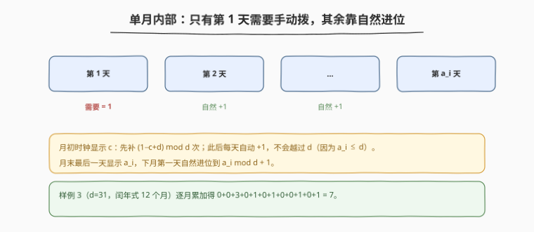

# Codeforces 182B 日历拨钟次数 题解

## 1. 题目概述

- **题目链接**：https://codeforces.com/problemset/problem/182/B
- **比赛来源**：Codeforces Round 117 (Div. 2) · Problem B（UTC 2012-04-24）
- **难度**：1000
- **标签**：模拟、取模、周期
- **评测类型**：普通
- **限制**：时间 1 s / 内存 256 MB

**题意**：某个世界的"年"有 $n$ 个月，第 $i$ 个月有 $a_i$ 天。Vasya 的日历钟只能显示 $1..d$ 的数字：新的一天到来时显示值自动 $+1$，超过 $d$ 就回到 $1$；他也可以手动把显示值 $+1$（同样在 $d$ 之后回到 $1$）。

每天开始时他看一眼钟：如果显示值不等于当天的真实日期，就反复手动 $+1$ 直到相等。已知第一个月第 1 天开始时钟显示 $1$，求整个一年里他手动加一的**总次数**。

**约束**：

- $1\le d\le10^6$，$1\le n\le2000$，$1\le a_i\le d$；
- 答案最大约 $n\cdot d\approx2\times10^9$，需要 64 位整数。

**这档约束排除了什么**：$n\le2000$、$a_i\le d\le10^6$ 时"逐天模拟"最多 $2\times10^9$ 天，太慢；必须发现"一个月内只需要在月初拨钟"的结构，做到 $O(n)$。

## 2. 示例与观察

官方样例一：

```text
输入：
4
2
2 2

输出：
2
```

官方样例二：

```text
输入：
5
3
3 4 3

输出：
3
```

官方样例三：

```text
输入：
31
12
31 28 31 30 31 30 31 31 30 31 30 31

输出：
7
```

**样例一解释**：$d=4$，两个月各 2 天。第 1 天钟是 1，匹配；之后每天自然 $+1$：钟依次是 2、3（第 1 月结束）→ 第 2 月第 1 天钟自然到 3，需要拨 $3\to4\to1$ 共 **2** 次；之后自然前进，全年共 2 次。

**样例二解释**：$d=5$，月份 $3,4,3$。月初钟 1 → 0 次；月末钟 3，下月第 1 天自然到 4，拨 $4\to5\to1$ 共 2 次；第 2 月末钟 4，下月第 1 天自然到 5，拨 1 次；总计 3。

**样例三**：$d=31$，12 个月的天数就是公历。逐月拨钟次数为 $0,0,3,0,1,0,1,0,0,1,0,1$，合计 7。

**第一条观察**：一个月的天数 $a_i\le d$，所以月内真实日期 $1,2,\dots,a_i$ 都不会超过 $d$。一旦月初把钟拨到 1，之后每天的"自然 $+1$"恰好让钟等于当天日期，**月内不需要再手动拨**。

**第二条观察**：月末最后一天钟显示 $a_i$；到下个月第 1 天，钟自然 $+1$，变成 $a_i+1$（若 $a_i=d$ 则回到 1）。这就是下个月的起点 $c'$。

**第三条观察**：月初钟显示 $c$ 时，要拨到 1 需要的次数是 $(1-c) \bmod d$，即 $(1-c+d)\bmod d$。



自造样例（标注"自造"）：

| 输入 | 输出 | 说明 |
|------|------|------|
| `1` / `1` / `1` | 0 | $d=1$，钟永远显示 1，日期也只有 1 |
| `2` / `1` / `2` | 0 | 单月 2 天：第 1 天是 1，第 2 天自然到 2 |
| `2` / `2` / `2 2` | 0 | 月末钟 2 恰好是 $d$，下月第 1 天自然回到 1 ⇒ 不用拨 |
| `3` / `2` / `3 1` | 0 | 月末钟 3 恰好是 $d$，下月自然回到 1 ⇒ 不用拨 |

## 3. 解题思路

### 3.1 朴素做法与瓶颈

逐天模拟：一年最多 $2000\times10^6=2\times10^9$ 天，每次还要可能多次拨钟，超时。

### 3.2 核心观察：只需在月初拨钟



- 月初钟显示 $c$，要显示 1：拨 $(1-c+d)\bmod d$ 次。
- 之后每天自然 $+1$；由于月内日期最大是 $a_i\le d$，钟不会越过 $d$，所以第 $j$ 天钟显示 $j$ —— 与真实日期一致，不再需要拨。
- 月末钟显示 $a_i$；下个月第 1 天自然 $+1$，得到 $c'=a_i\bmod d+1$。

于是把"一年"压缩成 $n$ 步：

$$\text{ans}=\sum_{i=1}^{n}\big((1-c_i)\bmod d\big),\qquad c_1=1,\ c_{i+1}=a_i\bmod d+1 .$$

### 3.3 算法流程

1. 读入 $d$、$n$、$a_i$；
2. `c = 1`，`ans = 0`；
3. 对每个月：`ans += (1 - c + d) % d`；`c = a_i % d + 1`；
4. 输出 `ans`。

### 3.4 样例走查

样例三逐月计算：

| 月 | $a_i$ | 月初钟 $c$ | 拨钟次数 | 下月起点 |
|----|-------|-----------|----------|----------|
| 1 | 31 | 1 | 0 | $31\bmod31+1=1$ |
| 2 | 28 | 1 | 0 | 29 |
| 3 | 31 | 29 | $(1-29+31)\bmod31=3$ | 1 |
| 4 | 30 | 1 | 0 | 31 |
| 5 | 31 | 31 | 1 | 1 |
| 6 | 30 | 1 | 0 | 31 |
| 7 | 31 | 31 | 1 | 1 |
| 8 | 31 | 1 | 0 | 1 |
| 9 | 30 | 1 | 0 | 31 |
| 10 | 31 | 31 | 1 | 1 |
| 11 | 30 | 1 | 0 | 31 |
| 12 | 31 | 31 | 1 | 1 |

合计 $0+0+3+0+1+0+1+0+0+1+0+1=7$，与官方输出一致。

## 4. 正确性证明

**引理 1（月内只需月初拨一次）**：若月初第 1 天开始时钟被拨到 1，则本月内所有天都不需要手动拨钟。

**证明**：对天数归纳。第 1 天钟为 1 等于真实日期；若第 $j$ 天钟为 $j$（$j<a_i$），则新的一天到来时钟自然 $+1$ 变 $j+1$，而 $j+1\le a_i\le d$，不会越过 $d$，恰等于第 $j+1$ 天的真实日期。∎

**引理 2（月初状态转移）**：设第 $i$ 个月月初钟为 $c_i$，则该月拨钟次数为 $(1-c_i+d)\bmod d$，且 $c_{i+1}=a_i\bmod d+1$。

**证明**：月初只需把 $c_i$ 变到 1，每次 $+1$ 模 $d$，最少次数就是 $(1-c_i)\bmod d$；由引理 1 月内不再拨。月末最后一天钟为 $a_i$，下个月第 1 天自然 $+1$，超过 $d$ 则回 1，即 $a_i\bmod d+1$。∎

**定理（算法正确）**：算法输出的总次数等于整年手动加一的次数。

**证明**：对月份归纳，$c_i$ 恰为第 $i$ 个月月初的钟面值：初始 $c_1=1$ 由题面给出；由引理 2 从 $c_i$ 得到 $c_{i+1}$。每月拨钟次数由引理 2 给出，且月内没有其他拨钟（引理 1），求和即为总次数。∎

## 5. 复杂度分析

- **时间**：$O(n)\le2000$ 次取模运算。
- **空间**：$O(n)$ 或 $O(1)$（边读边算）。
- **数值范围**：每月最多 $d-1\le10^6-1$ 次，$n\le2000$ ⇒ 答案 $\le2\times10^9$，超过 `int` 上界，必须 `long long`。
- **与时限的关系**：1 s 内实测不到 1 ms。

## 6. 参考代码

### C++17

```cpp
#include <bits/stdc++.h>
using namespace std;

int main() {
    long long d, n;
    if (!(cin >> d >> n)) return 0;
    vector<long long> a(n);
    for (auto &x : a) cin >> x;
    long long clockNow = 1, answer = 0;
    for (long long days : a) {
        answer += (1 - clockNow + d) % d;   // 本月初把时钟拨到 1 需要几次
        clockNow = days % d + 1;            // 月末自然进位到下个月的第 1 天
    }
    cout << answer << '\n';
    return 0;
}
```

### Python3

```python
import sys


def main() -> None:
    data = sys.stdin.buffer.read().split()
    if not data:
        return
    d = int(data[0])
    n = int(data[1])
    a = [int(data[2 + i]) for i in range(n)]

    clock_now = 1
    answer = 0
    for days in a:
        answer += (1 - clock_now + d) % d   # 本月初把钟拨到 1 需要几次
        clock_now = days % d + 1            # 月末自然进位
    sys.stdout.write(str(answer) + "\n")


main()
```

## 7. 边界情况与易错点

1. **$d=1$**：钟只能在 1，任何日期都是 1，答案恒 0；取模式 $(1-1+1)\bmod1=0$ 正确。
2. **$a_i=d$**：月末钟显示 $d$，下月第 1 天自然回到 1，所以 $c'=1$；写成 $a_i+1$ 就错了。
3. **$a_i<d$**：$c'=a_i+1$，直接加一。
4. **答案溢出**：$n\cdot d$ 可达 $2\times10^9$，用 `long long`（Python 无此问题）。
5. **第一个月第 1 天**：钟初始就是 1，不需要拨（$c_1=1$）；不要把初值写成 0。
6. **读入顺序**：第一行 $d$、第二行 $n$、第三行数组；不要像某些题那样把 $n$ 和 $k$ 放在同一行。
7. **月份天数上限**：$a_i\le d$ 是"月内不越过 $d$"的前提；若 $a_i>d$，月内也要拨钟，公式要改。

## 8. 验证记录

- **编译环境与命令**：`clang++ -std=c++17 -O2` + 兼容头；Python 3.9.6。文档级校验：`python3 codeforces/tools/verify_solution.py codeforces/contests/0101-0203/182/B_日历拨钟次数.md`。
- **官方样例**：3 / 3 通过（`2`、`3`、`7`），C++ 与 Python 一致。
- **独立对拍**：另写"逐天模拟（每天按规则反复 $+1$）"的暴力，随机 $d\le12$、$n\le6$、$a_i\le d$ 共 **300 组**，C++/Python 与暴力全部一致。
- **最大约束性能**：$d=10^6$、$n=2000$、$a_i$ 随机，端到端不到 1 ms。
- **图片校验**：两张 SVG（`cf182b_wrap.svg`、`cf182b_month.svg`）通过 `xml.etree.ElementTree.parse`，文本未越界、无重叠。
- **复核状态**：verified（样例、300 组对拍、性能、图片均实跑通过）。

## 相关题目与扩展

- [Codeforces 182A Battlefield](https://codeforces.com/problemset/problem/182/A)：同场最难题，也是"周期 + 状态"。
- [Codeforces 182C Optimal Sum](https://codeforces.com/problemset/problem/182/C)：同场的滑窗 + 数据结构题。
- [LeetCode 1185 一周中的第几天](https://leetcode.cn/problems/day-of-the-week/)：日期换算，练习取模与周期。
- [Codeforces 1352C K-th Not Divisible by n](https://codeforces.com/problemset/problem/1352/C)：$\lfloor x/n\rfloor$ 型的周期换算。
- [Codeforces 1613C Deep Down Below](https://codeforces.com/problemset/problem/1613/C)：另一类"按段推进"的模拟。

**延伸思考**：

1. **如果某个月的天数超过 $d$**：月内也要拨钟，且次数会累积，公式变成对每天求 $(j - c)\bmod d$ 的和，可用整除分块优化。
2. **如果钟只在每天开始被动校正**：等价于本题，只是"校正"发生在每天而不是月初。
3. **如果要求输出每个月的拨钟次数**：把累加改成逐月输出即可。
4. **反向问题**：已知总次数反推 $d$？由于每月次数是 $c$ 的函数，可以二分 $d$ 并 $O(n)$ 验证，但要注意单调性只在部分区间成立。

