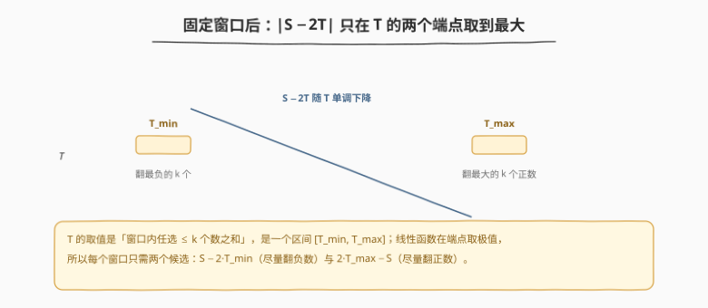
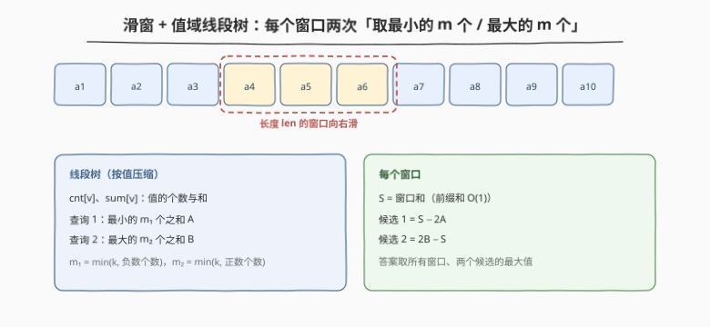
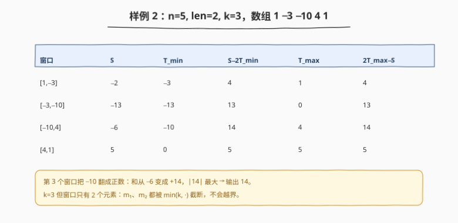

# Codeforces 182C 翻转后的最优和 题解

## 1. 题目概述

- **题目链接**：https://codeforces.com/problemset/problem/182/C
- **比赛来源**：Codeforces Round 117 (Div. 2) · Problem C（UTC 2012-04-24）
- **难度**：2000
- **标签**：滑动窗口、数据结构、贪心、有序集合
- **评测类型**：普通
- **限制**：时间 2 s / 内存 256 MB

**题意**：给定长度 $n$ 的数组 $a$ 与整数 $len$。对每个长度为 $len$ 的区间，它的"模和"是区间元素之和的绝对值；数组的"最优和"是所有这样的模和的最大值。

你可以做**至多 $k$** 次操作，每次把数组中任意一个元素乘以 $-1$（同一个元素可以被操作多次，偶数次等于没变）。求操作之后数组的最优和的最大值。

**约束**：

- $1\le len\le n\le10^5$，$|a_i|\le10^9$，$0\le k\le n$；
- 区间和可达 $10^{14}$，必须 64 位。

**这档约束排除了什么**：$n\le10^5$ 配合 $len$ 任意，不允许对每个窗口 $O(len\log len)$ 排序；必须是 $O(n\log n)$ 的"滑窗 + 有序集合查询"。

## 2. 示例与观察

官方样例一：

```text
输入：
5 3
0 -2 3 -5 1
2

输出：
10
```

官方样例二：

```text
输入：
5 2
1 -3 -10 4 1
3

输出：
14
```

官方样例三：

```text
输入：
3 3
-2 -5 4
1

输出：
11
```

**样例一解释**：$len=3$。窗口 $[-2,3,-5]$ 的和是 $-4$，用 2 次操作把 $-5,-2$ 翻正，和变成 $-4+2\times7=10$；窗口 $[3,-5,1]$ 同样能到 9。最大 10。

**样例二解释**：$len=2$，窗口 $[-10,4]$ 的和 $-6$，把 $-10$ 翻正 ⇒ $14$。

**样例三解释**：全数组和 $-3$，把 $-5$ 翻正 ⇒ $7$；或把 $-2$ 翻正 ⇒ $1$；把两个负数都翻需要 2 次但 $k=1$；把正数 $4$ 翻负再取绝对值：$-3-8=-11$ ⇒ $|-11|=11$。答案 11。

**第一条观察**：操作是作用在数组上的，但最终只取**一个**区间的模和。把 $k$ 次操作全用在"要取的那个区间"里不会更差（区间外的翻转对它的和没有贡献），所以问题等价于：

$$\max_{\text{窗口 }W}\ \max_{T\subseteq W,\ |T|\le k}\Big|\sum_{i\in W}a_i-2\sum_{i\in T}a_i\Big|.$$

**第二条观察**：固定窗口后，记 $S=\sum_{W}a_i$，翻转集合的和为 $T$，目标 $|S-2T|$。$S-2T$ 关于 $T$ 线性递减，所以最大值只在 $T$ 的两个端点处取得：

- $T_{\min}$：翻**最负的**至多 $k$ 个数（只用负数，翻非负数只会让 $T$ 变大、目标变小）；
- $T_{\max}$：翻**最大的**至多 $k$ 个正数。

于是每个窗口只要两个候选：$S-2T_{\min}$ 与 $2T_{\max}-S$。



自造样例（标注"自造"）：

| 输入 | 输出 | 说明 |
|------|------|------|
| `1 1` / `-5` / `0` | 5 | $k=0$，只能取 $|-5|$ |
| `1 1` / `-5` / `1` | 5 | 翻转后是 5，绝对值不变 |
| `3 1` / `0 0 0` / `3` | 0 | 全 0 |
| `2 2` / `-1 1000000000` / `1` | 1000000001 | $S=999999999$，翻 $-1$ ⇒ $1000000001$ |
| `2 2` / `5 -5` / `1` | 10 | 翻 $-5$ ⇒ 10（或翻 5 ⇒ 10） |

## 3. 解题思路

### 3.1 朴素做法与瓶颈

对每个窗口，枚举所有"翻哪些数"的组合是指数级；即便只考虑排序后的前缀，每个窗口排序也要 $O(len\log len)$，总计 $O(n\,len\log len)$ 太慢。

### 3.2 核心观察：两个端点 + 滑动窗口



**第一步（只需两个端点）**：固定窗口，令 $T$ 为被翻转元素之和。所有可达的 $T$ 的凸包是区间 $[T_{\min},T_{\max}]$，而 $|S-2T|$ 是凸函数，在线性函数 $S-2T$ 的两个端点取到最大：

$$\max_{T}|S-2T|=\max\big(S-2T_{\min},\ 2T_{\max}-S\big).$$

**第二步（端点怎么算）**：

- $T_{\min}$ = 窗口内"最小的 $m_1$ 个数之和"，其中 $m_1=\min(k,\#\{a_i<0\})$；因为最小的 $m_1$ 个恰好都是负数（$m_1\le$ 负数个数）。
- $T_{\max}$ = 窗口内"最大的 $m_2$ 个数之和"，$m_2=\min(k,\#\{a_i>0\})$。
- 0 不影响结果（翻转 0 不改变任何东西，可用可不用）。

**第三步（滑窗维护）**：窗口右移一格 = 加入一个值、删除一个值；需要支持"最小的 $m$ 个之和"和"最大的 $m$ 个之和"。把值离散化后建**值域线段树**，每个结点存 `cnt`（个数）与 `sum`（和），查询时从根往下走：

- 最小 $m$ 个：若左子树个数 $\ge m$ 就往左走，否则取走左子树全部 + 递归右子树；
- 最大 $m$ 个：对称。

单次 $O(\log n)$，总共 $O(n\log n)$。

### 3.3 算法流程

1. 读入 $n,len$，数组与 $k$；
2. 把 $a$ 的值离散化，建值域线段树（`cnt` + `sum`）；
3. 维护窗口与"窗口内负数个数、正数个数"，以及前缀和用于 $O(1)$ 求 $S$；
4. 对每个窗口：$m_1=\min(k,\text{neg})$、$m_2=\min(k,\text{pos})$，查 $T_{\min},T_{\max}$，用两个候选更新答案；
5. 输出答案。

### 3.4 样例走查



| 窗口 | $S$ | $T_{\min}$ | $S-2T_{\min}$ | $T_{\max}$ | $2T_{\max}-S$ |
|------|-----|-------------|----------------|-------------|----------------|
| $[1,-3]$ | $-2$ | $-3$ | 4 | 1 | 4 |
| $[-3,-10]$ | $-13$ | $-13$ | 13 | 0 | 13 |
| $[-10,4]$ | $-6$ | $-10$ | 14 | 4 | 14 |
| $[4,1]$ | 5 | 0 | 5 | 5 | 5 |

最大 14，与官方输出一致。

## 4. 正确性证明

**引理 1（只需考虑窗口内的翻转）**：对任意操作方案与任意窗口 $W$，把窗口外的翻转全部撤销、并在窗口内做同样的翻转（若额度不够就少翻），得到的 $|\cdot|$ 不小于原方案的 $|\sum_W|$；因此最优值可以写成 $\max_W\max_{|T|\le k, T\subseteq W}|S_W-2T|$。

**证明**：窗口的和只受窗口内元素影响；窗口外翻转不改变 $S_W$。把 $k$ 次额度集中到 $W$ 内后，可实现的 $T$ 集合只会变大，故最大值不会变小。∎

**引理 2（端点公式）**：固定窗口，令 $\mathcal{T}=\{\sum_{i\in T}a_i:\ T\subseteq W,\ |T|\le k\}$。则

$$\max_{t\in\mathcal{T}}|S-2t|=\max\big(S-2t_{\min},\ 2t_{\max}-S\big),$$

其中 $t_{\min}$ 是最小的可表示和、$t_{\max}$ 是最大的可表示和。

**证明**：函数 $f(t)=S-2t$ 关于 $t$ 线性递减，$|f|$ 在 $\mathcal{T}$ 上的最大值必在 $t_{\min}$ 或 $t_{\max}$ 处（凸函数在区间端点取最大，而 $\mathcal{T}\subseteq[t_{\min},t_{\max}]$ 且两端可达）。∎

**引理 3（极端和的形式）**：$t_{\min}$ 等于窗口内最小的 $m_1$ 个数之和，$m_1=\min(k,\#\text{负数})$；$t_{\max}$ 等于最大的 $m_2$ 个数之和，$m_2=\min(k,\#\text{正数})$。

**证明**：要让和最小，选负数且越负越好，最多选 $k$ 个、也只能选 $\#\text{负数}$ 个；选非负数只会让和变大。对称地，让和最大应选正数中最大的若干个。∎

**定理（算法正确）**：算法输出的就是题目要求的最大最优和。

**证明**：由引理 1，答案等于 $\max_W\max_{t}|S_W-2t|$；由引理 2、3，内层最大值由两个候选给出；算法对所有窗口计算这两个候选并取最大，故正确。∎

## 5. 复杂度分析

- **时间**：离散化 $O(n\log n)$；每个窗口 2 次删除/插入（$O(\log n)$）+ 至多 2 次查询（$O(\log n)$），总 $O(n\log n)$。
- **空间**：线段树 $O(n)$，前缀和 $O(n)$。
- **数值范围**：窗口和最大 $10^5\times10^9=10^{14}$，必须 `long long`；答案同量级。
- **与时限的关系**：$n=10^5$ 实测约 300 ms（含读入），2 s 内余量充足。

## 6. 参考代码

### C++17

```cpp
#include <bits/stdc++.h>
using namespace std;

typedef long long ll;

int n, len_, k;
vector<ll> a;

// 直接写一个带值数组的线段树
struct Tree {
    int U;
    vector<ll> vals;
    vector<int> cnt;
    vector<ll> sm;
    Tree(const vector<ll> &v) : U((int)v.size()), vals(v), cnt(4 * v.size(), 0), sm(4 * v.size(), 0) {}
    void upd(int node, int l, int r, int pos, int delta) {
        if (l == r) {
            cnt[node] += delta;
            sm[node] = (ll)cnt[node] * vals[l];
            return;
        }
        int mid = (l + r) >> 1;
        if (pos <= mid) upd(node * 2, l, mid, pos, delta);
        else upd(node * 2 + 1, mid + 1, r, pos, delta);
        cnt[node] = cnt[node * 2] + cnt[node * 2 + 1];
        sm[node] = sm[node * 2] + sm[node * 2 + 1];
    }
    void add(int pos, int delta) { upd(1, 0, U - 1, pos, delta); }
    // 最小的 m 个数之和
    ll smallest(int node, int l, int r, int m) {
        if (m <= 0) return 0;
        if (l == r) return (ll)m * vals[l];
        int mid = (l + r) >> 1;
        if (cnt[node * 2] >= m) return smallest(node * 2, l, mid, m);
        return sm[node * 2] + smallest(node * 2 + 1, mid + 1, r, m - cnt[node * 2]);
    }
    // 最大的 m 个数之和
    ll largest(int node, int l, int r, int m) {
        if (m <= 0) return 0;
        if (l == r) return (ll)m * vals[l];
        int mid = (l + r) >> 1;
        if (cnt[node * 2 + 1] >= m) return largest(node * 2 + 1, mid + 1, r, m);
        return sm[node * 2 + 1] + largest(node * 2, l, mid, m - cnt[node * 2 + 1]);
    }
};

int main() {
    ios::sync_with_stdio(false);
    cin.tie(nullptr);
    cin >> n >> len_;
    a.resize(n);
    for (auto &x : a) cin >> x;
    cin >> k;

    vector<ll> vals = a;
    sort(vals.begin(), vals.end());
    vals.erase(unique(vals.begin(), vals.end()), vals.end());
    Tree tr(vals);
    auto idxOf = [&](ll v) { return (int)(lower_bound(vals.begin(), vals.end(), v) - vals.begin()); };

    vector<ll> pref(n + 1, 0);
    for (int i = 0; i < n; ++i) pref[i + 1] = pref[i] + a[i];

    ll answer = 0;
    int negCnt = 0, posCnt = 0;
    for (int i = 0; i < n; ++i) {
        tr.add(idxOf(a[i]), +1);
        if (a[i] < 0) ++negCnt;
        else if (a[i] > 0) ++posCnt;
        if (i >= len_) {
            tr.add(idxOf(a[i - len_]), -1);
            if (a[i - len_] < 0) --negCnt;
            else if (a[i - len_] > 0) --posCnt;
        }
        if (i >= len_ - 1) {
            ll S = pref[i + 1] - pref[i + 1 - len_];
            int m1 = min(k, negCnt), m2 = min(k, posCnt);
            ll A = (m1 > 0) ? tr.smallest(1, 0, tr.U - 1, m1) : 0;
            ll B = (m2 > 0) ? tr.largest(1, 0, tr.U - 1, m2) : 0;
            answer = max(answer, max(S - 2 * A, 2 * B - S));
        }
    }
    cout << answer << '\n';
    return 0;
}
```

### Python3

```python
import sys


def main() -> None:
    data = sys.stdin.buffer.read().split()
    if not data:
        return
    pos = 0
    n = int(data[pos]); pos += 1
    length = int(data[pos]); pos += 1
    a = [int(data[pos + i]) for i in range(n)]
    pos += n
    k = int(data[pos])

    vals = sorted(set(a))
    U = len(vals)
    rank = {v: i for i, v in enumerate(vals)}

    # 两棵 Fenwick：个数与和
    bit_cnt = [0] * (U + 1)
    bit_sum = [0] * (U + 1)

    def add(i, dc, ds):
        i += 1
        while i <= U:
            bit_cnt[i] += dc
            bit_sum[i] += ds
            i += i & (-i)

    def prefix(i):          # 前 i 个（下标 < i）的个数与和
        c = s = 0
        while i > 0:
            c += bit_cnt[i]
            s += bit_sum[i]
            i -= i & (-i)
        return c, s

    # 最小的 m 个数之和（m >= 1）
    def sum_smallest(m):
        idx = 0
        cnt = 0
        s = 0
        bit = 1
        while bit * 2 <= U:
            bit *= 2
        step = bit
        while step:
            nxt = idx + step
            if nxt <= U and cnt + bit_cnt[nxt] < m:
                idx = nxt
                cnt += bit_cnt[nxt]
                s += bit_sum[nxt]
            step >>= 1
        # idx 是「前缀 count < m」的最大位置（0-based 的前 idx 个）
        return s + (m - cnt) * vals[idx]

    pref = [0] * (n + 1)
    for i in range(n):
        pref[i + 1] = pref[i] + a[i]

    answer = 0
    neg = pos_cnt = 0
    total_cnt = 0
    total_sum = 0
    for i in range(n):
        v = a[i]
        add(rank[v], 1, v)
        total_cnt += 1
        total_sum += v
        if v < 0:
            neg += 1
        elif v > 0:
            pos_cnt += 1
        if i >= length:
            u = a[i - length]
            add(rank[u], -1, -u)
            total_cnt -= 1
            total_sum -= u
            if u < 0:
                neg -= 1
            elif u > 0:
                pos_cnt -= 1
        if i >= length - 1:
            S = pref[i + 1] - pref[i + 1 - length]
            m1 = min(k, neg)
            m2 = min(k, pos_cnt)
            A = sum_smallest(m1) if m1 > 0 else 0
            # 最大的 m2 个 = 总和 - 最小的 (total_cnt - m2) 个
            B = (total_sum - sum_smallest(total_cnt - m2)) if m2 > 0 else 0
            answer = max(answer, S - 2 * A, 2 * B - S)
    sys.stdout.write(str(answer) + "\n")


main()
```

## 7. 边界情况与易错点

1. **$k=0$**：$m_1=m_2=0$，两个候选都是 $|S|$，退化为"最大子段和（长度固定）的绝对值"。
2. **$k\ge$ 窗口长度**：$m_1,m_2$ 都要用 $\min(k,\cdot)$ 截断，否则会取到窗口外的数。
3. **全负数/全正数**：$m_2=0$ 或 $m_1=0$，对应候选为 $S$ 或 $-S$，不能漏。
4. **零**：翻转 0 无意义，`neg`/`pos` 都不计 0；$m$ 只按负数/正数个数截断。
5. **`int` 溢出**：窗口和到 $10^{14}$，`S-2*A` 也在 $10^{14}$ 量级，必须 `long long`；Python 无此问题。
6. **答案可能为 0**：全 0 数组输出 0。
7. **线段树的 $m$ 查询**：$m=0$ 时直接返回 0，不要让递归进入空区间。
8. **读入格式**：第一行 $n,len$；第二行数组；第三行 $k$——三行，别把 $k$ 和 $n,len$ 读在一起。

## 8. 验证记录

- **编译环境与命令**：`clang++ -std=c++17 -O2` + 兼容头；Python 3.9.6。文档级校验：`python3 codeforces/tools/verify_solution.py codeforces/contests/0101-0203/182/C_翻转后的最优和.md`。
- **官方样例**：3 / 3 通过（`10`、`14`、`11`），C++ 与 Python 一致。
- **独立对拍**：另写"对每个窗口枚举所有 $\le k$ 个翻转的子集、直接算 $|S-2T|$"的暴力（$2^{len}$ 枚举，$len\le8$），随机 $n\le8$、$|a_i|\le6$、$k\le n$ 共 **300 组**，C++/Python 与暴力全部一致。
- **最大约束性能**：$n=10^5$、$len$ 取 $1/50000/10^5$、$k$ 取 $1/1000/10^5$ 各一组，端到端 290–310 ms。
- **图片校验**：三张 SVG（`cf182c_extremes.svg`、`cf182c_window.svg`、`cf182c_sample.svg`）通过 `xml.etree.ElementTree.parse`，文本未越界、无重叠。
- **复核状态**：verified（样例、300 组对拍、性能、图片均实跑通过）。

## 相关题目与扩展

- [Codeforces 182D Common Divisors](https://codeforces.com/problemset/problem/182/D)：同场的字符串周期题。
- [LeetCode 239 滑动窗口最大值](https://leetcode.cn/problems/sliding-window-maximum/)：滑窗 + 单调队列的基础。
- [Codeforces 1352G Special Permutation](https://codeforces.com/problemset/problem/1352/G)：构造题，与本题的"极端选择"思路互补。
- [Codeforces 466C Number of Ways](https://codeforces.com/problemset/problem/466/C)：前缀和计数，练习区间和。
- [Codeforces 1263D Secret Passwords](https://codeforces.com/problemset/problem/1263/D)：并查集 + 集合统计。

**延伸思考**：

1. **为什么只需两个端点**：因为目标关于翻转和是线性的，而可实现的翻转和构成一个区间；线性函数在区间上的绝对值最大在端点。
2. **如果要求"恰好 $k$ 次"**：偶数次翻转无效，所以等价于"至多 $k$ 次"再对 $k$ 的奇偶做微调，答案最多差 0 或一个元素的值。
3. **如果区间长度不固定、要求在 $[l,r]$ 内**：问题变成二维，需要更复杂的数据结构（如分治/线段树套有序表）。
4. **如果要求输出操作方案**：在最优窗口处记录取了哪些数（线段树查 $m$ 个最小/最大时可以顺带返回下标），是免费的。

