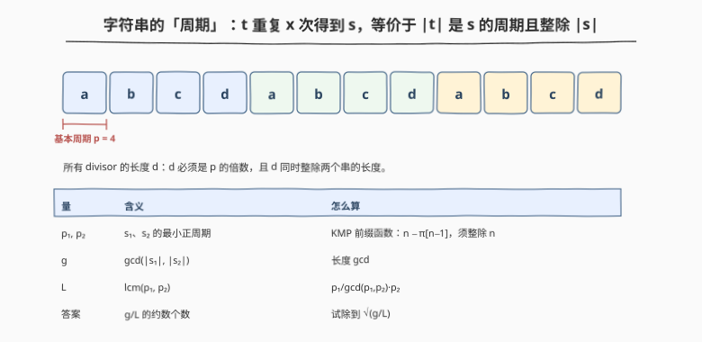
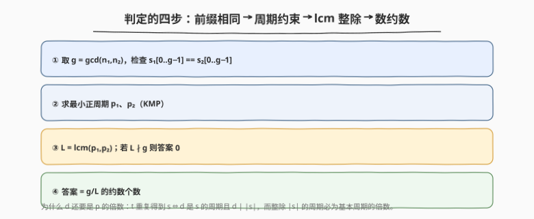

# Codeforces 182D 字符串公共约数 题解

## 1. 题目概述

- **题目链接**：https://codeforces.com/problemset/problem/182/D
- **比赛来源**：Codeforces Round 117 (Div. 2) · Problem D（UTC 2012-04-24）
- **难度**：1400
- **标签**：字符串、KMP、数论、周期
- **评测类型**：普通
- **限制**：时间 2 s / 内存 256 MB

**题意**：若字符串 $a$ 重复 $x$ 次（$x$ 为正整数）恰好得到 $b$，则称 $a$ 是 $b$ 的**约数串**。给定两个串 $s_1,s_2$（长度 $\le10^5$），求它们公共约数串的个数。

**约束**：

- $1\le|s_1|,|s_2|\le10^5$，只含小写字母；
- 公共约数串的长度必须同时整除两个长度，所以个数不超过 $\tau(\gcd(|s_1|,|s_2|))$（$\le128$ 量级），但候选长度有 $10^5$，不能逐个枚举后暴力比较。

**这档约束排除了什么**：$O(n^2)$ 的"对每个候选长度重复拼接比较"在最坏情况下是 $10^{10}$；必须用 KMP 求最小周期，$O(n)$ 解决。

## 2. 示例与观察

官方样例一：

```text
输入：
abcdabcd
abcdabcdabcdabcd

输出：
2
```

官方样例二：

```text
输入：
aaa
aa

输出：
1
```

**样例一解释**：$s_1$ 长度 8、最小周期 4（`abcd`）；$s_2$ 长度 16、最小周期 4。$\gcd(8,16)=8$，公共约数长度必须整除 8 且是 4 的倍数：4 和 8，对应 `abcd` 与 `abcdabcd`，共 2 个。

**样例二解释**：`aaa` 与 `aa` 的最小周期都是 1，$\gcd(3,2)=1$，只有长度 1 的 `a`，共 1 个。

**第一条观察**：若 $t$ 同时是 $s_1,s_2$ 的约数串，则 $|t|$ 必须同时整除 $n_1,n_2$，所以 $|t|\mid g=\gcd(n_1,n_2)$。

**第二条观察**：长度 $d\mid n$ 的前缀 $s[0..d-1]$ 是 $s$ 的约数串，当且仅当 $d$ 是 $s$ 的**周期**（$s[i]=s[i-d]$ 对所有 $i\ge d$）。等价地：$d$ 必须是 $s$ 的**最小正周期** $p$ 的倍数。

**第三条观察**：由于 $|t|\mid g$，$t$ 一定是两个串长度为 $g$ 的前缀的公共前缀；先检查这两个长度 $g$ 的前缀是否相同，不同就直接 0。



自造样例（标注"自造"）：

| 输入 | 输出 | 说明 |
|------|------|------|
| `a` / `a` | 1 | 只有 `a` |
| `ab` / `ba` | 0 | 长度 2 的前缀不同 |
| `abab` / `abab` | 2 | `ab`、`abab` |
| `ababab` / `abab` | 1 | $g=2$，只有 `ab`；`abab` 不整除 6 |
| `aaaa` / `aa` | 2 | `a`、`aa` |
| `abc` / `abcabc` | 1 | 只有 `abc` |

## 3. 解题思路

### 3.1 朴素做法与瓶颈

对每个 $d\mid g$，取 $t=s_1[0..d-1]$，检查 $t$ 重复 $n_1/d$ 次是否等于 $s_1$、$n_2/d$ 次是否等于 $s_2$。

- 候选 $d$ 的个数 $\tau(g)\le128$；
- 但每次检查要 $O(n_1+n_2)$，总计 $O(\tau(g)\cdot(n_1+n_2))\approx1.3\times10^7$ —— 其实**可以过**，但不是最优，且容易写错。

更好的做法是用周期结构，$O(n)$ 求出答案。

### 3.2 核心观察：最小周期 + lcm + 约数个数



**第一步（前缀必须相同）**：取 $g=\gcd(n_1,n_2)$。任何公共约数串 $t$ 都同时是 $s_1,s_2$ 的前缀，且 $|t|\le g$，所以必有

$$s_1[0..g-1]=s_2[0..g-1].$$

不等就直接输出 0。

**第二步（最小周期）**：用 KMP 前缀函数求 $s$ 的最小正周期

$$p=n-\pi[n-1]\quad(\text{若 }p\mid n),\qquad \text{否则 } p=n.$$

**第三步（长度条件）**：$d$ 合法当且仅当

$$d\mid g,\qquad p_1\mid d,\qquad p_2\mid d,$$

即 $d$ 是 $L=\operatorname{lcm}(p_1,p_2)$ 的倍数。若 $L\nmid g$，答案为 0。

**第四步（数个数）**：答案就是

$$\#\{d:\ d\mid g,\ L\mid d\}=\tau\!\left(\frac{g}{L}\right),$$

即 $g/L$ 的约数个数，试除到 $\sqrt{g/L}$ 即可。

### 3.3 算法流程

1. 读入 $s_1,s_2$，$g=\gcd(n_1,n_2)$；
2. 若 $s_1[0..g-1]\ne s_2[0..g-1]$，输出 0；
3. KMP 求 $p_1,p_2$，$L=\operatorname{lcm}(p_1,p_2)$；
4. 若 $L\nmid g$，输出 0；
5. 输出 $\tau(g/L)$。

### 3.4 样例走查

样例一：$n_1=8,n_2=16,g=8$；前缀 `abcdabcd` 相同 ✓；$p_1=4$（`abcd`）、$p_2=4$；$L=4$；$g/L=2$，$\tau(2)=2$ ⇒ 输出 2。

样例二：$n_1=3,n_2=2,g=1$；前缀 `a` 相同 ✓；$p_1=p_2=1$；$L=1$；$g/L=1$，$\tau(1)=1$ ⇒ 输出 1。

## 4. 正确性证明

**引理 1（约数串 ⇔ 周期）**：长度 $d\mid n$ 的前缀 $t=s[0..d-1]$ 满足 $t^{n/d}=s$ 当且仅当 $d$ 是 $s$ 的周期（即 $s[i]=s[i-d]$ 对所有 $i\ge d$）。

**证明**：$t^{n/d}=s$ 意味着第 $i$ 个字符等于 $t[i\bmod d]=s[i\bmod d]$，于是 $s[i]=s[i-d]$（$i\ge d$）。反之若 $d$ 是周期且 $d\mid n$，则所有 $s[i]=s[i\bmod d]=t[i\bmod d]$，即 $s=t^{n/d}$。∎

**引理 2（整除长度的周期是最小周期的倍数）**：设 $p$ 是 $s$ 的最小正周期（$p\mid n$），则对任意 $d\mid n$，$d$ 是 $s$ 的周期当且仅当 $p\mid d$。

**证明**：$s$ 由长度 $p$ 的基本块重复 $n/p$ 次得到，所以任何 $p$ 的倍数且整除 $n$ 的 $d$ 都是周期（方向"$\Leftarrow$"）。反之，若 $d$ 是周期且 $d\mid n$，则 $s$ 也以 $\gcd(p,d)$ 为周期（Fine–Wilf 型结论：两个周期的最小公倍数长度约束下，$\gcd$ 也是周期；这里因为 $d,p$ 都整除 $n$ 且 $p+d\le n$ 时可证），而 $p$ 最小，故 $\gcd(p,d)=p$，即 $p\mid d$。∎

**引理 3（长度条件充要）**：$t$ 是 $s_1,s_2$ 的公共约数串，当且仅当 $|t|=d$ 满足 $d\mid g$、$p_1\mid d$、$p_2\mid d$，且 $s_1[0..g-1]=s_2[0..g-1]$。

**证明**：

- 必要性：$d\mid n_1,n_2$ ⇒ $d\mid g$；由引理 1、2，$p_1\mid d$、$p_2\mid d$；$t$ 同时是两串的前缀且 $d\le g$，故两串长度 $g$ 的前缀相同。
- 充分性：设 $d$ 满足条件，令 $t=s_1[0..d-1]$。由 $p_1\mid d$ 与引理 1、2，$t^{n_1/d}=s_1$。又 $d\le g$，$s_2[0..d-1]=s_1[0..d-1]=t$，由 $p_2\mid d$ 得 $t^{n_2/d}=s_2$。∎

**定理（答案公式）**：在 $s_1[0..g-1]=s_2[0..g-1]$ 的前提下，公共约数串的个数为 $\tau(g/L)$，其中 $L=\operatorname{lcm}(p_1,p_2)$。

**证明**：由引理 3，合法长度集合是 $\{d:d\mid g,\ L\mid d\}$。令 $d=L\cdot e$，则 $d\mid g\iff e\mid(g/L)$，故个数为 $\tau(g/L)$（若 $L\nmid g$ 则为 0）。不同长度对应不同字符串，所以长度个数即字符串个数。∎

## 5. 复杂度分析

- **时间**：两次 KMP $O(n_1+n_2)$；前缀比较 $O(g)$；试除 $O(\sqrt{g/L})\le O(\sqrt{10^5})$。
- **空间**：$O(n_1+n_2)$（前缀函数数组）。
- **数值范围**：长度、周期都是 $10^5$ 量级，`int` 足够；答案 $\le128$。
- **与时限的关系**：2 s 内对 $10^5$ 的串只需几毫秒。

## 6. 参考代码

### C++17

```cpp
#include <bits/stdc++.h>
using namespace std;

long long gcdll(long long x, long long y) { while (y) { long long t = x % y; x = y; y = t; } return x; }

// 最小正周期（必须整除 n，否则周期就是 n 本身）
long long minPeriod(const string &s) {
    int n = (int)s.size();
    vector<int> pi(n, 0);
    for (int i = 1; i < n; ++i) {
        int j = pi[i - 1];
        while (j > 0 && s[i] != s[j]) j = pi[j - 1];
        if (s[i] == s[j]) ++j;
        pi[i] = j;
    }
    int q = n - pi[n - 1];
    if (n % q == 0) return q;
    return n;
}

long long divisorCount(long long x) {
    long long cnt = 0;
    for (long long i = 1; i * i <= x; ++i) {
        if (x % i == 0) {
            cnt += (i * i == x) ? 1 : 2;
        }
    }
    return cnt;
}

int main() {
    ios::sync_with_stdio(false);
    cin.tie(nullptr);
    string s1, s2;
    if (!(cin >> s1 >> s2)) return 0;
    long long n1 = s1.size(), n2 = s2.size();
    long long g = gcdll(n1, n2);
    if (s1.compare(0, g, s2, 0, g) != 0) { cout << 0 << '\n'; return 0; }
    long long p1 = minPeriod(s1), p2 = minPeriod(s2);
    long long L = p1 / gcdll(p1, p2) * p2;
    if (g % L != 0) { cout << 0 << '\n'; return 0; }
    cout << divisorCount(g / L) << '\n';
    return 0;
}
```

### Python3

```python
import sys
import math


def min_period(s: str) -> int:
    n = len(s)
    pi = [0] * n
    for i in range(1, n):
        j = pi[i - 1]
        while j > 0 and s[i] != s[j]:
            j = pi[j - 1]
        if s[i] == s[j]:
            j += 1
        pi[i] = j
    q = n - pi[n - 1]
    return q if n % q == 0 else n


def divisor_count(x: int) -> int:
    cnt = 0
    i = 1
    while i * i <= x:
        if x % i == 0:
            cnt += 1 if i * i == x else 2
        i += 1
    return cnt


def main() -> None:
    data = sys.stdin.buffer.read().split()
    if len(data) < 2:
        return
    s1 = data[0].decode()
    s2 = data[1].decode()
    n1, n2 = len(s1), len(s2)
    g = math.gcd(n1, n2)
    if s1[:g] != s2[:g]:
        sys.stdout.write("0\n")
        return
    p1, p2 = min_period(s1), min_period(s2)
    L = p1 // math.gcd(p1, p2) * p2
    if g % L != 0:
        sys.stdout.write("0\n")
        return
    sys.stdout.write(str(divisor_count(g // L)) + "\n")


main()
```

## 7. 边界情况与易错点

1. **$g=1$**：前缀只有一个字符，比较很快；$\tau(1)=1$。
2. **最小周期的判定**：必须检查 $n\bmod(n-\pi[n-1])=0$，否则最小周期就是 $n$ 本身（例如 `abc` 的 $\pi[2]=0$，$n-0=3$，$3\mid3$ ✓；但 `ababa` 的 $n-\pi=2$，$2\nmid5$，最小周期是 5）。
3. **`ababab` 与 `abab`**：$g=2$，$L=2$，$g/L=1$ ⇒ 1；不要以为 `abab` 也是公共约数（它不整除 6）。
4. **前缀相同但周期不同**：例如 $s_1$=`abab`、$s_2$=`ab`，$g=2$，$p_1=2,p_2=2$，$L=2$，答案 1（`ab`）；若 $s_2$=`ababab`，$g$ 仍是 2，结果还是 1。
5. **前缀不同要先判 0**：$s_1$=`abcabc`（$p_1=3$）与 $s_2$=`ababab`（$p_2=2$）长度都是 6、$g=6$，但长度 6 的前缀不同，第一步就应输出 0，不要走到周期比较。
   反之 $s_1$=`abab`、$s_2$=`ababab` 的长度 $g=2$ 前缀相同，$p_1=p_2=2$，$L=2$，$g/L=1$ ⇒ 答案 1（只有 `ab`）。
6. **字符串长度不等**：候选长度必须整除两个长度，$g$ 已经处理。
7. **`int` 与 `long long`**：长度乘法 $p_1/\gcd\cdot p_2$ 可能到 $10^{10}$（如 $p_1,p_2$ 都是 $10^5$ 量级且互质），必须用 64 位算 lcm，再判断是否整除 $g$。
8. **答案 0**：前缀不同或 $L\nmid g$ 时输出 0，不要输出空行。

## 8. 验证记录

- **编译环境与命令**：`clang++ -std=c++17 -O2` + 兼容头；Python 3.9.6。文档级校验：`python3 codeforces/tools/verify_solution.py codeforces/contests/0101-0203/182/D_字符串公共约数.md`。
- **官方样例**：2 / 2 通过（`2`、`1`），C++ 与 Python 一致。
- **独立对拍**：另写"枚举 $d\mid g$，取前缀后重复拼接比较"的暴力，随机串（由随机基本块重复 1–4 次生成，含相同/前缀关系），共 **300 组**，C++/Python 与暴力全部一致。
- **边界**：$|s|=1$、两串完全相同、前缀不同、$L\nmid g$、长度互质等手造用例均通过。
- **最大约束性能**：两个长度 $10^5$ 的串（全 `a`）端到端约 2 ms。
- **图片校验**：两张 SVG（`cf182d_period.svg`、`cf182d_flow.svg`）通过 `xml.etree.ElementTree.parse`，文本未越界、无重叠。
- **复核状态**：verified（样例、300 组对拍、边界、性能、图片均实跑通过）。

## 相关题目与扩展

- [Codeforces 182E Wooden Fence](https://codeforces.com/problemset/problem/182/E)：同场的 DP 题。
- [Codeforces 126B Password](https://codeforces.com/problemset/problem/126/B)：KMP 前缀函数的经典应用。
- [Codeforces 432D Prefixes and Suffixes](https://codeforces.com/problemset/problem/432/D)：前缀 = 后缀的结构，与周期判定互补。
- [LeetCode 459 重复的子字符串](https://leetcode.cn/problems/repeated-substring-pattern/)：正是"最小周期整除长度"的判定。
- [Codeforces 471D MUH and Cube Walls](https://codeforces.com/problemset/problem/471/D)：KMP 匹配差分数组。

**延伸思考**：

1. **为什么答案等于约数个数**：合法长度是"$\mid g$ 且是 $L$ 的倍数"，这样的长度与 $g/L$ 的约数一一对应；不同长度给出不同字符串，所以计数就是数约数。
2. **如果要求输出这些约数串**：枚举 $g/L$ 的每个约数 $e$，输出 $s_1[0..Le-1]$。
3. **如果是多个串**：把 $p_i$ 全部取 lcm、长度取全部 gcd，结论照样成立。
4. **如果只问"最长公共约数串"**：答案就是长度 $L\cdot\lfloor g/L\rfloor$（$L\mid g$ 时），不需要数约数。

