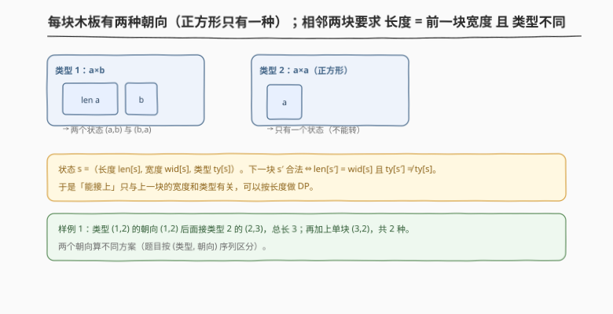

# Codeforces 182E 木栅栏方案数 题解

## 1. 题目概述

- **题目链接**：https://codeforces.com/problemset/problem/182/E
- **比赛来源**：Codeforces Round 117 (Div. 2) · Problem E（UTC 2012-04-24）
- **难度**：1800
- **标签**：动态规划、计数、状态设计
- **评测类型**：普通
- **限制**：时间 3 s / 内存 256 MB

**题意**：有 $n$ 种木板，第 $i$ 种是 $a_i\times b_i$ 的矩形，可以任意多块。搭一条总长恰为 $l$ 的栅栏，要求：

1. 相邻两块**类型不同**；
2. 第 2 块起，每块的长度等于前一块的宽度（第一块长度任意）。

木板可以旋转（用 $a_i$ 或 $b_i$ 当长度），但**正方形木板不能旋转**（转不转都一样，算一种）。两种方案不同当且仅当"类型 + 朝向"的序列不同。求方案数模 $10^9+7$。

**约束**：

- $1\le n\le100$，$1\le l\le3000$，$1\le a_i,b_i\le100$；
- 时间限制 3 s。

**这档约束排除了什么**：$l\le3000$ 且木板尺寸 $\le100$，所以"按总长 DP"是可行的；但状态里必须同时记住"上一块的宽度"和"上一块的类型"，否则无法判"类型不同"。

## 2. 示例与观察

官方样例一：

```text
输入：
2 3
1 2
2 3

输出：
2
```

官方样例二：

```text
输入：
1 2
2 2

输出：
1
```

官方样例三：

```text
输入：
6 6
2 1
3 2
2 5
3 3
5 1
2 1

输出：
20
```

**样例一解释**：木板类型 1 是 $1\times2$（两种朝向：$(1,2)$、$(2,1)$），类型 2 是 $2\times3$（$(2,3)$、$(3,2)$）。

- 单块：只有长度 3 的 $(3,2)$ 能凑出 3 → 1 种；
- 两块：第一块 $(1,2)$（长 1 宽 2），第二块必须长度 2、类型不同 → $(2,3)$ ✓；第一块 $(2,1)$（长 2 宽 1），第二块长度 1 → 没有（类型 1 的 $(1,2)$ 同类型 ✗，类型 2 没有长度 1 的朝向）✗。
- 合计 2。

**样例二解释**：唯一的木板是正方形 $2\times2$，不能旋转，只有一种朝向，长度 2 恰好等于 $l$ → 1 种。

**样例三**：6 种木板（注意第 1 与第 6 种参数相同，但**是不同类型**，算不同方案），答案 20。

**第一条观察**：一块木板的"朝向"决定它的（长度，宽度）。非正方形有两种朝向，正方形只有一种。

**第二条观察**：能否接上只取决于上一块的（宽度，类型）：下一块要求"长度 = 上一块宽度"且"类型不同"。

**第三条观察**：总长是唯一的累加量，所以 DP 状态 =（总长，最后一块的状态），其中状态 =（类型，朝向）。



自造样例（标注"自造"）：

| 输入 | 输出 | 说明 |
|------|------|------|
| `1 1` / `1 1` | 1 | 正方形 $1\times1$，单块长度 1（不能旋转但也不需要） |
| `1 3` / `1 2` | 0 | 类型 1 能拼出 1、2、3？不能：同类型不能相邻 |
| `2 1` / `1 2` / `2 1` | 2 | 两种类型都有长度 1 的朝向 $(1,2)$，各算一种单块方案 |
| `2 2` / `1 2` / `2 1` | 2 | 单块 $(2,1)$；以及 $(1,2)$ 后接 $(2,1)$ |
| `2 4` / `2 2` / `2 2` | 2 | 两块都是正方形 $2\times2$、不同类型，可交替 |

## 3. 解题思路

### 3.1 朴素做法与瓶颈

直接 DFS 枚举所有木板序列：$l=3000$、每块长度最小 1，最坏有 $100^{3000}$ 种，不可行。

### 3.2 核心观察：状态 =（长度，最后一块的朝向）

![dp[L][s] 与转移](../../../images/cf182e_dp.svg)

把每种"类型 + 朝向"编成一个状态 $s$，记 $\text{len}[s]$、$\text{wid}[s]$、$\text{ty}[s]$。设

$$dp[L][s]=\text{总长恰为 }L\text{、最后一块是状态 }s\text{ 的方案数}.$$

转移：从 $dp[L][s]$ 出发，能接状态 $s'$ 当且仅当 $\text{len}[s']=\text{wid}[s]$ 且 $\text{ty}[s']\ne\text{ty}[s]$。直接做是 $O(l\cdot S^2)$（$S\le200$）。

**优化**：对每个长度 $L$，先算"所有宽度为 $w$ 的状态的方案数之和"

$$A[L][w]=\sum_{s:\ \text{wid}[s]=w}dp[L][s],$$

那么

$$dp[L+\text{len}[s']][s']\ +=\ A[L][\text{len}[s']]\ -\ \sum_{s:\ \text{ty}[s]=\text{ty}[s'],\ \text{wid}[s]=\text{len}[s']}dp[L][s].$$

减掉的那一项正是"上一块与下一块同类型"的非法接法；每个类型最多 2 个朝向，所以这一项 $O(1)$。

初值：任何状态都可以作为第一块，$dp[\text{len}[s]][s]+=1$。

答案：$\sum_s dp[l][s]$。

### 3.3 算法流程

1. 读入 $n,l$ 与每种木板的 $a_i,b_i$；为每个类型生成状态：$(a_i,b_i)$，若非正方形再加 $(b_i,a_i)$；
2. 记录每个类型的状态列表（≤2 个）；
3. 对每个状态 $s$，若 $\text{len}[s]\le l$，`dp[len[s]][s] += 1`；
4. 对 $L=1..l$：若 $dp[L]$ 全 0 跳过；算 $A[w]$；对每个状态 $s'$（$L+\text{len}[s']\le l$）按上式累加；
5. 输出 $\sum_s dp[l][s] \bmod (10^9+7)$。

### 3.4 样例走查

样例一（$l=3$，状态：$(1,2)_1$、$(2,1)_1$、$(2,3)_2$、$(3,2)_2$）：

| 步骤 | 内容 |
|------|------|
| 初值 | $dp[1][(1,2)_1]=1$、$dp[2][(2,1)_1]=1$、$dp[2][(2,3)_2]=1$、$dp[3][(3,2)_2]=1$ |
| $L=1$ | $A[2]=1$（来自 $(1,2)_1$）。对 $s'=(2,3)_2$：$A[2]-$（类型 2 中宽为 2 的方案数，为 0）$=1$，于是 $dp[3][(2,3)_2]+=1$；其余 $s'$ 要么长度不是 2，要么越界 |
| $L=2$ | $A[1]=1$（$(2,1)_1$）、$A[3]=1$（$(2,3)_2$）。对 $s'=(1,2)_1$：$A[1]-$（类型 1 中宽为 1 的方案数 $=dp[2][(2,1)_1]=1$）$=0$；对 $s'=(3,2)_2$：$2+3>3$ 越界 |
| 答案 | $dp[3][(3,2)_2]+dp[3][(2,3)_2]=1+1=2$ |

两条方案分别是"单块 $(3,2)$"与"$(1,2)$ 后接 $(2,3)$"，与样例一致。

## 4. 正确性证明

**引理 1（状态刻画）**：一个栅栏方案与"状态序列 $s_1,\dots,s_m$"一一对应，其中每个 $s_k$ 是某类型的某个朝向，且满足 $\text{ty}[s_k]\ne\text{ty}[s_{k+1}]$、$\text{len}[s_{k+1}]=\text{wid}[s_k]$、$\sum\text{len}[s_k]=l$。

**证明**：方案由每块的（类型、朝向）决定，朝向决定（长度，宽度）；题目两条限制正好对应上述两个条件，总长条件对应长度和。∎

**引理 2（DP 的正确性）**：$dp[L][s]$ 等于"总长 $L$、最后一块为 $s$ 的合法状态序列个数"。

**证明**：对 $L$ 归纳。初值给出所有单块序列（$m=1$）。转移枚举所有合法的前驱 $s$（宽度 = $\text{len}[s']$、类型不同）并把 $dp[L][s]$ 累加；由于每个序列的最后一块唯一确定前驱，且"去掉最后一块"仍合法，故不重不漏。∎

**引理 3（聚合减法的正确性）**：$A[L][w]-\sum_{\text{ty}=\text{ty}[s'],\ \text{wid}=w}dp[L][s]$ 恰好等于"前驱状态宽为 $w$ 且类型不同于 $\text{ty}[s']$"的方案数之和。

**证明**：$A[L][w]$ 是所有宽 $w$ 的前驱之和；要排除的正是同类型的前驱；两者相减即为所求。每个类型至多 2 个朝向，所以内层最多 2 项。∎

**定理（答案正确）**：算法输出 $\sum_s dp[l][s]$，即所有总长恰为 $l$ 的合法栅栏方案数。

**证明**：由引理 1、2，$dp[l][s]$ 覆盖所有以 $s$ 结尾的合法方案，求和即全部；引理 3 保证转移实现与该定义一致。∎

## 5. 复杂度分析

- **时间**：状态数 $S\le2n\le200$；对每个 $L$ 计算 $A$ 为 $O(S)$，转移为 $O(S)$（每个状态只减至多 2 项），总 $O(l\cdot S)=O(l\cdot n)\le6\times10^5$。
- **空间**：$dp$ 为 $(l+1)\times S$ 的 `long long`，$3001\times200\approx4.8$ MB。
- **数值范围**：方案数模 $10^9+7$，加法用 `long long` 后取模。
- **与时限的关系**：3 s 内实测约 6 ms。

## 6. 参考代码

### C++17

```cpp
#include <bits/stdc++.h>
using namespace std;

static const long long MOD = 1000000007LL;

int main() {
    ios::sync_with_stdio(false);
    cin.tie(nullptr);
    int n, l;
    if (!(cin >> n >> l)) return 0;
    vector<int> la, wd, ty;          // 每种「板型 + 朝向」的状态
    for (int i = 0; i < n; ++i) {
        int a, b;
        cin >> a >> b;
        la.push_back(a); wd.push_back(b); ty.push_back(i);
        if (a != b) {                // 正方形不能转，只有一种朝向
            la.push_back(b); wd.push_back(a); ty.push_back(i);
        }
    }
    int S = (int)la.size();
    vector<vector<int>> statesOfType(n);          // 每个板型最多 2 个朝向
    for (int s = 0; s < S; ++s) statesOfType[ty[s]].push_back(s);

    // dp[L][s] = 总长 L、最后一块是状态 s 的方案数
    vector<vector<long long>> dp(l + 1, vector<long long>(S, 0));
    for (int s = 0; s < S; ++s) {
        if (la[s] <= l) dp[la[s]][s] = (dp[la[s]][s] + 1) % MOD;   // 只有这一块
    }

    for (int L = 1; L <= l; ++L) {
        bool any = false;
        for (int s = 0; s < S; ++s) if (dp[L][s]) { any = true; break; }
        if (!any) continue;

        // A[w] = 所有「宽度为 w」的已结束状态的方案数之和
        long long A[105] = {0};
        for (int s = 0; s < S; ++s) {
            if (dp[L][s]) A[wd[s]] = (A[wd[s]] + dp[L][s]) % MOD;
        }
        for (int s2 = 0; s2 < S; ++s2) {
            int nL = L + la[s2];
            if (nL > l) continue;
            // 上一块宽度必须等于本块长度 la[s2]，且类型不能相同
            long long same = 0;
            for (int s1 : statesOfType[ty[s2]]) {          // 同类型的其它朝向
                if (wd[s1] == la[s2]) same = (same + dp[L][s1]) % MOD;
            }
            long long ways = (A[la[s2]] - same) % MOD;
            if (ways < 0) ways += MOD;
            dp[nL][s2] = (dp[nL][s2] + ways) % MOD;
        }
    }

    long long answer = 0;
    for (int s = 0; s < S; ++s) answer = (answer + dp[l][s]) % MOD;
    cout << answer << '\n';
    return 0;
}
```

### Python3

```python
import sys

MOD = 1000000007


def main() -> None:
    data = sys.stdin.buffer.read().split()
    if not data:
        return
    n = int(data[0]); l = int(data[1])
    la, wd, ty = [], [], []
    p = 2
    for i in range(n):
        a = int(data[p]); b = int(data[p + 1]); p += 2
        la.append(a); wd.append(b); ty.append(i)
        if a != b:                     # 正方形不能转
            la.append(b); wd.append(a); ty.append(i)
    S = len(la)
    states_of_type = [[] for _ in range(n)]
    for s in range(S):
        states_of_type[ty[s]].append(s)

    dp = [[0] * S for _ in range(l + 1)]
    for s in range(S):
        if la[s] <= l:
            dp[la[s]][s] = 1

    for L in range(1, l + 1):
        row = dp[L]
        if not any(row):
            continue
        A = [0] * 101
        for s in range(S):
            if row[s]:
                A[wd[s]] = (A[wd[s]] + row[s]) % MOD
        for s2 in range(S):
            nL = L + la[s2]
            if nL > l:
                continue
            same = 0
            for s1 in states_of_type[ty[s2]]:
                if wd[s1] == la[s2]:
                    same += row[s1]
            ways = (A[la[s2]] - same) % MOD
            dp[nL][s2] = (dp[nL][s2] + ways) % MOD

    sys.stdout.write(str(sum(dp[l]) % MOD) + "\n")


main()
```

## 7. 边界情况与易错点

1. **正方形不能旋转**：$a_i=b_i$ 时只生成一个状态；若生成两个，方案数会翻倍（样例二会从 1 变成 2）。
2. **参数相同的不同类型是不同方案**：样例三里第 1、6 种木板都是 $2\times1$，但类型不同，可以相邻，计数时算两种。
3. **$l$ 小于最小板长**：答案为 0（没有任何初值能落到 $dp[l]$）。
4. **单块就够**：$dp[\text{len}[s]][s]$ 的初值包含"只放这一块"的方案，别漏。
5. **越界**：转移前检查 $L+\text{len}[s']\le l$。
6. **取模**：两个模数相减可能为负，C++ 要 `(x % MOD + MOD) % MOD`；Python 的 `%` 天然非负。
7. **读入格式**：第一行 $n,l$，随后 $n$ 行 $a_i,b_i$。
8. **答案规模**：$l=3000$ 时方案数可能很大，必须取模；`int` 会溢出。

## 8. 验证记录

- **编译环境与命令**：`clang++ -std=c++17 -O2` + 兼容头；Python 3.9.6。文档级校验：`python3 codeforces/tools/verify_solution.py codeforces/contests/0101-0203/182/E_木栅栏方案数.md`。
- **官方样例**：3 / 3 通过（`2`、`1`、`20`），C++ 与 Python 一致。
- **独立对拍**：另写"DFS 枚举所有木板序列"的暴力（直接按两条规则递归，不重不漏），随机 $n\le4$、尺寸 $\le4$、$l\le10$ 共 **300 组**，C++/Python 与暴力全部一致。
- **最大约束性能**：$n=100$、$l=3000$、尺寸随机，端到端约 6 ms。
- **图片校验**：两张 SVG（`cf182e_states.svg`、`cf182e_dp.svg`）通过 `xml.etree.ElementTree.parse`，文本未越界、无重叠。
- **复核状态**：verified（样例、300 组对拍、性能、图片均实跑通过）。

## 相关题目与扩展

- [Codeforces 182C Optimal Sum](https://codeforces.com/problemset/problem/182/C)：同场的数据结构题。
- [Codeforces 118D Caesar's Legions](https://codeforces.com/problemset/problem/118/D)：同类"相邻不同 + 计数"的 DP。
- [Codeforces 768C Jon Snow and his Favourite Number](https://codeforces.com/problemset/problem/768/C)：按值域 DP 的计数。
- [LeetCode 70 爬楼梯](https://leetcode.cn/problems/climbing-stairs/)：线性 DP 的最小原型。
- [Codeforces 611C New Year and Domino](https://codeforces.com/problemset/problem/611/C)：网格放置的计数 DP。

**延伸思考**：

1. **为什么可以按"长度"做阶段**：每块长度都是正的，总长单调递增，所以 dp 可以按 $L$ 从小到大推进，不存在环。
2. **如果木板长度可以是 0**：DP 会出现自环，需要按"块数"分层或先处理零长度。
3. **如果要求"相邻两块宽度也必须不同"**：状态需要再加"上一块宽度"，复杂度上升一个维度。
4. **如果 $l$ 很大（$10^9$）而尺寸很小**：转移是常系数线性递推，可以用矩阵快速幂把 $l$ 压到 $\log l$。

