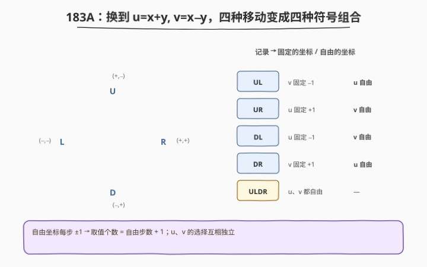
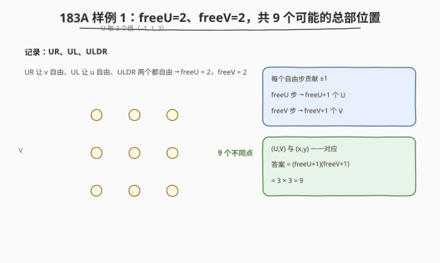

# Codeforces 183A 总部可能位置计数 题解

## 1. 题目概述

- **题目链接**：https://codeforces.com/problemset/problem/183/A
- **比赛来源**：Croc Champ 2012 - Final · Problem A（UTC 2012-04-27）
- **难度**：1700
- **标签**：坐标变换、组合计数、曼哈顿距离
- **评测类型**：普通
- **限制**：时间 2 s / 内存 256 MB

**题意**：逃犯从总部出发，走了 $n$ 步到达位于 $(0,0)$ 的冰淇淋摊。每步只能走上下左右之一。GPS 记录是 $n$ 条「可能方向」：`UL` 表示这步是 `U` 或 `L`，`UR` 表示 `U` 或 `R`，`DL` 表示 `D` 或 `L`，`DR` 表示 `D` 或 `R`，`ULDR` 表示四者皆可。求总部可能的不同位置数。

**约束**（原样摘自题面 `inputFormat.en`）：

- $1 \le n \le 2\cdot10^5$；每条记录是 `UL`、`UR`、`DL`、`DR`、`ULDR` 之一，按时间顺序给出。
- 输出一个整数。

**约束对算法的限制**：

- $n \le 2\cdot 10^5$：不能枚举所有 $2^n$ 条路径，必须找到结构。
- 答案最大约 $(n+1)^2 \approx 4\times10^{10}$，要用 64 位整数（题面也提醒了 `%I64d`/`cin`）。
- 记录只有 5 种，可以按类型计数。

## 2. 示例与观察

官方样例 1（输入 / 输出原样）：

```text
输入：
3
UR
UL
ULDR

输出：
9
```

官方样例 2（输入 / 输出原样）：

```text
输入：
2
DR
DL

输出：
4
```

**样例 1**：三步分别是 `UR`、`UL`、`ULDR`。按最朴素的想法枚举每步的 2/2/4 种选择，会得到 $2\times2\times4=16$ 条路径，但它们的终点只有 9 个不同的点（题面图也画了 9 个位置）。

**样例 2**：`DR`、`DL` 各 2 种选择，共 4 条路径，终点恰好 4 个不同点。

**观察 1**：把每步写成向量：`U=(0,1)`、`D=(0,-1)`、`L=(-1,0)`、`R=(1,0)`。总部位置 $=-$（所有步的位移和），所以「不同总部位置数」= 「不同位移和的个数」。

**观察 2**：做坐标变换 $u=x+y$、$v=x-y$。四个方向的增量立刻变得非常整齐：

| 方向 | $\Delta u$ | $\Delta v$ |
|------|------------|------------|
| `U` | $+1$ | $-1$ |
| `D` | $-1$ | $+1$ |
| `R` | $+1$ | $+1$ |
| `L` | $-1$ | $-1$ |

也就是说，**每个方向在 $u$ 和 $v$ 上各贡献一个独立的 $\pm1$**，四种方向恰好是 $(\Delta u,\Delta v)$ 的四种符号组合。

**观察 3**：每条记录允许的方向集合，在 $(u,v)$ 下恰好是「固定一个坐标的符号、另一个坐标自由」：

| 记录 | 允许方向 | 固定 | 自由 |
|------|----------|------|------|
| `UL` | $U,L$ | $v=-1$ | $u=\pm1$ |
| `UR` | $U,R$ | $u=+1$ | $v=\pm1$ |
| `DL` | $D,L$ | $u=-1$ | $v=\pm1$ |
| `DR` | $D,R$ | $v=+1$ | $u=\pm1$ |
| `ULDR` | 四个 | 无 | $u,v$ 都自由 |

**观察 4**：不同记录之间，$u$ 的自由选择与 $v$ 的自由选择互不影响（同一记录里要么只有一个坐标自由，要么两个都自由且四种组合齐全）。所以总位移的 $(u,v)$ 取值是两个独立集合的笛卡尔积。

**自造样例**（标注「自造」，输出由程序实测）：

| 输入 | 输出 | 说明 |
|------|------|------|
| `1` / `UL` | 2 | 一步只有 2 个终点 |
| `1` / `ULDR` | 4 | 四个方向 |
| `2` / `UL` / `UR` | 4 | $u$、$v$ 各自由一次，共 $2\times2=4$ 个终点 |
| `2` / `ULDR` / `ULDR` | 9 | 两步各 4 种，位移和只有 9 个 |

## 3. 解题思路

### 3.1 朴素做法与瓶颈

枚举每条路径：$4^n$ 或 $2^n$ 级别，$n=2\cdot10^5$ 完全不可行。

### 3.2 核心观察：换坐标 + 计数



设记录中「$u$ 自由」的条数为 $F_u$，「$v$ 自由」的条数为 $F_v$。则

- 每个自由的 $u$ 步贡献 $\pm1$，$F_u$ 步的和可以取 $-F_u,-F_u+2,\ldots,F_u$ 共 $F_u+1$ 个值；
- 同理 $v$ 有 $F_v+1$ 个取值；
- 两者独立，故不同 $(u,v)$ 对数为 $(F_u+1)(F_v+1)$；
- 由于 $(u,v)\leftrightarrow(x,y)$ 是一一对应（$x=(u+v)/2$、$y=(u-v)/2$，且 $u,v$ 同奇偶自动满足），答案就是 $(F_u+1)(F_v+1)$。

固定符号的那些步只贡献一个常数，不影响「有多少个不同取值」。

### 3.3 算法流程

1. 读入 $n$ 与 $n$ 条记录。
2. `UL`、`UR`、`DL`、`DR`、`ULDR` 分别让 $F_v$、$F_u$、$F_u$、$F_v$、$(F_u,F_v)$ 加一。
3. 输出 $(F_u+1)(F_v+1)$，用 64 位整数。

### 3.4 样例走查



样例 1：`UR` 让 $v$ 自由（$F_v=1$），`UL` 让 $u$ 自由（$F_u=1$），`ULDR` 两个都自由（$F_u=F_v=2$）。于是 $U$ 有 3 个取值、$V$ 有 3 个取值，$3\times3=9$。

样例 2：`DR` 让 $v$ 自由（$F_v=1$），`DL` 让 $u$ 自由（$F_u=1$），$(1+1)(1+1)=4$。

## 4. 正确性证明

**引理 1**：$u=x+y$、$v=x-y$ 是 $\mathbb{Z}^2$ 到 $\{(u,v): u\equiv v\pmod 2\}$ 的双射。

**证明**：$x=(u+v)/2$、$y=(u-v)/2$ 唯一确定，且 $u\equiv v\pmod 2$ 保证 $x,y$ 为整数。∎

**引理 2**：对任一步，四种方向对应的 $(\Delta u,\Delta v)$ 恰为 $(\pm1,\pm1)$ 的四种组合。

**证明**：直接计算：`U`→$(+1,-1)$、`D`→$(-1,+1)$、`R`→$(+1,+1)$、`L`→$(-1,-1)$，两两不同且覆盖四种符号组合。∎

**引理 3**：每条记录允许的总位移集合，在 $(u,v)$ 下是一个「矩形」：$U$ 坐标取 $F_u$ 个 $\pm1$ 之和的全部值，$V$ 坐标同理，且两者独立。

**证明**：由引理 2 与表格：`UL` 允许 $(+1,-1)$、$(-1,-1)$，即 $v=-1$ 固定、$u=\pm1$；其余四种同理。`ULDR` 是四种组合齐全，两个坐标独立。不同记录的自由坐标互不干扰，逐坐标相加即可。∎

**引理 4**：$F$ 个独立 $\pm1$ 之和的取值恰为 $-F,-F+2,\ldots,F$，共 $F+1$ 个。

**证明**：和为 $2k-F$，其中 $k$ 是取 $+1$ 的步数，$k=0..F$，故有 $F+1$ 个不同值。∎

**定理**：答案等于 $(F_u+1)(F_v+1)$。

**证明**：由引理 3，位移集合是 $U$ 集合与 $V$ 集合的笛卡尔积；由引理 4，两集合大小分别为 $F_u+1$、$F_v+1$，故 $(u,v)$ 取值数为乘积；由引理 1，$(x,y)$ 的取值数与之相同。总部位置是位移和的相反数，取反仍是双射，故不同位置数不变。∎

## 5. 复杂度分析

- **时间**：$O(n)$，每条记录 $O(1)$ 判断。
- **空间**：$O(1)$（只需两个计数器）。
- **数值范围**：$F_u,F_v\le n\le2\times10^5$，乘积 $\le (2\cdot10^5+1)^2\approx4\times10^{10}$，`long long` 足够。
- **与时限的关系**：2 s 对 $2\times10^5$ 次判断余量在千倍以上。实测 $n=2\times10^5$ 端到端约 12 ms（Python 约 47 ms）。

## 6. 参考代码

### C++17

```cpp
#include <bits/stdc++.h>
using namespace std;

// 183A：把坐标变换成 u=x+y, v=x-y，四种移动恰好是 (u,v) 各取 ±1 的四种组合。
// 每条记录固定 u 或 v 的一个符号，另一个自由：自由坐标的取值个数 = 自由步数+1。
int main() {
    int n;
    if (scanf("%d", &n) != 1) return 0;
    long long freeU = 0, freeV = 0;
    char buf[8];
    for (int i = 0; i < n; ++i) {
        scanf("%s", buf);
        if (buf[2] != '\0') {          // "ULDR"
            ++freeU;
            ++freeV;
        } else if (buf[0] == 'U') {
            if (buf[1] == 'L') ++freeV;   // UL: v 固定，u 自由
            else ++freeU;                 // UR: u 固定，v 自由
        } else {
            if (buf[1] == 'L') ++freeU;   // DL: u 固定，v 自由
            else ++freeV;                 // DR: v 固定，u 自由
        }
    }
    printf("%lld\n", (freeU + 1) * (freeV + 1));
    return 0;
}
```

### Python3

```python
import sys


def main() -> None:
    data = sys.stdin.buffer.read().split()
    n = int(data[0])
    free_u = free_v = 0
    for i in range(1, n + 1):
        s = data[i]
        if s == b'UL':
            free_v += 1
        elif s == b'UR':
            free_u += 1
        elif s == b'DL':
            free_u += 1
        elif s == b'DR':
            free_v += 1
        else:            # ULDR
            free_u += 1
            free_v += 1
    sys.stdout.write(str((free_u + 1) * (free_v + 1)) + "\n")


main()
```

## 7. 边界情况与易错点

1. **$n=1$**：`UL`/`UR`/`DL`/`DR` 给 2，`ULDR` 给 4。
2. **答案超过 `int`**：$n=2\times10^5$ 且全是 `ULDR` 时答案是 $(2\cdot10^5+1)^2\approx4\times10^{10}$，必须 64 位（Python 天然无碍）。
3. **`ULDR` 的判定**：字符串长度为 4；不要用「首字母」判断，否则会把 `ULDR` 当成 `UL`。
4. **`UL` 与 `UR` 方向不同**：`UL` 让 $v$ 自由（$u$ 固定），`UR` 让 $u$ 自由——恰好相反，容易记混。
5. **`DL` 与 `DR`**：同理，`DL` 让 $u$ 自由、`DR` 让 $v$ 自由。
6. **总部位置是位移的相反数**：取反是双射，所以计数不变；若要输出具体位置才需要注意符号。
7. **同一条记录里 $u,v$ 的相关性**：`UL` 固定 $v$、`UR` 固定 $u$，单个记录内部的坐标是「一个固定一个自由」，不会产生额外的耦合；`ULDR` 的四种组合正好让两个坐标独立。
8. **输入规模**：$2\times10^5$ 行字符串，C++ 用 `scanf("%s")` 或关闭同步的 `cin` 都行；Python 用 `read().split()`。

## 8. 验证记录

- **编译环境与命令**：`Apple clang 21.0.0`（`/usr/bin/g++` 是 clang 软链，无 GNU libstdc++），`clang++ -std=c++17 -O2 -Wall` 加仓库自带 `bits/stdc++.h`；正文代码仍写标准头。Python 为 `3.9.6`。验证命令：
  `python3 codeforces/tools/verify_solution.py codeforces/contests/0101-0203/183/A_总部可能位置计数.md`
- **官方样例**：2 / 2 通过（`9`、`4`），C++ 与 Python 一致。
- **额外测试**：自造 `1/UL`、`1/ULDR`、`2/UL/UR`、`2/ULDR/ULDR` 等 4 组，两种语言全部通过。
- **独立暴力对拍**：暴力逐条记录做集合 DP，枚举每步全部方向、用 `set` 收集位移并去重（与公式完全不同）；对 250 组随机数据（$n\le10$）逐组比对，全部一致。
- **最大约束性能**：$n=2\times10^5$ 全 `ULDR` 端到端约 12 ms，Python 约 47 ms，相对 2 s 时限余量在 40 倍以上。
- **图片与公式**：2 张 SVG（`cf183a_transform.svg`、`cf183a_count.svg`）通过 `ElementTree.parse` 与文本包围盒/重叠检查，headless Chrome 渲染确认无裁切；KaTeX 校验 0 错。
- **复核状态**：verified。

## 相关题目与扩展

- [Codeforces 183B Zoo](https://codeforces.com/problemset/problem/183/B)：同场 B 题，几何 + 计数。
- [Codeforces 183C Cyclic Coloring](https://codeforces.com/problemset/problem/183/C)：同场 C 题，图 + 数论。
- [Codeforces 1A Theatre Square](https://codeforces.com/problemset/problem/1/A)：最基础的坐标变换/取整题。
- [LeetCode 1266. 访问所有点的最小时间](https://leetcode.cn/problems/minimum-time-visiting-all-points/)：切比雪夫距离与 $u,v$ 变换的直接应用。
- [Codeforces 160A Twins](https://codeforces.com/problemset/problem/160/A)：贪心 + 计数的入门题。

**延伸思考**：

1. **如果记录是三元组**（如 `ULR`）：固定一个坐标符号、另一个自由的情形会变复杂，可能出现「两个坐标都固定」的记录，答案要按连通性/区间合并处理。
2. **如果要输出所有可能的总部位置**：可以用 BFS 生成 $F_u\times F_v$ 个点（答案规模最大 $4\times10^{10}$，只能输出范围）。
3. **如果步长可以不同**：$U=k$ 时 $u$ 与 $v$ 的增量变成 $+k,-k$，自由坐标的取值变成等差数列，计数公式不变（只是步长不同）。
4. **与切比雪夫距离的关系**：$u=x+y$、$v=x-y$ 的变换把曼哈顿距离变成切比雪夫距离，是网格题里的常用技巧。
5. **如果要求「总部到冰淇淋摊的最短路」**：就是 $\max(|x|,|y|)$ 的切比雪夫形式，可以用同样的变换快速计算。

