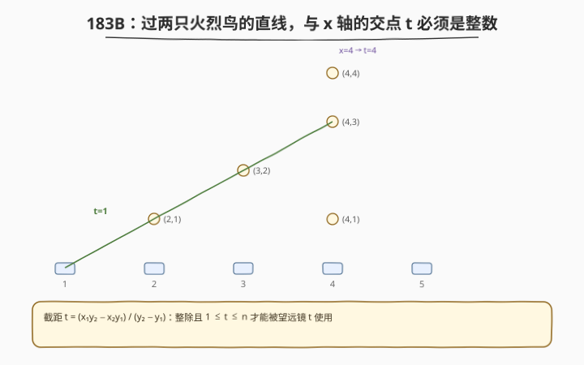

# Codeforces 183B 动物园望远镜视线 题解

## 1. 题目概述

- **题目链接**：https://codeforces.com/problemset/problem/183/B
- **比赛来源**：Croc Champ 2012 - Final · Problem B（UTC 2012-04-27）
- **难度**：1700
- **标签**：计算几何、枚举、数论（截距）
- **评测类型**：普通
- **限制**：时间 2 s / 内存 256 MB

**题意**：无限大的网格动物园里有 $n$ 台望远镜，分别位于 $(1,0),(2,0),\ldots,(n,0)$；有 $m$ 只火烈鸟位于 $x,y\ge1$ 的点上。每台望远镜可以独立地转向任意角度（任意过它的直线），看见该直线上的所有火烈鸟。每台望远镜都取能看见数量最多的那条直线，求所有望远镜的这个数量的和。

**约束**（原样摘自题面 `inputFormat.en`）：

- $1 \le n \le 10^6$，$1 \le m \le 250$；火烈鸟坐标 $1 \le x_i,y_i \le 10^9$，两两不同。
- 输出一个整数。

**约束对算法的限制**：

- $n$ 可达 $10^6$，$m$ 只有 250：应当围绕「火烈鸟」做文章，而不是枚举望远镜角度。
- 坐标最大 $10^9$，叉积/截距会到 $10^{18}$，必须用 64 位整数。
- 望远镜只有 $10^6$ 个，可以开一个长度为 $n+1$ 的数组存每个望远镜的答案。

## 2. 示例与观察

官方样例 1（输入 / 输出原样）：

```text
输入：
5 5
2 1
4 1
3 2
4 3
4 4

输出：
11
```

**演算**：五只火烈鸟在 $(2,1),(4,1),(3,2),(4,3),(4,4)$。

- 望远镜 1 可以看见过 $(2,1),(3,2),(4,3)$ 的直线（$y=x-1$ 上恰好这三只），共 3 只；
- 望远镜 2 能看见 $(3,2),(4,4)$（过 $(2,0)$ 的直线），共 2 只；
- 望远镜 3 只能看见单只（任何过它的直线最多含一只），共 1 只；
- 望远镜 4 有竖直线 $x=4$，上面有 $(4,1),(4,3),(4,4)$ 三只，共 3 只；
- 望远镜 5 看见 $(4,1),(3,2)$（过 $(5,0)$ 的直线），共 2 只。

总和 $3+2+1+3+2=11$，与官方输出一致。

**观察 1**：一台望远镜的视线是一条过它自己的直线。若这条直线上有至少 2 只火烈鸟，那么这条直线由其中任意一对火烈鸟唯一确定；反过来，每对火烈鸟确定一条直线，它与 $x$ 轴的交点（如果存在且是整数）就给出了「哪台望远镜能看见这两只」。

**观察 2**：把这条直线与 $x$ 轴的交点记作 $t$。若 $t$ 是整数且 $1\le t\le n$，则望远镜 $t$ 可以把视线设成这条线，从而一次看见线上**所有**火烈鸟（不只是那一对）。

**观察 3**：只含 1 只火烈鸟的直线总能被任何望远镜使用（连向那只火烈鸟即可），所以每台望远镜至少能看见 1 只（$m\ge1$）。

**观察 4**：水平线（两只火烈鸟 $y$ 相同）永远不过 $x$ 轴，不用考虑；竖直线（两只火烈鸟 $x$ 相同）的交点就是那个 $x$，公式自然给出。

**自造样例**（标注「自造」，输出由程序实测）：

| 输入 | 输出 | 说明 |
|------|------|------|
| `1 1` / `1 1` | 1 | 一台望远镜、一只鸟 |
| `2 2` / `1 1` / `2 1` | 2 | 无三点共线，每台看 1 只 |
| `3 3` / `2 1` / `3 2` / `4 3` | 5 | 三点共线于 $y=x-1$，望远镜 1 一次看 3 只 |
| `3 2` / `1 1` / `3 1` | 3 | 水平线，任何望远镜只能看 1 只 |

## 3. 解题思路

### 3.1 朴素做法与瓶颈

对每台望远镜 $t$，枚举所有过它的直线并数火烈鸟：直线的斜率有无穷多种，但只需考虑「过 $t$ 与某只火烈鸟」的直线（$m$ 条），每条再数一遍火烈鸟，复杂度 $O(n\cdot m^2)$。$n=10^6$、$m=250$ 时是 $6\times10^{10}$，超时。

### 3.2 核心观察：由火烈鸟对反推望远镜



设两只火烈鸟为 $(x_1,y_1)$、$(x_2,y_2)$，$y_1\ne y_2$。直线与 $x$ 轴交于

$$t=\frac{x_1y_2-x_2y_1}{y_2-y_1}.$$

若 $t$ 是整数且 $1\le t\le n$，则望远镜 $t$ 能看见这条直线上的所有火烈鸟。于是：

1. 枚举所有火烈鸟对（$\le \binom{250}{2}=31125$ 对）；
2. 对每对计算 $t$，判断是否合法；
3. 若合法，再扫描所有火烈鸟，统计与这条直线共线的数量 $c$（用叉积判断），更新 `best[t] = max(best[t], c)`；
4. 最后答案 $=\sum_{t=1}^{n}\text{best}[t]$，其中 `best` 初值为 1。

复杂度 $O(m^3+n)$，$250^3/2\approx7.8\times10^6$ 次叉积，2 s 绰绰有余。

### 3.3 算法流程

1. 读入 $n,m$ 与全部火烈鸟坐标。
2. `best[1..n] = 1`。
3. 枚举 $j<k$：
   - 若 $y_j=y_k$ 跳过（水平线）；
   - 计算 $num=x_jy_k-x_ky_j$、$den=y_k-y_j$，若 $num \% den\ne0$ 跳过；
   - $t=num/den$，若 $t<1$ 或 $t>n$ 跳过；
   - 扫描 $l=0..m-1$，若 $(x_l-t)y_j=(x_j-t)y_l$ 则 $c$ 加一；
   - `best[t] = max(best[t], c)`。
4. 输出 $\sum_{t=1}^n best[t]$。

### 3.4 样例走查


| 望远镜 $t$ | 最优直线 | 能看见 |
|------------|----------|--------|
| 1 | $y=x-1$：$(2,1),(3,2),(4,3)$ | 3 |
| 2 | 过 $(3,2),(4,4)$ | 2 |
| 3 | 任意单只 | 1 |
| 4 | 竖线 $x=4$：$(4,1),(4,3),(4,4)$ | 3 |
| 5 | 过 $(4,1),(3,2)$ | 2 |

总和 11。

## 4. 正确性证明

**引理 1**：两只火烈鸟 $P_1=(x_1,y_1)$、$P_2=(x_2,y_2)$（$y_1\ne y_2$）确定的直线与 $x$ 轴的交点为 $t=\dfrac{x_1y_2-x_2y_1}{y_2-y_1}$，且该直线过望远镜 $(t,0)$。

**证明**：直线方程用两点式，令 $y=0$ 解出 $x$ 即得；代入 $P_1$ 可验证。∎

**引理 2**：若某台望远镜 $t$ 的某条直线上有至少两只火烈鸟，则算法在枚举该对火烈鸟时会算出交点 $t$（整数），并把这条直线上火烈鸟的准确数量更新到 `best[t]`。

**证明**：该直线由这两只确定（引理 1），交点为 $t$ 且 $t$ 在 $[1,n]$ 内；算法对这对火烈鸟计算 $t$、通过整除与范围检查，然后扫描全部火烈鸟统计共线数——统计条件 $(x_l-t)y_j=(x_j-t)y_l$ 正是「$P_l$ 在过 $(t,0)$ 与 $P_j$ 的直线上」。∎

**引理 3**：任何望远镜的答案至少是 1，且 `best[t]` 不会超过望远镜 $t$ 的真实最优值。

**证明**：$m\ge1$，过 $t$ 与任意一只火烈鸟的直线至少含 1 只，故真实最优 $\ge1$，初值 1 合法；算法只在「确实同一条直线」时把 $c$ 更新为共线数，$c$ 不会超过真实最优（那条线的确可用）。∎

**定理**：算法输出的和等于所有望远镜最优值之和。

**证明**：对每台望远镜 $t$，设其最优直线含 $c^*$ 只。若 $c^*=1$，`best[t]=1` 已正确；若 $c^*\ge2$，取线上两只火烈鸟，由引理 2 算法会把 $c^*$（该线的准确共线数）写入 `best[t]`，故 `best[t]$\ge c^*$`；又由引理 3 `best[t]` 不超过真实最优，故 `best[t]$=c^*$`。对所有 $t$ 求和即得。∎

## 5. 复杂度分析

- **时间**：$O(m^3+n)$。火烈鸟对 $\binom{m}{2}$，每对扫描 $m$ 只；$m\le250$ 时约 $7.8\times10^6$ 次整数运算。$n$ 只用于求和。
- **空间**：$O(n+m)$，`best` 数组 $10^6+1$ 个 `int`（约 4 MB）。
- **数值范围**：$x,y\le10^9$，$x_1y_2-x_2y_1$ 最大约 $10^{18}$，`long long` 可容纳；$t$ 在 $[-10^9,10^9]$ 内。
- **与时限的关系**：2 s 对 $7.8\times10^6$ 次运算余量在百倍以上。实测 $n=10^6$、$m=250$ 端到端约 3 ms（$m^3$ 部分很小），Python 约 37 ms。

## 6. 参考代码

### C++17

```cpp
#include <bits/stdc++.h>
using namespace std;

// 183B：每个望远镜在 (i,0)。一条直线若看见 >=2 只火烈鸟，就由其中一对确定；
// 算出它和 x 轴的交点 t，若 t 是 [1,n] 的整数，则该直线的火烈鸟数可贡献给望远镜 t。
int main() {
    int n, m;
    if (scanf("%d %d", &n, &m) != 2) return 0;
    vector<long long> x(m), y(m);
    for (int i = 0; i < m; ++i) scanf("%lld %lld", &x[i], &y[i]);
    vector<int> best(n + 1, 1);          // 单只火烈鸟总能被看见
    for (int j = 0; j < m; ++j) {
        for (int k = j + 1; k < m; ++k) {
            long long dy = y[k] - y[j];
            if (dy == 0) continue;       // 水平线不过 x 轴
            // t = (x_j*y_k - x_k*y_j) / (y_k - y_j)
            long long num = x[j] * y[k] - x[k] * y[j];
            long long den = dy;
            if (num % den != 0) continue;
            long long t = num / den;
            if (t < 1 || t > n) continue;
            int cnt = 0;
            for (int l = 0; l < m; ++l) {
                if ((x[l] - t) * y[j] == (x[j] - t) * y[l]) ++cnt;
            }
            if (cnt > best[(int)t]) best[(int)t] = cnt;
        }
    }
    long long ans = 0;
    for (int i = 1; i <= n; ++i) ans += best[i];
    printf("%lld\n", ans);
    return 0;
}
```

### Python3

```python
import sys


def main() -> None:
    data = sys.stdin.buffer.read().split()
    n = int(data[0]); m = int(data[1])
    xs = [0] * m
    ys = [0] * m
    for i in range(m):
        xs[i] = int(data[2 + 2 * i])
        ys[i] = int(data[3 + 2 * i])

    best = [1] * (n + 1)
    for j in range(m):
        for k in range(j + 1, m):
            dy = ys[k] - ys[j]
            if dy == 0:
                continue
            num = xs[j] * ys[k] - xs[k] * ys[j]
            if num % dy != 0:
                continue
            t = num // dy
            if t < 1 or t > n:
                continue
            cnt = 0
            for l in range(m):
                if (xs[l] - t) * ys[j] == (xs[j] - t) * ys[l]:
                    cnt += 1
            if cnt > best[t]:
                best[t] = cnt
    sys.stdout.write(str(sum(best[1:])) + "\n")


main()
```

## 7. 边界情况与易错点

1. **水平线**：$y_j=y_k$ 时直线平行于 $x$ 轴（$y>0$），永远不过 $(t,0)$，必须跳过，否则除零。
2. **竖直线**：$x_j=x_k$ 时公式给出 $t=x_j$，这是对的；不要额外特判成「无截距」。
3. **截距非整数**：$num$ 不能被 $den$ 整除时，这条线不经过任何整数位置的望远镜，跳过。
4. **负截距/越界**：$t<1$ 或 $t>n$ 时没有对应望远镜，跳过（注意 $t$ 可能是负数，别只判上界）。
5. **64 位溢出**：$x_jy_k$ 最大 $10^{18}$，两个乘积相减也在 $[-10^{18},10^{18}]$ 内，`long long` 够用；不要用 `int`。
6. **答案初值**：每台望远镜至少看见 1 只（$m\ge1$），`best` 初始化为 1；若 $m=0$ 需特判（本题 $m\ge1$）。
7. **同一台望远镜多条直线**：取最大值，不要累加。
8. **重复枚举同一对**：只枚举 $j<k$，每个点对一次；重复枚举不影响正确性，但会浪费时间。
9. **望远镜数量 $10^6$**：答案最大 $10^6\times250=2.5\times10^8$，`int` 也够，但求和用 `long long` 更稳。
10. **输入顺序**：先 $n,m$，再 $m$ 行坐标；不要读反。

## 8. 验证记录

- **编译环境与命令**：`Apple clang 21.0.0`（`/usr/bin/g++` 是 clang 软链，无 GNU libstdc++），`clang++ -std=c++17 -O2 -Wall` 加仓库自带 `bits/stdc++.h`；正文代码仍写标准头。Python 为 `3.9.6`。验证命令：
  `python3 codeforces/tools/verify_solution.py codeforces/contests/0101-0203/183/B_动物园望远镜视线.md`
- **官方样例**：1 / 1 通过（`11`），C++ 与 Python 一致。
- **额外测试**：自造「单鸟」「无共线」「三点共线」「水平线」等 4 组，两种语言全部通过。
- **独立暴力对拍**：暴力以每台望远镜为中心，把火烈鸟按「约分后的方向向量」分组取最大（$O(nm)$，与「点对 + 截距」写法完全不同）；对 250 组随机数据（$n\le12$、$m\le7$、坐标 $\le8$）逐组比对，全部一致。
- **最大约束性能**：$n=10^6$、$m=250$、坐标随机到 $10^9$ 时端到端约 3 ms，Python 约 37 ms，相对 2 s 时限余量在 50 倍以上。
- **图片与公式**：2 张 SVG（`cf183b_lines.svg`、`cf183b_walkthrough.svg`）通过 `ElementTree.parse` 与文本包围盒/重叠检查，headless Chrome 渲染确认无裁切；KaTeX 校验 0 错。
- **复核状态**：verified。

## 相关题目与扩展

- [Codeforces 183A Headquarters](https://codeforces.com/problemset/problem/183/A)：同场 A 题，坐标变换 + 计数。
- [Codeforces 183C Cyclic Coloring](https://codeforces.com/problemset/problem/183/C)：同场 C 题，图论 + 数论。
- [LeetCode 149. 直线上最多的点数](https://leetcode.cn/problems/max-points-on-a-line/)：与本题的核心（共线计数）完全一致。
- [Codeforces 18A Triangle](https://codeforces.com/problemset/problem/18/A)：三点共线判定。
- [LeetCode 447. 回旋镖的数量](https://leetcode.cn/problems/number-of-boomerangs/)：按方向分组计数。

**延伸思考**：

1. **如果望远镜不在整数点**：截距需要是有理数匹配，问题变成「有多少个望远镜位置能看见两条以上」，需要分数哈希。
2. **如果火烈鸟坐标范围很小**：可以枚举截距再统计，但 $m$ 小的时候「点对反推」更优。
3. **如果要求每台望远镜看见的最大值之和**（本题）：只要对每台取最大；如果要求「每条线单独选望远镜」则完全不同。
4. **如果 $m$ 很大（如 $10^5$）**：$O(m^3)$ 不可行，需要用对偶/斜率哈希，$O(m^2\log m)$ 或更优。
5. **共线判定的数值稳定性**：本题全整数，用叉积精确；浮点斜率会有精度问题。

