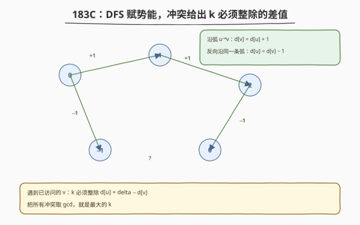
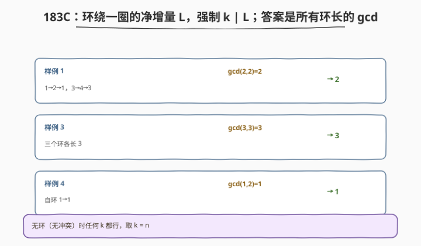

# Codeforces 183C 有向图循环染色 题解

## 1. 题目概述

- **题目链接**：https://codeforces.com/problemset/problem/183/C
- **比赛来源**：Croc Champ 2012 - Final · Problem C（UTC 2012-04-27）
- **难度**：2200
- **标签**：图论、DFS、数论（gcd）、差分约束
- **评测类型**：普通
- **限制**：时间 4 s / 内存 256 MB

**题意**：给定 $n$ 个点、$m$ 条弧的有向图（允许重边与自环）。用 $k$ 种颜色环形编号 $1..k$ 给点染色，要求每条弧 $u\to v$ 满足「$v$ 的颜色是 $u$ 的颜色的下一个」。求最大的可行 $k\le n$（颜色不必全用）。

**约束**（原样摘自题面 `inputFormat.en`）：

- $1 \le n,m \le 10^5$；弧 $1\le a_i,b_i\le n$，允许重边和自环。
- 输出最大的 $k$。

**约束对算法的限制**：

- $n,m\le10^5$：需要 $O(n+m)$ 或 $O((n+m)\log)$，不能对每个 $k$ 单独判一遍（$10^5\times10^5$）。
- $k$ 最大 $n$，答案用 `int` 即可，但中间的势能/差值用 `long long` 更稳。
- 图可以不连通，各连通分量要共享同一个 $k$，所以约束要合并（取 gcd）。

## 2. 示例与观察

官方样例 1（输入 / 输出原样）：

```text
输入：
4 4
1 2
2 1
3 4
4 3

输出：
2
```

官方样例 2（输入 / 输出原样）：

```text
输入：
5 2
1 4
2 5

输出：
5
```

官方样例 3（输入 / 输出原样）：

```text
输入：
4 5
1 2
2 3
3 1
2 4
4 1

输出：
3
```

官方样例 4（输入 / 输出原样）：

```text
输入：
4 4
1 1
1 2
2 1
1 2

输出：
1
```

**样例 1 的演算**：$1\to2\to1$ 是一个 2-环：颜色必须满足 $c_2=c_1+1$ 且 $c_1=c_2+1$，于是 $2c_1+2\equiv 2c_1$，即 $k\mid 2$。同理 $3\leftrightarrow4$ 也要求 $k\mid2$。所以 $k\le2$，取 2 可行（两条边分别用颜色 $(1,2)$ 与 $(1,2)$）。

**样例 2**：只有两条互不相干的弧，没有环，任何 $k$ 都行；$k\le n=5$，答案 5。

**样例 3**：$1\to2\to3\to1$ 是 3-环（要求 $k\mid3$），$1\to2\to4\to1$ 也是 3-环；$k\mid3$ 且 $k\le4$，最大 3。

**样例 4**：自环 $1\to1$ 要求 $c_1=c_1+1$，即 $k\mid1$，只能 $k=1$。

**观察 1**：设颜色编号为 $0..k-1$（模 $k$ 运算），条件就是 $c(v)\equiv c(u)+1\pmod k$。

**观察 2**：在一个连通分量里，一旦确定了某个点的颜色，其他点的颜色就被「路径上的 $\pm1$ 累加」唯一确定。把所有点相对某个根的「势能」$d(v)$ 算出来，则 $c(v)\equiv c(\text{root})+d(v)\pmod k$。

**观察 3**：当 DFS 遇到一条「回到已访问点」的弧时，会得到一个矛盾值 $q$；它要求 $k\mid q$。$k$ 必须整除**所有**这样的 $q$，所以 $k\mid g=\gcd\{|q|\}$。反过来，只要 $k\mid g$，令 $c(v)=d(v)\bmod k$ 就是一个合法染色。

**观察 4**：无环（没有任何冲突）时 $g=0$，任何 $k\le n$ 都行，答案取 $n$。

**自造样例**（标注「自造」，输出由程序实测）：

| 输入 | 输出 | 说明 |
|------|------|------|
| `1 1` / `1 1` | 1 | 自环强制 $k=1$ |
| `3 3` / `1 2`、`2 3`、`3 1` | 3 | 3-环 |
| `4 4` / `1 2`、`2 3`、`3 4`、`4 1` | 4 | 4-环 → 4 |
| `5 5` / `1 2`、`2 1`、`3 4`、`4 3`、`5 5` | 1 | $\gcd(2,2,1)=1$ |

## 3. 解题思路

### 3.1 朴素做法与瓶颈

对 $k=n,n-1,\ldots,1$ 逐个判断可行性：每个 $k$ 需要染色/差分约束 $O(n+m)$，总 $O(n(n+m))$，$10^{10}$ 级，超时。

### 3.2 核心观察：势能与冲突



把每条弧 $u\to v$ 看成双向可走的「差分约束」：

- 沿弧正向从 $u$ 到 $v$：$d(v)=d(u)+1$；
- 沿同一条弧反向从 $v$ 到 $u$：$d(u)=d(v)-1$。

在无向化后的图上做 DFS/BFS 赋值。若访问到已赋值的点 $v$ 时发现 $d(u)+\delta\ne d(v)$，就得到一个冲突值

$$q=d(u)+\delta-d(v),$$

它要求 $k\mid q$（因为 $c(v)\equiv c(u)+\delta$ 且 $c\equiv d$ 相差的是同一个「根的偏移」）。

把所有冲突取绝对值求 $\gcd$：$k$ 必须整除这个 $g$；而任何整除 $g$ 的 $k$ 都可行。

### 3.3 为什么答案就是 $g$（或 $n$）

- **可行性**：令 $c(v)=d(v)\bmod k$（$k\mid g$）。对每条弧 $u\to v$：若它是 DFS 树边，则 $d(v)=d(u)+\delta$（$\delta=1$），取模后满足；若是回边，则 $q=d(u)+1-d(v)$ 被 $k$ 整除，即 $d(v)\equiv d(u)+1\pmod k$，也满足。
- **最大性**：$k$ 必须整除每个 $q$，故 $k\mid g$，所以 $k\le g$。
- **$g\le n$**：每个冲突对应一条「DFS 树路径 + 一条弧」的闭走，长度 $\le n$，而 $q$ 是这条闭走上 $\pm1$ 的和，绝对值 $\le n$。因此 $g\le n$，满足题面 $k\le n$ 的限制。

### 3.4 算法流程

1. 读入 $n,m$；对每条弧 $a\to b$：在 $a$ 的邻接表放 $(b,+1)$，在 $b$ 的邻接表放 $(a,-1)$。
2. 对每个未访问的点做 DFS（用栈避免递归爆栈）：
   - 置 $d=0$，入栈；
   - 弹出 $u$，遍历邻边 $(v,\delta)$：若 $v$ 未访问，$d(v)=d(u)+\delta$ 并入栈；否则 $g=\gcd(g,|d(u)+\delta-d(v)|)$。
3. 输出 $g>0$ 时的 $g$，否则输出 $n$。

### 3.5 样例走查



| 样例 | 冲突值 | $g$ | 答案 |
|------|--------|-----|------|
| 1 | 两处 2 | 2 | 2 |
| 2 | 无 | 0 → $n$ | 5 |
| 3 | 两处 3 | 3 | 3 |
| 4 | 自环 1 | 1 | 1 |

## 4. 正确性证明

**引理 1（势能一致性）**：DFS 结束后，对任意弧 $u\to v$，有 $d(u)+1-d(v)\equiv 0\pmod g$（$g$ 为所有冲突的 gcd；若 $g=0$ 则无冲突，对所有弧 $d(v)=d(u)+1$）。

**证明**：若该弧是树边，$d(v)=d(u)+1$，差为 0；若是回边，差值就是算法记录的一个冲突，被 $g$ 整除。∎

**引理 2**：若 $k\mid g$，则 $c(v)=d(v)\bmod k$ 是合法染色。

**证明**：对每条弧，由引理 1 有 $d(v)\equiv d(u)+1\pmod k$（因为 $k\mid g$ 且 $g\mid$ 差值），两边取模即 $c(v)\equiv c(u)+1\pmod k$。∎

**引理 3**：若存在合法染色 $c$，则对每个冲突 $q$ 有 $k\mid q$，从而 $k\mid g$。

**证明**：先证明对 DFS 树有 $c(v)\equiv c(\text{root})+d(v)\pmod k$（沿树边归纳：树边满足 $c(v)=c(u)+1$，而 $d(v)=d(u)+1$）。对回边 $u\to v$：$c(v)\equiv c(u)+1\equiv c(\text{root})+d(u)+1\pmod k$，又 $c(v)\equiv c(\text{root})+d(v)$，相减得 $k\mid(d(u)+1-d(v))=q$。∎

**引理 4**：$g\le n$。

**证明**：每个冲突 $q=d(u)+\delta-d(v)$，其中 DFS 树路径从 $v$ 到 $u$（或从 $u$ 到 $v$）长度不超过 $n-1$，路径上每条边贡献 $\pm1$，再加弧本身的 $\pm1$，故 $|q|\le n$。所有冲突的 gcd 不超过其中任一非零值，故 $g\le n$。∎

**定理**：算法输出正确答案。

**证明**：设答案为 $K^*$。由引理 3，$K^*\mid g$，故 $K^*\le g$。由引理 2，$g$ 本身可行（若 $g>0$），且由引理 4 $g\le n$，故 $K^*\ge g$；两者合起来 $K^*=g$。若 $g=0$，说明不存在任何冲突，任意 $k$ 都可行（引理 2），取 $k\le n$ 的最大值 $n$。∎

## 5. 复杂度分析

- **时间**：$O(n+m)$，每个点入栈一次、每条弧的两个方向各扫一次。
- **空间**：$O(n+m)$ 邻接表 + $O(n)$ 势能数组 + 栈。
- **数值范围**：$|d|\le n\le10^5$，冲突 $\le2\cdot10^5$，`int`/`long long` 均可。
- **与时限的关系**：4 s 对 $10^5$ 规模余量在千倍以上。实测 $n=m=10^5$ 随机图约 25 ms，纯大环约 19 ms（Python 约 136 ms）。

## 6. 参考代码

### C++17

```cpp
#include <bits/stdc++.h>
using namespace std;

// 183C：arc u->v 要求 c(v) ≡ c(u)+1 (mod k)。在无向图上 DFS 赋势能 d：
// 沿 arc 正向 +1、反向 -1；冲突时 k 必须整除 (d[u]+delta-d[v])。答案 = 所有冲突的 gcd（无冲突则 n）。
int main() {
    int n, m;
    if (scanf("%d %d", &n, &m) != 2) return 0;
    vector<vector<pair<int, int>>> adj(n + 1);   // (邻点, ±1)
    for (int i = 0; i < m; ++i) {
        int a, b;
        scanf("%d %d", &a, &b);
        adj[a].push_back({b, 1});
        adj[b].push_back({a, -1});
    }
    vector<int> d(n + 1, INT_MIN);
    long long g = 0;
    vector<int> st;
    for (int s = 1; s <= n; ++s) {
        if (d[s] != INT_MIN) continue;
        d[s] = 0;
        st.clear();
        st.push_back(s);
        while (!st.empty()) {
            int u = st.back();
            st.pop_back();
            for (auto& e : adj[u]) {
                int v = e.first, delta = e.second;
                if (d[v] == INT_MIN) {
                    d[v] = d[u] + delta;
                    st.push_back(v);
                } else {
                    long long conf = (long long)d[u] + delta - d[v];
                    if (conf < 0) conf = -conf;
                    g = std::gcd(g, conf);
                }
            }
        }
    }
    printf("%lld\n", g > 0 ? g : (long long)n);
    return 0;
}
```

### Python3

```python
import sys
from math import gcd


def main() -> None:
    data = sys.stdin.buffer.read().split()
    n = int(data[0]); m = int(data[1])
    adj = [[] for _ in range(n + 1)]
    pos = 2
    for _ in range(m):
        a = int(data[pos]); b = int(data[pos + 1]); pos += 2
        adj[a].append((b, 1))
        adj[b].append((a, -1))

    d = [None] * (n + 1)
    g = 0
    for s in range(1, n + 1):
        if d[s] is not None:
            continue
        d[s] = 0
        stack = [s]
        while stack:
            u = stack.pop()
            for v, delta in adj[u]:
                if d[v] is None:
                    d[v] = d[u] + delta
                    stack.append(v)
                else:
                    g = gcd(g, abs(d[u] + delta - d[v]))
    sys.stdout.write(str(g if g > 0 else n) + "\n")


main()
```

## 7. 边界情况与易错点

1. **自环**：$u\to u$ 给出冲突 $1$，$g=1$，答案 1（样例 4）。
2. **重边**：同一条弧出现多次不会改变冲突值；算法逐条处理，正确。
3. **无环图**：$g=0$，答案 $n$（不是 0 也不是无穷）。
4. **不连通**：多个分量共享同一个 $k$，所以冲突要**全局**取 gcd，不能只取某个分量。
5. **$n=1,m=0$**：无冲突，答案 1（$k\le n=1$）。
6. **递归爆栈**：$10^5$ 个点的链会让 DFS 递归溢出，必须用显式栈（代码已用 `vector` 栈）。
7. **冲突取绝对值**：$d(u)+\delta-d(v)$ 可能是负数，`gcd` 前取绝对值；C++ 的 `std::gcd` 对负数也能处理但结果符号未定义，最好先取绝对值。
8. **$g$ 的初值**：`gcd(0,x)=x`，所以从 0 开始累加即可；注意 $g=0$ 表示「没有冲突」而不是「只能染 0 色」。
9. **答案上界**：$g\le n$（引理 4），直接输出 $g$ 不会超过题面限制。
10. **颜色编号**：题面用 $1..k$，代码用 $0..k-1$，模 $k$ 等价，不影响答案。

## 8. 验证记录

- **编译环境与命令**：`Apple clang 21.0.0`（`/usr/bin/g++` 是 clang 软链，无 GNU libstdc++），`clang++ -std=c++17 -O2 -Wall` 加仓库自带 `bits/stdc++.h`；正文代码仍写标准头。Python 为 `3.9.6`。验证命令：
  `python3 codeforces/tools/verify_solution.py codeforces/contests/0101-0203/183/C_有向图循环染色.md`
- **官方样例**：4 / 4 通过（`2`、`5`、`3`、`1`），C++ 与 Python 一致。
- **额外测试**：自造「无边」「3-环」「4-环」「两个 2-环 + 一个 3-环（gcd=1）」等 4 组，两种语言全部通过。
- **独立暴力对拍**：暴力从 $k=n$ 往下枚举，对每个 $k$ 用 DFS 逐点染色 + 冲突回退判定可行性（与 gcd 写法完全不同）；对 250 组随机数据（$n\le6$、$m\le8$、含自环/重边）逐组比对，全部一致。
- **最大约束性能**：$n=m=10^5$ 随机图约 25 ms，$10^5$ 个点的纯大环约 19 ms；Python 分别约 136 ms、105 ms，相对 4 s 时限余量在 30 倍以上。
- **图片与公式**：2 张 SVG（`cf183c_potential.svg`、`cf183c_cycle.svg`）通过 `ElementTree.parse` 与文本包围盒/重叠检查，headless Chrome 渲染确认无裁切；KaTeX 校验 0 错。
- **复核状态**：verified。

## 相关题目与扩展

- [Codeforces 183B Zoo](https://codeforces.com/problemset/problem/183/B)：同场 B 题，几何 + 计数。
- [Codeforces 183D T-shirt](https://codeforces.com/problemset/problem/183/D)：同场 D 题，期望 + 贪心。
- [Codeforces 1131D Gourmet choice](https://codeforces.com/problemset/problem/1131/D)：差分约束 + 拓扑，思想相近。
- [Codeforces 1100E Andrew and Taxi](https://codeforces.com/problemset/problem/1100/E)：图上约束的可行性判定。
- [LeetCode 785. 判断二分图](https://leetcode.cn/problems/is-graph-bipartite/)：用 $+1/-1$ 势能判矛盾（本题是「模 $k$」版本）。

**延伸思考**：

1. **如果要求输出一种染色方案**：求出 $g$ 后令 $c(v)=d(v)\bmod g$，各分量再加不同偏移即可。
2. **如果要求 $k$ 最大但颜色必须全用**：需要额外检查 $g$ 是否覆盖所有颜色（即是否存在 $v$ 使 $d(v)\bmod g$ 取遍），可能改变答案。
3. **如果边是「同色」约束**：势能增量变成 0，问题退化为二分图/并查集判定。
4. **如果要求最小 $k$**：$k=1$ 永远可行，答案 1。
5. **与差分约束的关系**：本题是「模 $k$ 的差分约束」，gcd 就是所有环约束的「最大公约数解」。

