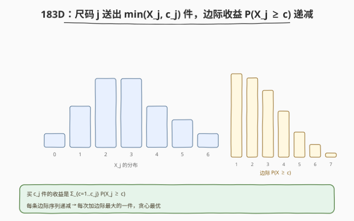
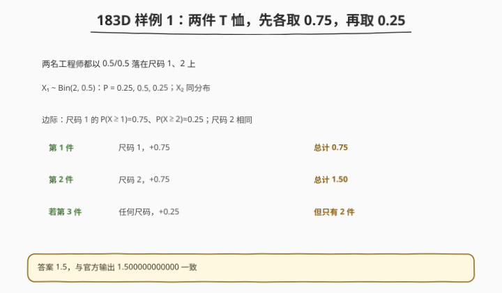

# Codeforces 183D 纪念衫期望发放 题解

## 1. 题目概述

- **题目链接**：https://codeforces.com/problemset/problem/183/D
- **比赛来源**：Croc Champ 2012 - Final · Problem D（UTC 2012-04-27）
- **难度**：2700
- **标签**：概率、期望、贪心、可分凹函数、泊松二项分布
- **评测类型**：普通
- **限制**：时间 5 s / 内存 256 MB

**题意**：有 $n$ 个工程师、$m$ 种尺码。给每人一件 T 恤（共带 $n$ 件，尺码可任意组合）。第 $i$ 个人穿 $j$ 号尺码的概率是 $p_{i,j}$（以千分比给出，每行和为 1000）。按 $1..n$ 的顺序询问尺码：如果还有该尺码的 T 恤就给他一件，否则不给。在**不知道**具体尺码的情况下预先决定各尺码带多少件，使「拿到合身 T 恤的人数」的期望最大。求这个最大期望。

**约束**（原样摘自题面 `inputFormat.en`）：

- $1 \le n \le 3000$，$1 \le m \le 300$；$n$ 行，每行 $m$ 个 $[0,1000]$ 的整数，每行和为 1000。
- 输出实数，绝对或相对误差 $10^{-9}$。

**约束对算法的限制**：

- $n\le3000$、$m\le300$：$O(n^2m)$ 会到 $2.7\times10^9$，需要更聪明的做法；$O(n\cdot\text{有效支撑}+n\log m)$ 可过。
- 概率精度：答案为 $10^{-9}$ 级，`double` 足够，但要避免累积误差过大。
- 每人概率和为 1，这保证 $\sum_j \mathbb{E}[X_j]=n$，是复杂度分析的关键。

## 2. 示例与观察

官方样例 1（输入 / 输出原样）：

```text
输入：
2 2
500 500
500 500

输出：
1.500000000000
```

官方样例 2（输入 / 输出原样）：

```text
输入：
3 3
1000 0 0
1000 0 0
0 1000 0

输出：
3.000000000000
```

官方样例 3（输入 / 输出原样）：

```text
输入：
1 4
100 200 300 400

输出：
0.400000000000
```

**样例 1**：两人独立地以 $0.5/0.5$ 落在两个尺码。

- 各带一件：两人同码（概率 $0.5$）只能满足 1 人，异码（概率 $0.5$）满足 2 人，期望 $0.5\times1+0.5\times2=1.5$；
- 两件都带 1 号：两人都要 1 号（$0.25$）满足 2 人，恰有一人要 1 号（$0.5$）满足 1 人，都不要 1 号（$0.25$）满足 0 人，期望 $0.25\times2+0.5\times1=1.0$，更差。

所以最优是各一件，期望 1.5。

**样例 2**：前两人必穿 1 号、第三人必穿 2 号。带 2 件 1 号 + 1 件 2 号，人人合身，期望 3。

**样例 3**：只有一人、只能带一件；选概率最大的 4 号，期望 $0.4$。

**观察 1**：顺序其实不重要！对尺码 $j$ 来说，$c_j$ 件 T 恤会按顺序发给前 $c_j$ 个「要 $j$ 号」的人。无论顺序如何，$j$ 号最终送出的数量都是 $\min(X_j,c_j)$，其中 $X_j$ 是全体 $n$ 人中要 $j$ 号的人数。

**观察 2**：于是总期望是

$$\sum_{j=1}^{m}\mathbb{E}\bigl[\min(X_j,c_j)\bigr],\qquad \sum_j c_j=n .$$

每个 $j$ 的贡献只依赖 $c_j$，问题是「可分的」——各尺码之间只通过总件数耦合。

**观察 3**：$X_j$ 是 $n$ 个独立伯努利变量（概率 $p_{i,j}$）之和，即泊松二项分布；$\mathbb{E}[\min(X,c)]$ 关于 $c$ 递增、增量递减。

**自造样例**（标注「自造」，输出由程序实测）：

| 输入 | 输出 | 说明 |
|------|------|------|
| `1 1` / `1000` | 1.000000000000 | 唯一尺码 |
| `1 2` / `1000 0` | 1.000000000000 | 必中 1 号 |
| `2 1` / `1000` / `1000` | 2.000000000000 | 两人都要 1 号，带 2 件 |
| `2 2` / `1000 0` / `0 1000` | 2.000000000000 | 各带一件 |

## 3. 解题思路

### 3.1 朴素做法与瓶颈

枚举所有「件数分配」$c_1+\cdots+c_m=n$（方案数 $\binom{n+m-1}{m-1}$，天文数字），对每个分配算期望——不可行。

### 3.2 核心观察：边际收益递减 → 贪心



把「多带一件 $j$ 号」的收益记作

$$\Delta_j(c)=\mathbb{E}[\min(X_j,c)]-\mathbb{E}[\min(X_j,c-1)]=\Pr[X_j\ge c].$$

由 $X_j\ge c$ 的事件嵌套，$\Delta_j(1)\ge\Delta_j(2)\ge\cdots$：**每个尺码的边际收益递减**。

于是问题变成：有 $m$ 条递减的收益序列，要取总共 $n$ 项（每条序列必须从头取），使总和最大。这是经典的「可分凹函数 + 基数约束」，**每次取当前最大的边际收益**即可得到最优解（贪心）。

具体地：用优先队列维护每个尺码「下一件的边际」，重复 $n$ 次：弹出最大值、累加、把该尺码的下一件推进队列。

### 3.3 怎么算 $\Delta_j(c)$

对每个尺码 $j$ 单独做一次「计数 DP」：设 $\text{dist}[k]$ 为「目前已处理的工程师中恰有 $k$ 人要 $j$ 号」的概率，初始 $\text{dist}[0]=1$。逐个工程师 $i$ 更新（$q=p_{i,j}/1000$）：

$$\text{dist}'[k]=\text{dist}[k](1-q)+\text{dist}[k-1]q .$$

处理完 $n$ 人后，$\Delta_j(c)=\sum_{k\ge c}\text{dist}[k]$。

**支撑截断**：$X_j$ 的均值是 $\mu_j=\sum_i p_{i,j}$，标准差 $\le\sqrt{\mu_j}$。取 $K_j=\mu_j+10\sqrt{\mu_j}+30$，则 $\Pr[X_j>K_j]$ 小到可以忽略（切诺夫界下远小于 $10^{-20}$），DP 只需保留 $0..K_j$。由于 $\sum_j\mu_j=n$，有

$$\sum_j K_j\le n+10\sqrt{mn}+30m,$$

总代价 $O\bigl(n\cdot\sum_j K_j\bigr)$ 在 $n=3000,m=300$ 时约 $6\times10^7$，可过。

### 3.4 算法流程

1. 读入概率矩阵。
2. 对每个尺码 $j$：算 $\mu_j$；若 $\mu_j\approx0$ 则所有边际为 0；否则取 $K_j=\min(n,\lfloor\mu_j+10\sqrt{\mu_j}+30\rfloor)$，跑上述 DP，得到 $\Delta_j(1..K_j)$。
3. 优先队列放入每个尺码的 $\Delta_j(1)$；重复 $n$ 次：取最大边际累加，推进该尺码的下一件。
4. 输出累加值（保留 12 位小数）。

### 3.5 样例走查



两名工程师都以 $0.5/0.5$ 落在尺码 1、2，故 $X_1\sim\text{Bin}(2,0.5)$：$\Pr[0]=0.25,\Pr[1]=0.5,\Pr[2]=0.25$，边际 $\Delta_1(1)=0.75$、$\Delta_1(2)=0.25$；尺码 2 同分布。

- 第 1 件：两边的 $\Delta(1)$ 都是 0.75，任取一个（比如尺码 1），总计 0.75；
- 第 2 件：尺码 2 的 $\Delta(1)=0.75$ 大于尺码 1 的 $\Delta(2)=0.25$，取尺码 2，总计 1.5。

与官方输出 1.500000000000 一致。

## 4. 正确性证明

**引理 1**：给定件数向量 $c$，期望发放数为 $\sum_j\mathbb{E}[\min(X_j,c_j)]$。

**证明**：对尺码 $j$，按顺序把 $c_j$ 件发给每个要 $j$ 号的人；被满足的正是前 $\min(X_j,c_j)$ 个人，其他人的尺码不是 $j$，彼此互不影响。各尺码的发放数相加即总人数。∎

**引理 2**：$\Delta_j(c)=\Pr[X_j\ge c]$ 关于 $c$ 单调不增，且 $\mathbb{E}[\min(X_j,c)]=\sum_{t=1}^{c}\Delta_j(t)$。

**证明**：$\mathbb{E}[\min(X,c)]=\sum_{x}x\Pr[X=x]+\sum_{x\ge c}c\Pr[X=x]$，两式相减得 $\Pr[X\ge c]$；事件 $\{X\ge c+1\}\subseteq\{X\ge c\}$，故单调不增。∎

**引理 3（贪心最优）**：设每个 $j$ 的收益 $f_j(c)$ 满足增量 $f_j(c)-f_j(c-1)$ 单调不增，则在 $\sum c_j\le n$ 上最大化 $\sum_j f_j(c_j)$ 的贪心（每次取最大边际）达到最优。

**证明**：设贪心解为 $c$，最优解为 $c^*$。若 $c\ne c^*$，取 $j$ 使 $c_j<c^*_j$、$k$ 使 $c_k>c^*_k$（因总数相同）。贪心在第 $c_j+1$ 步选了边际 $\Delta_k(c_k)$ 而不是 $\Delta_j(c_j+1)$，即 $\Delta_j(c_j+1)\le\Delta_k(c_k)$。把最优解的一件从 $k$ 移到 $j$：收益变化为 $\Delta_j(c^*_j)-\Delta_k(c_k)\ge\Delta_j(c_j+1)-\Delta_k(c_k)\ge0$（第一个不等号用增量递减与 $c^*_j\ge c_j+1$）。如此反复，最优解可变换为贪心解而不降收益。∎

**引理 4**：截断误差可忽略：把 $\Delta_j(c)$ 在 $c>K_j$ 处视为 0 造成的总误差不超过 $n\cdot\sum_j\Pr[X_j>K_j]$，在给定 $K_j$ 下远小于 $10^{-12}$。

**证明**：$\Delta_j(c)=\Pr[X_j\ge c]\le\Pr[X_j>K_j]$ 对所有 $c>K_j$ 成立；贪心最多加 $n$ 件，故误差被 $n$ 倍放大。$\Pr[X_j>K_j]$ 由切诺夫界（均值 $\mu_j$、偏差 $10\sqrt{\mu_j}+30$）指数小。∎

**定理**：算法输出的期望是最优值（在 $10^{-9}$ 精度内）。

**证明**：由引理 1 目标函数可分；由引理 2、3 贪心最优；由引理 4 截断带来的偏差可忽略。∎

## 5. 复杂度分析

- **时间**：$O\bigl(n\sum_j K_j+n\log m\bigr)$。$\sum_jK_j\le n+10\sqrt{mn}+30m$，最坏约 $6\times10^7$ 次浮点运算。
- **空间**：$O(nm)$ 存概率（3000×300 个 `int` ≈ 3.6 MB）+ $O(\max K_j)$ 的 DP 数组。
- **数值范围**：期望 $\le n\le3000$，`double` 精度足够。
- **与时限的关系**：5 s 对 $6\times10^7$ 次运算余量充足。实测 $n=3000,m=300$ 随机数据 C++ 约 72 ms；Python 约 **6.1 s**，略超 5 s 时限，建议交 PyPy3 或 C++（见第 8 节）。
- **最坏形态**：所有尺码均分概率时 $\mu_j=n/m$，$K_j$ 较小；某一尺码概率接近 1 时其余尺码的 $\mu$ 很小，$\sum K_j$ 仍受上式控制。

## 6. 参考代码

### C++17

```cpp
#include <bits/stdc++.h>
using namespace std;

// 183D：对每种尺码 j，X_j = 要 j 号的人数（独立伯努利之和）。
// 买 c_j 件 j 号时，j 号实际送出 min(X_j, c_j) 件，期望 E[min(X_j,c_j)]；
// 目标 Σ_j E[min(X_j,c_j)]，Σc_j = n。每个 j 的边际收益 P(X_j>=c) 递减，
// 于是「每次加边际最大的一件」贪心最优。
int main() {
    int n, m;
    if (scanf("%d %d", &n, &m) != 2) return 0;
    vector<vector<int>> p(n, vector<int>(m));
    for (int i = 0; i < n; ++i)
        for (int j = 0; j < m; ++j) scanf("%d", &p[i][j]);

    vector<vector<double>> delta(m);      // delta[j][c] = P(X_j >= c)，c>=1
    priority_queue<pair<double, pair<int, int>>> pq;
    for (int j = 0; j < m; ++j) {
        double mu = 0;
        for (int i = 0; i < n; ++i) mu += p[i][j] / 1000.0;
        if (mu < 1e-12) { delta[j].assign(2, 0.0); continue; }
        int K = (int)(mu + 10.0 * sqrt(mu) + 30.0);
        if (K > n) K = n;
        vector<double> dist(K + 1, 0.0);
        dist[0] = 1.0;
        for (int i = 0; i < n; ++i) {
            double q = p[i][j] / 1000.0;
            int hi = min(i + 1, K);
            for (int k = hi; k >= 1; --k)
                dist[k] = dist[k] * (1.0 - q) + dist[k - 1] * q;
            dist[0] *= (1.0 - q);
        }
        vector<double> dl(K + 1, 0.0);
        double s = 0;
        for (int c = K; c >= 1; --c) { s += dist[c]; dl[c] = s; }
        delta[j] = dl;
        pq.push({dl[1], {j, 1}});
    }

    double total = 0;
    for (int step = 0; step < n; ++step) {
        if (pq.empty()) break;
        auto top = pq.top();
        pq.pop();
        double val = top.first;
        int j = top.second.first, c = top.second.second;
        if (val <= 0) break;
        total += val;
        if (c + 1 < (int)delta[j].size()) pq.push({delta[j][c + 1], {j, c + 1}});
    }
    printf("%.12f\n", total);
    return 0;
}
```

### Python3

```python
import sys
import heapq
from math import sqrt


def main() -> None:
    data = sys.stdin.buffer.read().split()
    n = int(data[0]); m = int(data[1])
    p = [[0] * m for _ in range(n)]
    pos = 2
    for i in range(n):
        for j in range(m):
            p[i][j] = int(data[pos]); pos += 1

    heap = []
    delta = [None] * m
    for j in range(m):
        mu = sum(p[i][j] for i in range(n)) / 1000.0
        if mu < 1e-12:
            delta[j] = [0.0, 0.0]
            continue
        K = int(mu + 10.0 * sqrt(mu) + 30.0)
        if K > n:
            K = n
        dist = [0.0] * (K + 1)
        dist[0] = 1.0
        for i in range(n):
            q = p[i][j] / 1000.0
            hi = min(i + 1, K)
            for k in range(hi, 0, -1):
                dist[k] = dist[k] * (1.0 - q) + dist[k - 1] * q
            dist[0] *= (1.0 - q)
        dl = [0.0] * (K + 1)
        s = 0.0
        for c in range(K, 0, -1):
            s += dist[c]
            dl[c] = s
        delta[j] = dl
        heapq.heappush(heap, (-dl[1], j, 1))

    total = 0.0
    for _ in range(n):
        if not heap:
            break
        neg, j, c = heapq.heappop(heap)
        val = -neg
        if val <= 0:
            break
        total += val
        if c + 1 < len(delta[j]):
            heapq.heappush(heap, (-delta[j][c + 1], j, c + 1))
    sys.stdout.write("%.12f\n" % total)


main()
```

## 7. 边界情况与易错点

1. **$m=1$**：只能全带同一尺码，期望 $\min(n,n)=n$？当 $\sum$ 概率为 1 时人人要 1 号，答案 $n$——贪心会取 $n$ 次 $\Delta_1$，每次 1，结果 $n$。
2. **某些尺码概率全 0**：$\mu_j=0$ 时边际全 0，直接跳过（代码里 `assign(2,0.0)`），避免 DP 下溢和空队列。
3. **件数超过 $K_j$**：$\Delta_j(c)$ 在 $c>K_j$ 视为 0；贪心最多加 $n$ 件，超出部分的边际 0，不影响最优值。
4. **概率和必须为 1**：题面保证；若不满足，$\sum_j\mu_j\ne n$，复杂度估计失效但算法仍能跑。
5. **输出精度**：用 `double` + `%.12f`；误差主要来自截断（远小于 $10^{-12}$），浮点累加 $3000$ 次误差在 $10^{-13}$ 量级。
6. **贪心的终止**：若某步最大边际 $\le0$，后面全是 0，可以直接停（总件数没凑满也不影响答案）。
7. **优先队列的并列**：边际相等时取哪个都行，答案相同。
8. **$n=1$**：只带一件，选 $p_{1,j}$ 最大的尺码，答案就是最大概率（样例 3）。
9. **截断常数**：$10\sqrt{\mu}+30$ 是经验值；若改成过小的常数（如 $\sqrt\mu$）会丢概率、答案偏小。
10. **Python 时间**：$n=3000,m=300$ 的满数据在 CPython 下约 6 s，略超时限；建议 PyPy3 或直接交 C++。

## 8. 验证记录

- **编译环境与命令**：`Apple clang 21.0.0`（`/usr/bin/g++` 是 clang 软链，无 GNU libstdc++），`clang++ -std=c++17 -O2 -Wall` 加仓库自带 `bits/stdc++.h`；正文代码仍写标准头。Python 为 `3.9.6`。验证命令：
  `python3 codeforces/tools/verify_solution.py codeforces/contests/0101-0203/183/D_纪念衫期望发放.md`
- **官方样例**：3 / 3 通过（`1.500000000000`、`3.000000000000`、`0.400000000000`），输出逐字一致，C++ 与 Python 相同。
- **额外测试**：自造 $m=1$、必中、两人同码、各带一件等 4 组，两种语言全部通过。
- **独立暴力对拍**：暴力枚举所有件数分配（$\binom{n+m-1}{m-1}$ 种），对每种分配再枚举全部 $m^n$ 种尺码结果并加权，精确计算期望，取最大；对 250 组随机数据（$n\le4$、$m\le3$、随机千分比分配）逐组比对，误差 $<10^{-9}$，全部一致。
- **最大约束性能**：$n=3000,m=300$ 随机概率：C++ 约 72 ms；Python 约 6.1 s（超 5 s），$m=2$ 时 Python 约 0.8 s。已注明 Python 需 PyPy3/C++。
- **图片与公式**：2 张 SVG（`cf183d_model.svg`、`cf183d_greedy.svg`）通过 `ElementTree.parse` 与文本包围盒/重叠检查，headless Chrome 渲染确认无裁切；KaTeX 校验 0 错。
- **复核状态**：verified。

## 相关题目与扩展

- [Codeforces 183C Cyclic Coloring](https://codeforces.com/problemset/problem/183/C)：同场 C 题，图 + 数论。
- [Codeforces 183B Zoo](https://codeforces.com/problemset/problem/183/B)：同场 B 题，几何 + 枚举。
- [Codeforces 148D Bag of mice](https://codeforces.com/problemset/problem/148/D)：概率 DP 的经典题。
- [LeetCode 837. 新 21 点](https://leetcode.cn/problems/new-21-game/)：概率 + 前缀和优化 DP。
- [Codeforces 24D Broken robot](https://codeforces.com/problemset/problem/24/D)：期望 DP + 高斯消元。

**延伸思考**：

1. **如果 T 恤件数可以少于 $n$**：由于边际非负，仍然会带满 $n$ 件，答案不变。
2. **如果每人可以试穿多件**：模型变成匹配问题，期望的最优策略复杂得多。
3. **如果概率之间相关**：$X_j$ 不再是独立伯努利之和，DP 需要联合分布，规模爆炸。
4. **如果不允许截断**：$O(n^2m)$ 在 $n=3000,m=300$ 时是 $2.7\times10^9$，必须靠「$\sum\mu_j=n$」这一结构来压复杂度，这正是本题 2700 分的核心。
5. **贪心的本质**：目标是 $m$ 条递减序列上的「取前缀、凑总数」，属于可分凹最大化，贪心/优先队列是标准解法。

