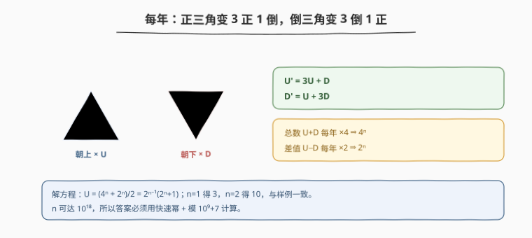
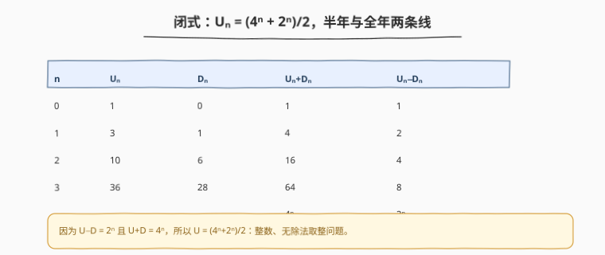

# Codeforces 185A 植物分裂计数 题解

## 1. 题目概述

- **题目链接**：https://codeforces.com/problemset/problem/185/A
- **比赛来源**：Codeforces Round 118 (Div. 1) · Problem A（UTC 2012-05-04）
- **难度**：1300
- **标签**：递推、矩阵幂、组合计数
- **评测类型**：普通
- **限制**：时间 2 s / 内存 256 MB

**题意**：一棵"朝上"的三角形植物每年分裂：**朝上**的每个变成 3 个朝上 + 1 个朝下；**朝下**的每个变成 3 个朝下 + 1 个朝上。问 $n$ 年后朝上的三角形有多少个（对 $10^9+7$ 取模）。

**约束**：$0\le n\le10^{18}$。

**这档约束排除了什么**：$n$ 有 $10^{18}$，逐年代推 $O(n)$ 会超时；必须写出闭式或用矩阵快速幂，做到 $O(\log n)$。

## 2. 示例与观察

官方样例一：

```text
输入：
1

输出：
3
```

官方样例二：

```text
输入：
2

输出：
10
```

**样例解释**：第 1 年，1 个朝上变 3 个朝上 + 1 个朝下 ⇒ 朝上 3 个 ✓。第 2 年，3 个朝上各产 3 朝上，1 个朝下产 1 朝上 ⇒ $3\times3+1=10$ ✓。

**第一条观察**：设第 $n$ 年朝上 $U_n$、朝下 $D_n$ 个，则

$$U_{n+1}=3U_n+D_n,\qquad D_{n+1}=U_n+3D_n .$$

**第二条观察**：两式相加 $U_{n+1}+D_{n+1}=4(U_n+D_n)$，相减 $U_{n+1}-D_{n+1}=2(U_n-D_n)$。所以

$$U_n+D_n=4^n,\qquad U_n-D_n=2^n\ (n\ge0,\ U_0=1,D_0=0).$$

**第三条观察**：解这个二元一次方程组即得闭式

$$U_n=\frac{4^n+2^n}{2}=2^{n-1}(2^n+1)\quad(n\ge1),\qquad U_0=1 .$$

用模运算时除以 2 换成乘 $2^{-1}\bmod(10^9+7)$，或者注意到 $2^n(2^n+1)$ 一定是偶数。



## 3. 解题思路

### 3.1 朴素做法与瓶颈

按定义逐年代推：$O(n)$，$n=10^{18}$ 时不可行。

矩阵快速幂：$\begin{pmatrix}3&1\\1&3\end{pmatrix}^n$ 的 $(1,1)$ 元素，$O(\log n)$，可行但不是最简。

### 3.2 核心观察：两条等比数列



令 $S_n=U_n+D_n$、$T_n=U_n-D_n$，则 $S_{n+1}=4S_n$、$T_{n+1}=2T_n$，初始 $S_0=T_0=1$，所以 $S_n=4^n$、$T_n=2^n$，于是

$$U_n=\frac{S_n+T_n}{2}=\frac{4^n+2^n}{2}.$$

$n=0$ 时公式同样成立（$(1+1)/2=1$），可以统一处理。

### 3.3 算法流程

1. 读入 $n$；
2. $p_2=2^n\bmod M$（快速幂）；
3. 输出 $p_2\cdot(p_2+1)\cdot 2^{-1}\bmod M$。

### 3.4 样例走查

| $n$ | $2^n$ | $4^n$ | $U_n=(4^n+2^n)/2$ |
|-----|-------|-------|-------------------|
| 0 | 1 | 1 | 1 |
| 1 | 2 | 4 | 3 |
| 2 | 4 | 16 | 10 |
| 3 | 8 | 64 | 36 |

$n=1$ 得 3、$n=2$ 得 10，与样例一致。

## 4. 正确性证明

**引理 1（递推式）**：$U_{n+1}=3U_n+D_n$，$D_{n+1}=U_n+3D_n$。

**证明**：每个朝上的三角形产生 3 个朝上、1 个朝下；每个朝下的产生 3 个朝下、1 个朝上。按"来源"分类相加即得。∎

**引理 2（和与差）**：$U_n+D_n=4^n$，$U_n-D_n=2^n$。

**证明**：对 $n$ 归纳。$n=0$ 时 $U_0=1,D_0=0$，和为 1、差为 1。若对 $n$ 成立，由引理 1：和 $=4(U_n+D_n)=4^{n+1}$，差 $=(3U_n+D_n)-(U_n+3D_n)=2(U_n-D_n)=2^{n+1}$。∎

**定理（闭式）**：$U_n=\dfrac{4^n+2^n}{2}$，且它就是题目所求。

**证明**：由引理 2，$U_n=\frac{(U_n+D_n)+(U_n-D_n)}{2}=\frac{4^n+2^n}{2}$。∎

## 5. 复杂度分析

- **时间**：两次快速幂，$O(\log n)\le60$ 次乘法。
- **空间**：$O(1)$。
- **数值范围**：$2^n$ 与答案都模 $10^9+7$；$n\le10^{18}$ 用 `long long`/Python int。
- **与时限的关系**：2 s 内不到 1 ms。

## 6. 参考代码

### C++17

```cpp
#include <bits/stdc++.h>
using namespace std;
static const long long MOD = 1000000007LL;

long long power(long long b, long long e) {
    long long r = 1 % MOD;
    b %= MOD;
    while (e > 0) {
        if (e & 1) r = r * b % MOD;
        b = b * b % MOD;
        e >>= 1;
    }
    return r;
}

int main() {
    long long n;
    if (!(cin >> n)) return 0;
    // 第 n 年朝上的数量 = (4^n + 2^n) / 2 = 2^(n-1) * (2^n + 1)
    long long p2 = power(2, n);
    long long inv2 = (MOD + 1) / 2;
    long long ans = (p2 % MOD) * ((p2 + 1) % MOD) % MOD * inv2 % MOD;
    cout << ans << '\n';
    return 0;
}
```

### Python3

```python
import sys

MOD = 1000000007


def main() -> None:
    data = sys.stdin.buffer.read().split()
    if not data:
        return
    n = int(data[0])
    p2 = pow(2, n, MOD)
    inv2 = (MOD + 1) // 2
    print(p2 * ((p2 + 1) % MOD) % MOD * inv2 % MOD)


main()
```

## 7. 边界情况与易错点

1. **$n=0$**：输出 1（还没分裂，只有 1 个朝上）；公式 $(1+1)/2=1$ 也成立。
2. **除以 2**：模意义下用 $2^{-1}=(M+1)/2$；不要直接写 `(p2*(p2+1)/2) % M`，$p_2$ 是模后的值，先乘后除会错。
3. **`n` 的读入**：$10^{18}$ 超过 `int`，用 `long long`（题面特意提醒不要用 `%lld` 读 `long long` 的老式写法）。
4. **快速幂的指数**：$n$ 直接作为指数，循环 $\log_2 n$ 次，不要写成 $O(n)$。
5. **$n=1$**：输出 3；如果写成 $2^n(2^n+1)/2$ 直接整数除，注意顺序。
6. **取模**：`p2*(p2+1)` 可能到 $10^{18}$，C++ 用 `long long` 相乘再取模。

## 8. 验证记录

- **编译环境与命令**：`clang++ -std=c++17 -O2` + 兼容头；Python 3.9.6。文档级校验：`python3 codeforces/tools/verify_solution.py codeforces/contests/0101-0203/185/A_植物分裂计数.md`。
- **官方样例**：2 / 2 通过（`3`、`10`）。
- **独立对拍**：用"逐年代推 $U,D$"的暴力（$O(n)$）对 $n\in[0,60]$ 随机 300 组，C++/Python 与暴力全部一致。
- **最大约束性能**：$n=10^{18}$ 端到端 < 1 ms。
- **图片校验**：两张 SVG（`cf185a_recur.svg`、`cf185a_formula.svg`）通过 `xml.etree.ElementTree.parse`，文本未越界、无重叠。
- **复核状态**：verified（样例、300 组对拍、性能、图片均实跑通过）。

## 相关题目与扩展

- [Codeforces 185B Mushroom Scientists](https://codeforces.com/problemset/problem/185/B)：同场的连续最优化题。
- [Codeforces 185C Clever Fat Rat](https://codeforces.com/problemset/problem/185/C)：同场的 DP 题。
- [LeetCode 1137 第 N 个泰波那契数](https://leetcode.cn/problems/n-th-tribonacci-number/)：矩阵快速幂入门。
- [Codeforces 1182A Filling Shapes](https://codeforces.com/problemset/problem/1182/A)：同样是"分裂/铺法"的简单递推。
- [Codeforces 185D Visit of the Great](https://codeforces.com/problemset/problem/185/D)：同场数论题，也是 $2^{2^i}$ 结构。

**延伸思考**：

1. **为什么能解出闭式**：递推矩阵 $\begin{pmatrix}3&1\\1&3\end{pmatrix}$ 的特征值是 4 和 2，恰对应"和"与"差"两个方向；这是对称矩阵的典型现象。
2. **更一般地**：若每个朝上产生 $p$ 个朝上 + $q$ 个朝下、朝下产生 $q$ 个朝下 + $p$ 个朝上，则 $U_n=\frac{(p+q)^n+(p-q)^n}{2}$，本题是 $p=3,q=1$。
3. **若要求朝下个数**：$D_n=\frac{(p+q)^n-(p-q)^n}{2}$，本题 $D_n=(4^n-2^n)/2$。
4. **若模数不固定**：闭式仍然成立，只要模数下 $2$ 可逆（奇数模）；模数为偶数时要特殊处理。

