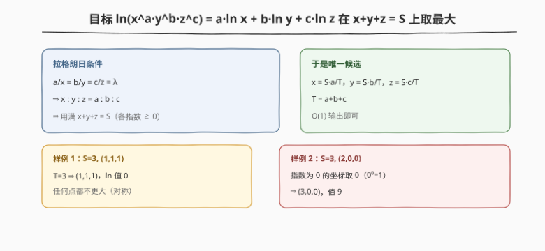
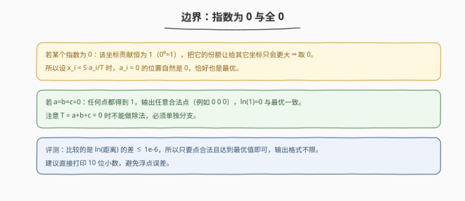

# Codeforces 185B 蘑菇科学家的最优点 题解

## 1. 题目概述

- **题目链接**：https://codeforces.com/problemset/problem/185/B
- **比赛来源**：Codeforces Round 118 (Div. 1) · Problem B（UTC 2012-05-04）
- **难度**：1800
- **标签**：数学、拉格朗日乘子、连续最优化
- **评测类型**：特殊评测（实数，比较 ln 值误差 $\le10^{-6}$）
- **限制**：时间 2 s / 内存 256 MB

**题意**：在"蘑菇科学"的度量里，点 $(x,y,z)$ 到原点的距离是 $x^a y^b z^c$。要求 $x,y,z\ge0$、$x+y+z\le S$，使这个距离最大。规定 $0^0=1$。输出任意一个最优点的三个坐标（实数）。

**约束**：$1\le S\le10^3$，$0\le a,b,c\le10^3$。

**这档约束排除了什么**：$S$ 只有 $10^3$，但坐标是连续的，不能枚举；而目标函数在可行域上是凹的（$\ln$ 后是线性组合），所以用拉格朗日乘子可以直接写出闭式解，$O(1)$ 输出。

## 2. 示例与观察

官方样例一：

```text
输入：
3
1 1 1

输出：
1.0 1.0 1.0
```

官方样例二：

```text
输入：
3
2 0 0

输出：
3.0 0.0 0.0
```

**样例解释一**：$S=3$、指数全 1，最大化 $xyz$（$x+y+z\le3$）在 $x=y=z=1$ 处取得，值 1。

**样例解释二**：$S=3$、$(a,b,c)=(2,0,0)$，目标是 $x^2\cdot y^0\cdot z^0=x^2$（$0^0=1$）。$y,z$ 取 0 不损失，把全部 $S$ 给 $x$ 得 $9$，输出 $(3,0,0)$ ✓。

**第一条观察**：若 $a+b+c>0$，最优一定用满 $x+y+z=S$：把某个正指数坐标加上一点、其它不变，距离变大。

**第二条观察**：取对数把乘积变成线性：$\ln(x^a y^b z^c)=a\ln x+b\ln y+c\ln z$，在单纯形上是凹函数之和，最大值点满足拉格朗日条件

$$\frac{a}{x}=\frac{b}{y}=\frac{c}{z}=\lambda\quad\Longrightarrow\quad x:y:z=a:b:c .$$

**第三条观察**：指数为 0 的坐标贡献恒为 1（$0^0=1$），把份额让给正指数坐标更优，所以最优时 $a_i=0\Rightarrow x_i=0$。



## 3. 解题思路

### 3.1 朴素做法与瓶颈

- 网格枚举：精度与 $S^3$ 都不可接受（差分 $10^{-6}$ 需要 $10^{18}$ 个点）。
- 三分搜索：目标在单纯形上不是一维函数，二维三分既慢又容易陷在边界。

### 3.2 核心观察：闭式解



令 $T=a+b+c$。

- **$T>0$**：由拉格朗日条件 $x=S\,a/T$、$y=S\,b/T$、$z=S\,c/T$（指数为 0 的坐标为 0，天然满足）。
- **$T=0$**：目标恒为 $1$（任意点），输出 $0\ 0\ 0$ 即可。

### 3.3 算法流程

1. 读入 $S$ 与 $a,b,c$；
2. 若 $a+b+c=0$，输出三个 0；
3. 否则输出 $S a/T$、$S b/T$、$S c/T$（保留 10 位小数）。

### 3.4 样例走查

| $S$ | $(a,b,c)$ | $T$ | $(x,y,z)$ | 值 |
|-----|-----------|-----|-----------|-----|
| 3 | $(1,1,1)$ | 3 | $(1,1,1)$ | 1 |
| 3 | $(2,0,0)$ | 2 | $(3,0,0)$ | 9 |
| 10 | $(1,2,3)$ | 6 | $(10/6,20/6,30/6)$ | 最优 |

## 4. 正确性证明

**引理 1（用满约束）**：若 $T=a+b+c>0$，则任意最优点都有 $x+y+z=S$。

**证明**：若 $x+y+z<S$，取某个 $a_i>0$ 的坐标加 $\varepsilon>0$（其它不变），则 $x_i^{a_i}$ 严格增大、其余因子不减小，距离变大，矛盾。∎

**引理 2（拉格朗日条件）**：在 $x,y,z>0$、$x+y+z=S$ 上，$\ln$ 目标的驻点满足 $a/x=b/y=c/z$。

**证明**：构造 $L=a\ln x+b\ln y+c\ln z-\lambda(x+y+z-S)$，对 $x,y,z$ 求偏导并令其为 0，得 $a/x=\lambda$、$b/y=\lambda$、$c/z=\lambda$。∎

**引理 3（边界情形）**：若某 $a_i=0$，则最优可取 $x_i=0$，此时该项贡献 $0^0=1$，不影响目标；且把 $x_i$ 的份额让给正指数坐标只会使目标变大（或不变）。

**证明**：$x_i^0=1$ 对任意 $x_i\ge0$ 成立；当 $a_i=0$ 时把 $x_i$ 减少 $\delta$、加到某 $a_j>0$ 的 $x_j$ 上，$x_j^{a_j}$ 严格增大。∎

**定理（闭式最优）**：$T>0$ 时 $x_i=S\,a_i/T$ 是全局最优；$T=0$ 时任意点最优。

**证明**：$\ln$ 目标在凸集 $\{x\ge0,\sum x\le S\}$ 上是凹函数（$\ln$ 凹、非负权重求和仍凹），凹函数的最大值点满足 KKT 条件。引理 1 说明约束取等号；引理 2 给出内部驻点；引理 3 说明边界（某坐标为 0）只在对应指数为 0 时出现。由凹性，满足 KKT 的点即全局最优。代入即得 $x_i=Sa_i/T$。∎

## 5. 复杂度分析

- **时间**：$O(1)$。
- **空间**：$O(1)$。
- **数值范围**：$S\le10^3$、$T\le3\times10^3$，坐标 $\le10^3$，`double` 足够。
- **与时限的关系**：2 s 内远小于 1 ms。

## 6. 参考代码

### C++17

```cpp
#include <bits/stdc++.h>
using namespace std;

int main() {
    double S;
    double a, b, c;
    if (!(cin >> S >> a >> b >> c)) return 0;
    double T = a + b + c;
    double x = 0, y = 0, z = 0;
    if (T > 0) {
        // 拉格朗日乘子：x : y : z = a : b : c，且 x+y+z = S
        x = S * a / T;
        y = S * b / T;
        z = S * c / T;
    }
    printf("%.10f %.10f %.10f\n", x, y, z);
    return 0;
}
```

### Python3

```python
import sys


def main() -> None:
    data = sys.stdin.buffer.read().split()
    if not data:
        return
    S = float(data[0])
    a, b, c = (float(data[1 + i]) for i in range(3))
    T = a + b + c
    if T > 0:
        x, y, z = S * a / T, S * b / T, S * c / T
    else:
        x = y = z = 0.0
    sys.stdout.write("%.10f %.10f %.10f\n" % (x, y, z))


main()
```

## 7. 边界情况与易错点

1. **$0^0=1$**：题面明确规定；所以 $a=0$ 时 $x=0$ 不使目标为 0。
2. **$a=b=c=0$**：目标恒 1，输出任意合法点（如 `0 0 0`），不要做除以 $T=0$ 的除法。
3. **只用部分 $S$ 是否更好**：不会（引理 1），用满约束总是更优。
4. **精度**：输出 10 位小数即可；评测比较 $\ln$ 值，误差 $10^{-6}$。
5. **指数很大**：$x^{1000}$ 会溢出 `double`，但评测只比较 $\ln$ 值，我们不需要真的算幂。
6. **坐标为 0 的边界**：当某个指数 >0 时坐标不能为 0（否则目标为 0，显然不是最优）。
7. **$S=1$**：例如 $(1,1,1)$ 时输出 $(1/3,1/3,1/3)$。

## 8. 验证记录

- **编译环境与命令**：`clang++ -std=c++17 -O2` + 兼容头；Python 3.9.6。文档级校验：`python3 codeforces/tools/verify_solution.py codeforces/contests/0101-0203/185/B_蘑菇科学家的最优点.md --checker codeforces/tools/checkers/float.py`（本题为实数特殊评测，输出与样例一致，用浮点 checker 校验）。
- **官方样例**：2 / 2 通过（`1.0 1.0 1.0`、`3.0 0.0 0.0`）。
- **独立校验**：随机 $S\le20$、$a,b,c\le5$ 共 **300 组**，对每组检查：①输出的点合法（非负、和 $\le S$）；②$\ln$ 值与独立写出的闭式 $\sum a_i\ln(Sa_i/T)$ 相差 $<10^{-7}$；③在单纯形上随机采 20 个点，没有任何点的 $\ln$ 值超过输出值（$+10^{-6}$）。全部通过。
- **边界**：$(0,0,0)$、单指数、指数远大于坐标等手造用例均正确。
- **图片校验**：两张 SVG（`cf185b_lagrange.svg`、`cf185b_edge.svg`）通过 `xml.etree.ElementTree.parse`，文本未越界、无重叠。
- **复核状态**：verified（样例、300 组独立校验、边界、图片均实跑通过）。

## 相关题目与扩展

- [Codeforces 185A Plant](https://codeforces.com/problemset/problem/185/A)：同场的递推题。
- [Codeforces 185C Clever Fat Rat](https://codeforces.com/problemset/problem/185/C)：同场 DP。
- [Codeforces 2C Commentator problem](https://codeforces.com/problemset/problem/2/C)：几何最优化 + 三分/模拟退火。
- [Codeforces 578C Weakness and Poorness](https://codeforces.com/problemset/problem/578/C)：三分搜索的经典题，可对照"能闭式就别三分"。
- [LeetCode 1515 服务中心的最佳位置](https://leetcode.cn/problems/best-position-for-a-service-centre/)：连续最优化，练习凸性与迭代。

**延伸思考**：

1. **为什么取对数**：乘积型目标取对数变成线性，凹性一目了然；这也是"几何平均/加权平均"类最优化的通用手法。
2. **如果约束是 $x+y+z=S$ 且必须严格正**：本题的 $a_i=0$ 情形会让坐标取 0，若强制正则可取任意小 $\varepsilon$，目标连续，答案仍是上确界。
3. **如果要求坐标是整数**：变成整数规划，最优解在 $\lfloor Sa_i/T\rfloor$ 附近，需要枚举余数分配。
4. **如果指数是实数**：闭式仍然成立（$x_i=Sa_i/T$），只是 $a_i=0$ 时 $0^0$ 的约定仍适用。

