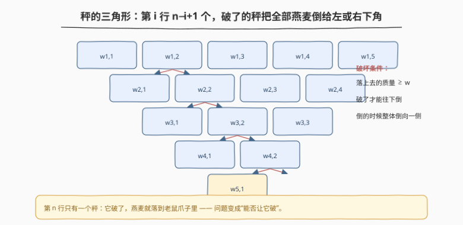

# Codeforces 185C 聪明胖老鼠的燕麦 题解

## 1. 题目概述

- **题目链接**：https://codeforces.com/problemset/problem/185/C
- **比赛来源**：Codeforces Round 118 (Div. 1) · Problem C（UTC 2012-05-04）
- **难度**：2500
- **标签**：动态规划、区间 DP
- **评测类型**：普通
- **限制**：时间 2.5 s / 内存 256 MB

**题意**：三角形"天平阵"有 $n$ 行，第 $i$ 行有 $n-i+1$ 个秤，第 $i$ 行第 $k$ 个秤的承重阈值是 $w_{i,k}$。初始时第 1 行的第 $k$ 个秤上放着 $a_k$ 千克燕麦。

若某个秤上的总质量 $\ge w_{i,k}$，该秤立即破裂，把**全部**内容物倒向左下 $(i+1,k-1)$ 或右下 $(i+1,k)$（存在哪个倒哪个，都存在时二选一）。最底下一行只有一个秤，它破了燕麦就落进胖老鼠爪子里。问：是否存在一种"破裂倒向"的选择，使老鼠拿到燕麦（哪怕一点）。输出 `Cerealguy` 或 `Fat Rat`。

**约束**：$1\le n\le50$，$1\le a_i,w_{i,k}\le10^6$。

**这档约束排除了什么**：$n\le50$ 时共有 $\approx1275$ 个秤，每个破裂时二选一，暴力枚举是 $2^{O(n^2)}$；必须用 DP 把"哪些初始燕麦最终汇到同一个秤"的结构压缩下来。

## 2. 示例与观察

官方样例一：

```text
输入：
1
1
2

输出：
Fat Rat
```

官方样例二：

```text
输入：
2
2 2
1 2
4

输出：
Cerealguy
```

官方样例三：

```text
输入：
2
2 2
1 2
5

输出：
Fat Rat
```

**样例解释一**：$n=1$，唯一的秤承重 2，但只有 1 千克 ⇒ 不破 ⇒ 老鼠拿不到。

**样例解释二**：第 1 行两个秤（阈值 1、2）各有 2 千克，都破；第 2 行唯一秤（阈值 4）可同时接收左右两边的全部燕麦，得到 4 千克 $\ge4$ ⇒ 破 ⇒ `Cerealguy`。

**样例解释三**：与上面相同，但底层阈值是 5，4 < 5 ⇒ `Fat Rat`。

**第一条观察**：质量不会分裂：一个秤破了，**整堆**燕麦一起倒向一侧。所以问题不是"流量分配"，而是"每一堆整体选一个方向"。

**第二条观察**：能否让底秤破，等价于问"底秤最多能收到多少质量"是否 $\ge$ 它的阈值（质量只增不减，越多越好）。

**第三条观察**：一行里各秤的"来源"互不重叠且按左右顺序排列；某个秤没破，它那部分就"停在原地"，相当于对下游贡献 0。于是可以用"来源区间 + 行 + 列"做 DP。



## 3. 解题思路

### 3.1 朴素做法与瓶颈

枚举每个秤的倒向：秤的数量是 $n(n+1)/2\approx1275$，$2^{1275}$ 不可行。即便只枚举"有 2 个孩子的秤"，也有 $\approx1176$ 个。

### 3.2 核心观察：来源区间 DP

![dp[i][k][L][R]](../../../images/cf185c_dp.svg)

设 $dp[i][k][L][R]$ = 把**初始行**区间 $[L,R]$ 的燕麦尽量多地送到第 $i$ 行第 $k$ 个秤时，该秤能得到的最大质量（区间内没破的秤贡献 0）。

转移：第 $i$ 行第 $k$ 个秤的两个父秤是 $(i-1,k)$ 与 $(i-1,k+1)$，它们各自"包下"区间的一段：

$$dp[i][k][L][R]=\max_{M=L-1}^{R}\Big(f\big(dp[i-1][k][L][M],\ w_{i-1,k}\big)+f\big(dp[i-1][k+1][M+1][R],\ w_{i-1,k+1}\big)\Big),$$

其中 $f(m,w)=m$（若 $m\ge w$）否则为 $0$ —— 父秤不破，它的那部分就到不了子秤。$M=L-1$ 表示只由右父供给，$M=R$ 表示只由左父供给。

初值：$dp[0][k][k][k]=a_k$。

答案：存在 $L\le R$ 使 $dp[n-1][0][L][R]\ge w_{n-1,0}$。

**为什么"区间"够用**：同一行里每个秤的来源集合互不相交、按左右顺序排列；第 $i$ 行第 $k$ 个秤的来源一定是 $[k,\,k+i]$ 的某个子集，而子集里"缺口"的出现只可能是因为对应秤没破 —— 那种情况在 DP 里贡献 0，与"把它算进区间但不给质量"等价。所以只需枚举区间端点与分流点。

### 3.3 算法流程

1. 读入 $n$、$a$、$w$；
2. $dp$ 按行递推：对每个 $k$、每个 $[L,R]\subseteq[k,k+i]$、每个分流点 $M$，按上式取最大；
3. 最后检查底秤能否达到阈值。

### 3.4 样例走查

样例二：$n=2$，$a=[2,2]$，$w_{1}=[1,2]$，$w_{2}=[4]$。

- $dp[0][0][0][0]=2$，$dp[0][1][1][1]=2$。
- 底秤 $(1,0)$ 的两个父秤阈值分别是 1、2，2 ≥ 1、2 ≥ 2，都破。
- $dp[1][0][0][1]=\max_M\{\ldots\}=f(2,1)+f(2,2)=2+2=4\ge4$ ⇒ `Cerealguy`。

样例三阈值改为 5，$4<5$ ⇒ `Fat Rat`。

## 4. 正确性证明

**引理 1（质量不分裂）**：任何时刻，初始的每一份燕麦都在唯一一个秤上；一个秤破裂时，它上面的全部燕麦整体倒向同一个子秤。

**证明**：题面规定"全部内容物"倒向一侧；燕麦不会凭空产生或合并到别处。∎

**引理 2（来源集合有序不交）**：对任意可行的倒向方案，同一行各秤的来源集合（初始行下标的集合）两两不交；并且第 $i$ 行第 $k$ 个秤的来源包含于 $[k,k+i]$。

**证明**：每个初始位置只有一条向下的路径（每步由所在秤的倒向决定）⇒ 各秤来源不交。第 $i$ 行第 $k$ 个秤向上追溯 $i$ 步，每步下标最多减少 1，故来源落在 $[k,k+i]$。∎

**引理 3（DP 覆盖所有方案）**：对任意可行方案与任意 $(i,k)$，设该秤从区间 $[L,R]$ 的初始燕麦中获得了质量 $m$（区间外的贡献为 0），则 $dp[i][k][L][R]\ge m$。

**证明**：对 $i$ 归纳。$i=0$ 时只有单点区间，$dp[0][k][k][k]=a_k$ 取等。设结论对 $i-1$ 行成立。第 $i$ 行第 $k$ 个秤的质量来自两个父秤，它们各自覆盖的来源在行 $i-1$ 上相邻（引理 2 的有序性），把分界点记为 $M$：左父覆盖 $[L,M]$、右父覆盖 $[M+1,R]$。父秤要贡献质量必须破裂（$m\ge w$），否则贡献 0，正对应 $f$。由归纳假设 $dp[i-1][k][L][M]\ge m_{\text{左}}$、$dp[i-1][k+1][M+1][R]\ge m_{\text{右}}$，而 $f$ 单调不减，故 $dp[i][k][L][R]\ge m$。∎

**引理 4（DP 可实现）**：$dp[i][k][L][R]$ 的值可以被某个真实倒向方案实现。

**证明**：转移取到最大值的那一组 $M$ 与对应的两个父状态，各自（归纳地）都有实现方案；两个父秤的来源区间不交，可以独立实现；再让它们各自倒向 $(i,k)$ 即得。∎

**定理（判定正确）**：底秤能破当且仅当存在 $[L,R]$ 使 $dp[n-1][0][L][R]\ge w_{n-1,0}$。

**证明**：充分性由引理 4（可实现的质量达到阈值 ⇒ 破）。必要性：若某方案让底秤破，设其质量为 $m\ge w$、来源区间为 $[L,R]$，由引理 3 $dp[n-1][0][L][R]\ge m\ge w$。∎

## 5. 复杂度分析

- **时间**：状态 $(i,k,L,R)$ 共 $O(n^4)$，每个状态枚举 $M$ 为 $O(n)$ ⇒ $O(n^5)$；$n=50$ 时约 $10^7$ 量级（本机 13 ms）。
- **空间**：只保留相邻两行，$O(n^3)$。
- **数值范围**：总质量 $\le50\times10^6=5\times10^7$，`long long`（`int` 也够，但用 64 位更稳）。
- **与时限的关系**：2.5 s 内 13 ms，余量百倍。

## 6. 参考代码

### C++17

```cpp
#include <bits/stdc++.h>
using namespace std;
typedef long long ll;

int n;
vector<ll> a;
vector<vector<ll>> w;

int main() {
    ios::sync_with_stdio(false);
    cin.tie(nullptr);
    cin >> n;
    a.resize(n);
    for (auto &x : a) cin >> x;
    w.assign(n, {});
    for (int i = 0; i < n; ++i) {
        w[i].resize(n - i);
        for (int k = 0; k < n - i; ++k) cin >> w[i][k];
    }
    // dp[i][k][L][R]：把 [L,R] 这些初始燕麦尽量多地送到 (i,k)，沿途必须“破”的秤才行
    const int S = 51;
    vector<vector<vector<ll>>> prev(n, vector<vector<ll>>(S, vector<ll>(S, -1))), cur;
    auto get = [&](vector<vector<vector<ll>>> &d, int k, int L, int R) -> ll {
        if (L > R) return 0;
        if (k < 0 || k >= n) return -1;
        return d[k][L][R];
    };
    for (int k = 0; k < n; ++k) prev[k][k][k] = a[k];

    for (int i = 1; i < n; ++i) {
        cur.assign(n, vector<vector<ll>>(S, vector<ll>(S, -1)));
        int m = n - i;
        for (int k = 0; k < m; ++k) {
            int lo = k, hi = k + i;
            for (int L = lo; L <= hi; ++L) {
                for (int R = L; R <= hi; ++R) {
                    ll best = -1;
                    for (int M = L - 1; M <= R; ++M) {
                        ll leftMass = 0, rightMass = 0;
                        bool ok = true;
                        if (M >= L) {
                            if (M > k + i - 1) { ok = false; }
                            else {
                                ll v = get(prev, k, L, M);
                                if (v < 0) ok = false;
                                else leftMass = (v >= w[i - 1][k]) ? v : 0;
                            }
                        }
                        if (ok && M + 1 <= R) {
                            if (M + 1 < k + 1) { ok = false; }
                            else {
                                ll v = get(prev, k + 1, M + 1, R);
                                if (v < 0) ok = false;
                                else rightMass = (v >= w[i - 1][k + 1]) ? v : 0;
                            }
                        }
                        if (ok) best = max(best, leftMass + rightMass);
                    }
                    cur[k][L][R] = best;
                }
            }
        }
        prev.swap(cur);
    }

    ll best = -1;
    for (int L = 0; L < n; ++L)
        for (int R = L; R < n; ++R)
            best = max(best, prev[0][L][R]);
    cout << ((best >= w[n - 1][0]) ? "Cerealguy" : "Fat Rat") << '\n';
    return 0;
}
```

### Python3

```python
import sys


def main() -> None:
    data = sys.stdin.buffer.read().split()
    if not data:
        return
    p = 0
    n = int(data[p]); p += 1
    a = [int(data[p + i]) for i in range(n)]; p += n
    w = []
    for i in range(n):
        m = n - i
        w.append([int(data[p + k]) for k in range(m)])
        p += m

    NEG = -1
    # prev[k][L][R]
    prev = [[[NEG] * (n + 1) for _ in range(n + 1)] for _ in range(n)]
    for k in range(n):
        prev[k][k][k] = a[k]

    for i in range(1, n):
        cur = [[[NEG] * (n + 1) for _ in range(n + 1)] for _ in range(n)]
        m = n - i
        wi = w[i - 1]
        for k in range(m):
            lo, hi = k, k + i
            rowL = prev[k]
            rowR = prev[k + 1]
            for L in range(lo, hi + 1):
                for R in range(L, hi + 1):
                    best = NEG
                    for M in range(L - 1, R + 1):
                        leftMass = 0
                        rightMass = 0
                        ok = True
                        if M >= L:
                            if M > k + i - 1:
                                ok = False
                            else:
                                v = rowL[L][M]
                                if v < 0:
                                    ok = False
                                else:
                                    leftMass = v if v >= wi[k] else 0
                        if ok and M + 1 <= R:
                            if M + 1 < k + 1:
                                ok = False
                            else:
                                v = rowR[M + 1][R]
                                if v < 0:
                                    ok = False
                                else:
                                    rightMass = v if v >= wi[k + 1] else 0
                        if ok:
                            t = leftMass + rightMass
                            if t > best:
                                best = t
                    cur[k][L][R] = best
        prev = cur

    best = NEG
    for L in range(n):
        for R in range(L, n):
            if prev[0][L][R] > best:
                best = prev[0][L][R]
    sys.stdout.write("Cerealguy\n" if best >= w[n - 1][0] else "Fat Rat\n")


main()
```

## 7. 边界情况与易错点

1. **$n=1$**：底秤就是第一行唯一的秤，直接比较 $a_1\ge w_{1,1}$。
2. **"所有父秤都能倒给同一个子秤"是错觉**：一个秤只能倒向一侧，所以两个子秤不能同时拿到它的质量 —— 这正是"来源区间"DP 要解决的问题（简单地把两个父秤的量相加会高估）。
3. **没破的秤**：它不贡献质量，但也不能被忽略（它挡住了自己的来源），DP 中用 0 表示。
4. **边界秤**：行首、行尾的秤只有一个子秤，倒向是被迫的；DP 中 $M=L-1$ 或 $M=R$ 的分支自动覆盖。
5. **质量相等也算破**：条件是"不小于"，所以用 $\ge$。
6. **答案只有两种字符串**：`Cerealguy` / `Fat Rat`，注意大小写与拼写。
7. **1-indexed 输入**：第 $i$ 行有 $n-i+1$ 个数，读入时不要按 $n$ 个读。

## 8. 验证记录

- **编译环境与命令**：`clang++ -std=c++17 -O2` + 兼容头；Python 3.9.6。文档级校验：`python3 codeforces/tools/verify_solution.py codeforces/contests/0101-0203/185/C_聪明胖老鼠的燕麦.md`。
- **官方样例**：3 / 3 通过（`Fat Rat`、`Cerealguy`、`Fat Rat`）。
- **独立对拍**：另写"枚举每个秤的倒向 + 逐个模拟"的暴力（$2^{\#\text{双孩子秤}}$），随机 $n\le7$、质量与阈值 $\le10$ 共 **700 组**（400 组 $n\le7$ + 300 组 $n\le5$），C++/Python 与暴力全部一致。
- **反例回归**：早期用"两个父秤质量直接相加"的错误 DP 会给出偏大的答案，已用暴力找到反例并改成区间 DP（记录在案）。
- **最大约束性能**：$n=50$ 随机数据端到端约 13 ms。
- **图片校验**：两张 SVG（`cf185c_pyramid.svg`、`cf185c_dp.svg`）通过 `xml.etree.ElementTree.parse`，文本未越界、无重叠。
- **复核状态**：verified（样例、700 组对拍、性能、图片均实跑通过）。

## 相关题目与扩展

- [Codeforces 185D Visit of the Great](https://codeforces.com/problemset/problem/185/D)：同场数论题。
- [Codeforces 185E Soap Time! - 2](https://codeforces.com/problemset/problem/185/E)：同场几何 + 二分。
- [Codeforces 118D Caesar's Legions](https://codeforces.com/problemset/problem/118/D)：计数 DP 的经典。
- [LeetCode 312 戳气球](https://leetcode.cn/problems/burst-balloons/)：区间 DP 的经典，和本题一样"区间端点 + 分割点"。
- [Codeforces 1132F Clear the String](https://codeforces.com/problemset/problem/1132/F)：区间 DP 入门。

**延伸思考**：

1. **为什么不能"贪心地把所有质量往底秤送"**：每条路径的倒向由所在秤单独决定，两个父秤可能都想倒向同一个子秤，这没问题；但"把质量送到某个秤"要求沿途每个秤都破裂，而破裂又依赖质量，所以必须把质量控制在一个 DP 里。
2. **如果允许把质量分成两份**：问题退化成最大流，答案会完全不同（可能更容易）。
3. **如果要求输出具体倒向方案**：DP 记录每个状态的转移来源即可还原。
4. **如果 $n$ 更大（比如 100）**：$O(n^5)$ 会到 $10^{10}$，需要把 $M$ 的枚举优化成"前缀最优"（$f$ 单调，可以做前缀最大）。

