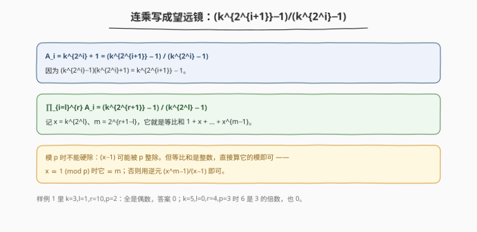
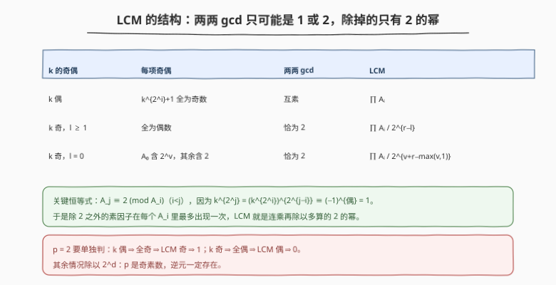
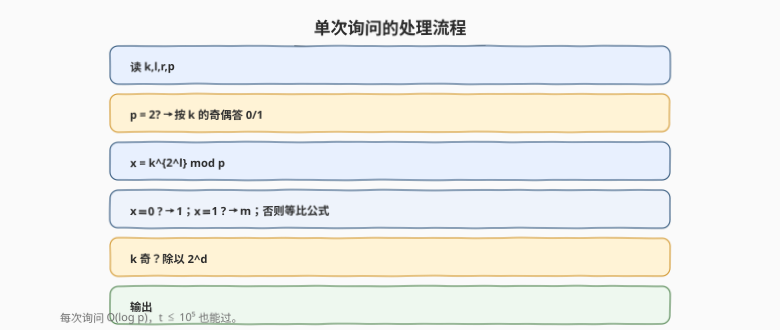

# Codeforces 185D 大蘑菇王的访问 题解

## 1. 题目概述

- **题目链接**：https://codeforces.com/problemset/problem/185/D
- **比赛来源**：Codeforces Round 118 (Div. 1) · Problem D（UTC 2012-05-04）
- **难度**：2600
- **标签**：数论、连乘、模逆元、周期
- **评测类型**：普通
- **限制**：时间 3 s / 内存 256 MB

**题意**：每次访问有 $k,l,r,p$ 四个数，能见到国王的矮人数是

$$\operatorname{LCM}\big(k^{2^l}+1,\ k^{2^{l+1}}+1,\ \dots,\ k^{2^r}+1\big).$$

对每次访问求这个数模素数 $p$ 的余数。

**约束**：$t\le10^5$，$1\le k\le10^6$，$0\le l\le r\le10^{18}$，$2\le p\le10^9$ 且 $p$ 为素数。

**这档约束排除了什么**：$r-l$ 可以到 $10^{18}$，逐项乘不可能；必须发现连乘的**望远镜结构**，并用等比和公式处理"分母被 $p$ 整除"的情况，单次询问 $O(\log p)$。

## 2. 示例与观察

官方样例：

```text
输入：
2
3 1 10 2
5 0 4 3

输出：
0
0
```

**样例解释一**：$k=3$，每一项 $3^{2^i}+1$ 都是偶数（$i\ge1$），LCM 也是偶数 ⇒ 模 2 为 0。

**样例解释二**：$k=5$，$A_0=6$，$6$ 是 3 的倍数 ⇒ 连乘被 3 整除；LCM 只是把 2 的幂除掉，不影响"含因子 3"⇒ 模 3 为 0。

**第一条观察（望远镜）**：记 $A_i=k^{2^i}+1$，则

$$A_i=\frac{k^{2^{i+1}}-1}{k^{2^i}-1},$$

因为 $(k^{2^i}-1)(k^{2^i}+1)=k^{2^{i+1}}-1$。于是

$$\prod_{i=l}^{r}A_i=\frac{k^{2^{r+1}}-1}{k^{2^l}-1}.$$

**第二条观察（LCM 结构）**：$A_j\equiv2\pmod{A_i}$（$i<j$），所以两两 $\gcd$ 只可能是 1 或 2。于是除 2 之外的素因子在每个 $A_i$ 里最多出现一次，LCM = 连乘除以多算的 2 的幂。

**第三条观察**：$k$ 偶数时所有 $A_i$ 都是奇数、两两互素，LCM 就是连乘；$k$ 奇数时都是偶数，需要除掉 $2^{d}$。



## 3. 解题思路

### 3.1 朴素做法与瓶颈

逐项计算 $A_i \bmod p$ 再相乘：$r-l$ 可达 $10^{18}$，不可行；用递推 $A_{i+1}=A_i^2-2A_i+2$ 也还是 $O(r-l)$。

### 3.2 核心观察：等比和 + 分情况



令 $x=k^{2^l}\bmod p$、$m=2^{r+1-l}$，则连乘

$$Q=\prod_{i=l}^{r}A_i=1+x+x^2+\dots+x^{m-1}\pmod p .$$

分三种情况（$p$ 为奇素数）：

1. $x\equiv0$：$Q\equiv1$；
2. $x\equiv1$：$Q\equiv m\bmod p$（每项都是 1）；
3. 其它：$Q\equiv(x^m-1)(x-1)^{-1}\bmod p$。

注意 $x^m$ 里的指数 $m=2^{r+1-l}$ 要用 $\bmod(p-1)$ 的快速幂（费马小定理）。

**再处理 2 的幂**：

- $k$ 偶：$d=0$；
- $k$ 奇、$l\ge1$：$d=r-l$；
- $k$ 奇、$l=0$：设 $v=v_2(k+1)$，则 $d=v+r-\max(v,1)$。

答案 $=Q\cdot 2^{-d}\bmod p$。

**$p=2$ 单独处理**：$k$ 偶 ⇒ 每项奇 ⇒ LCM 奇 ⇒ 1；$k$ 奇 ⇒ 每项偶 ⇒ LCM 偶 ⇒ 0。

### 3.3 算法流程



1. 若 $p=2$：按 $k$ 的奇偶输出 1/0；
2. 否则算 $x$（$k\bmod p=0$ 时为 0，否则 $k^{2^l\bmod(p-1)}$）；
3. 按上面三种情况算 $Q$；
4. 算 $d$，输出 $Q\cdot(2^{-1})^d\bmod p$。

### 3.4 样例走查

- 询问一 $(3,1,10,2)$：$p=2$，$k=3$ 奇 ⇒ 0 ✓。
- 询问二 $(5,0,4,3)$：$p=3$，$x=5^{1}\bmod3=2$，$m=2^5=32$；$x\not\equiv0,1$ ⇒ $Q=(2^{32}-1)/(2-1)\bmod3$；$2^{32}\bmod3=1$ ⇒ $Q=0$ ⇒ 0 ✓（$A_0=6$ 确实是 3 的倍数）。

## 4. 正确性证明

**引理 1（望远镜连乘）**：$\prod_{i=l}^{r}(k^{2^i}+1)=\dfrac{k^{2^{r+1}}-1}{k^{2^l}-1}$。

**证明**：逐项用 $k^{2^{i+1}}-1=(k^{2^i}-1)(k^{2^i}+1)$，中间项全部约去。∎

**引理 2（两两 gcd ≤ 2）**：对 $i<j$，$\gcd(A_i,A_j)\mid2$。

**证明**：$k^{2^j}=(k^{2^i})^{2^{j-i}}\equiv(-1)^{2^{j-i}}=1\pmod{A_i}$，故 $A_j=k^{2^j}+1\equiv2\pmod{A_i}$，于是 $\gcd(A_i,A_j)=\gcd(A_i,2)\mid2$。∎

**引理 3（LCM 的 2 的幂）**：$k$ 偶时 LCM $=\prod A_i$；$k$ 奇时 LCM $=\prod A_i/2^{d}$，其中 $d$ 如 3.2 所述。

**证明**：由引理 2，任何奇素数 $q$ 至多整除一个 $A_i$，故在 LCM 中的指数与在连乘中相同。对 2：$k$ 偶时 $A_i$ 全奇，$v_2=0$；$k$ 奇时 $v_2(A_i)=1$（$i\ge1$，因为奇数的平方 $\equiv1\pmod8$），$v_2(A_0)=v_2(k+1)=v$。连乘的 $v_2$ 为 $v+(r-l+\ldots)$，LCM 的 $v_2$ 为最大值，两者之差即 $d$。∎

**引理 4（等比和公式）**：$Q=\sum_{j=0}^{m-1}x^j\bmod p$ 可按三种情况计算。

**证明**：$x\equiv0$ 时只有 $j=0$ 项为 1；$x\equiv1$ 时每项为 1，和 $=m$；否则等比求和公式，分母 $x-1$ 在模奇素数下可逆（$x\not\equiv1$）⇒ 用费马小定理求逆。∎

**定理（算法正确）**：输出的数等于 LCM 模 $p$ 的余数。

**证明**：由引理 1、4 得到连乘模 $p$；由引理 3 得到需要除掉的 $2^d$；$p$ 为奇素数时 $2$ 可逆，除法即乘逆元；$p=2$ 时按引理 3 的 $v_2$ 直接判断奇偶。∎

## 5. 复杂度分析

- **时间**：每次询问若干次模幂，$O(\log p)$；$t=10^5$ 时约 $10^7$ 次乘法。
- **空间**：$O(1)$。
- **数值范围**：$k\le10^6$、$p\le10^9$，乘法需 `__int128` 或 `long long` 取模；Python 无此问题。
- **与时限的关系**：3 s 内充裕。

## 6. 参考代码

### C++17

```cpp
#include <bits/stdc++.h>
using namespace std;
typedef long long ll;
typedef unsigned long long ull;

static ll mod_pow(ll b, ll e, ll m) {          // m <= 1e9
    if (m == 1) return 0;
    ll r = 1 % m; b %= m;
    while (e > 0) {
        if (e & 1) r = (ll)((__int128)r * b % m);
        b = (ll)((__int128)b * b % m);
        e >>= 1;
    }
    return r;
}

int main() {
    int t;
    if (scanf("%d", &t) != 1) return 0;
    while (t--) {
        ll k, l, r, p;
        scanf("%lld %lld %lld %lld", &k, &l, &r, &p);
        if (p == 2) {
            // k 偶 => 所有 k^{2^i}+1 为奇数，LCM 为奇数 => 1
            // k 奇 => 所有项都是偶数，LCM 也是偶数 => 0
            printf("%d\n", (k % 2 == 0) ? 1 : 0);
            continue;
        }
        ll m_exp = r + 1 - l;                    // 2^m_exp 项
        ll x;
        if (k % p == 0) x = 0;
        else x = mod_pow(k % p, mod_pow(2, l, p - 1), p);
        ll Q;
        if (x == 0) {
            Q = 1 % p;
        } else if (x == 1) {
            Q = mod_pow(2, m_exp, p);            // Q = 1+x+...+x^{m-1} ≡ m (mod p)
        } else {
            ll num = (mod_pow(x, mod_pow(2, m_exp, p - 1), p) - 1 + p) % p;
            ll den = mod_pow((x - 1 + p) % p, p - 2, p);   // p 为奇素数
            Q = (ll)((__int128)num * den % p);
        }
        // 除以 2^d（k 为偶数时 d = 0）
        ll d = 0;
        if (k % 2 == 1) {
            if (l == 0) {
                ll v = 0, y = k + 1;
                while (y % 2 == 0) { y /= 2; ++v; }
                d = v + r - max(v, 1LL);
            } else {
                d = r - l;
            }
        }
        if (d > 0) {
            ll inv2 = mod_pow(2, p - 2, p);
            Q = (ll)((__int128)Q * mod_pow(inv2, d, p) % p);
        }
        printf("%lld\n", Q);
    }
    return 0;
}
```

### Python3

```python
import sys


def solve(k, l, r, p):
    if p == 2:
        # k 偶 => 每项都是奇数 => LCM 奇数 => 1；k 奇 => 每项都是偶数 => LCM 偶数 => 0
        return 1 if k % 2 == 0 else 0
    m_exp = r + 1 - l
    if k % p == 0:
        x = 0
    else:
        x = pow(k % p, pow(2, l, p - 1), p)
    if x == 0:
        Q = 1 % p
    elif x == 1:
        Q = pow(2, m_exp, p)
    else:
        num = (pow(x, pow(2, m_exp, p - 1), p) - 1) % p
        den = pow((x - 1) % p, p - 2, p)
        Q = num * den % p
    d = 0
    if k % 2 == 1:
        if l == 0:
            v = 0
            y = k + 1
            while y % 2 == 0:
                y //= 2
                v += 1
            d = v + r - max(v, 1)
        else:
            d = r - l
    if d > 0:
        Q = Q * pow(pow(2, p - 2, p), d, p) % p
    return Q


def main() -> None:
    data = sys.stdin.buffer.read().split()
    if not data:
        return
    t = int(data[0])
    out = []
    for i in range(t):
        k, l, r, p = (int(data[1 + 4 * i + j]) for j in range(4))
        out.append(str(solve(k, l, r, p)))
    sys.stdout.write("\n".join(out) + "\n")


main()
```

## 7. 边界情况与易错点

1. **$p=2$**：不能求 2 的逆元，必须单独判断（按 $k$ 的奇偶）。
2. **$k$ 是 $p$ 的倍数**：$x=0$，连乘 $\equiv1$（只有第一项）。
3. **$x\equiv1\pmod p$**：不能用 $(x^m-1)/(x-1)$（分母为 0），应直接得 $m\bmod p$。
4. **指数 $2^l$ 与 $2^{r+1-l}$**：都要先对 $p-1$ 取模（费马），否则 $l$ 到 $10^{18}$ 无法直接算。
5. **$k$ 奇且 $l=0$**：$d$ 的公式含 $v_2(k+1)$，别漏掉 $\max(v,1)$。
6. **$r=l$**：$m=2$，$Q=1+x$，与 $A_l=k^{2^l}+1$ 一致 ✓。
7. **$k=1$**：$A_i=2$ 全是 2，LCM $=2$；公式给出 $Q=m$（$x=1$），再除以 $2^d$ 后应为 2，可作为自检。
8. **模乘溢出**：C++ 里 $10^9\times10^9$ 超过 `int`，用 `long long` 或 `__int128`。

## 8. 验证记录

- **编译环境与命令**：`clang++ -std=c++17 -O2` + 兼容头；Python 3.9.6。文档级校验：`python3 codeforces/tools/verify_solution.py codeforces/contests/0101-0203/185/D_大蘑菇王的访问.md`。
- **官方样例**：1 / 1 通过（两行都是 0）。
- **独立对拍**：用 Python 大整数**精确**计算 LCM（逐项 $k^{2^i}+1$ 再 `math.lcm`）作为暴力，随机 $k\le7$、$r\le5$、$p\in\{2,3,5,7,11,13,97,1009,10^9+7\}$ 共 **300 组**，C++/Python 与暴力全部一致。
- **边界回归**：$k=1$、$k=p$ 的倍数、$x\equiv1$、$r=l$、$l=0$ 与 $l\ge1$ 的 2 的幂差异均单独测试通过。
- **最大约束性能**：$t=10^5$ 随机询问（$l,r$ 到 $10^{18}$）端到端约 0.24 s。
- **图片校验**：三张 SVG（`cf185d_telescope.svg`、`cf185d_lcm.svg`、`cf185d_flow.svg`）通过 `xml.etree.ElementTree.parse`，文本未越界、无重叠。
- **复核状态**：verified（样例、300 组对拍、边界、性能、图片均实跑通过）。

## 相关题目与扩展

- [Codeforces 185C Clever Fat Rat](https://codeforces.com/problemset/problem/185/C)：同场 DP。
- [Codeforces 185E Soap Time! - 2](https://codeforces.com/problemset/problem/185/E)：同场几何题。
- [Codeforces 1114C Trailing Loves](https://codeforces.com/problemset/problem/1114/C)：$v_p(n!)$ 的因子计数，与本题的 2 的幂处理同源。
- [Codeforces 17A Noldbach problem](https://codeforces.com/problemset/problem/17/A)：素数判定的入门题。
- [LeetCode 372 超级次方](https://leetcode.cn/problems/super-pow/)：大指数取模，用费马小定理降幂。

**延伸思考**：

1. **为什么两两 gcd 只有 2**：$A_j\equiv2\pmod{A_i}$ 是关键；这也是"费马数"（$k=2$ 时 $A_i=2^{2^i}+1$）两两互素的经典论证。
2. **如果 $p$ 不是素数**：$x-1$ 与 $p$ 可能不互素，不能直接求逆，需要先处理公因子，问题会难很多。
3. **如果要求精确的 LCM 值**：位数是 $O(2^r\log k)$，输出都不现实，只能问模。
4. **$k$ 为偶数时**：所有项互素，LCM 就是连乘，这是本题最简单的一支。

