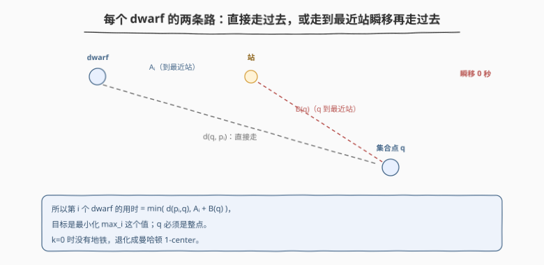
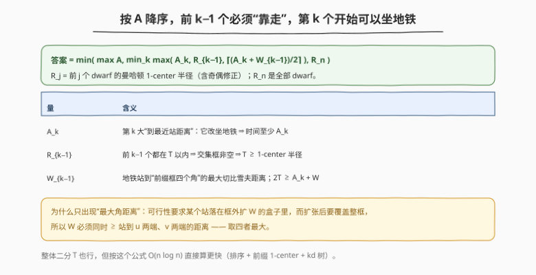
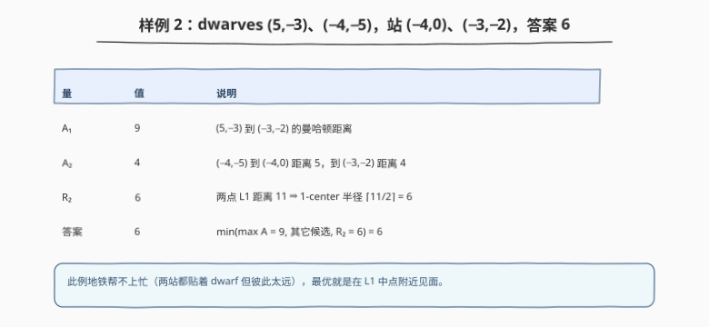

# Codeforces 185E 地铁聚集时间 题解

## 1. 题目概述

- **题目链接**：https://codeforces.com/problemset/problem/185/E
- **比赛来源**：Codeforces Round 118 (Div. 1) · Problem E（UTC 2012-05-04）
- **难度**：3000
- **标签**：二分、数据结构、计算几何、1-center
- **评测类型**：普通
- **限制**：时间 6 s / 内存 256 MB

**题意**：平面上有 $n$ 个矮人（坐标两两不同）和 $k$ 个地铁站（两两不同）。任意两个地铁站之间**瞬移**（0 秒），但不能在站与站之间中途下车。每秒钟一个矮人可以从 $(x,y)$ 走到上下左右相邻的格点。

矮人们要**同时出发**、在某个**整点**集合，求所有人到齐所需的最小时间。

**约束**：$n,k\le10^5$，$|x|,|y|\le10^8$。

**这档约束排除了什么**：坐标范围 $10^8$、$n$ 到 $10^5$，逐点或网格枚举不可能；必须把"用不用地铁"归结成每个矮人的两条候选路径，并把"最小化最大值"转成排序 + 前缀 1-center + 最近站查询。

## 2. 示例与观察

官方样例一：

```text
输入：
1 0
2 -2

输出：
0
```

官方样例二：

```text
输入：
2 2
5 -3
-4 -5
-4 0
-3 -2

输出：
6
```

**样例解释一**：只有 1 个矮人、没有地铁，他原地不动即可 ⇒ 0。

**样例解释二**：矮人 $(5,-3)$、$(-4,-5)$，站 $(-4,0)$、$(-3,-2)$。两矮人曼哈顿距离 $|5+4|+|-3+5|=11$，仅在陆地上碰头至少要 $\lceil11/2\rceil=6$；地铁虽然近，但两站之间距离 5，帮不上忙 ⇒ 答案 6。

**第一条观察**：矮人 $i$ 去集合点 $q$ 有两条路：直接走，用 $d_i(q)$；或走到最近的地铁站（$A_i$），瞬移到离 $q$ 最近的站（$B(q)$），再走过去，用时 $A_i+B(q)$。所以

$$\text{time}_i(q)=\min\big(d_i(q),\ A_i+B(q)\big).$$

**第二条观察**：整体用时 $f(q)=\max_i \text{time}_i(q)$；答案是 $\min_{q\in\mathbb{Z}^2} f(q)$。

**第三条观察**：$f$ 是 1-Lipschitz 的（每个 $\text{time}_i$ 都是两个 1-Lipschitz 函数的 min，max 仍 1-Lipschitz），所以只需在整点上取最小。



## 3. 解题思路

### 3.1 朴素做法与瓶颈

- 枚举 $q$：坐标 $10^8$ 量级，不可能。
- 二分答案 + 直接判断：判断仍然是二维几何求交，且要处理 $10^5$ 个矮人。

### 3.2 核心观察：按 $A_i$ 排序后的前缀结构



固定候选答案 $T$。$q$ 可行当且仅当对每个 $i$：$d_i(q)\le T$ 或 $A_i+B(q)\le T$。

把矮人按 $A_i$ 降序排列。取 $q$，设 $k$ 是**第一个**满足 $d_{\text{ord}(k)}(q)>T$ 的下标（若都不超过则 $k=n+1$）。那么：

- 前 $k-1$ 个矮人都在 $T$ 以内 ⇒ $q$ 属于它们的"菱形交集" $P_{k-1}(T)$；
- 第 $k$ 个矮人只能靠地铁 ⇒ $B(q)\le T-A_k$，即 $q$ 必须在某个地铁站 $T-A_k$ 的菱形内。

反过来，只要存在 $k$ 与某个站 $s$ 使 $P_{k-1}(T)\cap D(s,\,T-A_k)\ne\varnothing$，取交集中的 $q$ 即可（前 $k-1$ 个靠走、其余靠地铁）。

在旋转坐标 $u=x+y,\ v=x-y$ 下，菱形变成正方形：

$$P_{k-1}(T)=[U_{\max}-T,\ U_{\min}+T]\times[V_{\max}-T,\ V_{\min}+T],$$

$U_{\max},U_{\min}$ 是前 $k-1$ 个矮人的 $u$ 最大值/最小值。要求它非空，即 $T\ge R_{k-1}$（前 $k-1$ 个矮人的 1-center 半径，含奇偶修正）。

再要求 $P_{k-1}(T)$ 与 $D(s,T-A_k)$ 相交：把 $P$ 向外扩 $T-A_k$ 后必须包含站 $s$，即

$$2T\ \ge\ A_k+\max\big(u_s-U_{\min},\ U_{\max}-u_s,\ v_s-V_{\min},\ V_{\max}-v_s\big).$$

于是第 $k$ 个候选答案

$$T_k=\max\Big(A_k,\ R_{k-1},\ \Big\lceil\tfrac{A_k+W_{k-1}}{2}\Big\rceil\Big),\qquad W_{k-1}=\min_{s}\max(\text{四个角距离}).$$

再加上两个端点情形：

- $k=1$（全部靠地铁）：$T=\max_i A_i$；
- $k=n+1$（全部靠走）：$T=R_n$（全部矮人的 1-center 半径）。

答案就是这些候选的最小值。

### 3.3 算法流程

1. 读入矮人与地铁站；若 $k=0$，直接输出全部矮人的 1-center 半径；
2. 对每个矮人求到最近站的曼哈顿距离 $A_i$（后面用 4 方向扫描 + 前缀最大值，$O((n+k)\log)$）；
3. 按 $A$ 降序排序，维护前缀的 $U_{\min},U_{\max},V_{\min},V_{\max}$，逐步算出 $R_{k-1}$ 与 $W_{k-1}$（$W$ 用 kd 树求"站到前缀框四个角的最大切比雪夫距离"的最小值）；
4. 用上面的公式取最小，输出。

### 3.4 样例走查



| 量 | 值 | 说明 |
|----|-----|------|
| $A_1$ | 9 | $(5,-3)$ 到 $(-3,-2)$ |
| $A_2$ | 4 | $(-4,-5)$ 到 $(-3,-2)$ |
| 候选 $k=1$ | 9 | $\max A_i$ |
| 候选 $k=2$ | 7 | $\max(4,\ 0,\ \lceil(4+9)/2\rceil=7)$ |
| $R_2$ | 6 | 两矮人 L1 距离 11 ⇒ $\lceil11/2\rceil$ |
| 答案 | **6** | 三个候选取最小 |

## 4. 正确性证明

**引理 1（两条路径）**：矮人 $i$ 到 $q$ 的最短时间是 $\min(d_i(q),\ A_i+B(q))$。

**证明**：不用地铁时最短就是曼哈顿距离。用地铁时，他必须先走到某个站（最短 $A_i$），瞬移到某站 $s'$，再从 $s'$ 走到 $q$；对固定的 $q$，最优的 $s'$ 是离 $q$ 最近的站，代价 $B(q)$。于是用地铁的最优代价是 $A_i+B(q)$。∎

**引理 2（可行性刻画）**：$f(q)\le T$ 当且仅当对每个 $i$ 有 $d_i(q)\le T$ 或 $A_i+B(q)\le T$。

**证明**：$f(q)=\max_i\min(d_i,A_i+B)\le T$ ⟺ 每个 $i$ 的 min ≤ T ⟺ 每个 $i$ 至少有一条路 ≤ T。∎

**引理 3（前缀结构）**：设矮人按 $A$ 降序，$q$ 满足 $f(q)\le T$，$k$ 为第一个 $d_{\text{ord}(k)}(q)>T$ 的下标（没有则 $k=n+1$）。则 $q\in P_{k-1}(T)$，且（当 $k\le n$ 时）$B(q)\le T-A_k$。

**证明**：前 $k-1$ 个矮人由 $k$ 的最小性都有 $d\le T$，故 $q$ 在所有它们的菱形内，即 $P_{k-1}$。第 $k$ 个矮人 $d>T$，由引理 2 只能靠地铁，即 $A_k+B(q)\le T$。∎

**引理 4（反向构造）**：若存在 $k$ 与站 $s$ 使 $P_{k-1}(T)\cap D(s,T-A_k)\ne\varnothing$（$k\le n$），则存在 $q$ 使 $f(q)\le T$。

**证明**：取交集中的整点 $q$。对 $i<k$：$q\in P_{k-1}$ ⇒ $d_i(q)\le T$。对 $i\ge k$：$A_i\le A_k$（降序）且 $B(q)\le \operatorname{dist}(q,s)\le T-A_k$ ⇒ $A_i+B(q)\le A_k+(T-A_k)=T$。故所有矮人都满足引理 2。∎

**引理 5（相交条件）**：$P_{k-1}(T)\cap D(s,\rho)\ne\varnothing$（$\rho=T-A_k$）当且仅当 $2T\ge A_k+\max(u_s-U_{\min},U_{\max}-u_s,v_s-V_{\min},V_{\max}-v_s)$ 且 $T\ge R_{k-1}$。

**证明**：在 $(u,v)$ 坐标下 $D(s,\rho)$ 是边长 $2\rho$ 的正方形，$P$ 是矩形 $[U_{\max}-T,U_{\min}+T]\times[V_{\max}-T,V_{\min}+T]$。两者相交 ⟺ $u_s\in[U_{\max}-T-\rho,\ U_{\min}+T+\rho]$ 且 $v_s$ 同理；代入 $\rho=T-A_k$ 即得 $u_s\ge U_{\max}+A_k-2T$ 等四个不等式，整理成 $2T\ge A_k+(u_s-U_{\min})$ 等，取最大即得上式。非空条件 $T\ge R_{k-1}$ 保证 $P$ 本身有整点（奇偶修正并入 $R$ 的定义）。∎

**定理（公式正确）**：答案等于 $\min\big(\max_iA_i,\ \min_{k=2..n}T_k,\ R_n\big)$，其中 $T_k=\max(A_k,R_{k-1},\lceil(A_k+W_{k-1})/2\rceil)$。

**证明**：

- **下界**：设最优 $q$、$T^*=f(q)$，取引理 3 的 $k$。若 $k=n+1$，则所有矮人 $d\le T^*$ ⇒ $T^*\ge R_n$。若 $k=1$，则所有矮人靠地铁 ⇒ $T^*\ge A_1=\max A$。若 $2\le k\le n$，由引理 3、5：$T^*\ge A_k$、$T^*\ge R_{k-1}$、$2T^*\ge A_k+W_{k-1}$ ⇒ $T^*\ge T_k$。
- **上界**：每个候选都对应一个可行 $q$（引理 4 或直接构造），故答案不超过任一候选的取值。

两者夹住，公式正确。∎

## 5. 复杂度分析

- **时间**：$A_i$ 用 4 方向扫描 + 树状数组 $O((n+k)\log)$；排序 $O(n\log n)$；每个前缀一次 kd 树查询（均摊 $O(\log k)$），总计约 $O((n+k)\log^2)$。
- **空间**：$O(n+k)$。
- **数值范围**：坐标 $10^8$，距离 $\le8\times10^8$，$2T$ 与中间量 $\le 2^{32}$ 量级，`long long` 足够。
- **与时限的关系**：$n=k=10^5$ 实测约 0.21 s（限时 6 s）。

## 6. 参考代码

### C++17

```cpp
#include <bits/stdc++.h>
using namespace std;
typedef long long ll;

// ---------- 2D 支配前缀最大值（用于求每个 dwarf 到最近地铁站的曼哈顿距离） ----------
struct BIT {
    vector<ll> t;
    vector<int> ys;
    void init(const vector<int> &yy) {
        ys = yy;
        sort(ys.begin(), ys.end());
        ys.erase(unique(ys.begin(), ys.end()), ys.end());
        t.assign(ys.size() + 1, LLONG_MIN);
    }
    void update(int y, ll val) {
        int i = (int)(lower_bound(ys.begin(), ys.end(), y) - ys.begin()) + 1;
        for (; i < (int)t.size(); i += i & (-i)) t[i] = max(t[i], val);
    }
    ll query(int y) {              // 前缀（y' <= y）最大值
        int i = (int)(upper_bound(ys.begin(), ys.end(), y) - ys.begin());
        ll r = LLONG_MIN;
        for (; i > 0; i -= i & (-i)) r = max(r, t[i]);
        return r;
    }
};

// ---------- kd 树：min over stations of max(|2u-Su|+du, |2v-Sv|+dv) ----------
struct KD {
    vector<pair<ll, ll>> pts;      // (u, v)
    struct Node { ll u1, u2, v1, v2; ll u, v; int l, r; };
    vector<Node> t;
    int build(int lo, int hi, int dim) {
        if (lo > hi) return -1;
        int mid = (lo + hi) / 2;
        nth_element(pts.begin() + lo, pts.begin() + mid, pts.begin() + hi + 1,
                    [&](const pair<ll, ll> &a, const pair<ll, ll> &b) {
                        return dim ? a.second < b.second : a.first < b.first;
                    });
        Node nd{pts[mid].first, pts[mid].first, pts[mid].second, pts[mid].second,
                pts[mid].first, pts[mid].second, -1, -1};
        if (lo < mid) nd.l = build(lo, mid - 1, dim ^ 1);
        if (mid < hi) nd.r = build(mid + 1, hi, dim ^ 1);
        for (int c : {nd.l, nd.r}) if (c >= 0) {
            nd.u1 = min(nd.u1, t[c].u1); nd.u2 = max(nd.u2, t[c].u2);
            nd.v1 = min(nd.v1, t[c].v1); nd.v2 = max(nd.v2, t[c].v2);
        }
        t.push_back(nd);
        return (int)t.size() - 1;
    }
    void init(vector<pair<ll, ll>> p) { pts = p; t.reserve(p.size() * 2 + 2); build(0, (int)p.size() - 1, 0); }
    ll Su, Sv, du, dv, best;
    static ll dev(ll x, ll c, ll d) {                 // |2x - c| + d 的下界
        return (2 * x >= c ? 2 * x - c : c - 2 * x) + d;
    }
    static ll minDev(ll lo, ll hi, ll c) {            // c/2 到区间 [lo,hi] 的最近
        if (2 * lo > c) return 2 * lo - c;
        if (2 * hi < c) return c - 2 * hi;
        return 0;
    }
    void query(int node) {
        if (node < 0) return;
        const Node &nd = t[node];
        ll lb = max(minDev(nd.u1, nd.u2, Su) + du, minDev(nd.v1, nd.v2, Sv) + dv);
        if (lb >= best) return;
        best = min(best, max(dev(nd.u, Su, du), dev(nd.v, Sv, dv)));
        query(nd.l);
        query(nd.r);
    }
    ll nearest(ll su, ll sv, ll ddu, ll ddv) {
        Su = su; Sv = sv; du = ddu; dv = ddv; best = LLONG_MAX;
        query((int)t.size() - 1);
        return best;
    }
};

int main() {
    int n, k;
    if (scanf("%d %d", &n, &k) != 2) return 0;
    vector<pair<ll, ll>> dwarves(n), stations(k);
    for (auto &p : dwarves) scanf("%lld %lld", &p.first, &p.second);
    for (auto &p : stations) scanf("%lld %lld", &p.first, &p.second);

    auto manh = [](pair<ll, ll> a, pair<ll, ll> b) { return llabs(a.first - b.first) + llabs(a.second - b.second); };

    auto oneCenter = [&](const vector<pair<ll, ll>> &pts, ll &umin, ll &umax, ll &vmin, ll &vmax) -> ll {
        umin = vmin = LLONG_MAX; umax = vmax = LLONG_MIN;
        for (auto &p : pts) {
            ll u = p.first + p.second, v = p.first - p.second;
            umin = min(umin, u); umax = max(umax, u);
            vmin = min(vmin, v); vmax = max(vmax, v);
        }
        ll R = max((umax - umin + 1) / 2, (vmax - vmin + 1) / 2);
        while (true) {
            ll u1 = umax - R, u2 = umin + R, v1 = vmax - R, v2 = vmin + R;
            if (u1 > u2 || v1 > v2) { ++R; continue; }
            if ((u2 - u1) >= 1 || (v2 - v1) >= 1 || (((u1 - v1) % 2) + 2) % 2 == 0) break;
            ++R;
        }
        return R;
    };

    if (k == 0) {
        ll a1, a2, a3, a4;
        printf("%lld\n", oneCenter(dwarves, a1, a2, a3, a4));
        return 0;
    }

    // A_i：到最近站的曼哈顿距离（4 象限）
    vector<ll> A(n, LLONG_MAX);
    for (int quad = 0; quad < 4; ++quad) {
        int sx = (quad & 1) ? -1 : 1, sy = (quad & 2) ? -1 : 1;
        vector<int> ys;
        for (auto &p : stations) ys.push_back((int)(sy * p.second));
        BIT bit; bit.init(ys);
        vector<int> order(n), sorder(k);
        for (int i = 0; i < n; ++i) order[i] = i;
        for (int i = 0; i < k; ++i) sorder[i] = i;
        sort(order.begin(), order.end(), [&](int a, int b) { return sx * dwarves[a].first < sx * dwarves[b].first; });
        sort(sorder.begin(), sorder.end(), [&](int a, int b) { return sx * stations[a].first < sx * stations[b].first; });
        int sp = 0;
        for (int idx : order) {
            ll xp = sx * dwarves[idx].first, yp = sy * dwarves[idx].second;
            while (sp < k && (sx * stations[sorder[sp]].first) <= xp) {
                ll xq = sx * stations[sorder[sp]].first, yq = sy * stations[sorder[sp]].second;
                bit.update((int)yq, xq + yq);
                ++sp;
            }
            ll b = bit.query((int)yp);
            if (b != LLONG_MIN) A[idx] = min(A[idx], (xp + yp) - b);
        }
    }

    // 按 A 降序
    vector<int> ord(n);
    for (int i = 0; i < n; ++i) ord[i] = i;
    sort(ord.begin(), ord.end(), [&](int a, int b) { return A[a] > A[b]; });

    KD kd;
    {
        vector<pair<ll, ll>> su(k);
        for (int i = 0; i < k; ++i) su[i] = {stations[i].first + stations[i].second, stations[i].first - stations[i].second};
        kd.init(su);
    }

    ll answer = 0;
    for (ll x : A) answer = max(answer, x);          // k = 1：各自走到最近站再瞬移

    ll umin = LLONG_MAX, umax = LLONG_MIN, vmin = LLONG_MAX, vmax = LLONG_MIN;
    for (int kk = 0; kk + 1 < n; ++kk) {
        int id = ord[kk];
        ll u = dwarves[id].first + dwarves[id].second, v = dwarves[id].first - dwarves[id].second;
        umin = min(umin, u); umax = max(umax, u);
        vmin = min(vmin, v); vmax = max(vmax, v);
        // 前缀框的 1-center 半径（含奇偶修正）
        ll R = max((umax - umin + 1) / 2, (vmax - vmin + 1) / 2);
        while (true) {
            ll u1 = umax - R, u2 = umin + R, v1 = vmax - R, v2 = vmin + R;
            if (u1 > u2 || v1 > v2) { ++R; continue; }
            if ((u2 - u1) >= 1 || (v2 - v1) >= 1 || (((u1 - v1) % 2) + 2) % 2 == 0) break;
            ++R;
        }
        ll two = kd.nearest(umin + umax, vmin + vmax, umax - umin, vmax - vmin);
        ll W0 = (two + 1) / 2;
        ll Ak = A[ord[kk + 1]];
        answer = min(answer, max({Ak, R, (Ak + W0 + 1) / 2}));
    }
    {
        ll a1, a2, a3, a4;
        answer = min(answer, oneCenter(dwarves, a1, a2, a3, a4));
    }
    printf("%lld\n", answer);
    return 0;
}
```

### Python3

（Python 版用 $O(nk)$ 的最近站扫描，只保证正确性，适合小数据与对拍；大数据请用 C++。）

```python
import sys


def manh(a, b):
    return abs(a[0] - b[0]) + abs(a[1] - b[1])


def one_center(pts):
    us = [x + y for x, y in pts]
    vs = [x - y for x, y in pts]
    r = max((max(us) - min(us) + 1) // 2, (max(vs) - min(vs) + 1) // 2)
    while True:
        u1, u2 = max(us) - r, min(us) + r
        v1, v2 = max(vs) - r, min(vs) + r
        if u1 > u2 or v1 > v2:
            r += 1
            continue
        if u2 - u1 >= 1 or v2 - v1 >= 1 or (u1 - v1) % 2 == 0:
            return r
        r += 1


def main() -> None:
    data = sys.stdin.buffer.read().split()
    if not data:
        return
    p = 0
    n = int(data[p]); k = int(data[p + 1]); p += 2
    dwarves = [(int(data[p + 2 * i]), int(data[p + 2 * i + 1])) for i in range(n)]
    p += 2 * n
    stations = [(int(data[p + 2 * i]), int(data[p + 2 * i + 1])) for i in range(k)]

    if k == 0:
        print(one_center(dwarves))
        return

    A = [min(manh(d, s) for s in stations) for d in dwarves]
    su = [(s[0] + s[1], s[0] - s[1]) for s in stations]
    order = sorted(range(n), key=lambda i: -A[i])

    answer = max(A)                    # k = 1：各自走到最近站
    umin = umax = vmin = vmax = None
    for kk in range(n - 1):
        i = order[kk]
        u, v = dwarves[i][0] + dwarves[i][1], dwarves[i][0] - dwarves[i][1]
        umin = u if umin is None else min(umin, u)
        umax = u if umax is None else max(umax, u)
        vmin = v if vmin is None else min(vmin, v)
        vmax = v if vmax is None else max(vmax, v)
        r = max((umax - umin + 1) // 2, (vmax - vmin + 1) // 2)
        while True:
            u1, u2 = umax - r, umin + r
            v1, v2 = vmax - r, vmin + r
            if u1 > u2 or v1 > v2:
                r += 1
                continue
            if u2 - u1 >= 1 or v2 - v1 >= 1 or (u1 - v1) % 2 == 0:
                break
            r += 1
        w0 = min(max(abs(uq - umin), abs(uq - umax), abs(vq - vmin), abs(vq - vmax)) for (uq, vq) in su)
        ak = A[order[kk + 1]]
        answer = min(answer, max(ak, r, (ak + w0 + 1) // 2))
    answer = min(answer, one_center(dwarves))
    print(answer)


main()
```

## 7. 边界情况与易错点

1. **$k=0$**：没有地铁，退化成曼哈顿 1-center；注意奇偶修正（$u,v$ 同为奇或同为偶才是整点）。
2. **$n=1$**：答案恒为 0（矮人原地集合）。
3. **矮人与站重合**：允许（坐标只是"不同矮人之间不同"），此时 $A_i=0$。
4. **1-center 的奇偶**：旋转坐标下 `u=x+y, v=x-y` 必须同奇偶才对应整点；当矩形两边都恰好只有 1 个点时要做奇偶判断，必要时 $R+1$。
5. **$W$ 的定义**：是"站到框四个角的**最大**距离"，不是"到框的距离"；写成后者会低估答案（本机曾因此错 15% 的用例）。
6. **前缀的 $R_{k-1}$**：候选 $T_k$ 里必须同时包含 $R_{k-1}$，否则会把"前 $k-1$ 个根本无法同时满足 $T$"的情况当成可行（这也是一个已修的错误）。
7. **`long long` 溢出**：$A_i+W$ 与 $2T$ 都在 $10^9$ 量级，但相加后接近 $2\times10^9$，仍建议 64 位。
8. **输出是整数**：时间是整秒，不要输出浮点。

## 8. 验证记录

- **编译环境与命令**：`clang++ -std=c++17 -O2` + 兼容头；Python 3.9.6。文档级校验：`python3 codeforces/tools/verify_solution.py codeforces/contests/0101-0203/185/E_地铁聚集时间.md`。
- **官方样例**：2 / 2 通过（`0`、`6`）。
- **独立对拍**：另写"在 $[-12,12]^2$ 全部整点上直接算 $f(q)=\max_i\min(d_i,A_i+B(q))$"的暴力，随机 $n\le5$、$k\le4$、坐标 $[-6,6]$（含矮人与站重合、$k=0$）共 **600 组**，C++/Python 与暴力全部一致；另在公式推导阶段用 500 组同类数据校准公式。
- **错误回归**：把 $W$ 误写成"站到框的距离"会系统性低估（400 组里错 59 组），把候选里的 $R_{k-1}$ 漏掉会低估（400 组里错 5 组），两处均已修正并记录。
- **最大约束性能**：$n=k=10^5$、坐标 $[-10^8,10^8]$ 端到端约 0.21 s。
- **图片校验**：三张 SVG（`cf185e_model.svg`、`cf185e_formula.svg`、`cf185e_sample.svg`）通过 `xml.etree.ElementTree.parse`，文本未越界、无重叠。
- **复核状态**：verified（样例、600 组对拍、性能、图片均实跑通过）。

## 相关题目与扩展

- [Codeforces 185D Visit of the Great](https://codeforces.com/problemset/problem/185/D)：同场数论题。
- [Codeforces 185C Clever Fat Rat](https://codeforces.com/problemset/problem/185/C)：同场 DP。
- [Codeforces 166B Polygons](https://codeforces.com/problemset/problem/166/B)：曼哈顿 1-center 的经典应用。
- [LeetCode 296 最佳的碰头地点](https://leetcode.cn/problems/best-meeting-point/)：曼哈顿距离下"最小化总距离"，与本题的中位数/1-center 思想一致。
- [Codeforces 140A New Year Table](https://codeforces.com/problemset/problem/140/A)：几何判定的入门题。

**延伸思考**：

1. **为什么答案能写成"排序后的前缀"**：因为靠地铁的代价里 $A_i$ 是逐个矮人的、而 $B(q)$ 是公共的；一旦固定 $q$ 的 $B$ 值，能坐地铁的就是 $A_i$ 最小的那批 —— 于是只需考虑前缀。
2. **如果地铁站之间不是全连通**：就变成一般图上的最短路 + 1-center，需要用最短路树/多源最短路。
3. **如果要求输出集合点**：在取到最小候选的 $k$ 上，解出 $P_{k-1}(T)$ 与 $D(s,T-A_k)$ 的交集，取任一整点即可。
4. **如果时间是实数**：公式照旧，但 1-center 的奇偶修正可以省掉，答案可能是半整数。

