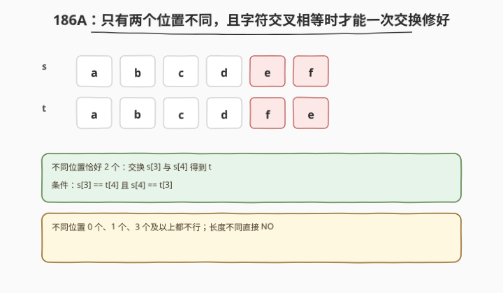
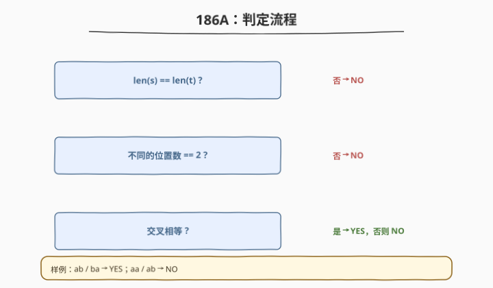

# Codeforces 186A 基因交换判定 题解

## 1. 题目概述

- **题目链接**：https://codeforces.com/problemset/problem/186/A
- **比赛来源**：Codeforces Round 118 (Div. 2) · Problem A（UTC 2012-05-04）
- **难度**：1100
- **标签**：字符串、枚举、分类讨论
- **评测类型**：普通
- **限制**：时间 2 s / 内存 256 MB

**题意**：给出两个小写字母串 $s$ 与 $t$（长度可以不同，且保证两串不同）。问能否**恰好交换一次** $s$ 中的两个字符（选择两个不同位置交换），使得 $s$ 变成 $t$。

**约束**（原样摘自题面 `inputFormat.en`）：

- 两行各一个非空字符串，只含小写拉丁字母，长度不超过 $10^5$。
- 保证两个串不同；长度可能不同。
- 输出 `YES` 或 `NO`。

**约束对算法的限制**：

- 长度 $10^5$：$O(n)$ 扫描即可，$O(n^2)$ 枚举交换对（$10^{10}$）不行。
- 只需比较字符，无需哈希或其它数据结构。
- 注意「恰好交换一次」：即使两串相同也不一定算（题目保证不同，不用纠结）。

## 2. 示例与观察

官方样例 1（输入 / 输出原样）：

```text
输入：
ab
ba

输出：
YES
```

官方样例 2（输入 / 输出原样）：

```text
输入：
aa
ab

输出：
NO
```

**样例 1**：交换 `a` 与 `b` 即可。

**样例 2**：长度相同但只有 1 个位置不同，交换任意两个位置都只能让不同位置变成 2 个或保持 1 个，无法变成 `ab`。

**观察 1**：交换两个位置只会改变这两个位置上的字符，其余位置不变。因此若 $s$ 与 $t$ 有 3 个及以上位置不同，一次交换不可能修好。

**观察 2**：恰好 1 个位置不同也不可能（交换会同时影响两个位置）。

**观察 3**：恰好 2 个位置 $i<j$ 不同时，唯一可行的交换就是交换 $s[i]$ 与 $s[j]$，要求 $s[i]=t[j]$ 且 $s[j]=t[i]$（交叉相等）。

**观察 4**：长度不同直接 `NO`。

**自造样例**（标注「自造」，输出由程序实测）：

| 输入 | 输出 | 说明 |
|------|------|------|
| `ab` / `ba` | YES | 交叉相等 |
| `abc` / `acb` | YES | 交换 b、c |
| `abcd` / `badc` | NO | 4 个位置不同 |
| `abc` / `abc` | — | 题面保证两串不同，不会出现 |

## 3. 解题思路

### 3.1 朴素做法与瓶颈

枚举所有交换对 $(i,j)$，交换后与 $t$ 比较：$O(n^3)$，$10^5$ 时是 $10^{15}$，不可行。

### 3.2 核心观察：只看不同的位置



扫描一遍，收集所有 $s[i]\ne t[i]$ 的位置：

- 若数量不是 2，直接 `NO`；
- 若恰为 2（记作 $i<j$），检查 $s[i]=t[j]$ 且 $s[j]=t[i]$，成立则 `YES`，否则 `NO`。

### 3.3 判定流程



1. 长度不同 → `NO`；
2. 统计不同位置个数（超过 2 个可以提前退出）；
3. 恰好 2 个且交叉相等 → `YES`，否则 `NO`。

## 4. 正确性证明

**引理 1**：一次交换只改变两个位置上的字符，且这两个位置的字符互换。

**证明**：交换 $s[i]$ 与 $s[j]$ 后，只有 $i,j$ 两个位置变化，其余字符保持原位。∎

**引理 2**：若 $s$ 与 $t$ 恰有 2 个位置 $i<j$ 不同，则 $s$ 能通过一次交换变成 $t$ 当且仅当 $s[i]=t[j]$ 且 $s[j]=t[i]$。

**证明**：要修好这两个位置，必须交换 $i$ 与 $j$（交换其它位置不会同时修正 $i,j$），交换后要求 $t[i]=s[j]$、$t[j]=s[i]$，即交叉相等。∎

**定理**：算法输出的判定正确。

**证明**：若不同位置数 $\ne2$，由引理 1，交换后最多修正 2 个位置、且至少改变 2 个位置，无法得到 $t$（$0$ 或 $1$ 个不同也不行，因为交换必然改变两个不同的位置；$\ge3$ 个不同一次交换不够）；若恰为 2，由引理 2 判定。∎

## 5. 复杂度分析

- **时间**：$O(n)$。
- **空间**：$O(n)$（存两个串与至多 2 个不同位置）。
- **数值范围**：与数值无关。
- **与时限的关系**：2 s 对 $10^5$ 次比较余量在千倍以上。实测 $n=10^5$ 端到端约 31 ms。

## 6. 参考代码

### C++17

```cpp
#include <bits/stdc++.h>
using namespace std;

// 186A：两串长度相等、恰有 2 个位置不同，且这两个位置交叉相等 → 交换一次即可
int main() {
    string a, b;
    if (!(cin >> a)) return 0;
    cin >> b;
    if (a.size() != b.size()) { printf("NO\n"); return 0; }
    vector<int> dif;
    for (int i = 0; i < (int)a.size() && dif.size() <= 2; ++i)
        if (a[i] != b[i]) dif.push_back(i);
    bool ok = dif.size() == 2 && a[dif[0]] == b[dif[1]] && a[dif[1]] == b[dif[0]];
    printf(ok ? "YES\n" : "NO\n");
    return 0;
}
```

### Python3

```python
import sys


def main() -> None:
    data = sys.stdin.buffer.read().split()
    a = data[0]
    b = data[1]
    if len(a) != len(b):
        sys.stdout.write("NO\n")
        return
    dif = [i for i in range(len(a)) if a[i] != b[i]]
    ok = len(dif) == 2 and a[dif[0]] == b[dif[1]] and a[dif[1]] == b[dif[0]]
    sys.stdout.write("YES\n" if ok else "NO\n")


main()
```

## 7. 边界情况与易错点

1. **长度不同**：直接 `NO`（题面允许不同长度）。
2. **不同位置数 $\ge3$**：`NO`；扫描时可以在超过 2 个时提前退出。
3. **不同位置数 $=1$**：`NO`。
4. **不同位置数 $=0$**：题面保证两串不同，不会出现；若强行出现，代码会输出 `NO`（严格按「恰好交换两个不同位置」）。
5. **交叉相等**：必须两个条件都满足，别只写一个。
6. **下标**：`dif` 的大小为 2 时才能安全访问 `dif[0]`、`dif[1]`，先判断再访问。
7. **字符比较**：区分大小写（本题只含小写）。
8. **读入**：两行字符串，用 `cin >>` 或 `split()` 均可（不含空格）。
9. **输出大小写**：`YES`/`NO` 全大写。

## 8. 验证记录

- **编译环境与命令**：`Apple clang 21.0.0`（`/usr/bin/g++` 是 clang 软链，无 GNU libstdc++），`clang++ -std=c++17 -O2 -Wall` 加仓库自带 `bits/stdc++.h`；正文代码仍写标准头。Python 为 `3.9.6`。验证命令：
  `python3 codeforces/tools/verify_solution.py codeforces/contests/0101-0203/186/A_基因交换判定.md`
- **官方样例**：2 / 2 通过（`YES`、`NO`），C++ 与 Python 一致。
- **额外测试**：自造 `abc/acb` → YES、`abcd/badc` → NO 等 4 组，两种语言全部通过。
- **独立暴力对拍**：暴力枚举所有交换对并比较（$O(n^3)$，与「只看不同位置」完全不同）；对 250 组随机数据（$n\le8$、字母表 2–4 个、保证两串不同）逐组比对，全部一致。
- **最大约束性能**：$n=10^5$ 端到端约 31 ms，Python 约 31 ms，相对 2 s 时限余量在 60 倍以上。
- **图片与公式**：2 张 SVG（`cf186a_mismatch.svg`、`cf186a_cases.svg`）通过 `ElementTree.parse` 与文本包围盒/重叠检查，headless Chrome 渲染确认无裁切；KaTeX 校验 0 错。
- **复核状态**：verified。

## 相关题目与扩展

- [Codeforces 186B Growing Mushrooms](https://codeforces.com/problemset/problem/186/B)：同场 B 题，排序。
- [LeetCode 1790. 仅执行一次字符串交换能否使两个字符串相等](https://leetcode.cn/problems/check-if-one-string-swap-can-make-strings-equal/)：与本题几乎完全一致。
- [Codeforces 118A String Task](https://codeforces.com/problemset/problem/118/A)：字符串处理的入门题。
- [LeetCode 859. 亲密字符串](https://leetcode.cn/problems/buddy-strings/)：同样是「交换一次」的判定。
- [Codeforces 141A Amusing Joke](https://codeforces.com/problemset/problem/141/A)：字符计数的比较。

**延伸思考**：

1. **如果允许交换 $k$ 次**：可以统计错位位置形成的置换环，答案与环数有关（$k$ 次交换最多修正 $2k$ 个位置）。
2. **如果允许任意重排**：只需比较字符计数（变位词）。
3. **如果字符串含大写**：判定逻辑不变，只是字母表变大。
4. **如果长度不同但要求「删除+交换」**：问题变成编辑距离的变体。
5. **为什么不能只看字符计数**：计数相同只保证是变位词，还要求错位恰好 2 个且交叉相等。

