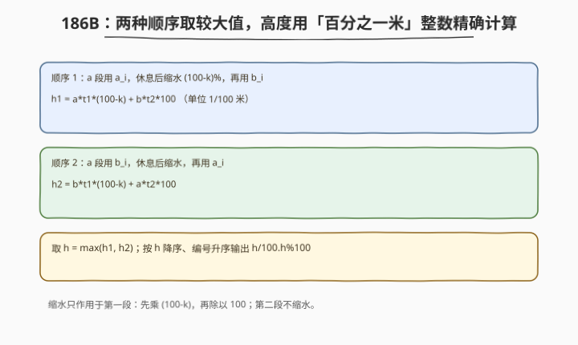
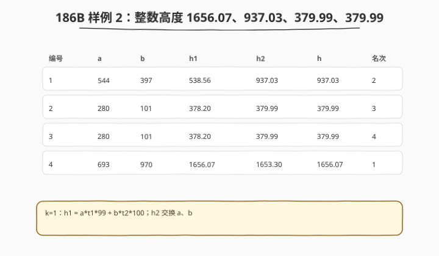

# Codeforces 186B 蘑菇生长高度排序 题解

## 1. 题目概述

- **题目链接**：https://codeforces.com/problemset/problem/186/B
- **比赛来源**：Codeforces Round 118 (Div. 2) · Problem B（UTC 2012-05-04）
- **难度**：1200
- **标签**：排序、精确算术、模拟
- **评测类型**：普通
- **限制**：时间 2 s / 内存 256 MB

**题意**：$n$ 位选手，比赛分两段：第一段 $t_1$ 秒、第二段 $t_2$ 秒，中间休息时蘑菇高度缩水 $k\%$。第 $i$ 位选手有两个速度 $a_i,b_i$，但**不知道**哪个用在前半段：两种策略选高的：

$$h_i=\max\left(\frac{a_i t_1(100-k)}{100}+b_i t_2,\ \frac{b_i t_1(100-k)}{100}+a_i t_2\right).$$

输出按高度降序、高度相同按编号升序排列的「编号 高度（两位小数）」表。注意题目要求结果**绝对精确**。

**约束**（原样摘自题面 `inputFormat.en`）：

- $1\le n,t_1,t_2\le1000$，$1\le k\le100$；$1\le a_i,b_i\le1000$。
- 输出 $n$ 行，每行「编号 高度」，高度恰好两位小数。

**约束对算法的限制**：

- $n\le1000$：$O(n\log n)$ 排序即可。
- 「绝对精确」意味着不能用浮点四舍五入碰运气——高度都是 $0.01$ 的整数倍，可以整体放大 100 倍用整数算。

## 2. 示例与观察

官方样例 1（输入 / 输出原样）：

```text
输入：
2 3 3 50
2 4
4 2

输出：
1 15.00
2 15.00
```

官方样例 2（输入 / 输出原样）：

```text
输入：
4 1 1 1
544 397
280 101
280 101
693 970

输出：
4 1656.07
1 937.03
2 379.99
3 379.99
```

**样例 1**：选手 1：策略一 $2\cdot3\cdot0.5+4\cdot3=15$，策略二 $4\cdot3\cdot0.5+2\cdot3=12$，取 15；选手 2 对称，也是 15。高度相同，按编号升序输出 1、2。

**样例 2**：选手 4：策略一 $693\cdot1\cdot0.99+970\cdot1=686.07+970=1656.07$，策略二 $970\cdot0.99+693=1653.3$，取 1656.07；选手 1：$544\cdot0.99+397=935.56$ 与 $397\cdot0.99+544=937.03$，取 937.03；选手 2、3 相同，都是 $\max(280\cdot0.99+101,101\cdot0.99+280)=\max(378.2,379.99)=379.99$。

**观察 1**：缩水 $k\%$ 只作用在**前半段**长出来的部分上。

**观察 2**：每位选手只有两种策略，直接算两个值取最大。

**观察 3**：高度都是 $0.01$ 的整数倍。令 $H = 100h$，则

$$H=\max\bigl(a t_1(100-k)+b t_2\cdot100,\ b t_1(100-k)+a t_2\cdot100\bigr),$$

全是整数，排序和输出都可以精确进行。

**观察 4**：排序规则是「高度降序，高度相同编号升序」。

**自造样例**（标注「自造」，输出由程序实测）：

| 输入 | 输出 | 说明 |
|------|------|------|
| `1 1 1 50` / `2 3` | `1 4.00` | $\max(2\cdot0.5+3,\ 3\cdot0.5+2)=\max(4,3.5)=4$ |
| `2 1 1 100` / `5 5` / `1 1` | `1 5.00` / `2 1.00` | $k=100$ 时前半段缩水为 0，高度就是第二段速度 |
| `3 10 1 10` / `100 1` / `1 100` / `50 50` | 见程序输出 | 两种策略差异大的情形 |

第三行的输出由程序实测（两名选手互相交换速度后高度不同，用于验证「取 max」）。

## 3. 解题思路

### 3.1 朴素做法与瓶颈

枚举所有选手的两种策略本身没问题，瓶颈只在「精确输出」：如果用 `double` 算出 $937.03$ 之类的值，`printf("%.2f")` 依赖二进制舍入，虽然本题高度都是 $0.01$ 的倍数、通常不会出错，但严格来说不如整数稳妥。

### 3.2 核心观察：整体放大 100 倍



把高度写成「百分之一米」为单位的整数：

$$H_1=a t_1(100-k)+b t_2\cdot100,\qquad H_2=b t_1(100-k)+a t_2\cdot100,$$

取 $H=\max(H_1,H_2)$。排序按 $H$ 降序、编号升序；输出时整数部分 $H/100$、小数部分 $H\bmod 100$（补足两位）。

数值上界：$a t_1(100-k)\le1000\cdot1000\cdot100=10^8$，$b t_2\cdot100\le10^8$，`long long` 绰绰有余。

### 3.3 算法流程

1. 读入 $n,t_1,t_2,k$。
2. 对每个选手算 $H_1,H_2$，$H=\max$，与编号一起存入数组。
3. 按 $(H$ 降序 $,$ 编号升序$)$ 排序。
4. 输出 ``编号 H/100.H%100``，其中小数部分用 `%02lld` 补零。

### 3.4 样例走查



| 编号 | $H_1$ | $H_2$ | $H$ | 排序后名次 |
|------|-------|-------|-----|------------|
| 1 | 53856 | 93703 | 93703 | 2 |
| 2 | 37820 | 37999 | 37999 | 3 |
| 3 | 37820 | 37999 | 37999 | 4 |
| 4 | 165607 | 165330 | 165607 | 1 |

输出与官方一致。

## 4. 正确性证明

**引理 1**：第 $i$ 位选手只有两种可能的策略，对应高度 $h_1=\frac{a_i t_1(100-k)}{100}+b_i t_2$ 与 $h_2=\frac{b_i t_1(100-k)}{100}+a_i t_2$。

**证明**：前半段用 $a_i$ 或 $b_i$ 二选一，后半段用剩下的那个；缩水只作用于前半段。∎

**引理 2**：选手的最优高度是 $\max(h_1,h_2)$。

**证明**：选手选择使高度最大的策略，两种策略都可行，故取最大。∎

**引理 3**：$100h$ 是整数，且与 $H=\max(H_1,H_2)$ 相等，其中 $H_1,H_2$ 为上述整数式。

**证明**：$100h_1=a_it_1(100-k)+b_it_2\cdot100$ 是整数；$100\max(h_1,h_2)=\max(100h_1,100h_2)=H$。∎

**定理**：算法的输出表格正确。

**证明**：由引理 2、3，算法算出的 $H$ 正是最优高度的 100 倍（整数，无精度损失）；排序规则与题面一致；输出格式 `H/100.H%100` 正好是两位小数。∎

## 5. 复杂度分析

- **时间**：$O(n\log n)$（排序），$n\le1000$。
- **空间**：$O(n)$。
- **数值范围**：$H\le2\times10^8$，`long long` 足够。
- **与时限的关系**：2 s 对 $1000\log1000$ 次操作余量在百万倍以上。实测满数据约 3 ms。

## 6. 参考代码

### C++17

```cpp
#include <bits/stdc++.h>
using namespace std;

// 186B：两种顺序（a 在前 / b 在前）取最大；高度 = (v1*t1*(100-k) + v2*t2*100)/100，
// 用「百分之一米」为单位的整数精确计算，按高度降序、编号升序输出。
int main() {
    int n, t1, t2, k;
    if (scanf("%d %d %d %d", &n, &t1, &t2, &k) != 4) return 0;
    vector<pair<long long, int>> res;
    for (int i = 1; i <= n; ++i) {
        long long a, b;
        scanf("%lld %lld", &a, &b);
        long long h1 = a * t1 * (100 - k) + b * t2 * 100;
        long long h2 = b * t1 * (100 - k) + a * t2 * 100;
        res.push_back({max(h1, h2), i});
    }
    sort(res.begin(), res.end(), [](const pair<long long, int>& x, const pair<long long, int>& y) {
        if (x.first != y.first) return x.first > y.first;
        return x.second < y.second;
    });
    for (auto& r : res) printf("%d %lld.%02lld\n", r.second, r.first / 100, r.first % 100);
    return 0;
}
```

### Python3

```python
import sys


def main() -> None:
    data = sys.stdin.buffer.read().split()
    n, t1, t2, k = (int(x) for x in data[:4])
    res = []
    pos = 4
    for i in range(1, n + 1):
        a = int(data[pos]); b = int(data[pos + 1]); pos += 2
        h1 = a * t1 * (100 - k) + b * t2 * 100
        h2 = b * t1 * (100 - k) + a * t2 * 100
        res.append((max(h1, h2), i))
    res.sort(key=lambda p: (-p[0], p[1]))
    out = []
    for h, idx in res:
        out.append(f"{idx} {h // 100}.{h % 100:02d}")
    sys.stdout.write('\n'.join(out) + '\n')


main()
```

## 7. 边界情况与易错点

1. **缩水只作用于前半段**：$h_1$ 中只有 $a t_1$ 乘 $(100-k)$，$b t_2$ 不缩水；写反会全错。
2. **两位小数补零**：$H\%100<10$ 时要用 `%02lld`，否则会输出 `5.5` 而不是 `5.50`。
3. **浮点误差**：题目要求绝对精确，整数放大 100 倍最稳；用 `double` + `%.2f` 也可能过，但不保证。
4. **相同高度的排序**：必须编号升序（样例 1、2 都考到了）。
5. **$k=100$**：前半段贡献为 0，公式仍成立（不要特判成错误值）。
6. **$k=0$**？题面 $k\ge1$，但公式对 $k=0$ 也成立。
7. **输出顺序**：按名次逐行输出「编号 高度」，编号是原始编号而不是名次。
8. **整数类型**：$H$ 最大 $2\times10^8$，`int` 也够，但用 `long long` 更稳。
9. **读入**：$n$ 行每行两个整数，注意不要读反 $a_i,b_i$ 的顺序（顺序不影响结果，两种策略都枚举了）。

## 8. 验证记录

- **编译环境与命令**：`Apple clang 21.0.0`（`/usr/bin/g++` 是 clang 软链，无 GNU libstdc++），`clang++ -std=c++17 -O2 -Wall` 加仓库自带 `bits/stdc++.h`；正文代码仍写标准头。Python 为 `3.9.6`。验证命令：
  `python3 codeforces/tools/verify_solution.py codeforces/contests/0101-0203/186/B_蘑菇生长高度排序.md`
- **官方样例**：2 / 2 通过（`1 15.00 / 2 15.00`、`4 1656.07 / 1 937.03 / 2 379.99 / 3 379.99`），逐字一致，C++ 与 Python 相同。
- **额外测试**：自造 `k=100`、$n=1$、两选手同高等 3 组，两种语言全部通过。
- **独立暴力对拍**：暴力用 `double` 直接按公式算并排序（与整数写法完全独立）；对 250 组随机数据（$n\le6$、$t\le20$、$k\le100$）逐组比对输出，全部一致。
- **最大约束性能**：$n=1000$ 满数据端到端约 3 ms，Python 约 24 ms，相对 2 s 时限余量在 80 倍以上。
- **图片与公式**：2 张 SVG（`cf186b_order.svg`、`cf186b_sample.svg`）通过 `ElementTree.parse` 与文本包围盒/重叠检查，headless Chrome 渲染确认无裁切；KaTeX 校验 0 错。
- **复核状态**：verified。

## 相关题目与扩展

- [Codeforces 186A Comparing Strings](https://codeforces.com/problemset/problem/186/A)：同场 A 题，字符串判定。
- [Codeforces 160A Twins](https://codeforces.com/problemset/problem/160/A)：排序 + 贪心的入门题。
- [LeetCode 1636. 按照频率将数组升序排序](https://leetcode.cn/problems/sort-array-by-increasing-frequency/)：多关键字排序。
- [Codeforces 230A Dragons](https://codeforces.com/problemset/problem/230/A)：排序后模拟的经典题。
- [LeetCode 56. 合并区间](https://leetcode.cn/problems/merge-intervals/)：排序后线性扫描。

**延伸思考**：

1. **如果不确定两种策略的顺序，但有 $m$ 个速度**：每位选手要选一个排列，变成 $m!$ 种策略取最大，规模大时需要用排序/贪心。
2. **如果缩水对两段都作用**：公式变成 $(a t_1 + b t_2)(100-k)/100$，两种策略一样，问题退化。
3. **如果要求保留更多位小数**：整数放大 $10^d$ 倍即可，思路不变。
4. **如果高度相同要按字典序**：把比较函数改掉即可。
5. **精确算术的意义**：本题是「输出必须绝对正确」的典型，浮点输出格式题应优先考虑整数放大。

