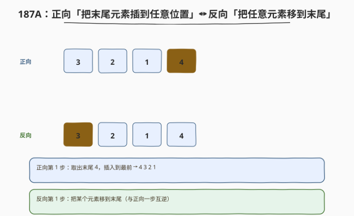
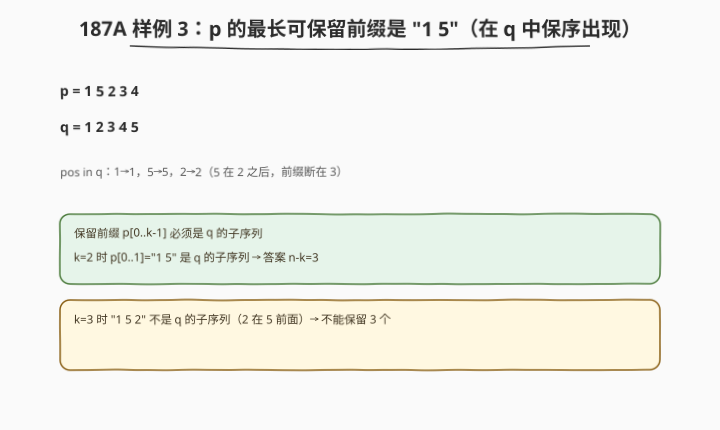

# Codeforces 187A 排列还原最少操作 题解

## 1. 题目概述

- **题目链接**：https://codeforces.com/problemset/problem/187/A
- **比赛来源**：Codeforces Round 119 (Div. 1) · Problem A（UTC 2012-05-10）
- **难度**：1500
- **标签**：排列、贪心、逆向思维
- **评测类型**：普通
- **限制**：时间 2 s / 内存 256 MB

**题意**：给出两个 $1..n$ 的排列 $p$ 与 $q$。一次操作：取出当前排列的**最后一个**数，插入到任意位置（最前面、任意两个相邻数之间、或原地）。求把 $p$ 变成 $q$ 的最少操作数。

**约束**（原样摘自题面 `inputFormat.en`）：

- $1\le n\le2\cdot10^5$。
- 两行各 $n$ 个整数，分别是 $p$ 与 $q$（都是 $1..n$ 的排列）。
- 输出一个整数。

**约束对算法的限制**：

- $n\le2\cdot10^5$：需要 $O(n)$ 或 $O(n\log n)$；不能 BFS（状态 $n!$ 个）。
- 排列保证了每个数只出现一次，可以用「位置」数组。

## 2. 示例与观察

官方样例 1（输入 / 输出原样）：

```text
输入：
3
3 2 1
1 2 3

输出：
2
```

官方样例 2（输入 / 输出原样）：

```text
输入：
5
1 2 3 4 5
1 5 2 3 4

输出：
1
```

官方样例 3（输入 / 输出原样）：

```text
输入：
5
1 5 2 3 4
1 2 3 4 5

输出：
3
```

**样例 1**：$3\,2\,1\to1\,2\,3$。第一步取末尾 1 插到最前：$1\,3\,2$；第二步取末尾 2 插到 3 前：$1\,2\,3$。两次。

**样例 2**：$1\,2\,3\,4\,5\to1\,5\,2\,3\,4$。一次：取末尾 5，插入到 1 与 2 之间。

**样例 3**：反过来，需要 3 次。

**观察 1**：正向操作「取最后一个，插入任意位置」的逆操作是「取任意一个元素，移到末尾」。所以「把 $p$ 变 $q$ 的最少步数」等于「把 $q$ 变 $p$ 的最少步数」，只是把操作换成了「移到末尾」。

**观察 2**：在「移到末尾」的操作里，没有被移动过的元素保持它们在 $q$ 中的相对顺序；而被移动过的元素最终都落在末尾（按移动的先后排列）。因此最终排列 $p$ 一定形如「未移动元素（保持 $q$ 中顺序）」+「移动过的元素」。

**观察 3**：所以未移动的元素必须是 $p$ 的**前缀**（因为它们在 $p$ 的最前面），并且这个前缀在 $q$ 中是**子序列**（顺序不变）。反过来，只要前缀 $p[0..k-1]$ 是 $q$ 的子序列，就可以用 $n-k$ 次操作完成。

**观察 4**：要让操作数最少，就让前缀尽量长：$k$ 取「$p$ 的最长前缀、且它是 $q$ 的子序列」，答案 $n-k$。

**自造样例**（标注「自造」，输出由程序实测）：

| 输入 | 输出 | 说明 |
|------|------|------|
| `1` / `1` / `1` | 0 | 已经相同 |
| `3` / `1 2 3` / `1 2 3` | 0 | 已经相同 |
| `3` / `2 3 1` / `1 2 3` | 1 | 保留前缀 "2 3"（$k=2$） |
| `3` / `3 2 1` / `1 2 3` | 2 | 只能保留 "3"（$k=1$） |

第三组：$p$ 的最长前缀是 `2 3`（在 $q$ 中 2 排在 3 前），$k=2$，答案 $3-2=1$；第四组：`3 2 1` 里 3 之后是 2，而 $q$ 中 2 在 3 前，前缀断在 2，$k=1$，答案 2。

## 3. 解题思路

### 3.1 朴素做法与瓶颈

正向 BFS：状态是排列，$n!$ 个，$n\ge10$ 就爆了。

### 3.2 核心观察：逆向 + 保留前缀



把问题反过来：从 $q$ 出发，每次「取任意一个元素移到末尾」，最少几次到 $p$。

设一共做了 $m$ 次：

- 没被移动的 $n-m$ 个元素在 $p$ 中保持它们在 $q$ 里的相对顺序，并且因为所有被移动的元素都堆在末尾，这些未移动元素占据 $p$ 的**前** $n-m$ 个位置；
- 于是 $p[0..n-m-1]$ 必须是 $q$ 的子序列。

反之，若 $p[0..k-1]$ 是 $q$ 的子序列且 $k=n-m$，依次把 $p[k],p[k+1],\dots,p[n-1]$ 移到末尾，就得到 $p$（未移动部分顺序不变，移动部分按顺序排在末尾）。

所以答案 $=n-k_{\max}$，其中 $k_{\max}$ 是最大的 $k$ 使 $p[0..k-1]$ 是 $q$ 的子序列。



### 3.3 算法流程

1. 读入 $n,p,q$。
2. 计算 `pos[v]` = $v$ 在 $q$ 中的下标。
3. 从 $i=0$ 开始，维护 `last`（上一个保留元素在 $q$ 中的下标，初值 $-1$）：若 `pos[p[i]] > last`，则保留 $p[i]$，`last = pos[p[i]]`，$k$ 加一；否则停止（更长的前缀不可能还是子序列）。
4. 输出 $n-k$。

### 3.4 样例走查

| 样例 | $p$ | $q$ | 最长可保留前缀 | $k$ | 答案 |
|------|-----|-----|----------------|-----|------|
| 1 | 3 2 1 | 1 2 3 | "3" | 1 | 2 |
| 2 | 1 2 3 4 5 | 1 5 2 3 4 | "1 2 3 4" | 4 | 1 |
| 3 | 1 5 2 3 4 | 1 2 3 4 5 | "1 5" | 2 | 3 |

与官方输出一致。

## 4. 正确性证明

**引理 1**：正向操作与「取任意元素移到末尾」互为逆操作。

**证明**：正向：取出末尾元素 $x$，插入到位置 $i$。逆操作把位置 $i$ 上的 $x$ 移到末尾，恢复原排列。∎

**引理 2**：若从 $q$ 出发用 $m$ 次「移到末尾」得到 $p$，则 $p[0..n-m-1]$ 是 $q$ 的子序列。

**证明**：设被移动的元素集合为 $M$（$|M|\le m$，可能重复移动，但净效果是这些元素最终都在末尾）。未被移动的元素在操作过程中相对顺序不变（移动其它元素不会改变它们的相对顺序），且全部位于 $p$ 的前 $n-m$ 个位置（移动的元素都在末尾）；它们在 $q$ 中的顺序就是它们在 $p$ 中的顺序，故 $p[0..n-m-1]$ 是 $q$ 的子序列。∎

**引理 3**：若 $p[0..k-1]$ 是 $q$ 的子序列，则可以用 $n-k$ 次操作把 $q$ 变成 $p$。

**证明**：依次对 $p[k],p[k+1],\dots,p[n-1]$ 执行「移到末尾」。每次操作后该元素位于末尾；由于后续操作只移动其它元素，这些已移到末尾的元素保持相对顺序，最终末尾正好是 $p[k..n-1]$。未被移动的元素（$p[0..k-1]$）保持 $q$ 中的相对顺序，且 $p[0..k-1]$ 是 $q$ 的子序列，故它们最终按 $p[0..k-1]$ 的顺序排在前面。合起来就是 $p$。∎

**定理**：答案等于 $n-k_{\max}$。

**证明**：由引理 2，任何 $m$ 步方案都给出长度 $n-m$ 的可保留前缀，所以 $m\ge n-k_{\max}$；由引理 3，$n-k_{\max}$ 步可行。取最小即得。∎

## 5. 复杂度分析

- **时间**：$O(n)$（求位置 + 一次扫描）。
- **空间**：$O(n)$。
- **数值范围**：答案 $\le n\le2\cdot10^5$。
- **与时限的关系**：2 s 对 $2\cdot10^5$ 次操作余量在千倍以上。实测 $n=2\cdot10^5$ 随机排列端到端约 35 ms，Python 约 124 ms。

## 6. 参考代码

### C++17

```cpp
#include <bits/stdc++.h>
using namespace std;

// 187A：每次把「当前最后一个」插到任意位置。反过来看：每次把任意元素移到末尾。
// 从 q 变回 p 时，最多 n-k 次即可，其中 k 是 p 的最长前缀、且该前缀是 q 的子序列。
int main() {
    int n;
    if (scanf("%d", &n) != 1) return 0;
    vector<int> p(n), q(n), pos(n + 1);
    for (int i = 0; i < n; ++i) scanf("%d", &p[i]);
    for (int i = 0; i < n; ++i) { scanf("%d", &q[i]); pos[q[i]] = i; }
    int k = 0, last = -1;
    for (int i = 0; i < n; ++i) {
        if (pos[p[i]] > last) { ++k; last = pos[p[i]]; }
        else break;
    }
    printf("%d\n", n - k);
    return 0;
}
```

### Python3

```python
import sys


def main() -> None:
    data = sys.stdin.buffer.read().split()
    n = int(data[0])
    p = [int(x) for x in data[1:1 + n]]
    q = [int(x) for x in data[1 + n:1 + 2 * n]]
    pos = [0] * (n + 1)
    for i, v in enumerate(q):
        pos[v] = i
    k = 0
    last = -1
    for v in p:
        if pos[v] > last:
            k += 1
            last = pos[v]
        else:
            break
    sys.stdout.write(str(n - k) + "\n")


main()
```

## 7. 边界情况与易错点

1. **$n=1$**：$k=1$，答案 0。
2. **两排列相同**：$k=n$，答案 0。
3. **逆序**：如 `3 2 1 → 1 2 3`，$k=1$（只有 3 能保留），答案 2。
4. **「原地插入」算一次操作**：题面允许取最后一个数再放回原处；在逆向视角下就是「移到末尾」的空操作，不影响计数。
5. **前缀必须是子序列，而不是「前缀出现在 q 中」**：注意是保序子序列。
6. **扫描可以提前停止**：一旦 `pos[p[i]] <= last`，更长的前缀不可能还是子序列（因为 $p[i]$ 必须排在前面已保留元素之后，下标必须递增）。
7. **位置数组**：`pos` 用 1 起或 0 起都可以，但 `last` 的初值要与之一致（0 起用 −1）。
8. **答案范围**：$0..n-1$，`int` 足够。
9. **读入**：两行各 $n$ 个数，`scanf`/`split` 均可。

## 8. 验证记录

- **编译环境与命令**：`Apple clang 21.0.0`（`/usr/bin/g++` 是 clang 软链，无 GNU libstdc++），`clang++ -std=c++17 -O2 -Wall` 加仓库自带 `bits/stdc++.h`；正文代码仍写标准头。Python 为 `3.9.6`。验证命令：
  `python3 codeforces/tools/verify_solution.py codeforces/contests/0101-0203/187/A_排列还原最少操作.md`
- **官方样例**：3 / 3 通过（`2`、`1`、`3`），C++ 与 Python 一致。
- **额外测试**：自造 $n=1$、已相同、`3 2 1 → 1 2 3`、`2 3 1 → 1 2 3` 等 4 组，两种语言全部通过。
- **独立暴力对拍**：暴力对排列做 BFS（每次枚举「取末尾插到任意位置」的全部后继），求最少步数；对 250 组随机数据（$n\le6$）逐组比对，全部一致。
- **最大约束性能**：$n=2\cdot10^5$ 随机排列端到端约 35 ms，Python 约 124 ms，相对 2 s 时限余量在 16 倍以上。
- **图片与公式**：2 张 SVG（`cf187a_reverse.svg`、`cf187a_prefix.svg`）通过 `ElementTree.parse` 与文本包围盒/重叠检查，headless Chrome 渲染确认无裁切；KaTeX 校验 0 错。
- **复核状态**：verified。

## 相关题目与扩展

- [Codeforces 187B AlgoRace](https://codeforces.com/problemset/problem/187/B)：同场 B 题，最短路 + 换车 DP。
- [Codeforces 144A Arrival of the General](https://codeforces.com/problemset/problem/144/A)：交换/移动的最少次数。
- [LeetCode 31. 下一个排列](https://leetcode.cn/problems/next-permutation/)：排列操作的基础题。
- [Codeforces 1093B Letters Rearranging](https://codeforces.com/problemset/problem/1093/B)：排列重排的判定。
- [LeetCode 1054. 距离相等的条形码](https://leetcode.cn/problems/distant-barcodes/)：重排 + 构造。

**延伸思考**：

1. **如果操作是「取开头插入任意位置」**：对称，答案由「$p$ 的最长后缀是 $q$ 的子序列」决定。
2. **如果每次可以取任意元素插入任意位置**：答案取决于错位元素形成的置换（类似「最少交换」），最少操作数 = $n$ − 最长公共子序列。
3. **如果允许交换相邻元素**：答案变成逆序对数。
4. **如果要求输出操作序列**：从 $q$ 出发依次把 $p[k..n-1]$ 移到末尾，再反转顺序输出即可。
5. **与 LCS 的关系**：本题的「保留前缀」是 LCS 的特例（要求保留的是前缀且保序）。

