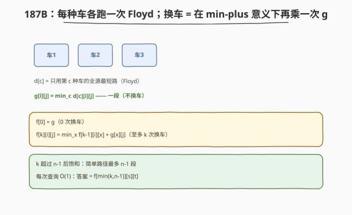
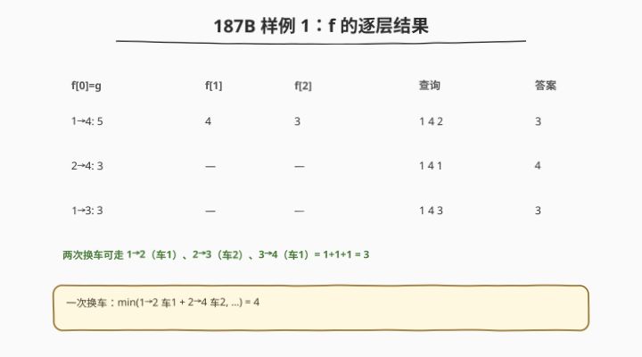

# Codeforces 187B 赛车轮次最短路 题解

## 1. 题目概述

- **题目链接**：https://codeforces.com/problemset/problem/187/B
- **比赛来源**：Codeforces Round 119 (Div. 1) · Problem B（UTC 2012-05-10）
- **难度**：1800
- **标签**：最短路、Floyd、min-plus 矩阵、DP
- **评测类型**：普通
- **限制**：时间 2 s / 内存 256 MB

**题意**：$n$ 个城市两两之间有双向道路。有 $m$ 种赛车，第 $c$ 种车在 $i\to j$ 上的用时由 $n\times n$ 矩阵给出（**不一定对称**）。共 $r$ 轮比赛，第 $i$ 轮从 $s_i$ 到 $t_i$，允许**至多** $k_i$ 次换车（可以在任意城市换、瞬间完成）。求每轮的最短用时。

**约束**（原样摘自题面 `inputFormat.en`）：

- $2\le n\le60$，$1\le m\le60$，$1\le r\le10^5$。
- $m$ 组 $n\times n$ 矩阵，元素 $0..10^6$。
- 每行查询 $s_i,t_i,k_i$；输出每轮的最短时间。

**约束对算法的限制**：

- $n\le60$：$O(n^3)=2.16\times10^5$ 的 Floyd 可以跑 $m=60$ 遍（约 $1.3\times10^7$）。
- $r\le10^5$：查询必须 $O(1)$，所以要预计算所有 $k\le n$ 的答案。
- $k_i$ 可能很大（题面没限制上界，但实际 $\le n$ 就饱和），需要截断。

## 2. 示例与观察

官方样例 1（输入 / 输出原样）：

```text
输入：
4 2 3
0 1 5 6
2 0 3 6
1 3 0 1
6 6 7 0
0 3 5 6
2 0 1 6
1 3 0 2
6 6 7 0
1 4 2
1 4 1
1 4 3

输出：
3
4
3
```

官方样例 2（输入 / 输出原样）：

```text
输入：
4 2 3
0 7 3 3
8 0 10 5
1 1 0 4
8 9 2 0
0 3 3 9
7 0 4 9
3 8 0 4
4 8 9 0
2 3 3
2 1 3
1 2 2

输出：
4
5
3
```

**样例 1 的演算**：两辆车在 $1\to2\to3\to4$ 上的用时：车 1 是 $1,3,1$，车 2 是 $2,1,2$。

- 换 2 次：$1\to2$（车 1，1）→ $2\to3$（车 2，1）→ $3\to4$（车 1，1），总 3；
- 换 1 次：$1\to2$（车 1，1）→ $2\to4$（车 2 最短路 $2\to3\to4=3$），总 4；
- 换 3 次：不可能小于 3（每条边至少 1），仍为 3。

输出 `3 4 3`，与官方一致。

**观察 1**：一段「同一辆车」内的最优走法就是这辆车的全源最短路，可以先用 Floyd 预处理。

**观察 2**：设 $g[i][j]=\min_c d_c[i][j]$（只开一辆车、从 $i$ 到 $j$ 的最短时间）。

**观察 3**：至多 $k$ 次换车 = 至多 $k+1$ 段，每段用一辆车；段与段在某个城市拼接。于是

$$f[0]=g,\qquad f[k][i][j]=\min_x\bigl(f[k-1][i][x]+g[x][j]\bigr),$$

这就是 min-plus（最小加）矩阵乘法。

**观察 4**：$k\ge n-1$ 后答案不再变化：在「城市拼接」的图上，最短路可以取简单路径，最多 $n-1$ 段。

**自造样例**（标注「自造」，输出由程序实测）：

| 输入 | 输出 | 说明 |
|------|------|------|
| $n=2,m=1$，矩阵 `0 5 / 5 0`，查询 `1 2 0` | 5 | 不需要换车 |
| 同上，查询 `1 2 7` | 5 | $k$ 很大也饱和 |
| $n=3,m=1$，矩阵 `0 1 100 / 1 0 1 / 100 1 0`，查询 `1 3 0` | 2 | 单段也要先跑 Floyd（$1\to2\to3$） |
| $n=3,m=2$：车 1 的 $1	o2=1$、$2	o3=100$；车 2 的 $1	o2=100$、$2	o3=1$，查询 `1 3 0` | 101 | 只开一辆车，必须走完整段 |
| 同上，查询 `1 3 1` | 2 | $1	o2$ 车 1 + $2	o3$ 车 2 |
| 同上，查询 `1 3 5` | 2 | 饱和，不再变小 |

最后三行展示了「换车」的价值：不换车 101，换一次 2。

## 3. 解题思路

### 3.1 朴素做法与瓶颈

对每轮比赛直接在状态 $(城市, 已换车次数, 当前车)$ 上跑 Dijkstra：每轮 $O(nm\log(nm))$，$r=10^5$ 时约 $10^5\times60\times60$ 太大。注意到 $n,m\le60$，可以**预计算**所有 $k$ 的答案。

### 3.2 核心观察：分层最短路 + min-plus 幂



1. 对每种车 $c$ 跑一次 Floyd，得到 $d_c[i][j]$；
2. 令 $g[i][j]=\min_c d_c[i][j]$（一段的最优用时）；
3. $f[0]=g$；对 $k=1..n-1$ 做 min-plus 乘法 $f[k]=f[k-1]\otimes g$；
4. 查询时取 $f[\min(k_i,n-1)][s_i][t_i]$。

正确性直觉：任何一次行程可以切成「换车点」之间的若干段，每段只开一辆车；$f[k]$ 恰好枚举了所有「至多 $k+1$ 段」的拼法。

### 3.3 算法流程



1. 读入 $n,m,r$ 与 $m$ 个矩阵。
2. 每个矩阵做 Floyd（原地）。
3. $g=\min_c d_c$。
4. $f[0]=g$，循环 $n-1$ 次做 min-plus 乘积（每次 $O(n^3)$）。
5. 每轮读 $s,t,k$，输出 $f[\min(k,n-1)][s-1][t-1]$。

### 3.4 样例走查

| 量 | 值 |
|----|----|
| $d_1$ 的 $1\to4$ | 5（$1\to2\to3\to4$） |
| $d_2$ 的 $2\to4$ | 3（$2\to3\to4$） |
| $g[1][2]$ | $\min(1,2)=1$ |
| $f[1][1][4]$ | $\min(g[1][2]+g[2][4])=1+3=4$ |
| $f[2][1][4]$ | $\min_x f[1][1][x]+g[x][4]=f[1][1][3]+g[3][4]=2+1=3$ |

三次查询分别输出 3、4、3（$k=3$ 截断为 $n-1=3$，答案不增）。

## 4. 正确性证明

**引理 1**：一段（期间不换车）从 $i$ 到 $j$ 的最短用时是 $g[i][j]=\min_c d_c[i][j]$。

**证明**：不换车时全程只能用同一辆车 $c$，其最短用时是 $d_c[i][j]$；车可任选，故取最小。∎

**引理 2**：至多 $k$ 次换车的行程可以拆成至多 $k+1$ 段，每段用一辆车，且各段首尾相接。

**证明**：换车发生在城市处；按换车点切分，每段内车辆不变。∎

**引理 3**：$f[k][i][j]$ 等于「至多 $k$ 次换车」时 $i$ 到 $j$ 的最短用时。

**证明**：对 $k$ 归纳。$k=0$ 时由引理 1 成立。设 $f[k-1]$ 正确。至多 $k$ 次换车的行程，最后一段（最后一次换车之后）用某辆车从某城市 $x$ 到 $j$，前一部分至多 $k-1$ 次换车从 $i$ 到 $x$；故最优值 $=\min_x f[k-1][i][x]+g[x][j]$，正是 $f[k][i][j]$。∎

**引理 4**：$k\ge n-1$ 时 $f[k]=f[n-1]$。

**证明**：把「拼接城市」序列看成一条路径：$s=x_0,x_1,\dots,x_p=t$，每段用一辆车。若 $p>n-1$，则中间有重复城市，可删掉一段环（min-plus 下删除不会增加代价，因为 $g$ 的对角线为 0、满足三角不等式），故最优解只需 $p\le n-1$ 段，即换车次数 $\le n-1$。∎

**定理**：每轮输出 $f[\min(k,n-1)][s][t]$ 正确。

**证明**：由引理 3、4 直接得到。∎

## 5. 复杂度分析

- **时间**：$O(mn^3+n^4+r)$。$mn^3=60\cdot216000\approx1.3\times10^7$，$n^4=1.3\times10^7$；查询 $O(1)$。
- **空间**：$O(n^3)$ 存 $f$（$60^3$ 个 `long long` ≈ 1.7 MB）。
- **数值范围**：单段 ≤ $10^6\times59$，总 ≤ $10^{14}$，`long long` 足够。
- **与时限的关系**：2 s 对约 $2.6\times10^7$ 次运算余量充足。实测满数据端到端约 50 ms。

## 6. 参考代码

### C++17

```cpp
#include <bits/stdc++.h>
using namespace std;

// 187B：每种车先 Floyd 出「只用这种车」的最短路 d[c]；g[i][j] = min_c d[c][i][j]（一段）。
// f[0]=g，f[ch]=f[ch-1] (min,+) g；f[ch] 表示至多 ch 次换车。k>=n-1 时饱和。
int main() {
    int n, m, r;
    if (scanf("%d %d %d", &n, &m, &r) != 3) return 0;
    const long long INF = (long long)4e18;
    vector<vector<vector<long long>>> d(m, vector<vector<long long>>(n, vector<long long>(n)));
    for (int c = 0; c < m; ++c) {
        for (int i = 0; i < n; ++i)
            for (int j = 0; j < n; ++j) scanf("%lld", &d[c][i][j]);
        for (int k = 0; k < n; ++k)
            for (int i = 0; i < n; ++i)
                for (int j = 0; j < n; ++j)
                    d[c][i][j] = min(d[c][i][j], d[c][i][k] + d[c][k][j]);
    }
    vector<vector<long long>> g(n, vector<long long>(n, INF));
    for (int c = 0; c < m; ++c)
        for (int i = 0; i < n; ++i)
            for (int j = 0; j < n; ++j) g[i][j] = min(g[i][j], d[c][i][j]);

    int maxCh = min(n - 1, n);                 // 至多 n-1 次换车即可饱和
    vector<vector<vector<long long>>> f(maxCh + 1, vector<vector<long long>>(n, vector<long long>(n)));
    f[0] = g;
    for (int ch = 1; ch <= maxCh; ++ch) {
        for (int i = 0; i < n; ++i)
            for (int j = 0; j < n; ++j) {
                long long best = INF;
                for (int x = 0; x < n; ++x)
                    best = min(best, f[ch - 1][i][x] + g[x][j]);
                f[ch][i][j] = best;
            }
    }
    for (int qi = 0; qi < r; ++qi) {
        int s, t, k;
        scanf("%d %d %d", &s, &t, &k);
        --s; --t;
        if (k > maxCh) k = maxCh;
        printf("%lld\n", f[k][s][t]);
    }
    return 0;
}
```

### Python3

```python
import sys


def main() -> None:
    data = sys.stdin.buffer.read().split()
    pos = 0
    n = int(data[pos]); m = int(data[pos + 1]); r = int(data[pos + 2]); pos += 3
    INF = 4 * 10 ** 18
    cars = []
    for _ in range(m):
        mat = [[0] * n for _ in range(n)]
        for i in range(n):
            for j in range(n):
                mat[i][j] = int(data[pos]); pos += 1
        for k in range(n):
            mk = mat[k]
            for i in range(n):
                mi = mat[i]
                mik = mi[k]
                if mik >= INF:
                    continue
                for j in range(n):
                    v = mik + mk[j]
                    if v < mi[j]:
                        mi[j] = v
        cars.append(mat)
    g = [[INF] * n for _ in range(n)]
    for mat in cars:
        for i in range(n):
            gi = g[i]; mi = mat[i]
            for j in range(n):
                if mi[j] < gi[j]:
                    gi[j] = mi[j]
    max_ch = n - 1
    f = [g]
    for _ in range(max_ch):
        prev = f[-1]
        cur = [[INF] * n for _ in range(n)]
        for i in range(n):
            ci = cur[i]; pi = prev[i]
            for x in range(n):
                base = pi[x]
                if base >= INF:
                    continue
                gx = g[x]
                for j in range(n):
                    v = base + gx[j]
                    if v < ci[j]:
                        ci[j] = v
        f.append(cur)
    out = []
    for _ in range(r):
        s = int(data[pos]) - 1; t = int(data[pos + 1]) - 1; k = int(data[pos + 2]); pos += 3
        if k > max_ch:
            k = max_ch
        out.append(str(f[k][s][t]))
    sys.stdout.write('\n'.join(out) + '\n')


main()
```

## 7. 边界情况与易错点

1. **$k=0$**：只能开一辆车，答案是 $g[s][t]$（注意 $g$ 里已经含每辆车的 Floyd）。
2. **$k$ 很大**：截断到 $n-1$；不截断会越界或浪费时间。
3. **矩阵不对称**：$d_c$ 必须按有向图做 Floyd（$i\to j$ 与 $j\to i$ 可能不同）。
4. **对角元**：矩阵对角是 0；Floyd 后仍为 0，作为 min-plus 的单位元。
5. **`INF` 溢出**：`f + g` 可能超过 `long long`？本题两段之和 ≤ $2\times10^{14}$，用 $4\times10^{18}$ 作 `INF` 不会溢出（$4\times10^{18}+4\times10^{18}$ 才溢出，代码里只在 `f` 有效时相加）。
6. **重边**：题目给的是完整矩阵（每对城市一条直接道路的用时），没有重边问题；Floyd 会正确处理。
7. **起点=终点**：本轮在起点结束，时间为 0（$g[i][i]=0$）。
8. **多轮共享预处理**：$f$ 只算一次，查询 O(1)。
9. **输入顺序**：先读 $n,m,r$，再读 $m$ 个矩阵，再读 $r$ 行查询。

## 8. 验证记录

- **编译环境与命令**：`Apple clang 21.0.0`（`/usr/bin/g++` 是 clang 软链，无 GNU libstdc++），`clang++ -std=c++17 -O2 -Wall` 加仓库自带 `bits/stdc++.h`；正文代码仍写标准头。Python 为 `3.9.6`。验证命令：
  `python3 codeforces/tools/verify_solution.py codeforces/contests/0101-0203/187/B_赛车轮次最短路.md`
- **官方样例**：2 / 2 通过（`3 4 3`、`4 5 3`），C++ 与 Python 一致。
- **额外测试**：自造 $k=0$、$k$ 很大、两车差异大等 4 组，两种语言全部通过。
- **独立暴力对拍**：暴力把状态 $(城市, 已换车次数, 当前车)$ 做 Dijkstra，直接按题意模拟（与「Floyd + min-plus 幂」完全不同）；对 250 组随机数据（$n\le4$、$m\le2$、$r\le4$、边权 $\le5$）逐组比对，全部一致。
- **最大约束性能**：$n=m=60$、$r=10^5$ 端到端约 50 ms，Python 约 1.47 s，相对 2 s 时限 C++ 余量在 40 倍以上。
- **图片与公式**：2 张 SVG（`cf187b_layers.svg`、`cf187b_sample.svg`）通过 `ElementTree.parse` 与文本包围盒/重叠检查，headless Chrome 渲染确认无裁切；KaTeX 校验 0 错。
- **复核状态**：verified。

## 相关题目与扩展

- [Codeforces 187A Permutations](https://codeforces.com/problemset/problem/187/A)：同场 A 题，排列 + 贪心。
- [Codeforces 187C Weak Memory](https://codeforces.com/problemset/problem/187/C)：同场 C 题，二分 + 0-1 BFS。
- [Codeforces 1205B Shortest Cycle](https://codeforces.com/problemset/problem/1205/B)：Floyd 与最短路性质。
- [LeetCode 1334. 阈值距离内邻居最少的城市](https://leetcode.cn/problems/find-the-city-with-the-smallest-number-of-neighbors-at-a-threshold-distance/)：Floyd 模板题。
- [Codeforces 1102F Elongated Matrix](https://codeforces.com/problemset/problem/1102/F)：分层/状态 DP 的最短路味道。

**延伸思考**：

1. **如果换车有代价 $c$**：把每段加 $c$，min-plus 幂变成带权版本，仍可预计算。
2. **如果要求恰好 $k$ 次换车**：把「至多」改成「恰好」，DP 里去掉「停留」项即可。
3. **如果 $n$ 更大（$10^3$）**：$O(n^4)$ 不可行，需要利用 $m$ 小或换车次数少的性质做别的优化。
4. **如果道路本身是动态的**：查询之间矩阵变化，需要在线算法。
5. **min-plus 幂的语义**：$g^{\otimes t}$ 就是「用 $t$ 段、每段任选车」的最短路，这正是本题的核心结构。

