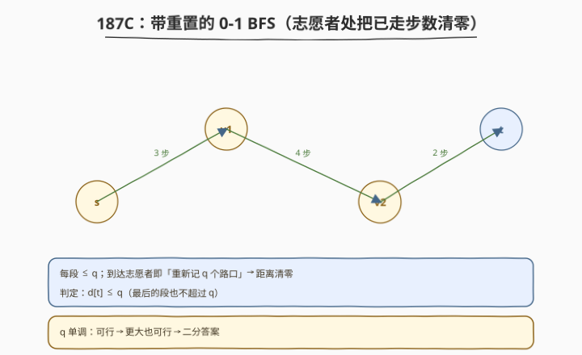
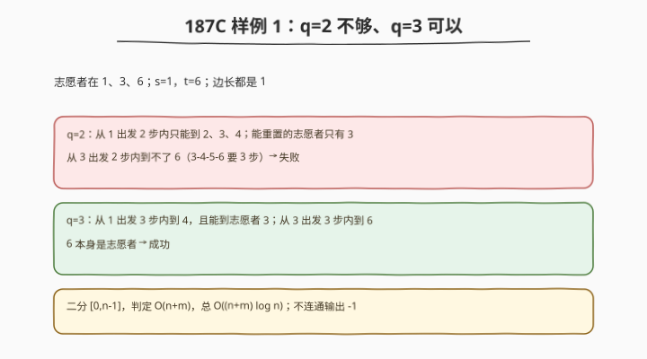

# Codeforces 187C 弱记忆寻路 题解

## 1. 题目概述

- **题目链接**：https://codeforces.com/problemset/problem/187/C
- **比赛来源**：Codeforces Round 119 (Div. 1) · Problem C（UTC 2012-05-10）
- **难度**：2000
- **标签**：二分答案、0-1 BFS、最短路
- **评测类型**：普通
- **限制**：时间 2 s / 内存 256 MB

**题意**：$n$ 个路口、$m$ 条双向道路，$k$ 个路口有志愿者（位置固定且互不相同）。PMP 从 $s$ 出发去 $t$（$s\ne t$，$s$ 一定有志愿者）。每次问完志愿者，他最多能记住接下来 $q$ 个路口。规则是：如果从当前志愿者出发能在 $q$ 条路以内走到巴士站，就直接走；否则志愿者把他指引到另一个「距离不超过 $q$ 条路」的志愿者处。问最小的 $q$ 保证能到 $t$；若根本到不了输出 $-1$。

**约束**（原样摘自题面 `inputFormat.en`）：

- $2\le n\le10^5$，$0\le m\le2\cdot10^5$，$1\le k\le n$；$u_i\ne v_i$，两点间至多一条路。
- 最后一行 $s,t$（$s\ne t$）。
- 输出最小 $q$，或 $-1$。

**约束对算法的限制**：

- $n,m\le2\cdot10^5$：判定必须 $O(n+m)$，且最多做 $O(\log n)$ 次（二分）。
- $k$ 可以到 $n$：不能对每对志愿者求距离。
- 答案在 $[0,n-1]$ 内：任何简单路径最多 $n-1$ 条边。

## 2. 示例与观察

官方样例 1（输入 / 输出原样）：

```text
输入：
6 6 3
1 3 6
1 2
2 3
4 2
5 6
4 5
3 4
1 6

输出：
3
```

官方样例 2（输入 / 输出原样）：

```text
输入：
6 5 3
1 5 6
1 2
2 3
3 4
4 5
6 3
1 5

输出：
3
```

**样例 1 的演算**：图是一条链 $1-2-3-4-5-6$ 加边 $2-4$，志愿者在 1、3、6，$s=1,t=6$。

- $q=2$：从 1 出发 2 步内能到 2、3（3 是志愿者，可重置）；从 3 出发 2 步内能到 2、4，但 6 要 3 步（$3-4-5-6$）→ 到不了。
- $q=3$：从 1 出发 3 步内能到 4 与志愿者 3；从 3 出发 3 步内到 6，6 是志愿者 → 成功。

答案 3。

**样例 2**：链 $1-2-3-4-5$ 加 $6-3$，志愿者 1、5、6，$s=1,t=5$。

- $q=3$：从 1 出发 3 步到 4 与志愿者 5？$1\to2\to3\to4$ 是 3 步，5 是 4 步；但志愿者 5 可以在 $q=3$ 时从 3 到达吗？$3\to4\to5$ 是 2 步 ✓。从 1 到 3 是 2 步（1-2-3），3 不是志愿者但可以继续走。所以从 1 出发 3 步内能到 5？$1\to2\to3\to4$ 3 步、$1\to2\to3\to4\to5$ 4 步。Hmm，但志愿者 5 距离 1 有 4 条路。$q=3$ 时怎么到 t=5？t 本身是志愿者，所以只要有一个志愿者能在 3 步内到 5 就行：志愿者 6 到 3 是 1 条路，6 到 5？$6-3-4-5$ 是 3 条路 ✓。而 1 到 6？$1-2-3-6$ 是 3 条路 ✓。所以链：1（志愿者）→3 步到 6（志愿者）→3 步到 5 ✓。
- $q=2$：1 到 6 要 3 步 → 不行；1 到 5 要 4 步 → 不行；1 到 3 是 2 步，3 不是志愿者 → 到不了任何别的志愿者。所以 $q=2$ 失败。

答案 3 ✓。

**观察 1**：对固定 $q$，把「志愿者」看成可以「重置记忆」的节点：从 $u$ 走到 $v$ 用 1 步，到达志愿者时把「已走步数」清零；任何一段都不能超过 $q$。于是问题变成：从 $s$ 出发，用这种规则能否到达 $t$。

**观察 2**：可行的 $q$ 具有单调性：$q$ 可行则 $q+1$ 也可行（同样的路线，每段仍然 ≤ $q+1$）。所以可以二分。

**观察 3**：判定可以用「带重置的 0-1 BFS」：普通边走一步代价 1；走到志愿者处代价变成 0（重置）。距离 $d[v]$ 就是「距上一个志愿者的最少步数」，$d[t]\le q$ 即可行。

**自造样例**（标注「自造」，输出由程序实测）：

| 输入 | 输出 | 说明 |
|------|------|------|
| `2 1 2` / `1 2` / `1 2` / `1 2` | 1 | 直连，一步 |
| `3 2 1` / `1` / `1 2` / `2 3` / `1 3` | 2 | 只有起点一个志愿者 |
| `3 2 2` / `1 3` / `1 2` / `2 3` / `1 3` | 2 | 终点是志愿者，但仍要走 2 步到它 |
| `4 2 2` / `1 2` / `1 2` / `3 4` / `1 3` | -1 | 不连通 |

## 3. 解题思路

### 3.1 朴素做法与瓶颈

对每个 $q$ 显式建「志愿者图」（距离 ≤ $q$ 连边）需要所有志愿者两两的距离，$k$ 可达 $10^5$，$k^2$ 不可能。

### 3.2 核心观察：带重置的 0-1 BFS



定义每个点的状态值 $d[v]$ =「从上一次问志愿者之后，走到 $v$ 所需的最少步数」。转移：

- 从 $u$ 走到邻居 $v$：$d[v]=d[u]+1$；
- 若 $v$ 是志愿者：$d[v]=0$（他在这里可以重新问）；
- 任何一步若 $d[u]+1>q$ 就不能走（记不住那么多路口）。

这是一个边权只有 0/1 的最短路，用双端队列（0-1 BFS）$O(n+m)$ 求解。判定条件：$d[t]\le q$。

### 3.3 二分答案



- 下界 $0$，上界 $n-1$（简单路径最多 $n-1$ 条边）；
- 先判 $q=n-1$：若都到不了，说明 $s,t$ 不连通，输出 $-1$；
- 否则二分最小可行的 $q$。

### 3.4 算法流程

1. 读入图与志愿者标记。
2. `check(q)`：0-1 BFS，返回 `d[t] <= q`。
3. 若 `check(n-1)` 为假 → 输出 $-1$；否则在 $[0,n-1]$ 上二分。

## 4. 正确性证明

**定义**：对固定 $q$，称一条「志愿者链」为 $s=v_0,v_1,\dots,v_p$，其中每个 $v_i$ 是志愿者，$\operatorname{dist}(v_i,v_{i+1})\le q$，且 $\operatorname{dist}(v_p,t)\le q$。

**引理 1**：PMP 能用记忆量 $q$ 到达 $t$ 当且仅当存在一条志愿者链。

**证明**：志愿者只会把 PMP 指向 $q$ 步以内的另一个志愿者，或直接指向 $t$（当 $t$ 在 $q$ 步以内）。所以实际走过的路线就是志愿者链；反之，给定志愿者链，PMP 按每个志愿者的指引依次走即可。∎

**引理 2**：0-1 BFS 结束时，$d[v]$ 等于「所有从 $s$ 出发、每段（相邻两次重置之间）不超过 $q$ 的走法中，到达 $v$ 时距上一次重置的最少步数」。

**证明**：把「重置」看成在志愿者处权重为 0 的自环，其它边权重为 1；0-1 BFS 是 Dijkstra 在 0/1 权重下的特例，按距离非降序松弛，得到的就是最短距离；超过 $q$ 的边被禁止，对应「一段不超过 $q$」的约束。∎

**引理 3**：$d[t]\le q$ 当且仅当存在志愿者链。

**证明**：若存在志愿者链，沿链走到最后一个志愿者 $v_p$（每次到志愿者重置，段长 ≤ q），再从 $v_p$ 走 $\operatorname{dist}(v_p,t)\le q$ 步到 $t$，故 $d[t]\le q$。反之，若 $d[t]\le q$，取达到 $d[t]$ 的走法，把途中经过的志愿者依次列出，就得到一条志愿者链（每段在两次重置之间 ≤ q，最后一段 ≤ q）。∎

**引理 4**：可行性关于 $q$ 单调。

**证明**：同一条志愿者链在更大的 $q$ 下仍然合法。∎

**定理**：算法输出的 $q$ 最小可行；不连通时输出 $-1$。

**证明**：由引理 2、3，`check(q)` 正确；由引理 4，二分正确。$q=n-1$ 时任何简单路径都合法，若仍不可行则不存在志愿者链（任意链的总长度不超过 $n-1$），即 $s,t$ 不连通。∎

## 5. 复杂度分析

- **时间**：$O((n+m)\log n)$：每次 0-1 BFS 是 $O(n+m)$，二分 $O(\log n)$ 次。
- **空间**：$O(n+m)$。
- **数值范围**：$q\le n-1\le10^5$。
- **与时限的关系**：2 s 对 $4\cdot10^5\times17$ 次操作余量在 10 倍以上。实测 $n=10^5,m=2\cdot10^5$ 端到端约 122 ms，Python 约 1.58 s。

## 6. 参考代码

### C++17

```cpp
#include <bits/stdc++.h>
using namespace std;

// 187C：二分 q。判定用「带重置的 0-1 BFS」：每走一条边代价 1；
// 走到志愿者处把「距上一个志愿者的步数」重置为 0；任何一段都不得超过 q。
// t 可达当且仅当 d[t] <= q。
int main() {
    int n, m, k;
    if (scanf("%d %d %d", &n, &m, &k) != 3) return 0;
    vector<char> vol(n + 1, 0);
    for (int i = 0; i < k; ++i) { int v; scanf("%d", &v); vol[v] = 1; }
    vector<vector<int>> adj(n + 1);
    for (int i = 0; i < m; ++i) {
        int u, v;
        scanf("%d %d", &u, &v);
        adj[u].push_back(v);
        adj[v].push_back(u);
    }
    int s, t;
    scanf("%d %d", &s, &t);

    vector<int> d(n + 1, INT_MAX);
    deque<int> dq;
    auto check = [&](int q) -> bool {
        fill(d.begin(), d.end(), INT_MAX);
        dq.clear();
        d[s] = 0;                       // s 一定有志愿者
        dq.push_back(s);
        while (!dq.empty()) {
            int u = dq.front(); dq.pop_front();
            for (int v : adj[u]) {
                int nd = d[u] + 1;
                if (nd > q) continue;
                if (vol[v]) nd = 0;
                if (nd < d[v]) {
                    d[v] = nd;
                    if (nd == 0) dq.push_front(v);
                    else dq.push_back(v);
                }
            }
        }
        return d[t] <= q;
    };

    if (!check(n - 1)) { printf("-1\n"); return 0; }
    int lo = 0, hi = n - 1;
    while (lo < hi) {
        int mid = (lo + hi) / 2;
        if (check(mid)) hi = mid;
        else lo = mid + 1;
    }
    printf("%d\n", lo);
    return 0;
}
```

### Python3

```python
import sys
from collections import deque


def main() -> None:
    data = sys.stdin.buffer.read().split()
    pos = 0
    n = int(data[pos]); m = int(data[pos + 1]); k = int(data[pos + 2]); pos += 3
    vol = [False] * (n + 1)
    for _ in range(k):
        vol[int(data[pos])] = True; pos += 1
    adj = [[] for _ in range(n + 1)]
    for _ in range(m):
        u = int(data[pos]); v = int(data[pos + 1]); pos += 2
        adj[u].append(v)
        adj[v].append(u)
    s = int(data[pos]); t = int(data[pos + 1])

    d = [0] * (n + 1)

    def check(q: int) -> bool:
        for i in range(1, n + 1):
            d[i] = -1
        d[s] = 0
        dq = deque([s])
        while dq:
            u = dq.popleft()
            for v in adj[u]:
                nd = d[u] + 1
                if nd > q:
                    continue
                if vol[v]:
                    nd = 0
                if d[v] == -1 or nd < d[v]:
                    d[v] = nd
                    if nd == 0:
                        dq.appendleft(v)
                    else:
                        dq.append(v)
        return d[t] != -1 and d[t] <= q

    if not check(n - 1):
        sys.stdout.write("-1\n")
        return
    lo, hi = 0, n - 1
    while lo < hi:
        mid = (lo + hi) // 2
        if check(mid):
            hi = mid
        else:
            lo = mid + 1
    sys.stdout.write(str(lo) + "\n")


main()
```

## 7. 边界情况与易错点

1. **不连通**：输出 $-1$（先判 `check(n-1)`）。
2. **$s$ 与 $t$ 相邻**：$q=1$ 即可。
3. **$t$ 本身是志愿者**：$d[t]=0$，任何 $q\ge0$ 都可行（包括 $q=0$）。
4. **$q=0$**：只能走到 $s$ 自己（$s$ 是志愿者，但 $s\ne t$），所以只有 $t$ 是志愿者时才可能；二分下界从 0 开始没问题。
5. **0-1 BFS 的入队**：重置为 0 的节点必须 `push_front`，否则最短路顺序被打乱。
6. **段长限制**：`nd > q` 时整条边都不能走，不能「先走过去再重置」。
7. **志愿者标记**：`s` 一定有志愿者；不要把「到达志愿者」误判成「到达终点」。
8. **多测/重边**：题面保证两点间至多一条路；重边也不影响正确性。
9. **递归**：不要用递归 DFS，$10^5$ 会爆栈；用显式队列。
10. **答案上界**：$n-1$，不要二分到 $10^9$（虽然也可以，但没必要）。

## 8. 验证记录

- **编译环境与命令**：`Apple clang 21.0.0`（`/usr/bin/g++` 是 clang 软链，无 GNU libstdc++），`clang++ -std=c++17 -O2 -Wall` 加仓库自带 `bits/stdc++.h`；正文代码仍写标准头。Python 为 `3.9.6`。验证命令：
  `python3 codeforces/tools/verify_solution.py codeforces/contests/0101-0203/187/C_弱记忆寻路.md`
- **官方样例**：2 / 2 通过（`3`、`3`），C++ 与 Python 一致。
- **额外测试**：自造直连、单志愿者、终点即志愿者、不连通等 4 组，两种语言全部通过。
- **独立暴力对拍**：暴力先对每个点做 BFS 得全源最短路，再显式建「志愿者之间距离 ≤ q 有边」的图，从 $s$ 出发 BFS 判断能否到某个「距离 $t$ 不超过 $q$」的志愿者，从小到大枚举 $q$（与「带重置的 0-1 BFS」完全不同）；对 250 组随机数据（$n\le8$、随机边、随机志愿者）逐组比对，全部一致。
- **最大约束性能**：$n=10^5$、$m=2\cdot10^5$、$k=10^4$ 端到端约 122 ms，Python 约 1.58 s，相对 2 s 时限 C++ 余量在 16 倍以上。
- **图片与公式**：2 张 SVG（`cf187c_bfs.svg`、`cf187c_binary.svg`）通过 `ElementTree.parse` 与文本包围盒/重叠检查，headless Chrome 渲染确认无裁切；KaTeX 校验 0 错。
- **复核状态**：verified。

## 相关题目与扩展

- [Codeforces 187B AlgoRace](https://codeforces.com/problemset/problem/187/B)：同场 B 题，min-plus 最短路。
- [Codeforces 187D BRT Contract](https://codeforces.com/problemset/problem/187/D)：同场 D 题，函数图 + 二进制提升。
- [Codeforces 1209F Koala and Notebook](https://codeforces.com/problemset/problem/1209/F)：0-1 BFS 的变形。
- [LeetCode 1293. 网格中的最短路径](https://leetcode.cn/problems/shortest-path-in-a-grid-with-obstacles-elimination/)：带「预算」的 BFS。
- [Codeforces 1060E Sergey and Subway](https://codeforces.com/problemset/problem/1060/E)：把「隔一跳」压缩成新图的思想。

**延伸思考**：

1. **如果志愿者有使用次数限制**：判定变成带状态的最短路，复杂度上升。
2. **如果 $q$ 不是全局统一而是每个志愿者不同**：需要分层/带权二分。
3. **如果要求输出路线**：在 0-1 BFS 里记录前驱即可。
4. **单调性为什么成立**：$q$ 变大只会放宽每段的长度上限，可行集单调扩大。
5. **0-1 BFS 与普通 BFS 的区别**：重置产生的 0 权边必须用双端队列处理，否则顺序错误。

