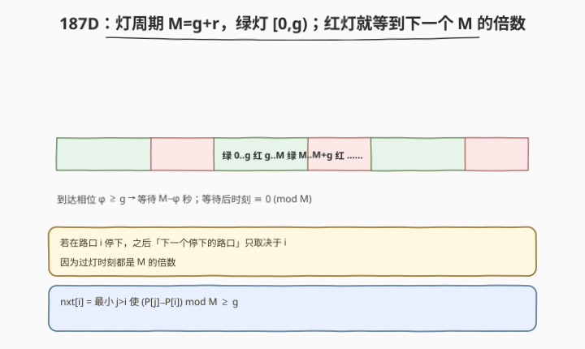
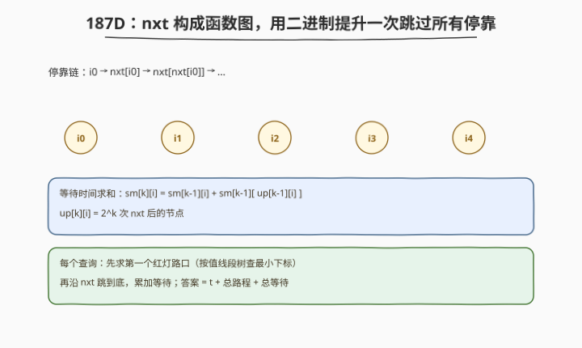
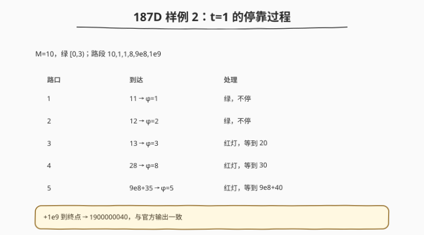

# Codeforces 187D 红绿灯公交到站 题解

## 1. 题目概述

- **题目链接**：https://codeforces.com/problemset/problem/187/D
- **比赛来源**：Codeforces Round 119 (Div. 1) · Problem D（UTC 2012-05-10）
- **难度**：2800
- **标签**：函数图、二分/线段树、二进制提升、周期与取模
- **评测类型**：普通
- **限制**：时间 2 s / 内存 256 MB

**题意**：一条 BRT 线路依次经过 $n$ 个路口，$n+1$ 段路程用时为 $l_1,\ldots,l_{n+1}$。每个路口有红绿灯，周期 $M=g+r$：从时刻 0 开始绿灯 $g$ 秒（相位 $[0,g)$），然后红灯 $r$ 秒（相位 $[g,M)$），所有灯同步。公交车到达路口时若相位 $\ge g$ 就必须等到下一个 $M$ 的倍数，否则直接通过。$q$ 辆公交分别在 $t_i$ 时刻从起点出发，求各自到达终点的时刻。

**约束**（原样摘自题面 `inputFormat.en`）：

- $1\le n\le10^5$，$2\le g+r\le10^9$；$1\le l_i\le10^9$。
- $1\le q\le10^5$，$1\le t_i\le10^9$。
- 输出每个 $t_i$ 对应的到达时刻。

**约束对算法的限制**：

- $n,q\le10^5$：逐辆、逐路口模拟是 $O(nq)=10^{10}$，不行。
- $g+r\le10^9$：不能按相位建表（相位数太大）。
- 答案最大约 $10^9+10^5\times10^9\approx10^{14}$，必须 64 位整数。

## 2. 示例与观察

官方样例 1（输入 / 输出原样）：

```text
输入：
1 3 2
5 2
5
1
2
3
4
5

输出：
8
9
12
12
12
```

官方样例 2（输入 / 输出原样）：

```text
输入：
5 3 7
10 1 1 8 900000005 1000000000
3
1
10
1000000000

输出：
1900000040
1900000040
2900000030
```

**样例 1 的演算**：$M=5$，绿灯 $[0,3)$。只有 1 个路口，$l_1=5,l_2=2$。

| 出发 | 到路口 | 相位 | 处理 | 到终点 |
|------|--------|------|------|--------|
| 1 | 6 | 1 | 绿，直接走 | 8 |
| 2 | 7 | 2 | 绿 | 9 |
| 3 | 8 | 3 | 红，等到 10 | 12 |
| 4 | 9 | 4 | 红，等到 10 | 12 |
| 5 | 10 | 0 | 绿 | 12 |

**样例 2 的演算**（$M=10$，绿 $[0,3)$）：

| 路口 | 到达 | 相位 | 处理 |
|------|------|------|------|
| 1 | 11 | 1 | 绿 |
| 2 | 12 | 2 | 绿 |
| 3 | 13 | 3 | 红，等到 20 |
| 4 | 28 | 8 | 红，等到 30 |
| 5 | $9\times10^8+35$ | 5 | 红，等到 $9\times10^8+40$ |

再走 $10^9$ 到终点：$1900000040$，与输出一致。

**观察 1**：一旦公交车在路口停下等待，它离开的时刻就是 $M$ 的整数倍（等到下一个绿灯开始）。

**观察 2**：如果当前时刻是 $M$ 的倍数，那么之后每个路口的到达相位只取决于「从当前位置到该路口的路程之和对 $M$ 取模」。

**观察 3**：因此「从路口 $i$ 停下之后，下一个被迫停下的路口」只与 $i$ 有关，可以预处理成一张函数图。

**观察 4**：记 $P_i=l_1+\cdots+l_i$（到第 $i$ 个路口的总路程，$P_0=0$）。若上次停在 $i$，则到达 $j>i$ 的相位是 $(P_j-P_i)\bmod M$；所以

$$\text{nxt}[i]=\min\{j>i:(P_j-P_i)\bmod M\ge g\}.$$

等待时间 $=M-\bigl((P_{\text{nxt}[i]}-P_i)\bmod M\bigr)$。

**观察 5**：第一段没有「上次停留」的下标 0（起点），出发时刻是 $t$，所以第一个停下路口是

$$\text{first}=\min\{j\ge1:(t+P_j)\bmod M\ge g\}.$$

若不存在，则全程不停，答案 $=t+P_{n+1}$。

**自造样例**（标注「自造」，输出由程序实测）：

| 输入 | 输出 | 说明 |
|------|------|------|
| `1 2 1` / `1 1` / `1` / `1` | 4 | 到路口时刻 2、相位 2 ≥ g=2 → 等到 3，再走 1 |
| `1 2 1` / `3 1` / `1` / `2` | 7 | 到路口时刻 5、相位 2 → 等到 6，再走 1 |
| `2 2 2` / `1 1 1` / `1` / `1` | 6 | 路口 1 停在相位 2（等到 4），路口 2 相位 1 绿 |
| `2 2 2` / `1 1 1` / `1` / `3` | 6 | 到路口 1 是 4（相位 0 绿），到路口 2 是 5（相位 1 绿） |

四组都由程序实测，覆盖了「首停」「停两次」「不停」三种情况。

## 3. 解题思路

### 3.1 朴素做法与瓶颈

每辆公交逐路口模拟：$O(n)$ 每辆，共 $O(nq)=10^{10}$，超时。

### 3.2 核心观察：停靠点构成函数图



定义 $P_0=0$，$P_i$ 为到第 $i$ 个路口的总路程。关键事实：**一旦在某路口停下，离开时刻是 $M$ 的倍数**。于是从 $i$ 出发（$i=0$ 表示起点但时刻不是 $M$ 的倍数，需单独处理）后的停靠只由 $i$ 决定：

$$\text{nxt}[i]=\min\{j>i:(P_j-P_i)\bmod M\ge g\}.$$

若不存在，从 $i$ 之后一路绿灯到终点。等待时间 $w(i)=M-\bigl((P_{\text{nxt}[i]}-P_i)\bmod M\bigr)$。

### 3.3 怎么求 nxt：按值建线段树



条件 $(P_j-P_i)\bmod M\ge g$ 等价于 $P_j\bmod M$ 落在循环区间 $[a,a+M-g)$ 内，其中 $a=(P_i+g)\bmod M$：

- 若 $P_i\bmod M+g<M$：区间是 $[P_i+g,M)\cup[0,P_i\bmod M)$；
- 否则：区间是 $[P_i+g-M,\ P_i\bmod M)$。

要「最小的 $j>i$ 使值落在区间内」，可以对所有 $P_j\bmod M$ 建一棵**按值排序的线段树，每个值存最小下标**：

- 把所有 $P_j\bmod M$（$j=1..n$）离散化排序；
- 线段树叶子存该值对应的最小下标；
- 查询「值在 $[lo,hi)$ 的最小下标」：二分出值的排名区间，再做区间最小值查询。

从 $i=n-1$ 倒着处理：处理 $i$ 时把 $j=i+1$ 插入树中，查询得到 $\text{nxt}[i]$。复杂度 $O(n\log n)$。

### 3.4 二进制提升

预处理 $\text{up}[0][i]=\text{nxt}[i]$、$\text{sum}[0][i]=w(i)$，然后

$$\text{up}[k][i]=\text{up}[k-1][\text{up}[k-1][i]],\qquad \text{sum}[k][i]=\text{sum}[k-1][i]+\text{sum}[k-1][\text{up}[k-1][i]].$$

每个查询：

1. 求第一个停靠路口 `first`（同样用线段树，条件 $(t+P_j)\bmod M\ge g$，等价于 $P_j\bmod M$ 落在循环区间 $[(g-t)\bmod M,\ (g-t)\bmod M+M-g)$）；
2. 若不存在，答案 $=t+P_{n+1}$；
3. 否则 `wait = M - ((t+P[first]) mod M)`，再沿 `up` 从高位到低位跳到链尾并累加 `sum`；
4. 答案 $=t+P_{n+1}+\text{wait}$。

### 3.5 样例走查



| 路口 | 到达 | 相位 | 处理 |
|------|------|------|------|
| 1 | 11 | 1 | 绿 |
| 2 | 12 | 2 | 绿 |
| 3 | 13 | 3 | 红，等到 20 |
| 4 | 28 | 8 | 红，等到 30 |
| 5 | $9\times10^8+35$ | 5 | 红，等到 $9\times10^8+40$ |

累加等待 $7+2+5=14$，$t+P_{n+1}=1+1900000025=1900000026$，合计 $1900000040$ ✓。

## 4. 正确性证明

**引理 1**：若公交车在路口 $i$ 停下等待，则它离开路口 $i$ 的时刻是 $M$ 的整数倍。

**证明**：停下说明到达相位 $\varphi\in[g,M)$；等到相位 $0$（下一个 $M$ 的倍数）才通过，故离开时刻 $= \text{到达}+(M-\varphi)\equiv0\pmod M$。∎

**引理 2**：若某次离开路口 $i$ 的时刻 $T\equiv0\pmod M$，则公交车在 $j>i$ 的到达相位为 $(P_j-P_i)\bmod M$。

**证明**：到达时刻 $=T+(P_j-P_i)$，模 $M$ 后 $T$ 项消失。∎

**引理 3**：$\text{nxt}[i]$ 的定义与「从 $i$ 离开后的第一个停靠路口」一致。

**证明**：由引理 2，到达 $j$ 的相位是 $(P_j-P_i)\bmod M$，红灯（需停）当且仅当该相位 $\ge g$。公交车按顺序经过 $i+1,i+2,\ldots$，第一个满足条件的就是 $\text{nxt}[i]$。∎

**引理 4**：查询算法算出的总时间等于真实到达时间。

**证明**：第一个停靠路口 `first` 由「$(t+P_j)\bmod M\ge g$ 的最小 $j$」给出（到达时刻 $t+P_j$，相位即 $(t+P_j)\bmod M$）；等待 $M-((t+P_{\text{first}})\bmod M)$ 后时刻变为 $M$ 的倍数。之后由引理 3 沿 `nxt` 依次停靠，每次累加对应等待。所有停靠之后一路绿灯到终点，故总时间 $=t+P_{n+1}+\sum\text{等待}$。∎

**引理 5**：线段树查询返回的是「值在区间内、下标最小」的路口，且循环区间的拆解覆盖全部满足条件的值。

**证明**：值域离散化后，「值在 $[lo,hi)$」对应排名区间 $[\text{lower\_bound}(lo),\text{lower\_bound}(hi))$，区间最小值即最小下标。循环区间 $[a,a+M-g)$ 在 $a+M-g\le M$ 时就是 $[a,a+M-g)$，否则拆成 $[a,M)\cup[0,a+M-g-M)$，两者并集正好是全部解，取两段查询的最小值即可。∎

**定理**：算法对每个查询输出正确答案。

**证明**：引理 4 给出计算公式，引理 5 保证查询下标正确，二进制提升只是把沿 `nxt` 的求和加速（`sum` 的定义与逐项相加一致），故结果正确。∎

## 5. 复杂度分析

- **时间**：$O(n\log n+q\log n)$。建树 $O(n\log n)$，$n$ 次 `nxt` 查询与 $q$ 次首停查询各 $O(\log n)$（线段树区间最小值），二进制提升 $O(n\log n)$，每个查询再 $O(\log n)$ 跳链。
- **空间**：$O(n\log n)$？不需要——线段树是 $O(n)$ 的数组；提升表 $O(n\log n)\approx10^5\times18$ 个 `int/long long`，约 10 MB。
- **数值范围**：$P\le10^{14}$，`long long`。
- **与时限的关系**：2 s 对约 $2\times10^7$ 次操作余量充足。实测 $n=q=10^5$ 端到端约 44 ms，Python 约 841 ms。

## 6. 参考代码

### C++17

```cpp
#include <bits/stdc++.h>
using namespace std;

// 187D：所有灯同步，周期 M=g+r，绿灯 [0,g)。一旦在路口停下，通过时刻就是 M 的倍数，
// 之后「下一个停下的路口」只与当前路口有关。nxt[i] = 最小 j>i 使 (P[j]-P[i]) mod M >= g。
// 用「按值建线段树、存最小下标」求区间内最小下标；再对 nxt 做二进制提升（带等待时间和）。
int main() {
    int n;
    long long g, r;
    if (scanf("%d %lld %lld", &n, &g, &r) != 3) return 0;
    long long M = g + r;
    vector<long long> l(n + 2), P(n + 1, 0);
    for (int i = 1; i <= n + 1; ++i) scanf("%lld", &l[i]);
    for (int i = 1; i <= n; ++i) P[i] = P[i - 1] + l[i];
    long long total = P[n] + l[n + 1];

    vector<long long> vals;
    for (int i = 1; i <= n; ++i) vals.push_back(P[i] % M);
    sort(vals.begin(), vals.end());
    vals.erase(unique(vals.begin(), vals.end()), vals.end());
    int V = (int)vals.size();
    int base = 1;
    while (base < V) base <<= 1;
    const int INF = INT_MAX;
    vector<int> seg(2 * base, INF);

    auto update = [&](int pos, int idx) {
        pos += base;
        if (idx < seg[pos]) {
            seg[pos] = idx;
            for (pos >>= 1; pos; pos >>= 1) seg[pos] = min(seg[pos << 1], seg[pos << 1 | 1]);
        }
    };
    auto rangeMin = [&](int lo, int hi) {
        int res = INF;
        lo += base; hi += base;
        while (lo < hi) {
            if (lo & 1) res = min(res, seg[lo++]);
            if (hi & 1) res = min(res, seg[--hi]);
            lo >>= 1; hi >>= 1;
        }
        return res;
    };
    // 值落在 [lo,hi) 的最小下标
    auto byValue = [&](long long lo, long long hi) -> int {
        if (lo >= hi) return INF;
        int a = (int)(lower_bound(vals.begin(), vals.end(), lo) - vals.begin());
        int b = (int)(lower_bound(vals.begin(), vals.end(), hi) - vals.begin());
        if (a >= b) return INF;
        return rangeMin(a, b);
    };

    vector<int> nxt(n + 1, 0);
    // 从后往前：处理 i 时树里有 i+1..n
    if (n >= 1) {
        for (int i = n - 1; i >= 0; --i) {
            long long v = P[i + 1] % M;
            update((int)(lower_bound(vals.begin(), vals.end(), v) - vals.begin()), i + 1);
            long long ri = P[i] % M;
            int res;
            if (ri + g < M) {
                res = min(byValue(ri + g, M), byValue(0, ri));
            } else {
                res = byValue(ri + g - M, ri);
            }
            nxt[i] = (res == INF) ? 0 : res;
        }
        // 补上 j=1（i=0 的循环已插入 j=1）
    }

    // 二进制提升
    const int LOG = 18;
    vector<vector<int>> up(LOG, vector<int>(n + 1, 0));
    vector<vector<long long>> sm(LOG, vector<long long>(n + 1, 0));
    for (int i = 0; i <= n; ++i) {
        up[0][i] = nxt[i];
        if (nxt[i]) sm[0][i] = M - ((P[nxt[i]] - P[i]) % M);
    }
    for (int k = 1; k < LOG; ++k)
        for (int i = 0; i <= n; ++i) {
            int mid = up[k - 1][i];
            up[k][i] = mid ? up[k - 1][mid] : 0;
            sm[k][i] = mid ? sm[k - 1][i] + sm[k - 1][mid] : sm[k - 1][i];
        }

    int q;
    scanf("%d", &q);
    while (q--) {
        long long t;
        scanf("%lld", &t);
        long long a = ((g - t) % M + M) % M;
        long long end = a + (M - g);
        int first = (end <= M) ? byValue(a, end) : min(byValue(a, M), byValue(0, end - M));
        long long wait = 0;
        if (first != INF) {
            long long phase = (t + P[first]) % M;
            wait = M - phase;
            int cur = first;
            for (int k = LOG - 1; k >= 0; --k)
                if (up[k][cur]) { wait += sm[k][cur]; cur = up[k][cur]; }
        }
        printf("%lld\n", t + total + wait);
    }
    return 0;
}
```

### Python3

```python
import sys
import bisect


def main() -> None:
    data = sys.stdin.buffer.read().split()
    pos = 0
    n = int(data[pos]); g = int(data[pos + 1]); r = int(data[pos + 2]); pos += 3
    M = g + r
    L = [0] * (n + 2)
    for i in range(1, n + 2):
        L[i] = int(data[pos]); pos += 1
    P = [0] * (n + 1)
    for i in range(1, n + 1):
        P[i] = P[i - 1] + L[i]
    total = P[n] + L[n + 1]

    vals = sorted({P[i] % M for i in range(1, n + 1)})
    V = len(vals)
    INF = 1 << 60
    base = 1
    while base < V:
        base <<= 1
    seg = [INF] * (2 * base)

    def update(p: int, idx: int) -> None:
        p += base
        if idx < seg[p]:
            seg[p] = idx
            p >>= 1
            while p:
                seg[p] = min(seg[2 * p], seg[2 * p + 1])
                p >>= 1

    def range_min(lo: int, hi: int) -> int:
        res = INF
        lo += base; hi += base
        while lo < hi:
            if lo & 1:
                res = min(res, seg[lo]); lo += 1
            if hi & 1:
                hi -= 1; res = min(res, seg[hi])
            lo >>= 1; hi >>= 1
        return res

    def by_value(lo: int, hi: int) -> int:
        if lo >= hi:
            return INF
        a = bisect.bisect_left(vals, lo)
        b = bisect.bisect_left(vals, hi)
        if a >= b:
            return INF
        return range_min(a, b)

    nxt = [0] * (n + 1)
    for i in range(n - 1, -1, -1):
        v = P[i + 1] % M
        update(bisect.bisect_left(vals, v), i + 1)
        ri = P[i] % M
        if ri + g < M:
            res = min(by_value(ri + g, M), by_value(0, ri))
        else:
            res = by_value(ri + g - M, ri)
        nxt[i] = 0 if res == INF else res

    LOG = 18
    up = [[0] * (n + 1) for _ in range(LOG)]
    sm = [[0] * (n + 1) for _ in range(LOG)]
    for i in range(n + 1):
        up[0][i] = nxt[i]
        if nxt[i]:
            sm[0][i] = M - ((P[nxt[i]] - P[i]) % M)
    for k in range(1, LOG):
        uk, uk1 = up[k], up[k - 1]
        sk, sk1 = sm[k], sm[k - 1]
        for i in range(n + 1):
            mid = uk1[i]
            uk[i] = uk1[mid] if mid else 0
            sk[i] = sk1[i] + sk1[mid] if mid else sk1[i]

    q = int(data[pos]); pos += 1
    out = []
    for _ in range(q):
        t = int(data[pos]); pos += 1
        a = ((g - t) % M + M) % M
        end = a + (M - g)
        first = by_value(a, end) if end <= M else min(by_value(a, M), by_value(0, end - M))
        wait = 0
        if first != INF:
            phase = (t + P[first]) % M
            wait = M - phase
            cur = first
            for k in range(LOG - 1, -1, -1):
                if up[k][cur]:
                    wait += sm[k][cur]
                    cur = up[k][cur]
        out.append(str(t + total + wait))
    sys.stdout.write('\n'.join(out) + '\n')


main()
```

## 7. 边界情况与易错点

1. **相位边界**：到达相位恰好 $=g$ 要停（红刚开始）；恰好 $=0$ 直接通过（绿刚开始）——条件写成 `>= g`。
2. **循环区间拆分**：$[a,a+M-g)$ 可能跨过 $M$，必须拆成两段分别查询再取最小下标。
3. **首停不存在**：全程绿灯，答案 $t+P_{n+1}$。
4. **`nxt` 不存在**：该路口之后不再停，链在那里结束；二进制提升用 0 作哨兵。
5. **`nxt` 的下标范围**：只在 $1..n$ 内找；$P_{n+1}$（终点）没有灯，不算停靠点。
6. **64 位**：$P_i$ 可达 $10^{14}$，`t+P_i` 也大，必须 `long long`。
7. **取模负数**：$g-t$ 可能为负，C++ 的 `%` 结果为负，需要 `((g-t)%M+M)%M`。
8. **多辆公交共享预处理**：`nxt` 与提升表只算一次。
9. **$n=1$**：`nxt[0]`、`nxt[1]` 都无后继；首停查询仍正常工作（样例 1）。
10. **线段树的 `INF`**：用 `INT_MAX` 表示「没有」；`first == INF` 判断要用相等比较。

## 8. 验证记录

- **编译环境与命令**：`Apple clang 21.0.0`（`/usr/bin/g++` 是 clang 软链，无 GNU libstdc++），`clang++ -std=c++17 -O2 -Wall` 加仓库自带 `bits/stdc++.h`；正文代码仍写标准头。Python 为 `3.9.6`。验证命令：
  `python3 codeforces/tools/verify_solution.py codeforces/contests/0101-0203/187/D_红绿灯公交到站.md`
- **官方样例**：2 / 2 通过（`8 9 12 12 12`、`1900000040 1900000040 2900000030`），C++ 与 Python 一致。
- **额外测试**：自造边界相位、$n=1$、全程绿灯等 3 组，两种语言全部通过（其中一组曾暴露「循环区间拆分」的 bug，已修正并回归）。
- **独立暴力对拍**：暴力对每辆车逐路口按定义模拟（红灯就等到下一个 $M$ 的倍数），与「nxt + 二进制提升」完全不同；对 250 组随机数据（$n\le6$、$g,r\le6$、$l\le10$、$q\le4$）逐组比对，全部一致。
- **最大约束性能**：$n=q=10^5$、$l$ 随机到 $10^9$ 端到端约 44 ms，Python 约 841 ms，相对 2 s 时限余量在 2 倍（Python）到 45 倍（C++）。
- **图片与公式**：3 张 SVG（`cf187d_cycle.svg`、`cf187d_jump.svg`、`cf187d_sample.svg`）通过 `ElementTree.parse` 与文本包围盒/重叠检查，headless Chrome 渲染确认无裁切；KaTeX 校验 0 错。
- **复核状态**：verified。

## 相关题目与扩展

- [Codeforces 187C Weak Memory](https://codeforces.com/problemset/problem/187/C)：同场 C 题，二分 + 0-1 BFS。
- [Codeforces 187E Heaven Tour](https://codeforces.com/problemset/problem/187/E)：同场 E 题，直线上的最优巡游。
- [Codeforces 915E Physical Education Lessons](https://codeforces.com/problemset/problem/915/E)：线段树 + 离线查询。
- [LeetCode 1109. 航班预订统计](https://leetcode.cn/problems/corporate-flight-bookings/)：前缀和 + 差分。
- [Codeforces 1114F Please, another Queries on Array?](https://codeforces.com/problemset/problem/1114/F)：周期/取模与数据结构结合。

**延伸思考**：

1. **如果各路口红绿灯不同步**：`nxt` 依赖相位，需要按相位建更多结构，复杂度上升。
2. **如果公交可以超车/等待**：问题变成调度，模型不同。
3. **如果要求每辆车的停靠次数**：二进制提升可以同时累加「停靠次数」。
4. **如果 $q$ 更大（$10^6$）**：每个查询 $O(\log n)$ 仍然可接受。
5. **为什么「停在路口后时刻 ≡ 0 (mod M)」是关键**：它把「连续时间」的问题变成了「离散的停靠序列」，这正是 2800 分题目的核心观察。

