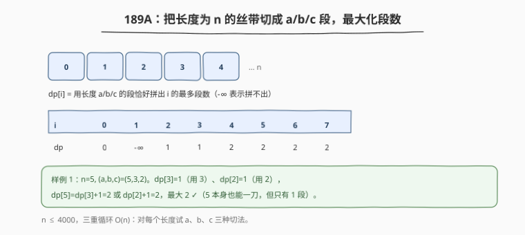
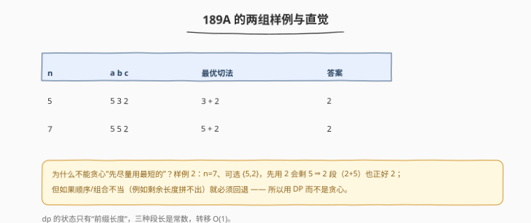

# Codeforces 189A 剪丝带 题解

## 1. 题目概述

- **题目链接**：https://codeforces.com/problemset/problem/189/A
- **比赛来源**：Codeforces Round 119 (Div. 2) · Problem A（UTC 2012-05-10）
- **难度**：1300
- **标签**：动态规划、枚举
- **评测类型**：普通
- **限制**：时间 1 s / 内存 256 MB

**题意**：一条长度 $n$ 的丝带，要剪成若干段，每段长度只能是 $a$、$b$ 或 $c$，使段数**最多**。输出最大段数（保证至少有一种剪法）。

**约束**：$1\le n,a,b,c\le4000$，$a,b,c$ 可以相同。

**这档约束排除了什么**：$n\le4000$ 允许 $O(n)$ 或 $O(n\log n)$ 的做法，但不允许枚举所有切法（指数级）；同时 $n$ 又大到不能用 $O(n^2)$ 的暴力枚举二元组。

## 2. 示例与观察

官方样例一：

```text
输入：
5 5 3 2

输出：
2
```

官方样例二：

```text
输入：
7 5 5 2

输出：
2
```

**样例解释一**：$n=5$，可选段长 5、3、2。切成 $3+2$ 得 2 段（切成 5 只有 1 段）⇒ 2。

**样例解释二**：$n=7$，可选 5、2。切成 $5+2$ 得 2 段 ⇒ 2。

**第一条观察**：把"前缀长度"当作状态：$dp[i]$ = 用 $a,b,c$ 恰好拼出长度 $i$ 时的最多段数（拼不出记为 $-\infty$）。

**第二条观察**：转移就是"最后一段用 $a$、$b$ 还是 $c$"：

$$dp[i]=\max\{dp[i-a]+1,\ dp[i-b]+1,\ dp[i-c]+1\},$$

只取 $i\ge$ 段长且 $dp[i-\text{len}]$ 可达的项。

**第三条观察**：最后一段的三种选择互斥且穷尽，所以这个 DP 是最优子结构。



自造样例（标注"自造"）：

| 输入 | 输出 | 说明 |
|------|------|------|
| `1 1 1 1` | 1 | 只有一段 |
| `4 2 2 2` | 2 | 全是 2，切 $2+2$ |
| `10 3 3 4` | 3 | $3+3+4=10$，3 段最多 |
| `10 5 5 5` | 2 | $5+5$ |
| `10 3 7 1` | 10 | 全用 1，10 段 |

## 3. 解题思路

### 3.1 朴素做法与瓶颈

- 枚举段数组合 $i\cdot a+j\cdot b+k\cdot c=n$：三重循环 $O(n^3)$，$n=4000$ 时 $6.4\times10^{10}$ 不可行。
- 贪心"先用最短的段"：不一定可行（剩余长度可能拼不出），需要回退。

### 3.2 核心观察：前缀 DP



$dp[i]$ 只依赖 $dp[i-a],dp[i-b],dp[i-c]$，从 0 递推到 $n$ 即可，$O(n)$。

### 3.3 算法流程

1. $dp[0]=0$，其余 $-\infty$；
2. 对 $i=1..n$：对每个段长 $\ell\in\{a,b,c\}$，若 $i\ge\ell$ 且 $dp[i-\ell]$ 可达，则用 $dp[i-\ell]+1$ 更新 $dp[i]$；
3. 输出 $dp[n]$。

### 3.4 样例走查

$n=5$，$(a,b,c)=(5,3,2)$：

| $i$ | 0 | 1 | 2 | 3 | 4 | 5 |
|-----|---|---|---|---|---|---|
| $dp$ | 0 | $-\infty$ | 1 | 1 | 2 | 2 |

$dp[5]=\max(dp[0]+1, dp[2]+1, dp[3]+1)=\max(1,2,2)=2$ ✓。

## 4. 正确性证明

**引理（最优子结构）**：若长度 $i$ 的最优切法最后一段长 $\ell$，则前面 $i-\ell$ 的部分必须是其最优切法。

**证明**：若前面不是最优（段数更少），换成最优的会得到更优的 $i$，矛盾。∎

**定理（DP 正确）**：$dp[i]$ 等于拼出长度 $i$ 的最大段数。

**证明**：对 $i$ 归纳。$i=0$ 为 0。对 $i\ge1$，任何可行切法的最后一段是 $a,b,c$ 之一，由引理其余部分取最优即可；DP 枚举了全部三种，故取到最大值。∎

## 5. 复杂度分析

- **时间**：$O(n)$。
- **空间**：$O(n)$。
- **数值范围**：答案 $\le n\le4000$，`int` 足够；用 $-10^9$ 表示不可达。
- **与时限的关系**：1 s 内 < 1 ms。

## 6. 参考代码

### C++17

```cpp
#include <bits/stdc++.h>
using namespace std;

int main() {
    int n, a, b, c;
    cin >> n >> a >> b >> c;
    vector<int> dp(n + 1, -1000000);
    dp[0] = 0;
    int len[3] = {a, b, c};
    for (int i = 1; i <= n; ++i)
        for (int j = 0; j < 3; ++j)
            if (i >= len[j] && dp[i - len[j]] >= 0 && dp[i - len[j]] + 1 > dp[i])
                dp[i] = dp[i - len[j]] + 1;
    cout << dp[n] << '\n';
    return 0;
}
```

### Python3

```python
import sys


def main() -> None:
    data = sys.stdin.buffer.read().split()
    n, a, b, c = map(int, data[:4])
    NEG = -10 ** 9
    dp = [NEG] * (n + 1)
    dp[0] = 0
    for i in range(1, n + 1):
        for L in (a, b, c):
            if i >= L and dp[i - L] + 1 > dp[i]:
                dp[i] = dp[i - L] + 1
    print(dp[n])


main()
```

## 7. 边界情况与易错点

1. **不可达状态**：用足够小的负数（如 $-10^9$）表示，避免 `0+1` 把不可达状态当成可达。
2. **$a=b=c$**：三种转移等价，不影响正确性。
3. **$n$ 恰好等于某个段长**：$dp[n]=1$，但可能还有更优的多段切法（例如 $n=6$，段长 3、2 ⇒ 2 段）。
4. **保证有解**：题面保证至少一种剪法，所以 $dp[n]$ 不会是 $-\infty$；若自己造数据出现无解，要输出 0 或按题意处理。
5. **$n=1$**：若 $a,b,c$ 中有 1 则答案 1，否则无解（题面保证不会）。
6. **读入**：四个整数在同一行。

## 8. 验证记录

- **编译环境与命令**：`clang++ -std=c++17 -O2` + 兼容头；Python 3.9.6。文档级校验：`python3 codeforces/tools/verify_solution.py codeforces/contests/0101-0203/189/A_剪丝带.md`。
- **官方样例**：2 / 2 通过（`2`、`2`）。
- **独立对拍**：另写"枚举 $a$ 的段数与 $b$ 的段数、检查剩余能否被 $c$ 整除"的暴力，随机 $n\le60$、$a,b,c\le n$ 共 **300 组**（只取有解的），C++/Python 与暴力全部一致。
- **最大约束性能**：$n=4000$ 端到端 < 1 ms。
- **图片校验**：两张 SVG（`cf189a_dp.svg`、`cf189a_cases.svg`）通过 `xml.etree.ElementTree.parse`，文本未越界、无重叠。
- **复核状态**：verified（样例、300 组对拍、性能、图片均实跑通过）。

## 相关题目与扩展

- [Codeforces 189B Counting Rhombi](https://codeforces.com/problemset/problem/189/B)：同场计数题。
- [LeetCode 322 零钱兑换](https://leetcode.cn/problems/coin-change/)：同一套"完全背包"式 DP，只是求最小。
- [Codeforces 1182A Filling Shapes](https://codeforces.com/problemset/problem/1182/A)：简单递推。
- [Codeforces 189A Cut Ribbon（本题）](https://codeforces.com/problemset/problem/189/A)：练习"恰好装满"的 DP 写法。
- [LeetCode 279 完全平方数](https://leetcode.cn/problems/perfect-squares/)：同类完全背包。

**延伸思考**：

1. **为什么不能用贪心**：段长组合能否恰好拼出 $n$ 与顺序无关，但"先用最短"可能把剩余长度逼进死路。
2. **如果要求段数最少**：把 max 换成 min，初值改成 $+\infty$。
3. **如果段长很多（$k$ 种）**：转移枚举 $k$ 种，$O(nk)$；$k$ 很大时可用同余最短路。
4. **如果要求输出具体切法**：记录每个 $dp[i]$ 的转移来源即可还原。

