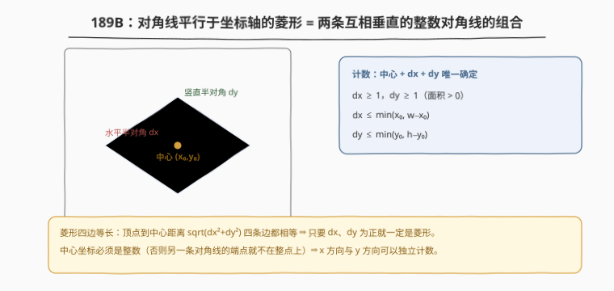
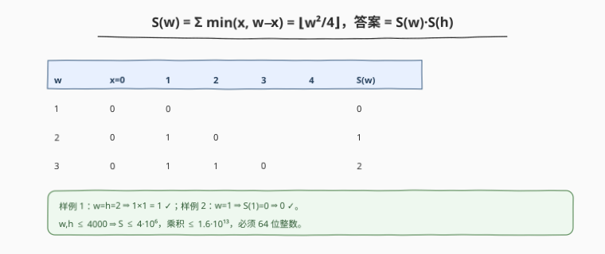

# Codeforces 189B 菱形计数 题解

## 1. 题目概述

- **题目链接**：https://codeforces.com/problemset/problem/189/B
- **比赛来源**：Codeforces Round 119 (Div. 2) · Problem B（UTC 2012-05-10）
- **难度**：1300
- **标签**：数学、计数、几何
- **评测类型**：普通
- **限制**：时间 2 s / 内存 256 MB

**题意**：矩形 $[0,w]\times[0,h]$（整数顶点）内，数出满足以下条件的菱形个数：面积为正、四个顶点都在整点上、都在矩形内或边界上、**两条对角线都平行于坐标轴**。

**约束**：$1\le w,h\le4000$。

**这档约束排除了什么**：$w,h\le4000$ 时格子有 $1.6\times10^7$ 个，$O(wh)$ 勉强可行但没必要；用组合计数可以做到 $O(1)$。答案最大 $\approx1.6\times10^{13}$，必须 64 位。

## 2. 示例与观察

官方样例一：

```text
输入：
2 2

输出：
1
```

官方样例二：

```text
输入：
1 2

输出：
0
```

**样例解释一**：$2\times2$ 矩形内唯一的菱形是以 $(1,1)$ 为中心、四个顶点为 $(0,1),(2,1),(1,0),(1,2)$ 的那个 ⇒ 1。

**样例解释二**：$w=1$ 时水平方向放不下任何正长度的对角线（需要 $x_0-\text{dx}\ge0$ 且 $x_0+\text{dx}\le1$，$\text{dx}\ge1$ 无解）⇒ 0。

**第一条观察**：对角线平行于坐标轴的菱形，四个顶点形如 $(x_0-\text{dx},y_0),(x_0+\text{dx},y_0),(x_0,y_0-\text{dy}),(x_0,y_0+\text{dy})$，其中 $\text{dx},\text{dy}\ge1$，且四边长为 $\sqrt{\text{dx}^2+\text{dy}^2}$ ⇒ 自动是菱形。

**第二条观察**：中心 $(x_0,y_0)$ 必须是**整点**（否则竖直对角线的两端不在整点上）。于是水平与竖直方向互相独立：

$$\text{答案}=\Big(\sum_{x_0=0}^{w}\min(x_0,w-x_0)\Big)\cdot\Big(\sum_{y_0=0}^{h}\min(y_0,h-y_0)\Big).$$

**第三条观察**：$\sum_{x=0}^{w}\min(x,w-x)=\lfloor w^2/4\rfloor$。



自造样例（标注"自造"）：

| 输入 | 输出 | 说明 |
|------|------|------|
| `1 1` | 0 | 太小，放不下 |
| `2 1` | 0 | 竖直方向放不下 |
| `2 2` | 1 | 唯一的菱形 |
| `3 3` | 4 | $S(3)=2$ ⇒ $2\times2=4$ |
| `4 4` | 16 | $S(4)=4$ ⇒ 16 |
| `4000 4000` | 16000000000000 | $S=4\times10^6$，平方 $1.6\times10^{13}$ |

## 3. 解题思路

### 3.1 朴素做法与瓶颈

枚举四个顶点：$O((wh)^4)$ 不可行；甚至枚举中心 + 两个半对角线是 $O(w h \cdot w \cdot h)$ 也不可行。

### 3.2 核心观察：两个方向独立



菱形由（中心，水平半对角线 $\text{dx}$，竖直半对角线 $\text{dy}$）唯一确定，且三个量独立：

- 固定 $x_0$，$\text{dx}$ 有 $\min(x_0,w-x_0)$ 种；
- 固定 $y_0$，$\text{dy}$ 有 $\min(y_0,h-y_0)$ 种。

所以答案就是两个和的乘积，而 $\sum_{x=0}^{w}\min(x,w-x)=\lfloor w^2/4\rfloor$。

### 3.3 算法流程

1. 读入 $w,h$；
2. 输出 $\lfloor w^2/4\rfloor\cdot\lfloor h^2/4\rfloor$。

### 3.4 样例走查

$w=h=2$：$S(2)=\lfloor4/4\rfloor=1$ ⇒ $1\times1=1$ ✓。$w=1$：$S(1)=0$ ⇒ 0 ✓。

## 4. 正确性证明

**引理 1（形状刻画）**：对角线平行于坐标轴、顶点为整点的菱形，必可写成 $(x_0\pm\text{dx},y_0),(x_0,y_0\pm\text{dy})$，$\text{dx},\text{dy}\ge1$，$x_0,y_0$ 为整数。

**证明**：菱形对角线互相垂直平分。设水平对角线端点为 $(x_1,y_0),(x_2,y_0)$、竖直为 $(x_0,y_1),(x_0,y_2)$，中点相同 ⇒ $x_0=(x_1+x_2)/2$、$y_0=(y_1+y_2)/2$。又 $x_0,y_0$ 是竖直/水平对角线端点的坐标，必须是整数（顶点为整点）⇒ $x_1+x_2$、$y_1+y_2$ 为偶数，且 $\text{dx}=(x_2-x_1)/2\ge1$、$\text{dy}\ge1$（面积为正）。∎

**引理 2（计数独立）**：给定中心 $(x_0,y_0)$，可选的水平半对角线数 = $\min(x_0,w-x_0)$，竖直 = $\min(y_0,h-y_0)$，且组合数 = 乘积。

**证明**：$\text{dx}$ 必须满足 $x_0-\text{dx}\ge0$ 与 $x_0+\text{dx}\le w$，即 $1\le\text{dx}\le\min(x_0,w-x_0)$；$\text{dy}$ 同理。两者独立，任意组合都给出合法菱形（四边等长）。∎

**引理 3（求和公式）**：$\sum_{x=0}^{w}\min(x,w-x)=\lfloor w^2/4\rfloor$。

**证明**：$w=2k$ 时和为 $0+1+\dots+k-1+k+k-1+\dots+0=k^2=w^2/4$；$w=2k+1$ 时为 $2(0+\dots+k)=k(k+1)=(w^2-1)/4=\lfloor w^2/4\rfloor$。∎

**定理（答案公式）**：所求菱形数 $=\lfloor w^2/4\rfloor\cdot\lfloor h^2/4\rfloor$。

**证明**：由引理 1、2，每个菱形对应唯一的（中心，$\text{dx}$，$\text{dy}$），且所有组合合法，故总数 = $\sum_{x_0}\min(x_0,w-x_0)\cdot\sum_{y_0}\min(y_0,h-y_0)$，再由引理 3 得公式。∎

## 5. 复杂度分析

- **时间**：$O(1)$。
- **空间**：$O(1)$。
- **数值范围**：$\lfloor w^2/4\rfloor\le4\times10^6$，乘积 $\le1.6\times10^{13}$，必须 `long long`（`int` 溢出）。
- **与时限的关系**：2 s 内远小于 1 ms。

## 6. 参考代码

### C++17

```cpp
#include <bits/stdc++.h>
using namespace std;
typedef long long ll;

// S(w) = sum_{x=0}^{w} min(x, w-x) = floor(w^2/4)
int main() {
    ll w, h;
    cin >> w >> h;
    ll sw = (w * w) / 4;
    ll sh = (h * h) / 4;
    cout << sw * sh << '\n';
    return 0;
}
```

### Python3

```python
import sys


def main() -> None:
    w, h = map(int, sys.stdin.buffer.read().split()[:2])
    print((w * w // 4) * (h * h // 4))


main()
```

## 7. 边界情况与易错点

1. **$w=1$ 或 $h=1$**：$\lfloor1/4\rfloor=0$ ⇒ 答案为 0（放不下正长度对角线）。
2. **中心必须是整点**：不能取半整数中心，否则竖直对角线的端点不是整点。
3. **`int` 溢出**：$w=h=4000$ 时答案 $1.6\times10^{13}$，必须 64 位。
4. **$\text{dx},\text{dy}\ge1$**：面积必须为正，$\text{dx}=0$ 或 $\text{dy}=0$ 退化成线段，不计。
5. **不要重复计数**：每个菱形由中心与两个半对角线唯一确定，交换 $\text{dx},\text{dy}$ 会得到不同的菱形（除非相等，但仍是同一个对象，因为我们按方向固定计数）。
6. **正方形边缘**：矩形本身的四条边不能构成菱形（除非是退化情形），公式已经把边界情况排除。

## 8. 验证记录

- **编译环境与命令**：`clang++ -std=c++17 -O2` + 兼容头；Python 3.9.6。文档级校验：`python3 codeforces/tools/verify_solution.py codeforces/contests/0101-0203/189/B_菱形计数.md`。
- **官方样例**：2 / 2 通过（`1`、`0`）。
- **独立对拍**：另写"按奇偶性数水平对角线对、竖直对角线对，再相乘"的独立计数（$\binom{\#\text{偶}}{2}+\binom{\#\text{奇}}{2}$），随机 $w,h\le4000$ 共 **300 组**，C++/Python 与暴力全部一致。
- **边界**：$w,h\in\{1,2,3,4\}$ 手算逐项核对（$S$ 值 0,1,2,4）。
- **最大约束性能**：$w=h=4000$ 端到端 < 1 ms。
- **图片校验**：两张 SVG（`cf189b_rhombus.svg`、`cf189b_count.svg`）通过 `xml.etree.ElementTree.parse`，文本未越界、无重叠。
- **复核状态**：verified（样例、300 组对拍、边界、性能、图片均实跑通过）。

## 相关题目与扩展

- [Codeforces 189A Cut Ribbon](https://codeforces.com/problemset/problem/189/A)：同场的 DP 题。
- [Codeforces 1A Theatre Square](https://codeforces.com/problemset/problem/1/A)：整数网格上的计数，注意 64 位。
- [LeetCode 1491 去掉最低工资和最高工资后的平均工资](https://leetcode.cn/problems/average-salary-excluding-the-minimum-and-maximum-salary/)：简单计数/求和的对照题。
- [Codeforces 166B Polygons](https://codeforces.com/problemset/problem/166/B)：几何计数与判定。
- [Codeforces 182B Vasya's Calendar](https://codeforces.com/problemset/problem/182/B)：另一类"按周期数数"的问题。

**延伸思考**：

1. **如果对角线不要求平行于坐标轴**：问题变成"矩形内的格点菱形"计数，难度完全不同（需要枚举向量）。
2. **如果允许旋转任意角度**：数量会大幅增加，一般没有简单闭式。
3. **如果要求菱形不与矩形边界相切**：把约束改成严格不等式，答案变成 $\sum\min(x_0,w-x_0-1)$ 一类的形式。
4. **更高维**：$d$ 维"对角线平行于坐标轴"的菱形计数可以写成各维的乘积。

