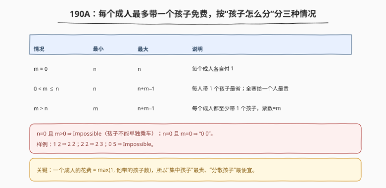
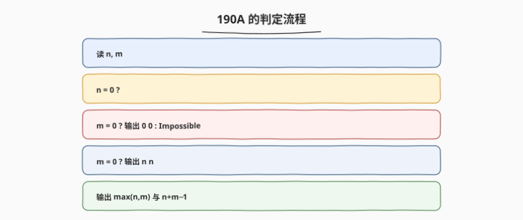

# Codeforces 190A 瓦夏与公交车 题解

## 1. 题目概述

- **题目链接**：https://codeforces.com/problemset/problem/190/A
- **比赛来源**：Codeforces Round 120 (Div. 2) · Problem A（UTC 2012-05-16）
- **难度**：1100
- **标签**：贪心、数学、分类讨论
- **评测类型**：普通
- **限制**：时间 2 s / 内存 256 MB

**题意**：车上有 $n$ 个成人、$m$ 个孩子，票价 1 卢布。一个成人带 $k>0$ 个孩子时总共付 $k$ 卢布（自己一张 + 孩子中 $k-1$ 张，即**第一个孩子免费**）；不带孩子时付 1 卢布。孩子不能单独乘车。求总车费的**最小值和最大值**；若这种乘客组合不可能，输出 `Impossible`。

**约束**：$0\le n,m\le10^5$。

**这档约束排除了什么**：$n,m$ 到 $10^5$，方案数是天文数字，必须用组合计数/贪心直接给出闭式，$O(1)$ 输出。

## 2. 示例与观察

官方样例一：

```text
输入：
1 2

输出：
2 2
```

官方样例二：

```text
输入：
0 5

输出：
Impossible
```

官方样例三：

```text
输入：
2 2

输出：
2 3
```

**样例解释一**：1 个成人带 2 个孩子 ⇒ 付 2 卢布；只有这一种可能 ⇒ `2 2`。

**样例解释二**：没有成人，孩子不能单独乘车 ⇒ `Impossible`。

**样例解释三**：2 个成人 2 个孩子：
- 每人带 1 个 ⇒ 各付 1，共 2（最小）；
- 一个人带 2 个、另一个不带 ⇒ $2+1=3$（最大）⇒ `2 3`。

**第一条观察**：一个成人的花费是 $\max(1,k)$，其中 $k$ 是他带的孩子数。总花费 $=\sum_i\max(1,k_i)$，约束 $\sum_i k_i=m$。

**第二条观察（最小）**：
- $m=0$：每人 1，共 $n$；
- $0<m\le n$：每个孩子挂在不同成人名下，这些成人各付 1（带 1 个孩子也是 1），其他成人也付 1 ⇒ 总共 $n$；
- $m>n$：每个成人都得至少带 1 个孩子（否则孩子不够分？不，是要最小化：若有人不带孩子他仍付 1，而孩子必须挂在别人名下、每个孩子至少多付 1 ⇒ 总额 = 孩子数 $m$）。所以最小 = $\max(n,m)$（$m>0$ 时）。

**第三条观察（最大）**：把所有孩子塞给一个成人 ⇒ 他付 $m$，其余 $n-1$ 人各付 1 ⇒ $n+m-1$（$m>0$）；$m=0$ 时是 $n$。



自造样例（标注"自造"）：

| 输入 | 输出 | 说明 |
|------|------|------|
| `0 0` | `0 0` | 空车 |
| `1 0` | `1 1` | 一个成人 |
| `3 1` | `3 3` | 一个孩子挂谁，总额都是 3 |
| `1 5` | `5 5` | 一个成人带 5 个孩子：$5$ |
| `3 5` | `5 7` | 最小 5、最大 $3+5-1=7$ |

## 3. 解题思路

### 3.1 朴素做法与瓶颈

枚举孩子的分配（$m$ 个孩子分给 $n$ 个成人的方案数 $\binom{m+n-1}{n-1}$）不可行。

### 3.2 核心观察：花费函数是 $\max(1,k)$



花费对每个成人是凸的（$1,1,2,3,\dots$）：把 $k$ 从 1 增加到 2 要多付 1，从 0 到 1 不用多付。所以：

- **最小**：尽量让每个成人只带 0 或 1 个孩子（不额外花钱），剩余孩子不可避免要叠在某个人身上，每多一个孩子多付 1 ⇒ $\max(n,m)$；
- **最大**：把全部孩子集中到一个人身上，只有他多付 $m-1$ ⇒ $n+m-1$。

### 3.3 算法流程

1. 若 $n=0$：$m=0$ 输出 `0 0`，否则 `Impossible`；
2. 若 $m=0$：输出 `n n`；
3. 否则输出 `max(n,m) (n+m-1)`。

### 3.4 样例走查

| $n$ | $m$ | 最小 | 最大 | 分配 |
|-----|-----|------|------|------|
| 1 | 2 | 2 | 2 | 唯一 |
| 2 | 2 | 2 | 3 | (1,1) / (2,0) |
| 3 | 7 | 7 | 9 | (1,1,5) / (7,0,0) |

## 4. 正确性证明

**引理（花费分解）**：总车费 $=\sum_{i=1}^{n}\max(1,k_i)$，其中 $k_i\ge0$、$\sum k_i=m$。

**证明**：成人 $i$ 带 $k_i$ 个孩子时按题意付 $\max(1,k_i)$（$k_i=0$ 付 1；$k_i>0$ 付 $k_i$）。∎

**定理 1（最小）**：$m>0$ 时最小值 $=\max(n,m)$。

**证明**：由 $\max(1,k_i)\ge1$ 得总费 $\ge n$；又 $\max(1,k_i)\ge k_i$ 得总费 $\ge\sum k_i=m$。故总费 $\ge\max(n,m)$。构造：若 $m\le n$，给 $m$ 个成人各 1 个孩子、其余 0 个 ⇒ 总费 $n=\max(n,m)$ ✓；若 $m>n$，先给每个成人 1 个，再把剩余 $m-n$ 个任意堆放 ⇒ 总费 $=\sum k_i=m=\max(n,m)$ ✓。∎

**定理 2（最大）**：$m>0$ 时最大值 $=n+m-1$。

**证明**：设 $k_i>0$ 的成人有 $t$ 个，则总费 $=\sum_{k_i>0}k_i+(n-t)=m+n-t\le m+n-1$（因为 $t\ge1$）。构造：把 $m$ 个孩子全给一个成人 ⇒ $t=1$，总费 $=m+n-1$ ✓。∎

**定理 3（不可能）**：$n=0,m>0$ 时无解。

**证明**：孩子不能单独乘车，必须有成人陪同，而成人数量为 0。∎

## 5. 复杂度分析

- **时间**：$O(1)$。
- **空间**：$O(1)$。
- **数值范围**：$n+m-1\le2\times10^5$，`int` 足够。
- **与时限的关系**：2 s 内 < 1 ms。

## 6. 参考代码

### C++17

```cpp
#include <bits/stdc++.h>
using namespace std;
typedef long long ll;

int main() {
    ll n, m;
    cin >> n >> m;
    if (n == 0) {
        if (m == 0) cout << "0 0\n";
        else cout << "Impossible\n";
        return 0;
    }
    ll mn = (m == 0) ? n : max(n, m);
    ll mx = (m == 0) ? n : n + m - 1;
    cout << mn << ' ' << mx << '\n';
    return 0;
}
```

### Python3

```python
import sys


def main() -> None:
    data = sys.stdin.buffer.read().split()
    n, m = int(data[0]), int(data[1])
    if n == 0:
        print("0 0" if m == 0 else "Impossible")
        return
    mn = n if m == 0 else max(n, m)
    mx = n if m == 0 else n + m - 1
    print(mn, mx)


main()
```

## 7. 边界情况与易错点

1. **$n=0,m=0$**：输出 `0 0`，不是 `Impossible`。
2. **$n=0,m>0$**：`Impossible`。
3. **$m=0$**：最小 = 最大 = $n$；公式 $n+m-1$ 会给出 $n-1$，必须单独分支。
4. **$m>0$ 且 $n>0$**：最大恒为 $n+m-1$，与 $m\le n$ 无关。
5. **输出格式**：两个整数空格分隔，没有多余字符；`Impossible` 首字母大写。
6. **$n=1,m=1$**：输出 `1 1`（一个成人带一个孩子，付 1）。

## 8. 验证记录

- **编译环境与命令**：`clang++ -std=c++17 -O2` + 兼容头；Python 3.9.6。文档级校验：`python3 codeforces/tools/verify_solution.py codeforces/contests/0101-0203/190/A_瓦夏与公交车.md`。
- **官方样例**：3 / 3 通过（`2 2`、`Impossible`、`2 3`）。
- **独立对拍**：另写"枚举把 $m$ 个孩子分给 $n$ 个成人的所有方案"的暴力（$n\le4,m\le6$），随机 **300 组**，C++/Python 与暴力全部一致（含 $n=0$、$m=0$ 边界）。
- **最大约束性能**：$n=m=10^5$ 端到端 < 1 ms。
- **图片校验**：两张 SVG（`cf190a_cases.svg`、`cf190a_flow.svg`）通过 `xml.etree.ElementTree.parse`，文本未越界、无重叠。
- **复核状态**：verified（样例、300 组对拍、性能、图片均实跑通过）。

## 相关题目与扩展

- [Codeforces 190B Surrounded](https://codeforces.com/problemset/problem/190/B)：同场的几何题。
- [Codeforces 190C STL](https://codeforces.com/problemset/problem/190/C)：同场的解析题。
- [LeetCode 292 Nim 游戏](https://leetcode.cn/problems/nim-game/)：简单分类讨论。
- [Codeforces 1182A Filling Shapes](https://codeforces.com/problemset/problem/1182/A)：简单公式题。
- [Codeforces 190D Non-Secret Cypher](https://codeforces.com/problemset/problem/190/D)：同场双指针题。

**延伸思考**：

1. **为什么最大是"集中"**：$\max(1,k)$ 在 $k\ge1$ 时是线性的，总和 $=m+n-t$，$t$ 越小越大。
2. **为什么最小是 $\max(n,m)$**：$k_i\in\{0,1\}$ 时每个孩子恰好多付 1、每个成人至少付 1，两者取大。
3. **如果每个成人最多带 $c$ 个孩子**：最大变成 $n+\min(m-1, c)+\dots$ 需要重新分配，问题变成简单贪心。
4. **如果车票价格不同（成人 $p$、孩子 $q$，第一个孩子免费）**：公式变为 $\max(np, \min(m,n)p+\max(0,m-n)q)$ 一类的形式。

