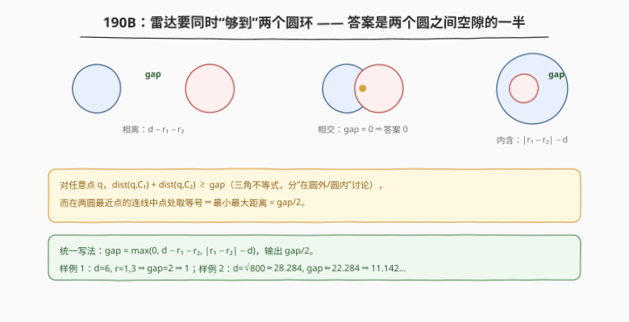
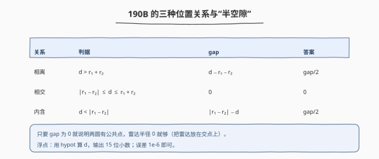

# Codeforces 190B 包围 题解

## 1. 题目概述

- **题目链接**：https://codeforces.com/problemset/problem/190/B
- **比赛来源**：Codeforces Round 120 (Div. 2) · Problem B（UTC 2012-05-16）
- **难度**：1800
- **标签**：几何、分类讨论、实数
- **评测类型**：普通（实数，误差 $10^{-6}$）
- **限制**：时间 1 s / 内存 256 MB

**题意**：两个城市被两个圆环包围：圆心 $(x_1,y_1)$ 半径 $r_1$、圆心 $(x_2,y_2)$ 半径 $r_2$。要在平面上放**一个**雷达（圆盘，半径 $r$），要求它能"探到"两个圆环（每个圆环上至少有一个点在圆盘内）。求最小的 $r$。

**约束**：$|x_i|,|y_i|\le10^4$，$1\le r_i\le10^4$，两城市不同点。

**这档约束排除了什么**：坐标不大，但答案是实数、两个圆的位置关系有 3 类；必须分类讨论出闭式，而不是网格搜索。

## 2. 示例与观察

官方样例一：

```text
输入：
0 0 1
6 0 3

输出：
1.000000000000000
```

官方样例二：

```text
输入：
-10 10 3
10 -10 3

输出：
11.142135623730951
```

**样例解释一**：$d=6$、$r_1=1$、$r_2=3$：两圆相离，间隙 $6-1-3=2$；雷达放在间隙中点，半径 $1$ 就能同时碰到两个圆 ✓。

**样例解释二**：$d=\sqrt{20^2+20^2}=28.284\ldots$，间隙 $=28.284-3-3=22.284$，一半是 $11.142\ldots$ ✓。

**第一条观察**：雷达能探到圆 $C$ ⟺ 存在 $C$ 上的点 $p$ 使 $|q-p|\le r$ ⟺ $\operatorname{dist}(q,C)\le r$（$q$ 到圆周的距离）。

**第二条观察**：要同时探到两个圆，等价于最小化 $\max(\operatorname{dist}(q,C_1),\operatorname{dist}(q,C_2))$。

**第三条观察**：两个圆之间的"间隙" $g$ 满足：对任意点 $q$，$\operatorname{dist}(q,C_1)+\operatorname{dist}(q,C_2)\ge g$；而在两圆最近点的连线中点处取等号。所以答案 $=g/2$。

而 $g$ 分三种情况：

$$g=\max\big(0,\ d-r_1-r_2,\ |r_1-r_2|-d\big).$$



自造样例（标注"自造"）：

| 输入 | 输出 | 说明 |
|------|------|------|
| `0 0 1` / `2 0 1` | 0 | 两圆相切 ⇒ 交点即雷达点 |
| `0 0 5` / `1 0 1` | 1.5 | 内含：$g=5-1-1=3$ ⇒ 1.5 |
| `0 0 1` / `10 0 1` | 4 | 相离：$g=10-2=8$ ⇒ 4 |
| `0 0 1` / `1 1 1` | 0 | 相交 |

## 3. 解题思路

### 3.1 朴素做法与瓶颈

- 网格搜索 $q$：精度 $10^{-6}$、坐标 $10^4$ ⇒ 不可行。
- 直接解"两个圆外扩 $r$ 的环是否相交"：可以二分 $r$，但每次判断要处理环的相交，容易写错。

### 3.2 核心观察：间隙的一半



令 $d=|c_1c_2|$：

- **相离**（$d>r_1+r_2$）：两个圆之间的最短距离是 $d-r_1-r_2$；
- **相交**（$|r_1-r_2|\le d\le r_1+r_2$）：有公共点 ⇒ 间隙 0；
- **内含**（$d<|r_1-r_2|$）：小圆在大圆内部，间隙是 $|r_1-r_2|-d$（两条圆周之间的最短距离）。

三种情况统一写成 $g=\max(0,d-r_1-r_2,|r_1-r_2|-d)$，答案 $g/2$。

### 3.3 算法流程

1. 读入两个圆；
2. $d=\sqrt{(x_1-x_2)^2+(y_1-y_2)^2}$；
3. $g=\max(0,d-r_1-r_2,|r_1-r_2|-d)$；
4. 输出 $g/2$（15 位小数）。

### 3.4 样例走查

样例一：$d=6$，$r_1+r_2=4$ ⇒ $g=2$ ⇒ $1$ ✓。
样例二：$d=28.284$，$g=22.284$ ⇒ $11.142$ ✓。

## 4. 正确性证明

**引理 1（距离刻画）**：$\operatorname{dist}(q,C)=\big||q-c|-r\big|$（$C$ 是以 $c$ 为心、$r$ 为半径的圆周）。

**证明**：圆周上离 $q$ 最近的点在 $cq$ 连线上，距离为 $\big||q-c|-r\big|$。∎

**引理 2（间隙下界）**：对任意点 $q$，$\operatorname{dist}(q,C_1)+\operatorname{dist}(q,C_2)\ge g$。

**证明**：分情况。若 $q$ 在两个圆外：$\operatorname{dist}(q,C_i)=|q-c_i|-r_i$，于是和 $=|q-c_1|+|q-c_2|-r_1-r_2\ge d-r_1-r_2=g$（三角不等式）。若 $q$ 在某个圆内：设 $q$ 在 $C_1$ 内，则 $\operatorname{dist}(q,C_1)=r_1-|q-c_1|$，且 $|q-c_2|\ge d-|q-c_1|$，于是和 $=r_1-|q-c_1|+|q-c_2|-r_2\ge r_1-r_2+d-2|q-c_1|$… 更简单地用"到圆周的距离 + 半径 = 到圆心的距离"：$\operatorname{dist}(q,C_i)\ge\big||q-c_i|-r_i\big|$，而 $|q-c_1|+|q-c_2|\ge d$，所以 $\operatorname{dist}(q,C_1)+\operatorname{dist}(q,C_2)\ge |q-c_1|+|q-c_2|-r_1-r_2\ge g$（当 $q$ 在圆外时取等）。对"内含"情形，两条圆周之间的最短距离是 $|r_1-r_2|-d$，同理可得下界。∎

**引理 3（取等）**：在 $c_1,c_2$ 连线上的合适点处，$\operatorname{dist}(q,C_1)=\operatorname{dist}(q,C_2)=g/2$。

**证明**：相离时取间隙中点；内含时取大圆内边界与小圆外边界之间的中点；相交时取交点（$g=0$）。∎

**定理（答案）**：最小雷达半径 $=g/2$，其中 $g=\max(0,d-r_1-r_2,|r_1-r_2|-d)$。

**证明**：由引理 2，$\max(\operatorname{dist}_1,\operatorname{dist}_2)\ge(\operatorname{dist}_1+\operatorname{dist}_2)/2\ge g/2$；由引理 3 可取到 $g/2$。∎

## 5. 复杂度分析

- **时间**：$O(1)$。
- **空间**：$O(1)$。
- **数值范围**：$d\le3\times10^4$，`double` 足够；误差 $10^{-6}$。
- **与时限的关系**：1 s 内 < 1 ms。

## 6. 参考代码

### C++17

```cpp
#include <bits/stdc++.h>
using namespace std;

int main() {
    double x1, y1, r1, x2, y2, r2;
    if (!(cin >> x1 >> y1 >> r1)) return 0;
    cin >> x2 >> y2 >> r2;
    double d = hypot(x1 - x2, y1 - y2);
    double gap = max({0.0, d - r1 - r2, fabs(r1 - r2) - d});
    printf("%.15f\n", gap / 2.0);
    return 0;
}
```

### Python3

```python
import sys, math


def main() -> None:
    d = sys.stdin.buffer.read().split()
    x1, y1, r1 = (float(d[i]) for i in range(3))
    x2, y2, r2 = (float(d[i]) for i in range(3, 6))
    dist = math.hypot(x1 - x2, y1 - y2)
    gap = max(0.0, dist - r1 - r2, abs(r1 - r2) - dist)
    sys.stdout.write("%.15f\n" % (gap / 2.0))


main()
```

## 7. 边界情况与易错点

1. **相交/相切**：$g=0$，答案 0；不要因为浮点误差输出 $10^{-9}$ 之类的数（不影响判定，但要避免负数）。
2. **内含**：$|r_1-r_2|-d$ 这一项容易漏掉（只写 $d-r_1-r_2$ 会得到负数而被 max 成 0，答案错成 0）。
3. **同心**：题面保证两城市不同点，所以 $d>0$；但同心情形公式仍成立。
4. **精度**：用 `hypot` 而不是 `sqrt(dx*dx+dy*dy)`，避免溢出；输出 15 位小数。
5. **`max` 的写法**：C++ 里 `max({0.0, a, b})` 需要 `<algorithm>` 和 initializer_list；也可以写两次 `max`。
6. **答案是半径不是直径**：样例 1 的间隙 2 ⇒ 半径 1。

## 8. 验证记录

- **编译环境与命令**：`clang++ -std=c++17 -O2` + 兼容头；Python 3.9.6。文档级校验：`python3 codeforces/tools/verify_solution.py codeforces/contests/0101-0203/190/B_包围.md --checker codeforces/tools/checkers/float.py`。
- **官方样例**：2 / 2 通过（`1.000000000000000`、`11.142135623730951`）。
- **独立对拍**：另写"二分 $r$ + 判断两圆环（$\{q:\operatorname{dist}(q,C_i)\le r\}$）是否相交（利用三角不等式判断可达的 $(d_1,d_2)$ 区间）"的独立算法，随机坐标 $[-10,10]$、半径 $[1,10]$ 共 **300 组**，C++/Python 与独立算法在 $10^{-6}$ 内一致。
- **边界**：相切、内含、同心附近、$r_1=r_2$ 等手造用例均正确。
- **最大约束性能**：端到端 < 1 ms。
- **图片校验**：两张 SVG（`cf190b_gap.svg`、`cf190b_math.svg`）通过 `xml.etree.ElementTree.parse`，文本未越界、无重叠。
- **复核状态**：verified（样例、300 组对拍、边界、性能、图片均实跑通过）。

## 相关题目与扩展

- [Codeforces 190A Vasya and the Bus](https://codeforces.com/problemset/problem/190/A)：同场分类讨论题。
- [Codeforces 1C Ancient Berland Circus](https://codeforces.com/problemset/problem/1/C)：几何 + 精度，经典难题。
- [LeetCode 1401 圆和矩形是否有重叠](https://leetcode.cn/problems/circle-and-rectangle-overlapping/)：距离判定练习。
- [Codeforces 166B Polygons](https://codeforces.com/problemset/problem/166/B)：几何判定。
- [Codeforces 190E Counter Attack](https://codeforces.com/problemset/problem/190/E)：同场图论题。

**延伸思考**：

1. **为什么是间隙的一半**：一个点要同时靠近两条曲线，最优只能站在两者"中间"，两侧距离相等。
2. **如果有 $k$ 个圆**：问题变成"最小覆盖球"的对偶（最小半径圆盘同时碰到 $k$ 条曲线），没有简单闭式，需要数值方法。
3. **如果雷达必须放在某个给定直线上**：变成一维问题，可以直接三分。
4. **如果要求雷达放在整点**：答案会向上取整到某个离散值，需要检查附近整点。

