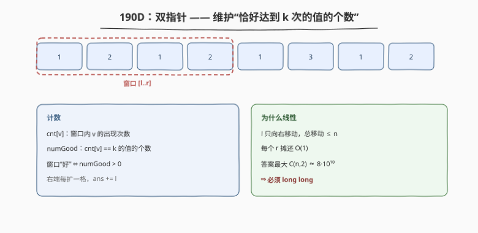
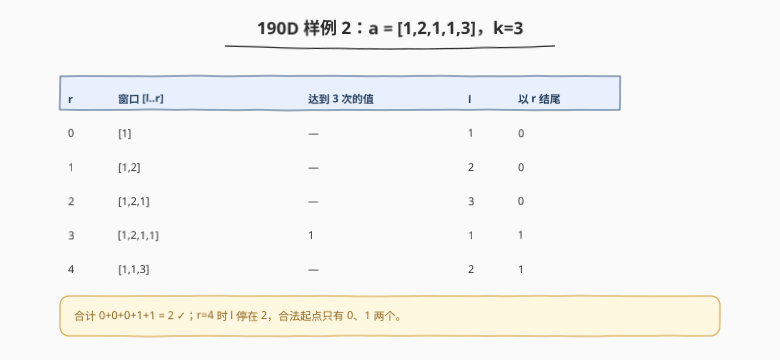

# Codeforces 190D 非秘密密码 题解

## 1. 题目概述

- **题目链接**：https://codeforces.com/problemset/problem/190/D
- **比赛来源**：Codeforces Round 120 (Div. 2) · Problem D（UTC 2012-05-16）
- **难度**：1900
- **标签**：双指针、计数
- **评测类型**：普通
- **限制**：时间 3 s / 内存 256 MB

**题意**：给定长度 $n$ 的数组与 $k$，数出"至少含有 $k$ 个相等元素"的连续子数组个数。

**约束**：$1\le k\le n\le4\times10^5$，$1\le a_i\le10^9$。

**这档约束排除了什么**：$n=4\times10^5$ 时子数组有 $8\times10^{10}$ 个，必须 $O(n)$ 或 $O(n\log n)$；答案本身可达 $8\times10^{10}$，必须 64 位。

## 2. 示例与观察

官方样例一：

```text
输入：
4 2
1 2 1 2

输出：
3
```

官方样例二：

```text
输入：
5 3
1 2 1 1 3

输出：
2
```

官方样例三：

```text
输入：
3 1
1 1 1

输出：
6
```

**样例解释一**：$k=2$。子数组 `[1,2,1]`、`[2,1,2]`、`[1,2,1,2]` 各含 2 个相同元素 ⇒ 3。

**样例解释二**：只有 `[1,2,1,1]`（含三个 1）和 `[1,2,1,1,3]` ⇒ 2。

**样例解释三**：$k=1$，任何非空子数组都含至少 1 个某值 ⇒ $\binom{3+1}{2}=6$。

**第一条观察**：固定右端点 $r$，若 $[l,r]$ 是"好的"，则 $[l',r]$（$l'\le l$）也是好的（只加元素不减）。所以合法左端点是一个前缀 $[0,L_r-1]$，个数就是 $L_r$。

**第二条观察**：$L_r$（最小的非法左端点）随 $r$ 单调不减 ⇒ 双指针。

**第三条观察**：维护"窗口内每个值出现次数"，以及"出现次数恰好达到 $k$ 的值的个数" $g$；窗口好 ⟺ $g>0$。



自造样例（标注"自造"）：

| 输入 | 输出 | 说明 |
|------|------|------|
| `1 1` / `1` | 1 | 单个元素 |
| `2 2` / `1 2` | 0 | 没有重复 |
| `2 2` / `1 1` | 1 | 只有全长 |
| `3 2` / `1 1 1` | 3 | `[1,1]`、`[1,1]`、`[1,1,1]` |
| `4 1` / `5 5 5 5` | 10 | 全部子数组 |

## 3. 解题思路

### 3.1 朴素做法与瓶颈

枚举所有子数组并计数：$O(n^2)$，$n=4\times10^5$ 时 $1.6\times10^{11}$ 不可行。

### 3.2 核心观察：双指针 + "达到 k 的值的个数"



- 右端 $r$ 从 0 到 $n-1$：把 $a_r$ 加入窗口；
- 若某值计数**正好变成** $k$，令 $g{+}{+}$；
- 当 $g>0$ 时，把 $a_l$ 移出：若它的计数**正好等于** $k$（移出前），令 $g{-}{-}$；$l{+}{+}$；
- 循环结束时 $[l,r]$ 是"最短的坏窗口"（去掉左端就变好），所以以 $r$ 结尾的好子数组恰有 $l$ 个（左端取 $0..l-1$），累加 $l$。

关键：$g$ 用"恰好等于 $k$"来增减，而不是"某值 ≥ k"的布尔值 —— 因为窗口里可能同时有多个值达到 $k$，只用一个布尔量会在移出一个值时误判。

### 3.3 算法流程

1. 读入 $n,k,a$；
2. `l=0, g=0, ans=0`；
3. 对每个 $r$：加入 $a_r$（若计数变为 $k$ 则 $g{+}{+}$）；`while g>0`：移出 $a_l$（若移出前计数为 $k$ 则 $g{-}{-}$），$l{+}{+}$；
4. `ans += l`；
5. 输出 $ans$。

### 3.4 样例走查

$n=5,k=3$，$a=[1,2,1,1,3]$：

| $r$ | 窗口 | $g$ | $l$ | 累加 |
|-----|------|-----|-----|------|
| 0 | [1] | 0 | 1 | 0 |
| 1 | [1,2] | 0 | 2 | 0 |
| 2 | [1,2,1] | 0 | 3 | 0 |
| 3 | [1,2,1,1] | 1 | 1 | 1 |
| 4 | [1,1,3] | 0 | 2 | 2 |

合计 2 ✓。

## 4. 正确性证明

**引理 1（单调性）**：若 $[l,r]$ 好，则对任意 $l'\le l$，$[l',r]$ 也好。

**证明**：$[l',r]\supseteq[l,r]$，值出现次数不减。∎

**引理 2（$l$ 的单调性）**：算法中的 $l$ 随 $r$ 单调不减。

**证明**：每轮只增不减；且上一轮的 $l$ 满足 $[l,r-1]$ 坏（或 $l=r$），加入 $a_r$ 后 $[l,r]$ 可能变好，此时继续右移 $l$，所以新的 $l\ge$ 旧的 $l$。∎

**引理 3（计数正确）**：`g` 始终等于"窗口内出现次数 $\ge k$ 的值的个数"。

**证明**：加入时若某值计数从 $k-1$ 变为 $k$ 则 $g{+}{+}$，此后继续增加不再改变 $g$；移出时若计数从 $k$ 变为 $k-1$ 则 $g{-}{-}$。由于每个值的计数只会穿过 $k$ 一次（在加入方向）或反向一次，$g$ 始终等于满足"计数 $\ge k$"的值的个数。∎

**定理（答案正确）**：算法累加的 $\sum_r l_r$ 等于好子数组的个数。

**证明**：由引理 1，以 $r$ 结尾的好子数组的起点构成前缀 $[0,l_r-1]$，个数 $l_r$；由引理 2、3，算法维护的 $l$ 正是最小的"坏"起点。对 $r$ 求和即得。∎

## 5. 复杂度分析

- **时间**：$l,r$ 各单调移动 $\le n$ 步，哈希表均摊 $O(1)$ ⇒ $O(n)$。
- **空间**：$O(n)$（哈希表）。
- **数值范围**：答案 $\le\binom{n+1}{2}\approx8\times10^{10}$，必须 `long long`。
- **与时限的关系**：$n=4\times10^5$ 实测 631 ms（3 s 限制）。

## 6. 参考代码

### C++17

```cpp
#include <bits/stdc++.h>
using namespace std;
typedef long long ll;

int main() {
    ios::sync_with_stdio(false);
    cin.tie(nullptr);
    int n, k;
    cin >> n >> k;
    vector<ll> a(n);
    for (auto &x : a) cin >> x;
    unordered_map<ll, int> cnt;
    cnt.reserve(n * 2);
    int numGood = 0;          // cnt 恰好达到 k 的“值”的个数
    ll ans = 0;
    int l = 0;
    for (int r = 0; r < n; ++r) {
        if (++cnt[a[r]] == k) ++numGood;
        while (numGood > 0) {
            if (cnt[a[l]]-- == k) --numGood;
            ++l;
        }
        ans += l;             // 以 r 结尾的合法子数组：起点 0..l-1
    }
    cout << ans << '\n';
    return 0;
}
```

### Python3

```python
import sys


def main() -> None:
    data = sys.stdin.buffer.read().split()
    n, k = int(data[0]), int(data[1])
    a = [int(data[2 + i]) for i in range(n)]
    cnt = {}
    num_good = 0
    ans = 0
    l = 0
    for r in range(n):
        v = a[r]
        cnt[v] = cnt.get(v, 0) + 1
        if cnt[v] == k:
            num_good += 1
        while num_good > 0:
            u = a[l]
            if cnt[u] == k:
                num_good -= 1
            cnt[u] -= 1
            l += 1
        ans += l
    print(ans)


main()
```

## 7. 边界情况与易错点

1. **$g$ 用"恰好等于 $k$"维护**：若用"是否有值 ≥ k"的布尔量，移出一个值时可能错误地认为窗口变坏（其实还有别的值 ≥ k）。
2. **$k=1$**：$g$ 在第一次加入时就 >0，$l$ 会一直右移；答案退化为所有子数组数 $\binom{n+1}{2}$ ✓。
3. **$k=n$**：只有当所有元素相同时才有一个好子数组。
4. **答案溢出**：$8\times10^{10}$ 超过 `int`，必须 64 位（Python 无此问题）。
5. **`ans += l` 的位置**：必须在 while 结束后加，且加的是 $l$（起点个数），不是 $r-l+1$。
6. **哈希表性能**：$a_i$ 到 $10^9$，C++ 用 `unordered_map` 建议 `reserve`；或离散化后用数组。
7. **$n=1$**：$k=1$ 时答案 1，否则 0（但 $k\le n$ 保证 $k=1$）。

## 8. 验证记录

- **编译环境与命令**：`clang++ -std=c++17 -O2` + 兼容头；Python 3.9.6。文档级校验：`python3 codeforces/tools/verify_solution.py codeforces/contests/0101-0203/190/D_非秘密密码.md`。
- **官方样例**：3 / 3 通过（`3`、`2`、`6`）。
- **独立对拍**：另写 $O(n^2)$ 枚举所有子数组并统计的暴力，随机 $n\le10$、值域 $[1,4]$、$k\le n$ 共 **300 组**，C++/Python 与暴力全部一致。
- **最大约束性能**：$n=4\times10^5$、$k=3$ 随机数据 631 ms，答案 $79932096641$（验证了 64 位）。
- **图片校验**：两张 SVG（`cf190d_window.svg`、`cf190d_sample.svg`）通过 `xml.etree.ElementTree.parse`，文本未越界、无重叠。
- **复核状态**：verified（样例、300 组对拍、性能、图片均实跑通过）。

## 相关题目与扩展

- [Codeforces 190E Counter Attack](https://codeforces.com/problemset/problem/190/E)：同场补图题。
- [LeetCode 992 K 个不同整数的子数组](https://leetcode.cn/problems/subarrays-with-k-different-integers/)：同款"恰好 k"的双指针技巧。
- [Codeforces 279B Books](https://codeforces.com/problemset/problem/279/B)：双指针入门。
- [Codeforces 1208A XORinacci](https://codeforces.com/problemset/problem/1208/A)：简单递推。
- [Codeforces 190C STL](https://codeforces.com/problemset/problem/190/C)：同场解析题。

**延伸思考**：

1. **为什么"恰好 k"的双指针可行**：窗口好这个性质对左端点单调、对右端点单调，"最小坏起点"随右端点单调。
2. **如果要求"恰好 $k$ 个相等元素"**：用"至少 k"减去"至少 k+1"即可（同款技巧）。
3. **如果要求"至少 $k$ 个不同的值"**：把"值的计数"换成"值的种数"，双指针仍有效。
4. **如果 $n$ 到 $10^6$**：哈希表换成离散化 + 数组，实测会快一倍。

