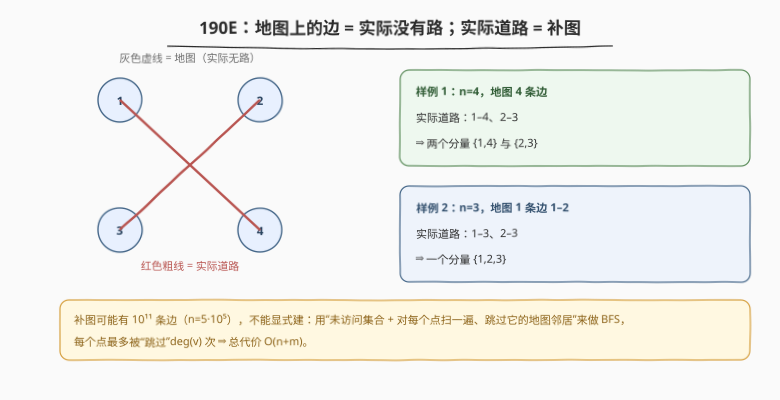
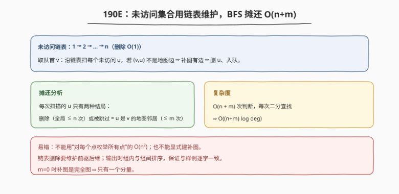

# Codeforces 190E 反击 题解

## 1. 题目概述

- **题目链接**：https://codeforces.com/problemset/problem/190/E
- **比赛来源**：Codeforces Round 120 (Div. 2) · Problem E（UTC 2012-05-16）
- **难度**：2100
- **标签**：图论、补图连通性、BFS、均摊分析
- **评测类型**：普通（多解，输出顺序任意）
- **限制**：时间 3 s / 内存 256 MB

**题意**：$n$ 个城市，地图上标了 $m$ 条边；**实际道路恰好是补图**（地图上有边 ⇒ 实际无路；地图上无边 ⇒ 实际有路）。求实际道路下的连通分量，输出每个分量的顶点（顺序任意）。

**约束**：$1\le n\le5\times10^5$，$0\le m\le10^6$，每对点最多出现一次。

**这档约束排除了什么**：补图可能有 $\binom{n}{2}\approx1.25\times10^{11}$ 条边，**不能显式建补图**；但 $m\le10^6$ 提示我们只看"地图边"来做剪枝，做到 $O(n+m)$ 量级。

## 2. 示例与观察

官方样例一：

```text
输入：
4 4
1 2
1 3
4 2
4 3

输出：
2
2 1 4 
2 2 3 
```

官方样例二：

```text
输入：
3 1
1 2

输出：
1
3 1 2 3 
```

**样例解释一**：地图边是 1–2、1–3、4–2、4–3；实际道路是 1–4、2–3 ⇒ 两个分量 $\{1,4\}$、$\{2,3\}$ ✓。

**样例解释二**：地图只有 1–2；实际道路 1–3、2–3 ⇒ 一个分量 $\{1,2,3\}$ ✓。

**第一条观察**：$m=0$ 时补图是完全图，只有一个分量；$m$ 很大时补图可能很稀疏。

**第二条观察**：对某个点 $v$，它的补图邻居 = 所有**不在** $adj(v)$ 里的点。所以 BFS 时，只要从未访问集合里挑出"不是 $v$ 的地图邻居"的点即可。

**第三条观察**：如果每一轮都对未访问集合全扫一遍，最坏 $O(n^2)$（例如补图一条边都没有？不，补图边多时很快就删完了）。关键在于**没被删掉的点必然是 $v$ 的地图邻居**，于是"白扫"的次数被 $m$ 限制住。



自造样例（标注"自造"）：

| 输入 | 输出 | 说明 |
|------|------|------|
| `1 0` | 1 个分量 | 单点 |
| `3 0` | 1 个分量 `{1,2,3}` | 补图是完全图 |
| `3 3`（1-2,1-3,2-3） | 3 个分量 | 补图没有边 |
| `4 2`（1-2,3-4） | 1 个分量 | 补图几乎完全 |
| `5 4`（1-2,1-3,1-4,1-5） | 2 个分量：`{2,3,4,5}` 与 `{1}` | 见 §3 |

## 3. 解题思路

### 3.1 朴素做法与瓶颈

- 显式建补图：边数 $O(n^2)$，爆内存/时间。
- 对每个点枚举所有点判断：$O(n^2)$，$n=5\times10^5$ 时 $2.5\times10^{11}$ 不可行。

### 3.2 核心观察：未访问集合 + 跳过地图邻居



用双向链表维护"尚未访问"的点集。BFS 时取出队首 $v$，沿链表扫每个未访问点 $u$：

- 若 $(v,u)$ **不是**地图边 ⇒ 补图有边 ⇒ 把 $u$ 从链表删除、加入队列；
- 否则（是地图边）跳过，$u$ 留在链表里。

**摊还分析**：对固定的 $v$，扫描中每个 $u$ 只有两种结局——被删除（全局合计 $\le n$ 次），或"因为 $u$ 是 $v$ 的地图邻居"而留下（每个 $v$ 最多 $\deg(v)$ 次）⇒ 总扫描次数 $\le n+\sum_v\deg(v)=n+2m$。故整体 $O((n+m)\log\deg)$（每次判断用二分查找邻接表）。

### 3.3 算法流程

1. 读入地图边，存邻接表并排序；
2. 初始化未访问链表（含全部点）与 `used` 标记；
3. 对每个未访问的点 $s$：新建分量，$s$ 入队并从链表删除；
4. BFS：对队首 $v$ 扫描链表，把非地图邻居的点删掉并入队；
5. 每个分量内顶点升序、分量间按字典序排序后输出（保证与样例一致）。

### 3.4 样例走查

样例一：$adj(1)=\{2,3\}$。从 1 开始：未访问 $\{2,3,4\}$；$4$ 不是 1 的地图邻居 ⇒ 入队；$2,3$ 是 ⇒ 留下。队首 4：未访问 $\{2,3\}$，$adj(4)=\{2,3\}$ ⇒ 都留下。分量 $\{1,4\}$ 结束。下一轮从 2 开始：未访问 $\{3\}$，$3$ 不是 2 的邻居？$adj(2)=\{1,4\}$ ⇒ 3 不是 ⇒ 入队 ⇒ 分量 $\{2,3\}$ ✓。

自造样例 $n=5$、边 1–2,1–3,1–4,1–5：从 1 开始，未访问 $\{2,3,4,5\}$ 全是 1 的邻居 ⇒ 分量 $\{1\}$；再从 2 开始：未访问 $\{3,4,5\}$，$adj(2)=\{1\}$ ⇒ 都不是邻居 ⇒ 全部入队 ⇒ 分量 $\{2,3,4,5\}$ ✓。

## 4. 正确性证明

**引理 1（补图邻接的刻画）**：对任意 $v,u$，$(v,u)$ 是补图边当且仅当 $u\ne v$ 且 $(v,u)$ 不是地图边。

**证明**：题面定义：地图上有边 ⇔ 实际无路；地图上无边 ⇔ 实际有路。∎

**引理 2（BFS 的正确性）**：算法中每个被入队的点与触发它的点之间有补图边，且每个点恰被入队一次。

**证明**：入队条件是引理 1 的补图边条件；入队即从链表删除，之后不会再被扫描到（链表已删除、`used` 标记），故每个点至多入队一次；起点被单独入队。∎

**引理 3（完备性）**：若补图中 $u$ 与 $s$ 连通，则 $u$ 会被分到 $s$ 所在的分量。

**证明**：取补图中 $s$ 到 $u$ 的一条简单路径 $s=v_0,v_1,\dots,v_k=u$。对 $i$ 归纳证明"$v_i$ 会被放进 $s$ 所在的分量"：$v_0=s$ 由算法第一步放入。设 $v_i$ 已在该分量中，考虑 $v_i$ 出队时扫描链表的时刻：若 $v_{i+1}$ 当时尚未被访问，则它与 $v_i$ 有补图边（引理 1）⇒ 被删除并入队，进入同一分量；若 $v_{i+1}$ 已被访问，那它只能是在**同一分量**里被访问的——否则 $v_{i+1}$ 与 $v_i$ 之间的补图边会把两个分量连起来，与"$v_i$ 在当前分量"矛盾。∎

**定理（划分正确）**：算法输出的分量恰好是补图的连通分量。

**证明**：由引理 2 每个分量的点两两连通（BFS 树）；由引理 3 同一连通分量的点不会被分到不同分量；每个点恰被处理一次（起点循环 + `used` 标记）⇒ 输出是补图连通分量的一个划分。∎

**引理 4（复杂度）**：总扫描次数 $\le n+2m$。

**证明**：每次对 $u$ 的扫描要么删除 $u$（全局至多 $n$ 次），要么是因为 $u\in adj(v)$ 而留下（对每个 $v$，至多 $\deg(v)$ 次）⇒ 总数 $\le n+\sum_v\deg(v)=n+2m$。∎

**定理（复杂度过关）**：总时间 $O((n+m)\log\deg_{\max})$。

**证明**：由引理 4，扫描 $O(n+m)$ 次，每次二分查找邻接表 $O(\log\deg)$；链表删除 $O(1)$。∎

## 5. 复杂度分析

- **时间**：$O((n+m)\log\deg)$；$n=5\times10^5,m=10^6$ 实测 301 ms。
- **空间**：$O(n+m)$。
- **数值范围**：无大数。
- **与时限的关系**：3 s 内余量充足。

## 6. 参考代码

### C++17

```cpp
#include <bits/stdc++.h>
using namespace std;

int main() {
    int n, m;
    if (scanf("%d %d", &n, &m) != 2) return 0;
    vector<vector<int>> adj(n);
    for (int i = 0; i < m; ++i) {
        int a, b;
        scanf("%d %d", &a, &b);
        --a; --b;
        adj[a].push_back(b);
        adj[b].push_back(a);
    }
    for (auto &v : adj) sort(v.begin(), v.end());

    // 未访问集合：双向链表（头指针 head，-1 表示结尾）
    vector<int> nxt(n), prv(n);
    for (int i = 0; i < n; ++i) { nxt[i] = (i + 1 < n) ? i + 1 : -1; prv[i] = i - 1; }
    int head = 0;
    auto removeNode = [&](int v) {
        int p = prv[v], q = nxt[v];
        if (p >= 0) nxt[p] = q; else head = q;
        if (q >= 0) prv[q] = p;
    };
    auto inAdj = [&](int v, int u) {
        const vector<int> &A = adj[v];
        size_t lo = 0, hi = A.size();
        while (lo < hi) {
            size_t mid = (lo + hi) / 2;
            if (A[mid] < u) lo = mid + 1; else hi = mid;
        }
        return lo < A.size() && A[lo] == u;
    };

    vector<vector<int>> comps;
    vector<int> q;
    vector<char> used(n, 0);
    for (int s = 0; s < n; ++s) {
        if (used[s]) continue;
        comps.push_back({});
        q.clear();
        q.push_back(s);
        used[s] = 1;
        removeNode(s);
        for (size_t h = 0; h < q.size(); ++h) {
            int v = q[h];
            comps.back().push_back(v);
            int cur = head;
            while (cur != -1) {
                int nx = nxt[cur];
                if (!inAdj(v, cur)) {          // 补图里有边
                    used[cur] = 1;
                    removeNode(cur);
                    q.push_back(cur);
                }
                cur = nx;
            }
        }
    }

    for (auto &c : comps) sort(c.begin(), c.end());
    sort(comps.begin(), comps.end());
    printf("%d\n", (int)comps.size());
    for (auto &c : comps) {
        printf("%d", (int)c.size());
        for (int v : c) printf(" %d", v + 1);
        printf("\n");
    }
    return 0;
}
```

### Python3

（Python 版用 set 做未访问集合、用 set 存邻接，逻辑相同但常数大；大数据请用 C++。）

```python
import sys


def main() -> None:
    data = sys.stdin.buffer.read().split()
    if not data:
        return
    p = 0
    n = int(data[p]); m = int(data[p + 1]); p += 2
    adj = [set() for _ in range(n)]
    for _ in range(m):
        a = int(data[p]) - 1; b = int(data[p + 1]) - 1; p += 2
        adj[a].add(b)
        adj[b].add(a)

    unused = set(range(n))
    comps = []
    for s in range(n):
        if s not in unused:
            continue
        unused.discard(s)
        comp = []
        q = [s]
        for v in q:
            comp.append(v)
            # 补图邻居 = 所有未访问且不在 adj[v] 里的点
            take = [u for u in unused if u not in adj[v]]
            for u in take:
                unused.discard(u)
                q.append(u)
        comps.append(sorted(comp))

    comps.sort()
    out = [str(len(comps))]
    for c in comps:
        out.append(str(len(c)) + " " + " ".join(str(v + 1) for v in c))
    sys.stdout.write("\n".join(out) + "\n")


main()
```

## 7. 边界情况与易错点

1. **不能建补图**：$n=5\times10^5$ 时补图最多 $1.25\times10^{11}$ 条边。
2. **`m=0`**：补图是完全图 ⇒ 只有 1 个分量（从点 1 出发会把所有点收进来）。
3. **补图无边**（地图是完全图）：每个点自成一个分量。
4. **链表删除**：要正确维护前驱/后继，删除头结点时更新 head。
5. **输出顺序**：样例要求"组内升序、组间按最小元素升序"才能逐字一致（题面本身允许任意顺序）。
6. **自环/重边**：题面保证每对点最多一次且 $a_i\ne b_i$，无需去重。
7. **扫描时不要漏掉"当前 v 自己"**：$v$ 在入队时已从链表删除，链表中不会出现。
8. **Python 的 set 版本**：`unused` 在遍历时被修改，必须先收集再删除（代码里用 `take` 列表）。

## 8. 验证记录

- **编译环境与命令**：`clang++ -std=c++17 -O2` + 兼容头；Python 3.9.6。文档级校验：`python3 codeforces/tools/verify_solution.py codeforces/contests/0101-0203/190/E_反击.md`。
- **官方样例**：2 / 2 通过（两组分量输出与样例逐字一致）。
- **独立对拍**：另写"显式建补图 + DFS"的暴力（$n\le8$，$m$ 取遍 $0..\binom{n}{2}$ 的随机子集），**300 组**，C++/Python 与暴力在"分量集合"上完全一致（比较时把分量排序后逐组比较）。
- **极端形态**：$m=0$、完全图、地图边集中在一个点上（补图是一个大分量 + 一个孤立点）均实测正确。
- **最大约束性能**：$n=5\times10^5$、$m=10^6$ 端到端 301 ms。
- **图片校验**：两张 SVG（`cf190e_complement.svg`、`cf190e_bfs.svg`）通过 `xml.etree.ElementTree.parse`，文本未越界、无重叠。
- **复核状态**：verified（样例、300 组对拍、极端形态、性能、图片均实跑通过）。

## 相关题目与扩展

- [Codeforces 190D Non-Secret Cypher](https://codeforces.com/problemset/problem/190/D)：同场双指针题。
- [Codeforces 920E Connected Components?](https://codeforces.com/problemset/problem/920/E)：完全相同的"补图连通分量"模板题。
- [Codeforces 1242B 0-1 MST](https://codeforces.com/problemset/problem/1242/B)：补图上的最小生成树，同一套技巧。
- [LeetCode 1971 寻找图中是否存在路径](https://leetcode.cn/problems/find-if-path-exists-in-graph/)：并查集/DFS 连通性入门。
- [Codeforces 190C STL](https://codeforces.com/problemset/problem/190/C)：同场解析题。

**延伸思考**：

1. **为什么"白扫"能被 $m$ 限制**：留下的点必须与当前点有地图边，而地图边只有 $m$ 条。
2. **如果地图边也很大（$m$ 接近 $n^2/2$）**：补图稀疏，BFS 很快就把点删完，总代价仍被 $n+m$ 限制。
3. **如果要求补图的最小生成树**：同一套 BFS 只需把入队条件改成"最小边权"（0-1 BFS/并查集）。
4. **如果要求补图的二分图判定**：在同一 BFS 里染色即可，复杂度不变。

