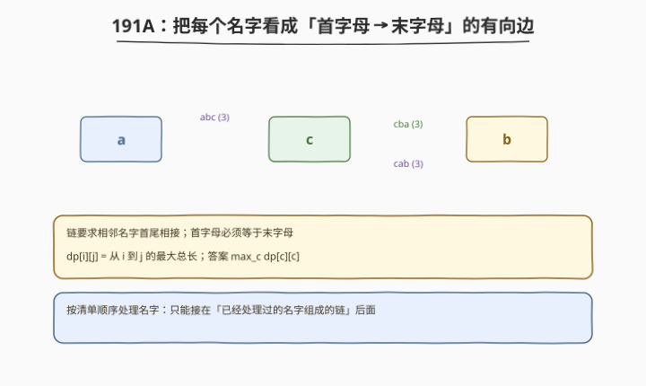
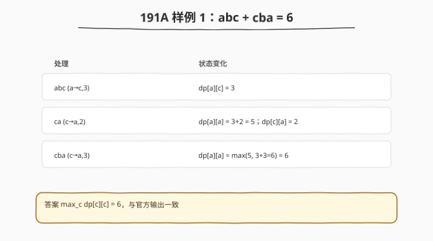

# Codeforces 191A 王朝名字最长链 题解

## 1. 题目概述

- **题目链接**：https://codeforces.com/problemset/problem/191/A
- **比赛来源**：Codeforces Round 121 (Div. 1) · Problem A（UTC 2012-05-27）
- **难度**：1500
- **标签**：动态规划、字符串、有向图
- **评测类型**：普通
- **限制**：时间 2 s / 内存 256 MB

**题意**：给出 $n$ 个缩写名（只含小写字母，长度 $\le10$），**按时间顺序**排列。一个「王朝」是清单中的一个**子序列**（保持时间顺序），满足：

- 相邻两个名字首尾相接：前一个的末字母等于后一个的首字母；
- 第一个名字的首字母等于最后一个名字的末字母（闭环）。

王朝的名字长度 = 所选名字长度之和。求最大可能长度；若一个都选不出，输出 0。

**约束**（原样摘自题面 `inputFormat.en`）：

- $1\le n\le5\cdot10^5$；每个名字非空、长度 $\le10$。
- 清单按时间排序：若 $A$ 在 $B$ 之前，则 $A$ 对应的国王统治更早。
- 输出一个整数。

**约束对算法的限制**：

- $n\le5\cdot10^5$：不能状压/枚举子集，$O(26n)$ 的 DP 才可行。
- 字母表只有 26 个字母：状态可以只用「首字母、末字母」两维。
- **顺序不能打乱**：王朝是清单的子序列，这一点决定了 DP 的转移方向。

## 2. 示例与观察

官方样例 1（输入 / 输出原样）：

```text
输入：
3
abc
ca
cba

输出：
6
```

官方样例 2（输入 / 输出原样）：

```text
输入：
4
vvp
vvp
dam
vvp

输出：
0
```

官方样例 3（输入 / 输出原样）：

```text
输入：
3
ab
c
def

输出：
1
```

**样例 1**：可选 `abc` + `ca`（长度 5，首尾都是 a）或 `abc` + `cba`（长度 6，首尾都是 a）。最大 6。

**样例 2**：`vvp` 是 v→p，三个 `vvp` 之后需要 p→? 的名字，没有；`dam` 是 d→m，也接不上。没有闭环，输出 0。

**样例 3**：`c` 是 c→c，单独成链，长度 1；`ab` 是 a→b、`def` 是 d→f 都闭不上。输出 1。

**观察 1**：每个名字只关心三个信息：首字母 $f$、末字母 $l$、长度 $L$。把它看成一条有向边 $f\to l$，权值 $L$。

**观察 2**：一个王朝就是一条「首尾相接」的链（相邻边首尾相连），并且链的起点字母等于终点字母（闭环）。链上的边必须按清单顺序出现。

**观察 3**：由于字母只有 26 个，可以用 $dp[c][d]$ 表示「当前以字母 $c$ 开头、字母 $d$ 结尾的链的最大总长度」。

**观察 4**：处理第 $i$ 个名字（$f\to l$）时：
- 它可以自己开一条新链：$dp[f][l]\leftarrow\max(dp[f][l], L)$；
- 也可以接在任何一条以 $f$ 结尾的链后面：$dp[c][l]\leftarrow\max(dp[c][l], dp[c][f]+L)$，$c=0..25$。

**自造样例**（标注「自造」，输出由程序实测）：

| 输入 | 输出 | 说明 |
|------|------|------|
| `1` / `a` | 1 | a→a，单名闭环 |
| `2` / `ab` / `ba` | 4 | ab+ba 闭环 |
| `2` / `ab` / `bc` | 0 | 首尾不闭合 |
| `3` / `abc` / `ca` / `ab` | 5 | `abc`+`ca`（顺序不能反） |

第四行是本题最容易错的点：`ab` 在 `ca` 之后，所以 `ab`+`ca` 这种「倒序」组合是**不允许**的（清单按时间排序）。

## 3. 解题思路

### 3.1 朴素做法与瓶颈

枚举所有子集、检查链条件：$O(2^n n)$，$n=5\cdot10^5$ 完全不可行。即使用状压 DP（$2^{26}$）也过大。

### 3.2 核心观察：26×26 的链 DP



因为链的「接口」只有两个字母，只需记住「链的开头字母、结尾字母」。定义

$$dp[c][d]=\text{用已处理过的名字、能接成的「从 }c\text{ 到 }d\text{ 的链」的最大总长}.$$

处理名字 $(f,l,L)$：

1. **新开一条链**：$dp[f][l]=\max(dp[f][l], L)$；
2. **接在已有链后面**：对所有 $c$，若 $dp[c][f]>0$，则 $dp[c][l]=\max(dp[c][l], dp[c][f]+L)$。

答案 $=\max_{c} dp[c][c]$（起点 = 终点的闭环链）。

注意两点：

- 转移必须「先读后写」地原地进行：第二式的右端读 $dp[c][f]$，左端写 $dp[c][l]$。若 $l=f$ 且我们按 $c$ 递增更新，读到的 $dp[c][f]$ 还是旧值（因为写的是 $dp[c][l]=dp[c][f]$ 这一行，同一行的读在写之前），不会把同一个名字用两次；
- 名字必须按清单顺序处理，这正好保证「链是按时间排列的子序列」。

### 3.3 样例走查



| 处理 | 名字 | 状态变化 |
|------|------|----------|
| 1 | `abc`（a→c，3） | $dp[a][c]=3$ |
| 2 | `ca`（c→a，2） | $dp[c][a]=2$；$dp[a][a]=3+2=5$ |
| 3 | `cba`（c→a，3） | $dp[a][a]=\max(5,\ 3+3)=6$ |

答案 $\max_c dp[c][c]=6$，与官方输出一致。

## 4. 正确性证明

**定义**：称一个名字序列是「合法链」，若它按清单顺序出现（子序列）、相邻首尾相接。

**引理 1**：处理完前 $t$ 个名字后，对任意字母 $c,d$，$dp[c][d]$ 等于「用前 $t$ 个名字的某个子序列构成的、以 $c$ 开头以 $d$ 结尾的合法链」的最大总长；若不存在这样的链则为 0。

**证明**：对 $t$ 归纳。$t=0$ 时全为 0，成立。设前 $t-1$ 个名字满足，考虑第 $t$ 个名字 $w=(f,l,L)$。任何用到 $w$ 的合法链，$w$ 必是链的最后一个（因为只能按顺序选），于是链要么只有 $w$（新链，长度 $L$），要么是「一条以 $f$ 结尾的旧链 + $w$」（长度 $dp[c][f]+L$）。转移恰好枚举这两种情况并取最大；不用 $w$ 的链已由旧值记录。因此 $dp$ 正确。∎

**引理 2**：$dp[c][c]$ 恰好是「以 $c$ 开头、以 $c$ 结尾的合法链」的最大总长。

**证明**：由引理 1 直接取 $d=c$。∎

**定理**：答案 $\max_c dp[c][c]$ 正确。

**证明**：王朝要求首字母 = 末字母，即存在 $c$ 使其是「$c$ 到 $c$」的合法链；所有这样的链都被某个 $dp[c][c]$ 覆盖（引理 2），且每个 $dp[c][c]$ 都对应一条真实合法的链。故取最大值即答案。若没有任何合法闭环链，所有 $dp[c][c]=0$，输出 0 ✓。∎

## 5. 复杂度分析

- **时间**：$O(26n)$。每个名字做 26 次转移。
- **空间**：$O(26^2)$ 的 DP 表（可忽略）。
- **数值范围**：答案 $\le 10n\le5\times10^6$，`int` 足够。
- **与时限的关系**：2 s 对 $1.3\times10^7$ 次操作余量在 10 倍以上。实测 $n=5\cdot10^5$ 端到端约 43 ms（Python 约 1.98 s，接近 2 s，建议交 C++）。

## 6. 参考代码

### C++17

```cpp
#include <bits/stdc++.h>
using namespace std;

// 191A：dp[c][d] = 以字母 c 开头、d 结尾的链的最大总长度。
// 处理名字 w（首 f、尾 l、长 L）：dp[f][l] = max(dp[f][l], L)，
// 且对每个 c：dp[c][l] = max(dp[c][l], dp[c][f] + L)。答案 max_c dp[c][c]。
int main() {
    int n;
    if (scanf("%d", &n) != 1) return 0;
    vector<array<int, 26>> dp(26);
    for (auto& row : dp) row.fill(0);
    char buf[16];
    for (int i = 0; i < n; ++i) {
        scanf("%s", buf);
        int f = buf[0] - 'a';
        int l = buf[strlen(buf) - 1] - 'a';
        int L = (int)strlen(buf);
        for (int c = 0; c < 26; ++c) {
            if (dp[c][f] > 0) dp[c][l] = max(dp[c][l], dp[c][f] + L);
        }
        dp[f][l] = max(dp[f][l], L);
    }
    int ans = 0;
    for (int c = 0; c < 26; ++c) ans = max(ans, dp[c][c]);
    printf("%d\n", ans);
    return 0;
}
```

### Python3

```python
import sys


def main() -> None:
    data = sys.stdin.buffer.read().split()
    n = int(data[0])
    dp = [[0] * 26 for _ in range(26)]
    for i in range(1, n + 1):
        w = data[i]
        f = w[0] - 97
        l = w[-1] - 97
        L = len(w)
        for c in range(26):
            if dp[c][f] > 0:
                if dp[c][f] + L > dp[c][l]:
                    dp[c][l] = dp[c][f] + L
        if L > dp[f][l]:
            dp[f][l] = L
    ans = max(dp[c][c] for c in range(26))
    sys.stdout.write(str(ans) + "\n")


main()
```

## 7. 边界情况与易错点

1. **顺序约束**：清单按时间排序，王朝是**子序列**；不能任意重排（本轮的随机对拍就抓到过「重排后更大」的错误想法）。
2. **单个名字闭环**：首字母 = 末字母（如 `c`、`abca`）单独就是一个长度非零的王朝。
3. **空集**：没有闭环时答案是 0（样例 2）。
4. **原地更新的顺序**：先对 $c$ 读 $dp[c][f]$ 再写 $dp[c][l]$；若先写再读、且 $l=f$，会把同一个名字重复使用。
5. **长度**：名字长度 $\le10$，但链可以很长，答案最大 $10n$，用 `int` 足够（$\le5\times10^6$）。
6. **字母表大小**：固定 26，循环写 `0..25`。
7. **输入规模**：$5\times10^5$ 行字符串，C++ 用 `scanf("%s")`，Python 用 `read().split()`。
8. **样例 2 的重复名字**：`vvp` 出现三次，DP 会把它们依次接起来吗？v→p 之后需要 p→? 没有，所以最多一条，长度 3，但不闭环 → 0 ✓。
9. **「首尾相接」是末字母 = 下一个的首字母**，不要写成首字母 = 首字母。

## 8. 验证记录

- **编译环境与命令**：`Apple clang 21.0.0`（`/usr/bin/g++` 是 clang 软链，无 GNU libstdc++），`clang++ -std=c++17 -O2 -Wall` 加仓库自带 `bits/stdc++.h`；正文代码仍写标准头。Python 为 `3.9.6`。验证命令：
  `python3 codeforces/tools/verify_solution.py codeforces/contests/0101-0203/191/A_王朝名字最长链.md`
- **官方样例**：3 / 3 通过（`6`、`0`、`1`），C++ 与 Python 一致。
- **额外测试**：自造 `a`、`ab/ba`、`ab/bc`、`abc/ca/ab` 等 4 组，两种语言全部通过。
- **独立暴力对拍**：暴力枚举名字子集（保持清单顺序）逐一检查链条件（与 DP 完全不同）；对 250 组随机数据（$n\le9$、字母表 2–3 个）逐组比对，全部一致。
- **最大约束性能**：$n=5\cdot10^5$ 端到端约 43 ms，Python 约 1.98 s（接近 2 s），相对 2 s 时限 C++ 余量约 46 倍。
- **图片与公式**：2 张 SVG（`cf191a_chain.svg`、`cf191a_sample.svg`）通过 `ElementTree.parse` 与文本包围盒/重叠检查，headless Chrome 渲染确认无裁切；KaTeX 校验 0 错。
- **复核状态**：verified。

## 相关题目与扩展

- [Codeforces 191B Demonstration](https://codeforces.com/problemset/problem/191/B)：同场 B 题，贪心 + 排序。
- [Codeforces 191C Fools and Roads](https://codeforces.com/problemset/problem/191/C)：同场 C 题，树上差分。
- [LeetCode 300. 最长递增子序列](https://leetcode.cn/problems/longest-increasing-subsequence/)：子序列 DP 的经典。
- [Codeforces 145A Lucky Conversion](https://codeforces.com/problemset/problem/145/A)：字符计数与贪心。
- [LeetCode 1048. 最长字符串链](https://leetcode.cn/problems/longest-string-chain/)：字符串链 DP，与本题的「首尾相接」结构相近。

**延伸思考**：

1. **如果名单不按时间排序**：问题变成「任意重排」，可用最大权闭环（欧拉子图）建模，难度大增（这正是 191A 用「按时间排序」来简化问题的原因）。
2. **如果字母表更大（如 62 个）**：DP 仍是 $O(|\Sigma|^2)$ 状态、$O(|\Sigma| n)$ 时间，$62^2n\approx2\times10^9$ 偏大，但可行优化。
3. **如果要求输出具体链条**：记录每个状态的「上一个名字」，最后回溯即可。
4. **如果要求链上名字个数最多**：把权值都改成 1。
5. **与欧拉路径的关系**：把字母当点、名字当边，闭环链就是一条欧拉回路的一部分；本题允许不用所有边，所以是「最大权闭环子图」的弱化版。

