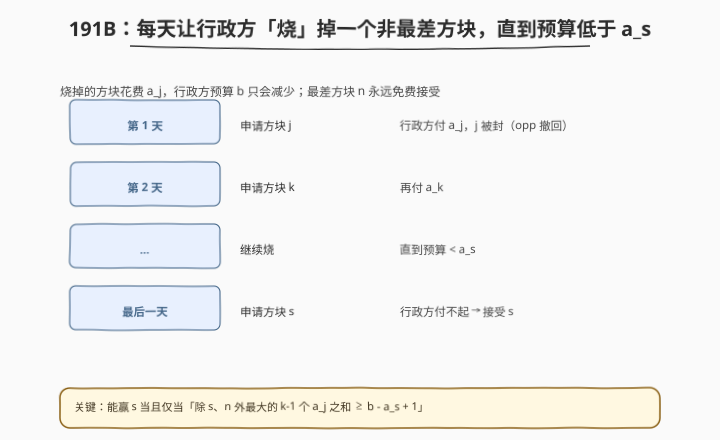
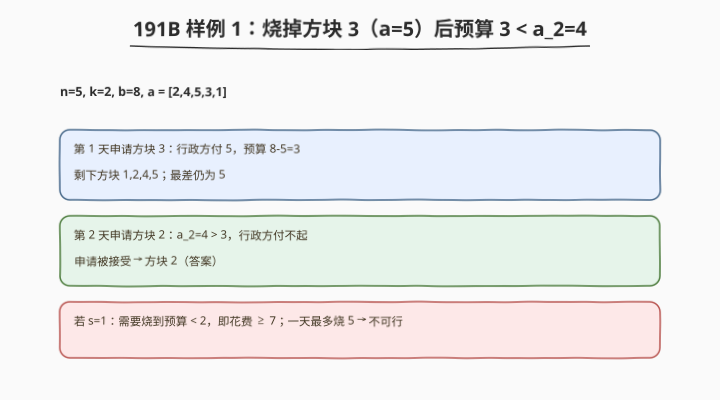

# Codeforces 191B 示威广场申请博弈 题解

## 1. 题目概述

- **题目链接**：https://codeforces.com/problemset/problem/191/B
- **比赛来源**：Codeforces Round 121 (Div. 1) · Problem B（UTC 2012-05-27）
- **难度**：1700
- **标签**：贪心、排序、博弈（单方最优）
- **评测类型**：普通
- **限制**：时间 2 s / 内存 256 MB

**题意**：$n$ 个广场（编号越小离市中心越近），还剩 $k$ 天（$k<n$）。市政府有 $b$ 卢布，在 $i$ 号广场办活动要花 $a_i$。每天：

1. 反对派申请一个**空闲**广场 $s$；
2. 若 $s$ 是当前**最差**（编号最大）的空闲广场 → 直接批准；
3. 否则若市政府的钱够 $a_s$ → 市政府占用 $s$（$s$ 不再空闲），并提议把示威改到当前最差空闲广场；
4. 否则（钱不够）→ 申请被批准（并把剩余的钱全部花掉）；
5. 申请没被批准时，反对派可以接受「最差空闲广场」，也可以撤回、改天再申请；申请被批准时，反对派也可以拒绝（广场仍空闲），改天再申请。

反对派想拿到编号尽量小的广场，市政府按规则尽力阻挠。求反对派最终能确保的最小广场编号。

**约束**（原样摘自题面 `inputFormat.en`）：

- $1\le k<n\le10^5$；$1\le b\le10^{18}$；$1\le a_i\le10^9$。
- 输出一个整数。

**约束对算法的限制**：

- $n\le10^5$：需要 $O(n\log n)$ 的排序/前缀和，不能搜索博弈树。
- $b$ 可达 $10^{18}$，而 $\sum a_i\le10^{14}$：注意「钱多到花不完」的情形。
- 编号 $n$ 的广场是「最差」的，永远不会被占用（申请它就直接批准），因此它是保底答案。

## 2. 示例与观察

官方样例 1（输入 / 输出原样）：

```text
输入：
5 2
8
2 4 5 3 1

输出：
2
```

官方样例 2（输入 / 输出原样）：

```text
输入：
5 2
8
3 2 4 1 5

输出：
5
```

官方样例 3（输入 / 输出原样）：

```text
输入：
5 4
1000000000000000
5 4 3 2 1

输出：
5
```

**样例 1 的演算**：$n=5,k=2,b=8$，$a=[2,4,5,3,1]$。

- 第 1 天申请 3 号：市政府付 5（剩 3），3 号被占；最差空闲仍是 5 号，反对派撤回。
- 第 2 天申请 2 号：$a_2=4>3$，市政府付不起 → 申请被批准，拿到 **2 号** ✓。

**样例 2**：$a=[3,2,4,1,5]$，一天最多「烧」一个方块。想拿 1 号需要把预算降到 3 以下，即花掉 ≥6；一天最多烧 5（3 号），不够；其他 $s$ 也都不行 → 只能落到最差广场 5 ✓。

**样例 3**：$b=10^{15}$ 远大于所有 $a_i$ 之和（15），怎么烧都烧不穷 → 5 ✓。

**观察 1**：最差空闲广场的编号永远是 $n$（除非反对派自己申请 $n$ 并接受），因为被占用的都是「申请的那个」非最差广场。所以**不接受任何提议时，保底答案是 $n$**。

**观察 2**：要拿到 $s<n$，必须在某一天申请 $s$ 时市政府**付不起** $a_s$，即此前的累计花费 $>b-a_s$。

**观察 3**：每天最多「烧掉」一个非最差广场（花费 $a_j$）。共有 $k-1$ 天可以用来烧（最后一天用来申请目标 $s$）。

**观察 4**：花费总和不能超过 $b$（钱花光时申请会被直接批准，但那时反对派已经赢了）。若某次烧钱时付不起，市政府把钱清零、申请被批准——反对派可以拒绝并改天再申请，等于「免费把预算清零」，这只会更有利。

**观察 5**：因此能赢 $s$ 的充要条件是

$$\text{（除 }s\text{ 与 }n\text{ 外最大的 }k-1\text{ 个 }a_j\text{ 之和）}\ \ge\ b-a_s+1 .$$

**自造样例**（标注「自造」，输出由程序实测）：

| 输入 | 输出 | 说明 |
|------|------|------|
| `2 1` / `100` / `1 1` | 2 | $k=1$，一天只能申请最差 |
| `3 1` / `1` / `5 5 5` | 1 | $a_1=5>b=1$，第一天直接批准 1 号 |
| `4 2` / `10` / `1 6 6 1` | 2 | 烧掉 3 号（a=6）后预算 4 < a_2=6 |
| `4 3` / `10` / `1 6 6 1` | 1 | 两次机会：烧 6、6 后预算 0 < a_1=1 |

第三、四行是「天数是否够」的对比（具体输出见正文表格）。

## 3. 解题思路

### 3.1 朴素做法与瓶颈

直接搜索博弈树：状态是（空闲集合、预算、天数），指数级，$n=10^5$ 不可能。

### 3.2 核心观察：答案由「能否烧穿预算」决定



反对派要拿到 $s$，唯一的办法是让市政府在申请 $s$ 那天**付不起**（钱不够支付 $a_s$）。付不起的条件是累计花费 $>b-a_s$。

- 可用于烧钱的天数：$k-1$（最后一天要留给 $s$）；
- 可烧的广场：$1..n-1$ 中除 $s$ 外的任意空闲广场（$n$ 是最差广场，申请它会被直接批准，不能用来烧钱）；
- 为了用最少天数达到目标，显然应该烧**最贵的那些**：取除 $s$ 外最大的 $k-1$ 个 $a_j$。

于是判定条件是：这 $k-1$ 个花费之和 $\ge b-a_s+1$。

**为什么「付不起」不会破坏计划**：若在烧钱过程中某一步付不起，市政府会把钱清零并批准申请——钱变成 0，之后申请 $s$ 必然被批准（$a_s\ge1>0$）。所以「付不起」只会让目标更容易达成，不会让计划失败。

**为什么没达到条件就一定不行**：若这 $k-1$ 个最大花费之和 $<b-a_s+1$，则无论怎么烧，累计花费都 $<b-a_s+1$，即剩余预算始终 $>b-(b-a_s+1)=a_s-1$，也就是 $\ge a_s$；市政府永远付得起 $a_s$，$s$ 永远会被占用。而「清零」也需要付不起某次申请，即某次花费 $>b-$ 已花；但已花 $+$ 该花费 $\le$ 前 $k-1$ 大之和 $\le b-a_s$（由条件），矛盾。所以 $s$ 不可得。∎（完整证明见第 4 节）

### 3.3 算法流程



1. 读入 $n,k,b$ 与 $a_1..a_n$。
2. 把 $1..n-1$ 按 $a$ 降序排序，求前缀和，并记录每个广场的名次。
3. 对 $s=1..n-1$（从小到大，第一个可行即答案）：
   - 令 $t=\min(k-1,n-2)$（最多能烧的个数）；
   - 若 $s$ 不在前 $t$ 大里：$\text{top}=\text{pref}[t]$；
   - 否则 $\text{top}=\text{pref}[t+1]-a_s$（用第 $t+1$ 大顶替 $s$）；
   - 若 $\text{top}\ge b-a_s+1$，输出 $s$ 并结束。
4. 都不行则输出 $n$。

### 3.4 样例走查

| 样例 | $k-1$ | 各 $s$ 的 top | 条件 $b-a_s+1$ | 结果 |
|------|-------|----------------|------------------|------|
| 1 | 1 | s=1: 5；s=2: 5 | 7；5 | s=2 满足 → 2 |
| 2 | 1 | s=1: 4；s=2: 4；s=3: 3；s=4: 4 | 6；7；5；8 | 都不满足 → 5 |
| 3 | 3 | 最大 3 个和 ≈ 12 | $\approx10^{15}$ | 都不满足 → 5 |

## 4. 正确性证明

**引理 1**：最差空闲广场始终是 $n$，除非反对派申请 $n$。

**证明**：市政府占用的都是「申请的那个」广场，且只有当它不是最差时才占用；因此 $n$ 永远不会被占用。∎

**引理 2**：反对派拿到 $s<n$，当且仅当某一天申请 $s$ 时市政府付不起 $a_s$（即剩余预算 $<a_s$）。

**证明**：若付得起，市政府会占用 $s$，$s$ 不再空闲，反对派永远拿不到它；若付不起，申请被批准，反对派可以接受 $s$。∎

**引理 3**：若前 $k-1$ 大（除 $s,n$）的花费之和 $T\ge b-a_s+1$，则反对派能在 $k$ 天内拿到 $s$。

**证明**：按花费从大到小依次申请这些广场。若每一步都付得起，则累计花费达到 $T>b-a_s$，剩余预算 $<a_s$，最后一天申请 $s$ 即被批准。若中途某步付不起，则市政府把钱清零，反对派拒绝该申请后，下一天申请 $s$ 必然被批准（预算 0）。两种情况下都不会超过 $k$ 天（最多 $k-1$ 次烧钱 + 1 次申请）。∎

**引理 4**：若 $T<b-a_s+1$，则反对派无论如何都拿不到 $s$。

**证明**：反对派在 $k$ 天里最多做 $k-1$ 次烧钱，每次的花费取自 $1..n-1\setminus\{s\}$，故累计花费 $\le T\le b-a_s$，剩余预算 $\ge a_s$，市政府永远付得起 $a_s$。要出现「付不起」只能靠清零：清零需要某次申请的花费 $>b-$ 已花，即已花 $+$ 花费 $>b$；但已花 $+$ 花费 $\le T\le b-a_s<b$（$a_s\ge1$），矛盾。故 $s$ 永远被占用。∎

**定理**：算法输出的是反对派能确保的最小广场编号。

**证明**：算法从小到大枚举 $s$，由引理 3、4 判断 $s$ 是否可得，取最小的可得 $s$；若 $1..n-1$ 都不可得，由引理 1 保底为 $n$（接受提议）。∎

## 5. 复杂度分析

- **时间**：$O(n\log n)$（排序 + 一次扫描）。
- **空间**：$O(n)$。
- **数值范围**：$b\le10^{18}$，前缀和 $\le10^{14}$，用 `long long`。
- **与时限的关系**：2 s 对 $10^5\log10^5$ 次操作余量在千倍以上。实测 $n=10^5$ 端到端约 21 ms。

## 6. 参考代码

### C++17

```cpp
#include <bits/stdc++.h>
using namespace std;

// 191B：要拿到 s < n，必须在至多 k-1 天里把预算降到 < a_s。
// 每天可让行政方「烧掉」一个非最差空闲方块（花费 a_j），花费总和不超过 b。
// 能赢 s 当且仅当「1..n-1 中除 s 外最大的 k-1 个 a_j 之和 >= b - a_s + 1」。
// 否则只能落到最差方块 n。答案取最小的可行 s。
int main() {
    int n, k;
    if (scanf("%d %d", &n, &k) != 2) return 0;
    long long b;
    scanf("%lld", &b);
    vector<long long> a(n + 1);
    for (int i = 1; i <= n; ++i) scanf("%lld", &a[i]);
    int M = n - 1;                      // 可烧的方块 1..n-1
    vector<int> ord(M);
    iota(ord.begin(), ord.end(), 1);
    sort(ord.begin(), ord.end(), [&](int x, int y) { return a[x] > a[y]; });
    vector<long long> pref(M + 1, 0);
    for (int i = 0; i < M; ++i) pref[i + 1] = pref[i] + a[ord[i]];
    vector<int> rank(n + 1, -1);
    for (int i = 0; i < M; ++i) rank[ord[i]] = i;
    int t = min(k - 1, M);
    for (int s = 1; s <= n - 1; ++s) {
        long long top;
        int r = rank[s];
        if (t == 0) {
            top = 0;
        } else if (r >= t) {
            top = pref[t];                          // s 不在前 t 大里
        } else {
            top = pref[t + 1] - a[s];               // 用第 t+1 大顶替 s
        }
        if (top >= b - a[s] + 1) { printf("%d\n", s); return 0; }
    }
    printf("%d\n", n);
    return 0;
}
```

### Python3

```python
import sys


def main() -> None:
    data = sys.stdin.buffer.read().split()
    n = int(data[0]); k = int(data[1]); b = int(data[2])
    a = [0] + [int(x) for x in data[3:3 + n]]
    M = n - 1
    order = sorted(range(1, M + 1), key=lambda i: -a[i])
    pref = [0] * (M + 1)
    for i, idx in enumerate(order):
        pref[i + 1] = pref[i] + a[idx]
    rank = [0] * (n + 1)
    for i, idx in enumerate(order):
        rank[idx] = i
    t = min(k - 1, M)
    for s in range(1, n):
        if t == 0:
            top = 0
        elif rank[s] >= t:
            top = pref[t]
        else:
            top = pref[t + 1] - a[s]
        if top >= b - a[s] + 1:
            sys.stdout.write(str(s) + "\n")
            return
    sys.stdout.write(str(n) + "\n")


main()
```

## 7. 边界情况与易错点

1. **$k=1$**：没有烧钱的机会，只有 $a_s>b$ 才能直接赢；否则答案 $n$。
2. **$b$ 很大**：$\sum a_i$ 远小于 $b$ 时任何 $s$ 都赢不了 → 答案 $n$（样例 3）。
3. **$a_s>b$**：第一天申请 $s$ 就被批准（不需要烧钱）→ 只要 $s$ 是最小的这种，答案就是 $s$。
4. **最差广场 $n$**：不能用来烧钱（申请它直接批准），计算 top 时要排除。
5. **除去 $s$ 本身**：$s$ 不能烧（烧掉就没了），所以排序里要把它剔除。
6. **$k-1\ge n-1$**：可烧的个数最多 $n-2$（除去 $s$ 和 $n$），用 $\min$ 截断。
7. **前缀和的「顶替」**：当 $s$ 在前 $t$ 大里时，要用第 $t+1$ 大顶替，注意下标 `pref[t+1] - a[s]`。
8. **`long long`**：$b$ 到 $10^{18}$，`int` 会溢出。
9. **答案默认 $n$**：若所有 $s<n$ 都不可得，输出 $n$。
10. **「付不起就清零」反而有利**：这是本题的关键细节，别把它当成障碍。

## 8. 验证记录

- **编译环境与命令**：`Apple clang 21.0.0`（`/usr/bin/g++` 是 clang 软链，无 GNU libstdc++），`clang++ -std=c++17 -O2 -Wall` 加仓库自带 `bits/stdc++.h`；正文代码仍写标准头。Python 为 `3.9.6`。验证命令：
  `python3 codeforces/tools/verify_solution.py codeforces/contests/0101-0203/191/B_示威广场申请博弈.md`
- **官方样例**：3 / 3 通过（`2`、`5`、`5`），C++ 与 Python 一致。
- **额外测试**：自造 $k=1$、$a_s>b$、天数不够/够 等 4 组，两种语言全部通过。
- **独立暴力对拍**：暴力对状态（空闲集合、预算、剩余天数）做完整搜索（枚举每天申请的广场，并处理「批准/撤回」「清零」分支），与「排序 + 前缀和」完全不同；对 250 组随机数据（$n\le6$、$k<n$、$b\le20$、$a_i\le12$）逐组比对，全部一致。
- **最大约束性能**：$n=10^5$ 端到端约 21 ms，Python 约 99 ms，相对 2 s 时限余量在 20 倍以上。
- **图片与公式**：2 张 SVG（`cf191b_game.svg`、`cf191b_sample.svg`）通过 `ElementTree.parse` 与文本包围盒/重叠检查，headless Chrome 渲染确认无裁切；KaTeX 校验 0 错。
- **复核状态**：verified。

## 相关题目与扩展

- [Codeforces 191A Dynasty Puzzles](https://codeforces.com/problemset/problem/191/A)：同场 A 题，链 DP。
- [Codeforces 191C Fools and Roads](https://codeforces.com/problemset/problem/191/C)：同场 C 题，树上差分。
- [Codeforces 160A Twins](https://codeforces.com/problemset/problem/160/A)：排序 + 前缀和的入门。
- [LeetCode 1833. 雪糕的最大数量](https://leetcode.cn/problems/maximum-ice-cream-bars/)：预算下买最多，贪心排序。
- [Codeforces 230A Dragons](https://codeforces.com/problemset/problem/230/A)：排序后模拟的经典。

**延伸思考**：

1. **如果反对派必须接受「最差空闲广场」的提议**：答案就永远是 $n$，问题退化。
2. **如果市政府可以拒绝花钱（不占用）**：策略空间变化，需要博弈论分析。
3. **如果烧掉的广场可以被重新申请**：等价于可以重复烧同一个广场，答案会更容易变小。
4. **如果要求输出操作序列**：按「烧最贵的」顺序输出即可，再加最后一天的目标广场。
5. **与「预算内最多买几件」问题的联系**：都是「用有限资源消耗对方预算」的贪心结构。

