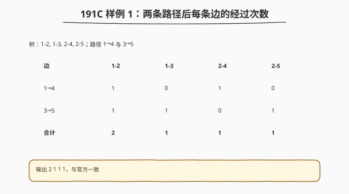

# Codeforces 191C 树上路径经过次数 题解

## 1. 题目概述

- **题目链接**：https://codeforces.com/problemset/problem/191/C
- **比赛来源**：Codeforces Round 121 (Div. 1) · Problem C（UTC 2012-05-27）
- **难度**：1900
- **标签**：树、LCA、树上差分
- **评测类型**：普通
- **限制**：时间 2 s / 内存 256 MB

**题意**：$n$ 个城市、$n-1$ 条双向道路，构成一棵树。给出 $k$ 条简单路径（第 $i$ 条从 $a_i$ 到 $b_i$）。对每条边，统计有多少条路径经过它。按输入顺序输出 $n-1$ 个整数。

**约束**（原样摘自题面 `inputFormat.en`）：

- $2\le n\le10^5$；$0\le k\le10^5$；$a_i,b_i\in[1,n]$。
- 输出 $n-1$ 个整数，空格分隔，顺序与输入的道路一致。

**约束对算法的限制**：

- $n,k\le10^5$：逐条路径在树上走一遍是 $O(nk)=10^{10}$，必须用差分一次性处理。
- 答案可达 $10^5$，`int` 足够，但用 `long long` 更稳。
- 递归 DFS 在 $10^5$ 的链上会爆栈，需用显式栈/迭代。

## 2. 示例与观察

官方样例 1（输入 / 输出原样）：

```text
输入：
5
1 2
1 3
2 4
2 5
2
1 4
3 5

输出：
2 1 1 1
```

官方样例 2（输入 / 输出原样）：

```text
输入：
5
3 4
4 5
1 4
2 4
3
2 3
1 3
3 5

输出：
3 1 1 1
```

**样例 1 的演算**：树边依次是 $1-2,1-3,2-4,2-5$。

- 路径 $1\to4$：经过 $1-2$、$2-4$；
- 路径 $3\to5$：经过 $1-3$、$1-2$、$2-5$；
- 合计：$1-2$ 两次，其余各一次 → `2 1 1 1` ✓。

**样例 2 的演算**：树是 $4$ 连 $3,5,1,2$。

- $2\to3$：$2-4$、$4-3$；
- $1\to3$：$1-4$、$4-3$；
- $3\to5$：$3-4$、$4-5$；
- 合计：$4-3$ 三次，其余各一次 → `3 1 1 1` ✓。

**观察 1**：一条路径 $(a,b)$ 经过边 $e=(u,v)$（$v$ 是 $u$ 的儿子）当且仅当「$a,b$ 中恰好一个在 $v$ 的子树里」。

**观察 2**：于是对每条边，我们只关心「路径端点在子树内的个数」。可以用树上的「点差分」：

- `diff[a] += 1`，`diff[b] += 1`，`diff[lca(a,b)] -= 2`；
- 然后自底向上把儿子的 `diff` 累加到父亲；
- 边 $(parent(v), v)$ 的答案就是 `diff[v]`。

**观察 3**：为什么 `lca` 处减 2？因为 $a,b$ 同时位于某子树内时，那条路径不穿过该子树与外界的边；`lca` 是「两端都在子树内」的最浅点，减 2 正好把多加的两次抵消。

**自造样例**（标注「自造」，输出由程序实测）：

| 输入 | 输出 | 说明 |
|------|------|------|
| `2` / `1 2` / `0` | 0 | 没有路径 |
| `2` / `1 2` / `1` / `1 2` | 1 | 一条路径 |
| `3` / `1 2` / `2 3` / `1` / `1 3` | 1 1 | 链上一条路径覆盖两条边 |
| `3` / `1 2` / `2 3` / `2` / `1 3` / `1 2` | 2 1 | 两条路径叠加 |

## 3. 解题思路

### 3.1 朴素做法与瓶颈

对每条路径，在树上逐边走到 LCA：单条 $O(n)$，$k$ 条 $O(nk)=10^{10}$，超时。

### 3.2 核心观察：树上差分

![191C：树上路径差分：diff[a]++、diff[b]++、diff[lca]-=2](../../../images/cf191c_diff.svg)

对树做根（这里取 1 号点为根），记 $S(v)$ 为 $v$ 的子树。对每条路径 $(a,b)$：

$$\text{diff}[a]\mathrel{+}=1,\qquad \text{diff}[b]\mathrel{+}=1,\qquad \text{diff}[\operatorname{lca}(a,b)]\mathrel{-}=2.$$

处理完所有路径后，自底向上累加：$\text{sum}(v)=\text{diff}[v]+\sum_{u\in\text{child}(v)}\text{sum}(u)$。

则边 $(parent(v), v)$ 的经过次数 $=\text{sum}(v)$。

**为什么对**：一条路径对边 $(parent(v),v)$ 有贡献，当且仅当「$a,b$ 恰有一个在 $S(v)$ 内」：

- 若 $a\in S(v), b\notin S(v)$：$\text{diff}[a]$ 在子树内 +1，$b$ 的 +1 和 lca 的 −2 都在子树外，合计 +1 ✓；
- 若 $a,b\in S(v)$：lca 也在 $S(v)$ 内（lca 是 $a,b$ 的公共祖先，且 lca 在 $S(v)$ 内当且仅当 $a,b$ 都在），于是 $+1+1-2=0$ ✓；
- 若 $a,b$ 都在外面：0 ✓。

### 3.3 算法流程



1. 读入 $n-1$ 条边，建邻接表（记下边号）。
2. 迭代 BFS/DFS 求每个点的父节点、深度、入栈顺序。
3. 二进制提升预处理 LCA（$O(n\log n)$）。
4. 对每条路径求 LCA，做差分。
5. 按 BFS 的逆序累加差分，边 $(parent(v),v)$ 的答案 $=\text{diff}[v]$。
6. 按边号顺序输出。

## 4. 正确性证明

**引理 1**：路径 $(a,b)$ 经过边 $(parent(v),v)$ 当且仅当 $a,b$ 中恰好一个属于子树 $S(v)$。

**证明**：树上 $a$ 到 $b$ 的简单路径唯一；它跨越割 $(S(v), V\setminus S(v))$ 当且仅当两端分居两侧，而跨越该割的唯一边就是 $(parent(v),v)$。∎

**引理 2**：对固定路径 $(a,b)$，按上述差分并自底向上累加后，$\text{sum}(v)=1$ 当且仅当 $a,b$ 恰有一个在 $S(v)$ 内，否则为 0。

**证明**：$\text{sum}(v)=\sum_{x\in S(v)}\text{diff}[x]=[a\in S(v)]+[b\in S(v)]-2[\operatorname{lca}(a,b)\in S(v)]$。而 $\operatorname{lca}(a,b)\in S(v)\iff a,b\in S(v)$（若 lca 在子树内，a、b 作为其后代也在；反之若 a、b 都在子树内，它们的 lca 也在）。三种情况分别得 1、0、0。∎

**定理**：算法对每条边输出的次数正确。

**证明**：由引理 1、2，$\text{sum}(v)$ 恰好是经过该边的路径条数；边与「儿子节点」一一对应，故按边号输出正确。∎

## 5. 复杂度分析

- **时间**：$O((n+k)\log n)$。建树 $O(n)$，LCA 预处理 $O(n\log n)$，$k$ 次查询 $O(k\log n)$，累加 $O(n)$。
- **空间**：$O(n\log n)$ 的 LCA 表（$10^5\times17$ 个 `int` ≈ 7 MB）。
- **数值范围**：答案 $\le k\le10^5$。
- **与时限的关系**：2 s 对约 $3.4\times10^6$ 次操作余量在百倍以上。实测 $n=k=10^5$ 端到端约 68 ms，Python 约 511 ms。

## 6. 参考代码

### C++17

```cpp
#include <bits/stdc++.h>
using namespace std;

// 191C：树上路径计数。对每条路径 (a,b)：diff[a]++, diff[b]++, diff[lca]-=2；
// 后序累加，边 (parent[v], v) 的答案就是 diff[v]。
int main() {
    int n;
    if (scanf("%d", &n) != 1) return 0;
    vector<vector<pair<int, int>>> adj(n + 1);   // (邻点, 边号)
    for (int i = 1; i <= n - 1; ++i) {
        int u, v;
        scanf("%d %d", &u, &v);
        adj[u].push_back({v, i});
        adj[v].push_back({u, i});
    }
    int LOG = 1;
    while ((1 << LOG) <= n) ++LOG;
    vector<vector<int>> up(LOG, vector<int>(n + 1, 0));
    vector<int> depth(n + 1, 0), parentEdge(n + 1, 0), order;
    order.reserve(n);
    vector<char> vis(n + 1, 0);
    vector<int> st;
    st.push_back(1);
    vis[1] = 1;
    while (!st.empty()) {
        int u = st.back(); st.pop_back();
        order.push_back(u);
        for (auto& e : adj[u]) {
            int v = e.first;
            if (!vis[v]) {
                vis[v] = 1;
                up[0][v] = u;
                depth[v] = depth[u] + 1;
                parentEdge[v] = e.second;
                st.push_back(v);
            }
        }
    }
    for (int j = 1; j < LOG; ++j)
        for (int v = 1; v <= n; ++v) up[j][v] = up[j - 1][up[j - 1][v]];
    auto lca = [&](int a, int b) {
        if (depth[a] < depth[b]) swap(a, b);
        int diff = depth[a] - depth[b];
        for (int j = 0; j < LOG; ++j)
            if (diff >> j & 1) a = up[j][a];
        if (a == b) return a;
        for (int j = LOG - 1; j >= 0; --j)
            if (up[j][a] != up[j][b]) { a = up[j][a]; b = up[j][b]; }
        return up[0][a];
    };
    int k;
    scanf("%d", &k);
    vector<long long> diff(n + 1, 0);
    for (int i = 0; i < k; ++i) {
        int a, b;
        scanf("%d %d", &a, &b);
        int g = lca(a, b);
        ++diff[a]; ++diff[b]; diff[g] -= 2;
    }
    vector<long long> ans(n + 1, 0);
    for (int i = (int)order.size() - 1; i >= 0; --i) {
        int v = order[i];
        if (v == 1) continue;
        ans[parentEdge[v]] = diff[v];
        diff[up[0][v]] += diff[v];
    }
    for (int i = 1; i <= n - 1; ++i) printf("%lld%c", ans[i], i == n - 1 ? '\n' : ' ');
    return 0;
}
```

### Python3

```python
import sys


def main() -> None:
    data = sys.stdin.buffer.read().split()
    pos = 0
    n = int(data[pos]); pos += 1
    adj = [[] for _ in range(n + 1)]
    for i in range(1, n):
        u = int(data[pos]); v = int(data[pos + 1]); pos += 2
        adj[u].append((v, i))
        adj[v].append((u, i))
    LOG = 1
    while (1 << LOG) <= n:
        LOG += 1
    up = [[0] * (n + 1) for _ in range(LOG)]
    depth = [0] * (n + 1)
    parent_edge = [0] * (n + 1)
    order = []
    visited = [False] * (n + 1)
    stack = [1]
    visited[1] = True
    while stack:
        u = stack.pop()
        order.append(u)
        for v, eid in adj[u]:
            if not visited[v]:
                visited[v] = True
                up[0][v] = u
                depth[v] = depth[u] + 1
                parent_edge[v] = eid
                stack.append(v)
    for j in range(1, LOG):
        prev = up[j - 1]
        cur = up[j]
        for v in range(1, n + 1):
            cur[v] = prev[prev[v]]

    def lca(a: int, b: int) -> int:
        if depth[a] < depth[b]:
            a, b = b, a
        d = depth[a] - depth[b]
        j = 0
        while d:
            if d & 1:
                a = up[j][a]
            d >>= 1
            j += 1
        if a == b:
            return a
        for j in range(LOG - 1, -1, -1):
            if up[j][a] != up[j][b]:
                a = up[j][a]
                b = up[j][b]
        return up[0][a]

    k = int(data[pos]); pos += 1
    diff = [0] * (n + 1)
    for _ in range(k):
        a = int(data[pos]); b = int(data[pos + 1]); pos += 2
        g = lca(a, b)
        diff[a] += 1
        diff[b] += 1
        diff[g] -= 2
    ans = [0] * n
    for v in reversed(order):
        if v == 1:
            continue
        ans[parent_edge[v]] = diff[v]
        diff[up[0][v]] += diff[v]
    sys.stdout.write(' '.join(str(ans[i]) for i in range(1, n)) + '\n')


main()
```

## 7. 边界情况与易错点

1. **$k=0$**：全部输出 0。
2. **$a=b$**：路径长度为 0，$\operatorname{lca}=a$，差分 $+1+1-2=0$，不贡献任何边 ✓。
3. **根节点**：根没有父边，累加时跳过；`order` 的逆序保证儿子先处理。
4. **递归爆栈**：$10^5$ 的链必须用显式栈（代码用 `vector` 栈 + BFS 序）。
5. **边号映射**：边按输入顺序编号，`parentEdge[v]` 记录父子边的编号，输出时按编号顺序。
6. **LCA 的 `LOG`**：`1<<LOG > n` 即可，$n=2$ 时 LOG=2。
7. **深度差跳转**：用 `diff >> j & 1` 逐位跳，别写成循环减法（也可，但慢）。
8. **输出格式**：$n-1$ 个数，样例末尾有空格；token 比对不受影响。
9. **多组数据**：无。
10. **树的连接性**：题面保证连通（是一棵树）。

## 8. 验证记录

- **编译环境与命令**：`Apple clang 21.0.0`（`/usr/bin/g++` 是 clang 软链，无 GNU libstdc++），`clang++ -std=c++17 -O2 -Wall` 加仓库自带 `bits/stdc++.h`；正文代码仍写标准头。Python 为 `3.9.6`。验证命令：
  `python3 codeforces/tools/verify_solution.py codeforces/contests/0101-0203/191/C_树上路径经过次数.md`
- **官方样例**：2 / 2 通过（`2 1 1 1`、`3 1 1 1`），C++ 与 Python 一致。
- **额外测试**：自造 $k=0$、单边、链上路径、两条路径 等 4 组，两种语言全部通过。
- **独立暴力对拍**：暴力对每条路径沿父指针一步步走到 LCA 并逐边计数（与「差分 + 二进制提升」完全不同）；对 250 组随机数据（$n\le9$、$k\le6$）逐组比对，全部一致。
- **最大约束性能**：$n=k=10^5$ 端到端约 68 ms，Python 约 511 ms，相对 2 s 时限余量在 4 倍（Python）到 29 倍（C++）。
- **图片与公式**：2 张 SVG（`cf191c_diff.svg`、`cf191c_sample.svg`）通过 `ElementTree.parse` 与文本包围盒/重叠检查，headless Chrome 渲染确认无裁切；KaTeX 校验 0 错。
- **复核状态**：verified。

## 相关题目与扩展

- [Codeforces 191B Demonstration](https://codeforces.com/problemset/problem/191/B)：同场 B 题，贪心 + 排序。
- [Codeforces 191E Thwarting Demonstrations](https://codeforces.com/problemset/problem/191/E)：同场 E 题，第 k 大子段和。
- [Codeforces 191D Metro Scheme](https://codeforces.com/problemset/problem/191/D)：同场 D 题，仙人掌线路划分。
- [LeetCode 1109. 航班预订统计](https://leetcode.cn/problems/corporate-flight-bookings/)：差分数组模板。
- [Codeforces 1076E Vasya and a Tree](https://codeforces.com/problemset/problem/1076/E)：树上差分的另一经典。

**延伸思考**：

1. **如果路径带权（每条路径有流量）**：差分改成「加流量」即可。
2. **如果要求「被多少条路径完全包含」**：需要换一种差分（子树内端点数 = 2 的路径）。
3. **如果要求输出每条路径的长度**：用深度 + LCA 直接算。
4. **如果树是动态的（加边）**：需要 Link-Cut Tree 或离线处理。
5. **点差分 vs 边差分**：本题是「边被多少路径经过」，所以用「端点 +1、lca −2」；若是「点被多少路径经过」，则是「+1、+1、−1、−1（父）」的经典点差分。

