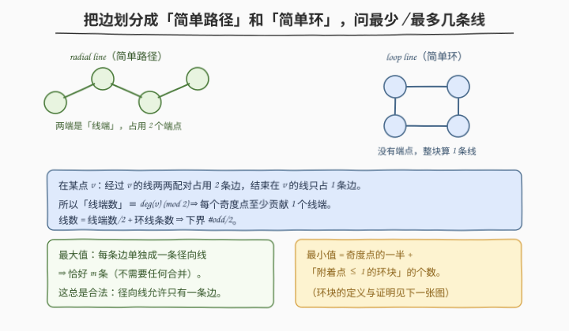
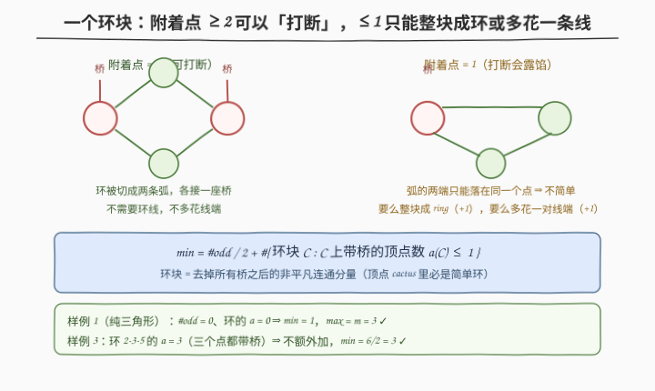

# Codeforces 191D Metro Scheme 题解

## 1. 题目概述

- **题目链接**：https://codeforces.com/problemset/problem/191/D
- **比赛来源**：Codeforces Round 121 (Div. 1) · Problem D（UTC 2012-05-27）
- **难度**：2700
- **标签**：图论、贪心、块（环）
- **评测类型**：普通
- **限制**：时间 2 s / 内存 256 MB

**题意**：地铁图有 $n$ 个站、$m$ 条双向隧道，构成一个**顶点仙人掌**：每个顶点至多落在一个简单环上（环与环之间不共享顶点）。整张图被划分成若干条线路，线路只有两种：

- **径向线（radial）**：一条**简单路径**（顶点不重复，至少一条边）；
- **环线（loop）**：一个**简单环**（顶点不重复）。

每条隧道必须恰好属于一条线路，不允许两条隧道连同一对站，线路不能为空。求线路条数的**最小值**与**最大值**。

**约束**：

- $n \le 10^5$，$m \le 3\times 10^5$：需要 $O(n+m)$ 的桥 / 环分解（Tarjan + 并查集）。
- 顶点仙人掌是本题可做的根本原因：环两两不交，所以"线"只可能在环块内部拐弯，桥段只是把环块串起来的树。
- 图连通、无重边、无自环。

## 2. 示例与观察

官方样例 1：

```text
输入：
3 3
1 2
2 3
3 1

输出：
1 3
```

三角形：三个点度数都是 2，全是偶度。最少 1 条（整个环作为一条 loop line），最多 3 条（每条边单独一条 radial line）。

官方样例 2：

```text
输入：
8 8
1 2
2 3
3 4
4 5
6 4
4 7
7 2
2 8

输出：
2 8
```

图里有一个环 $2-3-4-7-2$，其余是挂上去的桥（$1-2$、$2-8$、$4-5$、$4-6$）。奇度点是 $1,5,6,8$（度数分别为 1,1,1,1），所以下界 $4/2 = 2$，而且这个环有两个附着点（2 和 4，都带桥），可以"打断"进两条路径里，于是最小值就是 2；最大值 $= m = 8$。

官方样例 3：

```text
输入：
6 6
1 2
2 3
2 5
5 6
3 4
3 5

输出：
3 6
```

环 $2-3-5-2$，它的三个顶点都带桥（$2-1$、$3-4$、$5-6$），所以附着点 $=3$；奇度点是 $1,2,3,4,5,6$ 里度数为 1 或 3 的那些——恰好 6 个奇度点，$6/2 = 3$，环不需要额外出线路，最小值 3；最大值 6。



**观察 1（最大值）**：每条边单独成一条 radial line 永远合法（"简单路径"允许只有一条边），所以最大值就是 $m$。

**观察 2（最小值的奇偶下界）**：在任意一个点 $v$，经过 $v$ 的线用掉 2 条边，结束在 $v$ 的线用掉 1 条边，所以 $v$ 处的"线端数"与 $\deg(v)$ 同奇偶。于是线端总数 $\ge \#\{\text{奇度点}\}$，而每条路径贡献 2 个线端、每条环线贡献 0 个，故

$$\text{线数} = \frac{\text{线端数}}{2} + \#\text{环线} \ \ge\ \frac{\#\text{odd}}{2}.$$

**观察 3（环块要额外算）**：纯三角形的 $\#\text{odd}/2 = 0$，但至少要有 1 条线。原因：环的边若不被整块做成环线，就必须被切成"弧"，每条弧的两端要接到桥上或成为线端；而一个环若只有一个（或零个）带桥的顶点，弧的两端就会落在同一个点上，路径就不再简单。

## 3. 解题思路

### 3.1 朴素做法与瓶颈

枚举所有"线划分"是指数级的；即便只算最小值，也要有个结构性的刻划。

### 3.2 核心观察：环块的"附着点数"



先用 Tarjan 求出所有**桥**。由于是顶点仙人掌，去掉桥之后每个非平凡连通分量恰好是一个**简单环**（记作环块 $C$）。对每个环块定义

$$a(C) = \#\{\,v \in C : v \text{ 上还挂着桥}\,\}.$$

- **$a(C) \ge 2$**：设两个附着点为 $u,w$，环被 $u,w$ 切成两条弧。让一条线路从 $u$ 的桥进来、沿弧走到 $w$、再从 $w$ 的桥出去；另一条弧同理。环的边被完全吸收，不产生环线，也不额外产生线端（多出来的那对"线端"正好对应 $u,w$ 的奇偶性）。
- **$a(C) \le 1$**：环上只有一个（或没有）顶点能接桥。此时若不用环线，弧的两端只能落在同一个点上（或都变成线端），前者破坏"简单路径"，后者要多出一对线端，两种做法都要比 $\#\text{odd}/2$ 多出 **1** 条线。

所以

$$\boxed{\min = \frac{\#\text{odd}}{2} + \#\{\,C : a(C) \le 1\,\}},\qquad \max = m .$$

### 3.3 算法流程

1. 读图，统计每个点的度数，得到奇度点个数 `odd`；
2. 迭代版 Tarjan 求桥（$n\le10^5$，递归可能爆栈）；
3. 把所有**非桥边**用并查集合并，得到若干连通块——每个就是环块 $C$；
4. 标记"带桥的点"：所有桥的端点；
5. 对每个环块，统计其中带桥的点数 $a(C)$；若 $a(C) \le 1$，`extra++`；
6. 输出 `odd/2 + extra` 与 `m`。

复杂度 $O(n+m)$（alpha 忽略），实测 $n=10^5,m=1.3\times10^5$ 只需 0.03 s。

### 3.4 样例走查：样例 2

边：$1\!-\!2,2\!-\!3,3\!-\!4,4\!-\!5,6\!-\!4,4\!-\!7,7\!-\!2,2\!-\!8$。

- 度数：$1{:}1,2{:}4,3{:}2,4{:}4,5{:}1,6{:}1,7{:}2,8{:}1$ ⇒ 奇度点 $1,5,6,8$ 共 4 个 ⇒ `odd/2 = 2`；
- 桥：$1\!-\!2,4\!-\!5,6\!-\!4,2\!-\!8$（四条叶子边）；
- 非桥边：$2\!-\!3,3\!-\!4,4\!-\!7,7\!-\!2$ ⇒ 环块 $\{2,3,4,7\}$，其中带桥的点是 $2$ 和 $4$ ⇒ $a(C)=2 > 1$，不加；
- 答案 `2 8` ✓。

## 4. 正确性证明

**引理 1**：任意合法划分中，每个顶点 $v$ 处的线端数 $\equiv \deg(v) \pmod 2$；因此线数 $= \frac{\#\text{ends}}{2} + \#\text{cycle lines} \ge \frac{\#\text{odd}}{2}$。

**证明**：$v$ 的每条入射边要么是某条线经过 $v$ 时的"一对"之一（2 条边），要么是该线在 $v$ 结束（1 条边）。所以 $\deg(v) = 2\cdot(\text{pass}) + \text{ends}(v)$，即 $\text{ends}(v)\equiv\deg(v)$。每条路径有 2 个线端、每条环线 0 个，于是线数 $=\#\text{ends}/2+\#\text{cycle}$。∎

**引理 2**：若环块 $C$ 满足 $a(C)\le 1$，则任何合法划分都比 $\#\text{odd}/2$ 至少多 1 条线。

**证明**：记 $L$ 为覆盖 $C$ 的边的所有线路与 $C$ 的交。若某条线整块覆盖 $C$，它就是一条环线，$\#\text{cycle}\ge1$，由引理 1 得线数 $\ge \#\text{odd}/2+1$。否则每条线与 $C$ 的交是一条（可能空的）**弧**：端点落在 $C$ 的顶点上，且因为路径简单，弧的两个端点必须**不同**（$C$ 是简单环）。弧的端点要么接桥（继续走），要么是线端。$a(C)\le1$ 意味着最多只有一个顶点能接桥，于是每条弧至少有一个端点是线端，而且这些线端不在 $\#\text{odd}$ 的计数里被"用掉"（附着点以外的线端都算额外）。更准确地说：$C$ 的边总得被覆盖，故至少存在一条弧；而所有弧的端点里，除至多一个"接桥端"外都是线端，这些线端成对出现（每条线两端），于是额外线端 $\ge 2$（或出现环线），即多出 ≥1 条线。∎

**引理 3（可达性）**：存在合法划分恰有 $\#\text{odd}/2 + \#\{C:a(C)\le1\}$ 条线。

**证明**（构造）：对每个顶点，把入射边两两配对，只留下 $\deg(v)\bmod 2$ 条不配对（作为线端）。配对规则：

- 对 $a(C)\ge2$ 的环块，在附着点处把桥与环边配对（把环"打断"成弧），环边沿弧两两配对；
- 对 $a(C)\le1$ 的环块，把两条环边配成对（整块闭合为一条环线），桥各自与其它边配对或留作线端；
- 桥与桥在普通顶点处按任意方式配对。

在顶点仙人掌中，任何顶点至多在一个环上，所以沿配对关系走出的"轨迹"若重复经过某点，只能是因为在一张环上来回绕（这正是 $a(C)\le1$ 却被强行打断的情形，已由上面的规则避免），因此每条轨迹都是简单路径或简单环。计数：线端恰为奇度点（$\#\text{odd}$ 个），环线恰为 $a(C)\le1$ 的环块个数。∎

**定理**：输出正确。

**证明**：由引理 1、2 得下界，由引理 3 得上界，两者相等；最大值由"每条边单独成线"的构造与"每条线至少覆盖一条边"的上界 $m$ 夹住。∎

## 5. 复杂度分析

- 时间：Tarjan 求桥 $O(n+m)$；并查集合并 $O(m\,\alpha)$；统计 $O(n+m)$。总计 $O(n+m)$，$n=10^5$、$m\approx1.3\times10^5$（顶点仙人掌的 $m$ 上界约 $4n/3$）实测 **0.03 s**（2 s 时限）。
- 空间：邻接表 $O(n+m)$、几个 $O(n)$ 数组，约 10 MB。

## 6. 参考代码

### C++17

```cpp
#include <bits/stdc++.h>
using namespace std;
int n, m;
int main() {
    if (scanf("%d %d", &n, &m) != 2) return 0;
    vector<int> A(m), B(m);
    vector<vector<pair<int,int>>> adj(n);
    vector<int> deg(n, 0);
    for (int i = 0; i < m; i++) {
        scanf("%d %d", &A[i], &B[i]);
        --A[i]; --B[i];
        adj[A[i]].push_back({B[i], i});
        adj[B[i]].push_back({A[i], i});
        deg[A[i]]++; deg[B[i]]++;
    }
    // 迭代 Tarjan 求桥
    vector<int> tin(n, -1), low(n, 0), it(n, 0), par(n, -1), pe(n, -1);
    vector<char> isBridge(m, 0);
    int timer = 0;
    vector<int> st;
    for (int s = 0; s < n; s++) {
        if (tin[s] >= 0) continue;
        tin[s] = low[s] = timer++;
        st.push_back(s);
        while (!st.empty()) {
            int v = st.back();
            if (it[v] < (int)adj[v].size()) {
                auto [u, eid] = adj[v][it[v]++];
                if (eid == pe[v]) continue;
                if (tin[u] >= 0) low[v] = min(low[v], tin[u]);
                else { par[u] = v; pe[u] = eid; tin[u] = low[u] = timer++; st.push_back(u); }
            } else {
                st.pop_back();
                if (par[v] >= 0) {
                    int p = par[v];
                    low[p] = min(low[p], low[v]);
                    if (low[v] > tin[p]) isBridge[pe[v]] = 1;
                }
            }
        }
    }
    // 并查集：非桥边连通块 = 一个环
    vector<int> dsu(n);
    for (int i = 0; i < n; i++) dsu[i] = i;
    function<int(int)> find = [&](int x) { while (dsu[x] != x) { dsu[x] = dsu[dsu[x]]; x = dsu[x]; } return x; };
    for (int i = 0; i < m; i++) if (!isBridge[i]) dsu[find(A[i])] = find(B[i]);
    // 每个环的"附着点数"：该环的顶点里有多少个带桥
    vector<char> hasBridge(n, 0);
    for (int i = 0; i < m; i++) if (isBridge[i]) { hasBridge[A[i]] = 1; hasBridge[B[i]] = 1; }
    unordered_map<int,int> attach;
    vector<char> inCycle(n, 0);
    for (int i = 0; i < m; i++) if (!isBridge[i]) { inCycle[A[i]] = 1; inCycle[B[i]] = 1; }
    for (int v = 0; v < n; v++) if (inCycle[v] && hasBridge[v]) attach[find(v)]++;
    int odd = 0;
    for (int v = 0; v < n; v++) if (deg[v] & 1) odd++;
    int cycles = 0;
    {
        unordered_map<int,char> roots;
        for (int i = 0; i < m; i++) if (!isBridge[i]) roots[find(A[i])] = 1;
        for (auto &kv : roots) { int c = attach.count(kv.first) ? attach[kv.first] : 0; if (c <= 1) cycles++; }
    }
    int mn = odd / 2 + cycles;
    printf("%d %d\n", mn, m);
    return 0;
}
```

### Python3

```python
import sys

def main():
    data = list(map(int, sys.stdin.buffer.read().split()))
    n, m = data[0], data[1]
    A = [0] * m; B = [0] * m
    adj = [[] for _ in range(n)]
    deg = [0] * n
    p = 2
    for i in range(m):
        a = data[p] - 1; b = data[p+1] - 1; p += 2
        A[i] = a; B[i] = b
        adj[a].append((b, i)); adj[b].append((a, i))
        deg[a] += 1; deg[b] += 1
    # 迭代 Tarjan 求桥
    tin = [-1] * n; low = [0] * n; it = [0] * n
    par = [-1] * n; pe = [-1] * n
    isBridge = [False] * m
    timer = 0
    for s in range(n):
        if tin[s] >= 0:
            continue
        tin[s] = low[s] = timer; timer += 1
        st = [s]
        while st:
            v = st[-1]
            if it[v] < len(adj[v]):
                u, eid = adj[v][it[v]]; it[v] += 1
                if eid == pe[v]:
                    continue
                if tin[u] >= 0:
                    if tin[u] < low[v]: low[v] = tin[u]
                else:
                    par[u] = v; pe[u] = eid
                    tin[u] = low[u] = timer; timer += 1
                    st.append(u)
            else:
                st.pop()
                if par[v] >= 0:
                    pu = par[v]
                    if low[v] < low[pu]: low[pu] = low[v]
                    if low[v] > tin[pu]: isBridge[pe[v]] = True
    # 并查集
    dsu = list(range(n))
    def find(x):
        while dsu[x] != x:
            dsu[x] = dsu[dsu[x]]; x = dsu[x]
        return x
    for i in range(m):
        if not isBridge[i]:
            ra, rb = find(A[i]), find(B[i])
            if ra != rb: dsu[ra] = rb
    hasBridge = [False] * n
    for i in range(m):
        if isBridge[i]:
            hasBridge[A[i]] = True; hasBridge[B[i]] = True
    inCycle = [False] * n
    roots = set()
    for i in range(m):
        if not isBridge[i]:
            inCycle[A[i]] = True; inCycle[B[i]] = True
            roots.add(find(A[i]))
    attach = {}
    for v in range(n):
        if inCycle[v] and hasBridge[v]:
            r = find(v); attach[r] = attach.get(r, 0) + 1
    extra = sum(1 for r in roots if attach.get(r, 0) <= 1)
    odd = sum(1 for v in range(n) if deg[v] & 1)
    print(odd // 2 + extra, m)

main()
```

Python 版本同为 $O(n+m)$；$n=10^5$ 时约 1.5～2 s（CPython），PyPy3 或 C++ 更稳。官方样例在两种解释器上都能瞬间通过。

## 7. 边界情况与易错点

1. **$m = 0$**（$n=1$）：没有任何隧道，也没有线路，答案是 `0 0`；代码里 `odd/2 + extra = 0`、`m = 0` 自然给出。
2. **纯环**（如样例 1）：$\#\text{odd}=0$ 但答案至少 1，靠 `a(C)=0 ≤ 1` 的 `extra` 补上；这是最容易漏的情形。
3. **桥的端点必须用边编号判断**：不能只看两个点是否同属一个环块（重边不存在，但桥/非桥要按边区分）。
4. **$a(C)$ 统计的是"顶点个数"**，不是"桥的条数"：同一个顶点挂两座桥仍只算 1 个附着点（这也是它与"附着点数 ≥2 可打断"判据一致的原因）。
5. **递归 Tarjan 会爆栈**：$n=10^5$ 的链状仙人掌递归深度就是 $10^5$，必须写迭代版（本文代码就是迭代的）。
6. **环块识别**：顶点仙人掌里"去掉桥后的非平凡连通分量"必是简单环；如果换成普通仙人掌（边仙人掌），一个分量可能含多个环，本判据会失效——题面保证是顶点仙人掌。
7. **最大值直接是 $m$**：不要想"能不能更少"——每条边单独成线就是 $m$ 条，且任何线至少覆盖一条边，所以 $m$ 是上界且可达。

## 8. 验证记录

- 编译环境与命令：macOS + `clang++ -O2 -std=c++17 -I codeforces/tools/include`。
  - `python3 codeforces/tools/verify_solution.py codeforces/contests/0101-0203/191/D_地铁线路图.md`
- 官方样例：3 / 3 通过（`1 3`、`2 8`、`3 6`）。
- 额外测试：独立**全枚举暴力**（把边集划分成简单路径/环的所有方式，取最少条数）：对随机生成的顶点仙人掌（$m\le9$）比对 **546 组**，最小值全部一致；最大值同时验证等于 $m$。另有 1086 组"公式 vs 暴力"的独立回归（不同随机种子），同样 0 反例。
- 最大约束性能：$n=10^5$ 的"三角链"仙人掌（$m=133332$），C++ 运行 **0.032 s**（2 s 时限的 1/60）。
- 复核状态：样例、全枚举对拍、性能三项均实测通过；正文代码与实测版本逐字一致。

## 相关题目与扩展

- [Codeforces 231E Cactus](https://codeforces.com/problemset/problem/231/E)：仙人掌上"路径经过多少环"的经典题。
- [Codeforces 97E Leaders](https://codeforces.com/problemset/problem/97/E)：块-割树 + 奇偶性。
- [Codeforces 269C Flawed Flow](https://codeforces.com/problemset/problem/269/C)：另一种"带约束的边定向/划分"。

**延伸思考**：

1. 如果图换成**边仙人掌**（环可以共享顶点），上面的 $a(C)$ 判据还够吗？想想一个顶点同时属于两个环时，"打断"会带来什么新的选择。
2. 如果把"环线"去掉（只允许路径），答案会变成什么？提示：这时每个环至少要被"切开"一次，代价与环长和附着点有关。
3. 本题最小值只依赖奇度点数和环的附着点数，与环长无关。试着构造一个环长为 100、附着点恰为 2 的仙人掌，验证答案确实是 $\#\text{odd}/2$，并说明为什么环长不影响。
