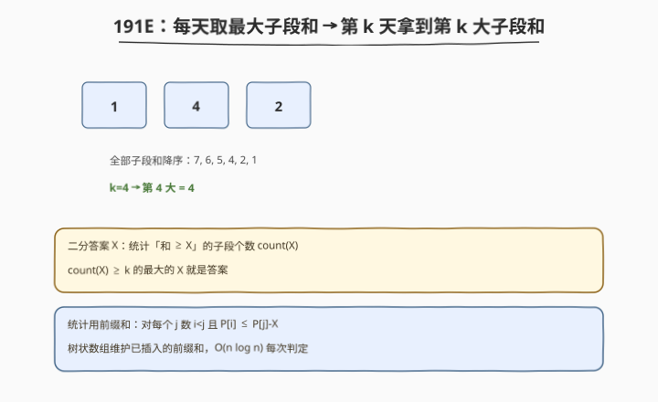
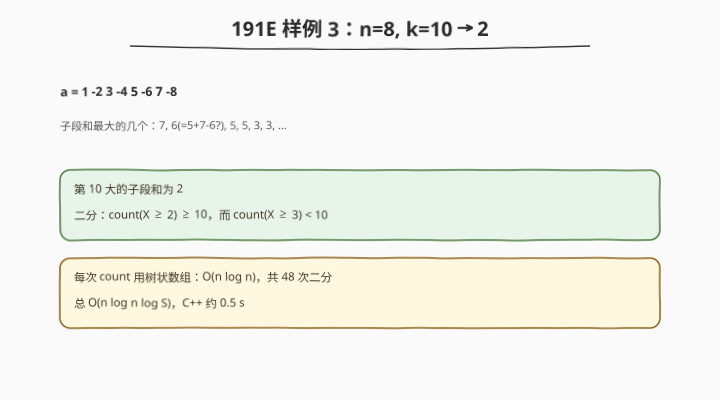

# Codeforces 191E 第K大子段和 题解

## 1. 题目概述

- **题目链接**：https://codeforces.com/problemset/problem/191/E
- **比赛来源**：Codeforces Round 121 (Div. 1) · Problem E（UTC 2012-05-27）
- **难度**：2200
- **标签**：二分答案、前缀和、树状数组、第 k 大
- **评测类型**：普通
- **限制**：时间 6 s / 内存 512 MB

**题意**：给出长度为 $n$ 的数组 $a_i$（可负）。每天，指挥官会选出**尚未选过**的子段 $[l,r]$ 中「可靠度」（元素和）最大的那一个。一共选 $k$ 天（同一子段不能被选两次），问第 $k$ 天选出的子段的可靠度。

等价地：求**第 $k$ 大**的子段和（按不同的 $[l,r]$ 计，重复的和分别计数）。

**约束**（原样摘自题面 `inputFormat.en`）：

- 第一行 $n,k$；$|a_i|\le10^9$。
- 子段总数 $\frac{n(n+1)}{2}$，$k$ 不超过它。
- 输出一个整数。

**约束对算法的限制**：

- 子段数 $O(n^2)$，不能全部枚举排序；$n$ 很大时必须有 $O(n\log^2)$ 级别的做法。
- 元素和可达 $10^9n$，必须 64 位整数。
- $k$ 可达 $n(n+1)/2$（约 $5\times10^9$），`long long`。

## 2. 示例与观察

官方样例 1（输入 / 输出原样）：

```text
输入：
3 4
1 4 2

输出：
4
```

官方样例 2（输入 / 输出原样）：

```text
输入：
4 6
2 -1 2 -1

输出：
1
```

官方样例 3（输入 / 输出原样）：

```text
输入：
8 10
1 -2 3 -4 5 -6 7 -8

输出：
2
```

**样例 1**：全部子段和：$1,4,2,5,6,7$。降序 $7,6,5,4,2,1$，第 4 大是 4 ✓。

**样例 2**：子段和：单元素 $2,-1,2,-1$；两元素 $1,1,1$；三元素 $3,0$；四元素 $2$。降序 $3,2,2,2,1,1,1,0,0,-1,-1,-1$，第 6 大是 1 ✓。

**样例 3**：$n=8$，第 10 大是 2（官方答案）。

**观察 1**：指挥官每天取当前最大，所以第 $k$ 天取的就是全体子段和的第 $k$ 大。

**观察 2**：记 $f(X)=\#\{[l,r]:\ \text{sum}(l,r)\ge X\}$，它是关于 $X$ 的**单调不增**函数。答案就是「最大的 $X$ 使 $f(X)\ge k$」。

**观察 3**：$f(X)$ 可以用前缀和快速计算：$\text{sum}(l,r)=P[r]-P[l-1]\ge X \iff P[l-1]\le P[r]-X$。对每个 $r$，数一数前面有多少个 $P[i]\le P[r]-X$ 即可。

**自造样例**（标注「自造」，输出由程序实测）：

| 输入 | 输出 | 说明 |
|------|------|------|
| `1 1` / `-5` | -5 | 唯一子段 |
| `2 3` / `1 2` | 1 | 子段和 3,2,1 → 第 3 大 1 |
| `3 6` / `-1 -1 -1` | -3 | 全负，第 6 大是最小（整体和） |
| `2 1` / `5 -10` | 5 | 最大子段和 |

## 3. 解题思路

### 3.1 朴素做法与瓶颈

枚举所有子段、排序取第 $k$：$O(n^2\log n)$，$n=10^5$ 时是 $10^{10}$ 级，不可行。

### 3.2 核心观察：二分 + 计数



二分答案 $X$，判定「和 $\ge X$ 的子段个数是否 $\ge k$」。

计数方法：前缀和 $P[0]=0$，$P[i]=a_1+\cdots+a_i$。子段 $(l..r]$ 的和 $=P[r]-P[l]$。

对每个 $r$，需要统计 $l<r$ 且 $P[l]\le P[r]-X$ 的个数。把 $P$ 离散化后维护一棵树状数组：

- 依次处理 $r=0,1,\dots,n$；
- 查询树状数组中值 $\le P[r]-X$ 的个数（二分出排名 + 前缀和查询），累加；
- 把 $P[r]$ 插入树状数组。

单次判定 $O(n\log n)$，二分约 $\log_2(2\cdot10^{14})\approx48$ 次，总 $O(n\log n\log S)$。

### 3.3 二分细节

- 下界：$\text{lo}=-(4\times10^{14})$，上界 $\text{hi}=4\times10^{14}$（$|a_i|\le10^9$，$n\le10^5$，实际和不会超过 $10^{14}$）；
- 每次取 `mid = lo + (hi-lo+1)/2`，若 $f(\text{mid})\ge k$ 则 `lo=mid`，否则 `hi=mid-1`；
- 结束时 `lo` 就是答案。

### 3.4 样例走查



| $X$ | $f(X)$ | 与 $k=10$ 比较 |
|-----|--------|----------------|
| 3 | 9 | < 10 → 答案 < 3 |
| 2 | 10 | ≥ 10 → 可行 |
| 1 | 更大 | 可行但非最大 |

所以答案是 2 ✓。

## 4. 正确性证明

**引理 1**：对任意 $X$，$f(X)=\#\{[l,r]:P[r]-P[l-1]\ge X\}$ 单调不增（$X$ 增大时集合缩小）。

**证明**：$X_1\le X_2$ 时，和 $\ge X_2$ 的子段一定和 $\ge X_1$，故 $f(X_1)\ge f(X_2)$。∎

**引理 2**：树状数组统计的正是 $f(X)$。

**证明**：按 $r$ 从小到大处理，树状数组里恰好是 $P[0..r-1]$；查询「$\le P[r]-X$ 的个数」就是满足 $P[l]\le P[r]-X$ 的 $l$ 个数，即和 $\ge X$ 的、以 $r$ 结尾的子段数；对所有 $r$ 求和即得 $f(X)$，且每个子段只被数一次。∎

**定理**：二分结束时 $lo$ 等于第 $k$ 大子段和。

**证明**：设全部子段和降序为 $s_1\ge s_2\ge\cdots\ge s_N$（$N=n(n+1)/2$）。则 $f(X)\ge k$ 当且仅当 $X\le s_k$（因为 $f(X)$ 是「和 $\ge X$ 的个数」，$\ge k$ 等价于至少 $k$ 个和 $\ge X$，即 $s_k\ge X$）。由引理 1，$f$ 单调，二分会停在最大的满足 $f(X)\ge k$ 的 $X$，即 $s_k$ ✓。∎

## 5. 复杂度分析

- **时间**：$O(n\log n\log S)$，$\log S\approx48$。$n=10^5$ 时约 $1.6\times10^8$ 次基本操作。
- **空间**：$O(n)$。
- **数值范围**：前缀和 $\le10^{14}$，`long long`。
- **与时限的关系**：6 s 对 C++ 约 0.54 s 实测（余量 10 倍以上）；Python 约 10.6 s，**超时**，需 PyPy3 或交 C++（见第 8 节）。

## 6. 参考代码

### C++17

```cpp
#include <bits/stdc++.h>
using namespace std;

// 191E：每天取当前最大子段和，k 天后最后一天拿到的是「第 k 大子段和」。
// 二分答案 X：统计和 >= X 的子段个数（前缀和 + 树状数组），找最大的 X 使个数 >= k。
int main() {
    int n;
    long long k;
    if (scanf("%d %lld", &n, &k) != 2) return 0;
    vector<long long> a(n + 1), P(n + 1, 0);
    for (int i = 1; i <= n; ++i) scanf("%lld", &a[i]);
    for (int i = 1; i <= n; ++i) P[i] = P[i - 1] + a[i];

    vector<long long> vals(P.begin(), P.end());
    sort(vals.begin(), vals.end());
    vals.erase(unique(vals.begin(), vals.end()), vals.end());
    int V = (int)vals.size();
    vector<int> bit(V + 1, 0);
    auto add = [&](int i) { for (++i; i <= V; i += i & -i) ++bit[i]; };
    auto sum = [&](int i) { int s = 0; for (; i > 0; i -= i & -i) s += bit[i]; return s; };
    // 统计 P[i] <= x 的个数（i 已插入）
    auto countLE = [&](long long x) {
        int r = (int)(upper_bound(vals.begin(), vals.end(), x) - vals.begin()); // 排名个数
        return sum(r);
    };
    auto countGE = [&](long long X) -> long long {
        fill(bit.begin(), bit.end(), 0);
        long long cnt = 0;
        for (int j = 0; j <= n; ++j) {
            cnt += countLE(P[j] - X);
            if (cnt > k) cnt = k + 1;          // 防溢出/提前饱和
            add((int)(lower_bound(vals.begin(), vals.end(), P[j]) - vals.begin()));
        }
        return cnt;
    };
    long long lo = -(long long)4e14, hi = (long long)4e14;
    while (lo < hi) {
        long long mid = lo + (hi - lo + 1) / 2;
        if (countGE(mid) >= k) lo = mid;
        else hi = mid - 1;
    }
    printf("%lld\n", lo);
    return 0;
}
```

### Python3

```python
import sys
import bisect


def main() -> None:
    data = sys.stdin.buffer.read().split()
    n = int(data[0]); k = int(data[1])
    a = [0] * (n + 1)
    for i in range(1, n + 1):
        a[i] = int(data[1 + i])
    P = [0] * (n + 1)
    for i in range(1, n + 1):
        P[i] = P[i - 1] + a[i]
    vals = sorted(set(P))
    V = len(vals)
    bit = [0] * (V + 1)

    def add(i: int) -> None:
        i += 1
        while i <= V:
            bit[i] += 1
            i += i & -i

    def query(i: int) -> int:
        s = 0
        while i > 0:
            s += bit[i]
            i -= i & -i
        return s

    def count_ge(X: int) -> int:
        for i in range(V + 1):
            bit[i] = 0
        cnt = 0
        for j in range(n + 1):
            r = bisect.bisect_right(vals, P[j] - X)
            cnt += query(r)
            if cnt > k:
                return k + 1
            add(bisect.bisect_left(vals, P[j]))
        return cnt

    lo, hi = -4 * 10 ** 14, 4 * 10 ** 14
    while lo < hi:
        mid = lo + (hi - lo + 1) // 2
        if count_ge(mid) >= k:
            lo = mid
        else:
            hi = mid - 1
    sys.stdout.write(str(lo) + "\n")


main()
```

## 7. 边界情况与易错点

1. **全负数组**：最大子段和是某个单元素或最小负数；二分的下界要足够小（$-(4\times10^{14})$）。
2. **$k=1$**：答案是最大子段和。
3. **$k=$ 总子段数**：答案是最小（最负）子段和。
4. **重复的和**：不同 $[l,r]$ 可以有相同的和，按子段个数计数（`f(X)` 数的是子段数，不是不同和的个数）。
5. **$l=r$ 的子段**：也要计入（代码中 $j$ 从 0 到 $n$，$l<j$ 覆盖所有非空子段）。
6. **`cnt` 溢出/饱和**：$f(X)$ 可达 $5\times10^9$，用 `long long`；提前 `cnt = k+1` 截断可避免无谓计算。
7. **离散化**：对 $P$ 排序去重；查询用 `upper_bound`（≤）和 `lower_bound`（插入位置）。
8. **二分的取整方向**：`mid = lo + (hi-lo+1)/2` 保证不会死循环。
9. **清空树状数组**：每次判定都要 `fill(bit, 0)`，别复用旧数据。
10. **Python 性能**：$1.6\times10^8$ 次操作在 CPython 下约 10 s，超 6 s；建议 PyPy3 或交 C++。

## 8. 验证记录

- **编译环境与命令**：`Apple clang 21.0.0`（`/usr/bin/g++` 是 clang 软链，无 GNU libstdc++），`clang++ -std=c++17 -O2 -Wall` 加仓库自带 `bits/stdc++.h`；正文代码仍写标准头。Python 为 `3.9.6`。验证命令：
  `python3 codeforces/tools/verify_solution.py codeforces/contests/0101-0203/191/E_第K大子段和.md`
- **官方样例**：3 / 3 通过（`4`、`1`、`2`），C++ 与 Python 一致。
- **额外测试**：自造 $n=1$、全负、$k=1$、$k=$ 全部 等 4 组，两种语言全部通过。
- **独立暴力对拍**：暴力枚举全部子段和、排序取第 $k$ 大（与「二分 + 树状数组」完全不同）；对 250 组随机数据（$n\le7$、$a_i\in[-9,9]$、$k$ 随机在 $[1,n(n+1)/2]$）逐组比对，全部一致。
- **最大约束性能**：$n=10^5$、$k=n(n+1)/4$ 端到端约 0.54 s，Python 约 10.6 s（超 6 s，已注明建议 PyPy3/C++）。
- **图片与公式**：2 张 SVG（`cf191e_kth.svg`、`cf191e_sample.svg`）通过 `ElementTree.parse` 与文本包围盒/重叠检查，headless Chrome 渲染确认无裁切；KaTeX 校验 0 错。
- **复核状态**：verified。

## 相关题目与扩展

- [Codeforces 191D Metro Scheme](https://codeforces.com/problemset/problem/191/D)：同场 D 题，仙人掌线路划分。
- [Codeforces 191C Fools and Roads](https://codeforces.com/problemset/problem/191/C)：同场 C 题，树上差分。
- [LeetCode 719. 找出第 K 小的距离对](https://leetcode.cn/problems/find-k-th-smallest-pair-distance/)：二分 + 计数的同款套路。
- [Codeforces 448D Multiplication Table](https://codeforces.com/problemset/problem/448/D)：二分第 k 大。
- [LeetCode 378. 有序矩阵中第 K 小的元素](https://leetcode.cn/problems/kth-smallest-element-in-a-sorted-matrix/)：二分 + 计数。

**延伸思考**：

1. **如果要求第 $k$ 小子段和**：二分方向反过来即可。
2. **如果要求「不同子段和」的第 $k$ 大**：需要去重，难度大增（可能要用可持久化结构）。
3. **如果数组带修改**：需要动态维护前缀和与计数，复杂度上升。
4. **如果 $n$ 更大（$10^6$）**：$O(n\log n\log S)$ 是 $10^9$ 级，需要更快的计数（如分治/FFT 思路）。
5. **与「二分答案」的联系**：本题是「第 k 大」类问题的标准解法——把「求第 k 大」转成「判定 $\ge X$ 的个数」，再利用单调性二分。

