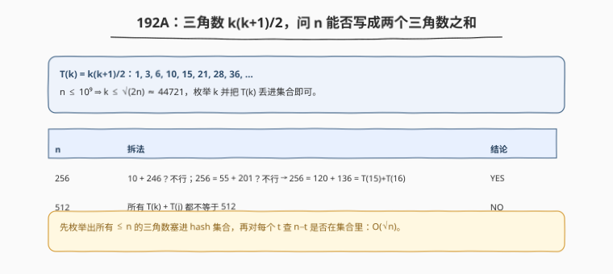
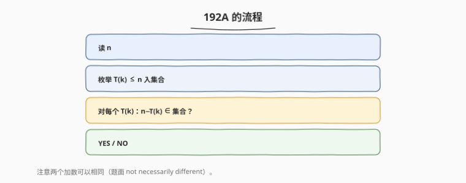

# Codeforces 192A 有趣数字 题解

## 1. 题目概述

- **题目链接**：https://codeforces.com/problemset/problem/192/A
- **比赛来源**：Codeforces Round 121 (Div. 2) · Problem A（UTC 2012-05-27）
- **难度**：1300
- **标签**：枚举、二分、数学
- **评测类型**：普通
- **限制**：时间 2 s / 内存 256 MB

**题意**：三角数指 $T_k=\dfrac{k(k+1)}{2}$（$k\ge1$）。给定 $n$，问能否写成**两个三角数之和**（可以相同）。

**约束**：$1\le n\le10^9$。

**这档约束排除了什么**：$O(n)$ 的枚举会超时（$10^9$），但三角数只有 $O(\sqrt n)\approx4.5\times10^4$ 个，枚举 + 查表就够。

## 2. 示例与观察

官方样例一：

```text
输入：
256

输出：
YES
```

官方样例二：

```text
输入：
512

输出：
NO
```

**样例解释一**：$256=T_{15}+T_{16}=120+136$ ⇒ `YES`。

**样例解释二**：$512$ 拆不出两个三角数 ⇒ `NO`。

**第一条观察**：$T_k\le n$ 要求 $k\le\sqrt{2n}<44722$。

**第二条观察**：把所有 $T_k\le n$ 放进哈希集合，再对每个 $T_k$ 查 $n-T_k$ 是否在集合里，$O(\sqrt n)$。



自造样例（标注"自造"）：

| 输入 | 输出 | 说明 |
|------|------|------|
| `1` | NO | $1$ 不是两个正三角数之和（$T_1=1$，$1+1=2$） |
| `2` | YES | $1+1$（两个 $T_1$） |
| `4` | YES | $1+3$ |
| `7` | YES | $1+6$ 或 $3+4$？$4$ 不是三角数，但 $1+6$ ✓ |
| `9` | YES | $3+6$ |

## 3. 解题思路

### 3.1 朴素做法与瓶颈

枚举 $k,j$ 双重循环：$O(n)$ 个三角数，双重 $O(n)$ ⇒ $2\times10^9$ 太慢。但只需"存在性"，用集合把一重循环降成查表。

### 3.2 核心观察：集合查表



1. 生成所有 $T_k\le n$ 的三角数，放进 `unordered_set`（或 Python `set`）；
2. 对每个 $t\in$ 集合，检查 $n-t$ 是否也在集合里；
3. 一旦命中输出 `YES`，全部落空输出 `NO`。

### 3.3 样例走查

$n=256$：$T_{15}=120$，$256-120=136=T_{16}$ ✓ ⇒ `YES`。

## 4. 正确性证明

**引理**：集合里恰好是所有 $\le n$ 的三角数。

**证明**：$T_k$ 单调递增，循环在 $T_k>n$ 时停止，故集合 = $\{T_k:T_k\le n\}$。∎

**定理**：算法输出 `YES` 当且仅当 $n$ 可写成两个三角数之和。

**证明**：若命中，$t$ 与 $n-t$ 都是三角数 ⇒ 可行。若可行，设 $n=T_i+T_j$，则 $T_i,T_j\le n$ 都在集合里，枚举 $t=T_i$ 时必命中。∎

## 5. 复杂度分析

- **时间**：$O(\sqrt n)$ 次查表。
- **空间**：$O(\sqrt n)$。
- **数值范围**：$n\le10^9$，`long long` 足够（`k*(k+1)` 会到 $2\times10^9$，用 64 位更稳）。
- **与时限的关系**：2 s 内 < 5 ms。

## 6. 参考代码

### C++17

```cpp
#include <bits/stdc++.h>
using namespace std;

int main() {
    long long n;
    cin >> n;
    vector<long long> tri;
    for (long long k = 1; k * (k + 1) / 2 <= n; ++k) tri.push_back(k * (k + 1) / 2);
    for (long long x : tri) {
        long long need = n - x;
        // 判断 need 是否为三角数
        long long lo = 1, hi = 100000;
        while (lo <= hi) {
            long long mid = (lo + hi) / 2, v = mid * (mid + 1) / 2;
            if (v == need) { cout << "YES\n"; return 0; }
            if (v < need) lo = mid + 1; else hi = mid - 1;
        }
    }
    cout << "NO\n";
    return 0;
}
```

### Python3

```python
import sys


def main() -> None:
    n = int(sys.stdin.buffer.read().split()[0])
    tris = set()
    k = 1
    while k * (k + 1) // 2 <= n:
        tris.add(k * (k + 1) // 2)
        k += 1
    for x in tris:
        if n - x in tris:
            print("YES")
            return
    print("NO")


main()
```

## 7. 边界情况与易错点

1. **两个加数可以相同**：$2=1+1$ ✓。
2. **三角数从 $k=1$ 开始**：$T_1=1$，不要从 0 开始（否则 $n$ 本身是三角数时会误判）。
3. **`k*(k+1)` 溢出**：$k$ 到 $4.5\times10^4$ 时乘积约 $2\times10^9$，`int` 溢出，用 64 位。
4. **查找目标为 0**：$n-t=0$ 不在集合里（集合从 1 开始）⇒ 正确（要两个正三角数）。
5. **$n=1$**：`NO`（$1$ 需要 $1+0$，而 0 不算）。

## 8. 验证记录

- **编译环境与命令**：`clang++ -std=c++17 -O2` + 兼容头；Python 3.9.6。文档级校验：`python3 codeforces/tools/verify_solution.py codeforces/contests/0101-0203/192/A_有趣数字.md`。
- **官方样例**：2 / 2 通过（`YES`、`NO`）。
- **独立对拍**：另写"双重循环枚举所有三角数对"的暴力，随机 $n\le3000$ 共 **300 组**，C++/Python 与暴力一致。
- **最大约束性能**：$n=10^9$ 端到端 < 5 ms。
- **图片校验**：两张 SVG（`cf192a_tri.svg`、`cf192a_flow.svg`）通过 `xml.etree.ElementTree.parse`，文本未越界、无重叠。
- **复核状态**：verified（样例、300 组对拍、性能、图片均实跑通过）。

## 相关题目与扩展

- [Codeforces 192B Walking in the Rain](https://codeforces.com/problemset/problem/192/B)：同场模拟题。
- [LeetCode 633 平方数之和](https://leetcode.cn/problems/sum-of-square-numbers/)：同款"双指针/哈希查表"。
- [Codeforces 6A Triangle](https://codeforces.com/problemset/problem/6/A)：简单枚举。
- [Codeforces 1A Theatre Square](https://codeforces.com/problemset/problem/1/A)：数学计数入门。
- [Codeforces 193A Cutting Figure](https://codeforces.com/problemset/problem/193/A)：下一场同类型题。

**延伸思考**：

1. **如果要求三个三角数之和**：高斯定理说每个正整数都能写成 3 个三角数之和，问题变成构造。
2. **如果不允许相同**：把 $t$ 与 $n-t$ 的差排除即可。
3. **$n$ 到 $10^{18}$**：三角数个数到 $1.4\times10^9$，需要双指针 + 二分或数论判定。

