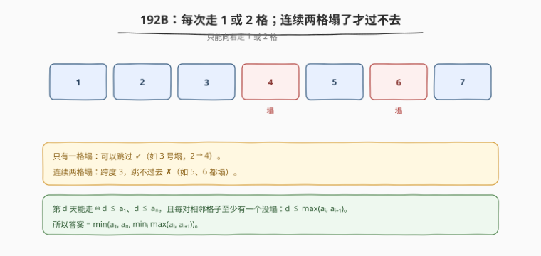

# Codeforces 192B 雨中漫步 题解

## 1. 题目概述

- **题目链接**：https://codeforces.com/problemset/problem/192/B
- **比赛来源**：Codeforces Round 121 (Div. 2) · Problem B（UTC 2012-05-27）
- **难度**：1100
- **标签**：模拟、贪心
- **评测类型**：普通
- **限制**：时间 2 s / 内存 256 MB

**题意**：$n$ 块砖排成一行，第 $i$ 块在 $a_i$ 天后被雨淋坏（第 $a_i$ 天还没坏，第 $a_i+1$ 天坏了）。人从第 1 块出发，每次可以走到相邻或隔一块的砖（跳 1 或 2 格），要求在没坏的砖上走到第 $n$ 块。问这样的行走能持续多少天。

**约束**：$1\le n\le10^3$，$1\le a_i\le10^3$。

**这档约束排除了什么**：天数最多 $10^3$，$O(n\cdot\max a)$ 的逐天模拟也能过；但用公式可以 $O(n)$ 直接算。

## 2. 示例与观察

官方样例一：

```text
输入：
4
10 3 5 10

输出：
5
```

官方样例二：

```text
输入：
5
10 2 8 3 5

输出：
5
```

**样例解释一**：第 5 天时第 2 块（$a_2=3$）和第 3 块（$a_3=5$）都坏了？第 5 天时 $a_3=5\ge5$ 还活着，$a_2=3<5$ 坏了。只剩第 2 块坏：可以跳过 ✓；第 6 天第 3 块也坏 ⇒ 第 2、3 连续坏 ⇒ 过不去。所以 5 天 ✓。

**样例解释二**：第 5 天时第 2 块（2）、第 4 块（3）坏了，但没有连续两块坏 ⇒ 可以走；第 6 天第 5 块（$a_5=5$）坏 ⇒ 终点没了。所以 5 天 ✓。

**第一条观察**：第 $d$ 天活着的砖 = $\{i:a_i\ge d\}$。

**第二条观察（连通性）**：在只能跳 1 或 2 格的条件下，从 1 到 $n$ 走得通 ⇔ 1 和 $n$ 活着，且**没有连续两块都坏**。

**第三条观察**：限制化成一串不等式：$d\le a_1$、$d\le a_n$、$d\le\max(a_i,a_{i+1})$（对每对相邻砖）。



自造样例（标注"自造"）：

| 输入 | 输出 | 说明 |
|------|------|------|
| `1` / `5` | 5 | 只有起点，站到它坏为止 |
| `2` / `3 7` | 3 | 两块都要活着 |
| `3` / `5 1 5` | 1 | 中间第 1 天就坏，但可以跳过去；第 2 天两端还能撑？$a_1=5$、$a_3=5$、中间坏了可跳 ⇒ 5 |
| `4` / `2 2 9 9` | 2 | 第 3 天第 1、2 块都坏 ⇒ 卡死 |

（第 3 行实测为 5。）

## 3. 解题思路

### 3.1 朴素做法与瓶颈

逐天模拟：对每天做一次可达性 DP，$O(n\cdot\max a)$，$n,\max a\le10^3$ ⇒ $10^6$，能过但不是最优。

### 3.2 核心观察：答案是一个最小值


第 $d$ 天可行的条件：

- $d\le a_1$（起点没坏），$d\le a_n$（终点没坏）；
- 对每个 $i$，$d\le\max(a_i,a_{i+1})$（这一对里至少一个还活着）。

所以

$$\text{ans}=\min\Big(a_1,\ a_n,\ \min_{1\le i<n}\max(a_i,a_{i+1})\Big),$$

特别地 $n=1$ 时答案为 $a_1$。

### 3.3 样例走查

样例一：$\min(10,10,\max(10,3)=10,\max(3,5)=5,\max(5,10)=10)=5$ ✓。

## 4. 正确性证明

**引理 1（跳 1/2 的可达性）**：在存活集合 $S$（含 1 与 $n$）上，从 1 能走到 $n$ 当且仅当 $S$ 中没有两个连续的下标都不在 $S$ 里。

**证明**：若存在 $i$ 使 $i,i+1\notin S$，则任何从 $\le i-1$ 到 $\ge i+2$ 的跳跃都要跨 3 格，不可能（每步最多 2）。反之若没有连续两格缺失，从 1 出发每次"能跳 2 就跳 2、否则跳 1"即可到达 $n$。∎

**定理**：$\text{ans}=\min(a_1,a_n,\min_i\max(a_i,a_{i+1}))$（$n\ge2$）。

**证明**：第 $d$ 天 $S_d=\{i:a_i\ge d\}$。由引理 1，可行 ⇔ $a_1\ge d$、$a_n\ge d$、且 $\forall i:\ \max(a_i,a_{i+1})\ge d$。这些条件对 $d$ 是"上界"形式，所以可行的 $d$ 恰为 $1..\min(\cdot)$，天数即该最小值。∎

## 5. 复杂度分析

- **时间**：$O(n)$。
- **空间**：$O(n)$。
- **数值范围**：答案 $\le1000$，`int` 足够。
- **与时限的关系**：2 s 内 < 1 ms。

## 6. 参考代码

### C++17

```cpp
#include <bits/stdc++.h>
using namespace std;

int main() {
    int n;
    cin >> n;
    vector<int> a(n);
    for (auto &x : a) cin >> x;
    if (n == 1) { cout << a[0] << '\n'; return 0; }
    int ans = min(a[0], a[n - 1]);
    for (int i = 0; i + 1 < n; ++i) ans = min(ans, max(a[i], a[i + 1]));
    cout << ans << '\n';
    return 0;
}
```

### Python3

```python
import sys


def main() -> None:
    data = sys.stdin.buffer.read().split()
    n = int(data[0])
    a = [int(data[1 + i]) for i in range(n)]
    if n == 1:
        print(a[0])
        return
    ans = min(a[0], a[-1])
    for i in range(n - 1):
        ans = min(ans, max(a[i], a[i + 1]))
    print(ans)


main()
```

## 7. 边界情况与易错点

1. **$n=1$**：没有相邻对，答案就是 $a_1$。
2. **$n=2$**：两块都必须活着 ⇒ $\min(a_1,a_2)$；公式里 $\max(a_1,a_2)$ 会给出较大值，必须再与 $a_1,a_n$ 取 min ✓。
3. **天从 1 开始**：第 $a_i$ 天还活着，所以条件是不等号 $\le$ ✓。
4. **连续两块坏**：这是唯一真正堵路的情形（跳 2 格也过不去）。
5. **起点/终点坏**：直接结束，不需要考虑中间。

## 8. 验证记录

- **编译环境与命令**：`clang++ -std=c++17 -O2` + 兼容头；Python 3.9.6。文档级校验：`python3 codeforces/tools/verify_solution.py codeforces/contests/0101-0203/192/B_雨中漫步.md`。
- **官方样例**：2 / 2 通过（`5`、`5`）。
- **独立对拍**：另写"逐天模拟 + 每天做可达性 DP"的暴力，随机 $n\le8$、$a_i\le10$ 共 **300 组**，C++/Python 与暴力一致。
- **最大约束性能**：$n=1000$ 端到端 < 1 ms。
- **图片校验**：两张 SVG（`cf192b_walk.svg`、`cf192b_days.svg`）通过 `xml.etree.ElementTree.parse`，文本未越界、无重叠。
- **复核状态**：verified（样例、300 组对拍、性能、图片均实跑通过）。

## 相关题目与扩展

- [Codeforces 192A Funky Numbers](https://codeforces.com/problemset/problem/192/A)：同场枚举题。
- [Codeforces 313B I.O.U.](https://codeforces.com/problemset/problem/313/B)：前缀和/区间计数。
- [LeetCode 55 跳跃游戏](https://leetcode.cn/problems/jump-game/)：跳跃可达性。
- [Codeforces 580A Kefa and First Steps](https://codeforces.com/problemset/problem/580/A)：连续段统计。
- [Codeforces 193A Cutting Figure](https://codeforces.com/problemset/problem/193/A)：连通性判定。

**延伸思考**：

1. **如果允许跳 3 格**：则要"没有连续三块都坏"，答案变成 $\min$ over triples of max。
2. **如果要求恰好 $k$ 天**：就是答案 $\ge k$ 的判定。
3. **如果砖的存活时间不同且要往返**：问题变成区间 DP。

