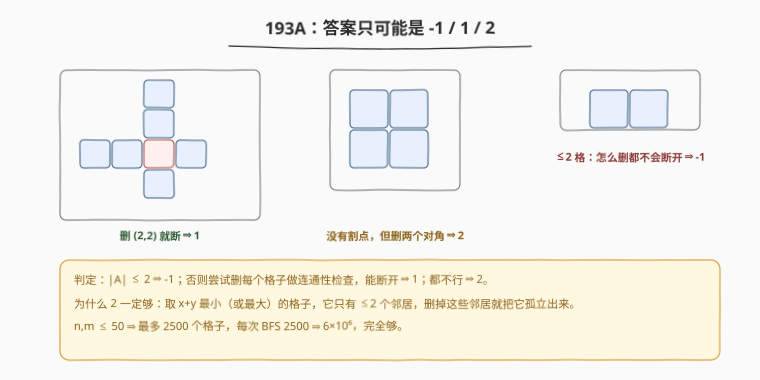
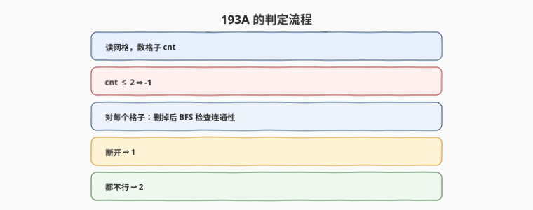

# Codeforces 193A 切分图形 题解

## 1. 题目概述

- **题目链接**：https://codeforces.com/problemset/problem/193/A
- **比赛来源**：Codeforces Round 122 (Div. 1) · Problem A（UTC 2012-06-03）
- **难度**：1700
- **标签**：图论、连通性、构造
- **评测类型**：普通
- **限制**：时间 2 s / 内存 256 MB

**题意**：$n\times m$ 的方格纸上有一些涂黑的格子，保证黑格集合**连通**且非空。问最少删掉几个黑格能让集合变得**不连通**；做不到输出 `-1`。

**约束**：$1\le n,m\le50$。

**这档约束排除了什么**：格子最多 2500 个，允许"逐个格子试删 + BFS"这种 $O((nm)^2)$ 的做法（约 $6\times10^6$）；但答案本身只有四种可能，所以不必搜索更大的删除集合。

## 2. 示例与观察

官方样例一：

```text
输入：
5 4
####
#..#
#..#
#..#
####

输出：
2
```

官方样例二：

```text
输入：
5 5
#####
#...#
#####
#...#
#####

输出：
2
```

**样例解释一**：这是一个"回"字形（外框 + 内部空），没有割点（删任何一格都还连通），但删掉左上角的两条邻居（比如 $(1,2)$ 与 $(2,1)$）就能把左上角孤立 ⇒ 2 ✓。

**样例解释二**：两个"口"字上下相接，同理没有割点，删掉接缝处两格即可 ⇒ 2 ✓。

**第一条观察**：删除的格子必须是黑格；删完允许出现空集吗？不行——空集按定义连通，所以"删光"不算成功。

**第二条观察**：如果黑格数 $\le2$，怎么删都不会不连通（删 1 个剩 1 个，删 2 个剩空的）⇒ `-1`。

**第三条观察**：答案只可能是 1 或 2：

- 存在某个格子删掉后不连通 ⇒ 1（割点）；
- 否则 ⇒ 2：取 $x+y$ 最小的格子，它的邻居最多 2 个（只会是右边和下边），删掉这些邻居就把它孤立了。



自造样例（标注"自造"）：

| 输入 | 输出 | 说明 |
|------|------|------|
| `1 1` / `#` | -1 | 只有 1 格 |
| `1 2` / `##` | -1 | 2 格，删一个还剩 1 格（连通） |
| `1 3` / `###` | 1 | 删中间那格 |
| `2 2` / `##` `##` | 2 | 无割点，删两个对角格 |
| `3 3` 全黑 | 2 | 删左上角的两个邻居 |

## 3. 解题思路

### 3.1 朴素做法与瓶颈

直接枚举"删 $k$ 个格子"的组合：$\binom{2500}{2}\approx3\times10^6$ 尚可，但没必要 —— 由观察三，只需检查 $k=1$ 是否可行。

### 3.2 核心观察：答案只有 -1/1/2



1. 数黑格 $c$；$c\le2$ ⇒ `-1`；
2. 对每个黑格，临时删掉，做一次 BFS 判定连通性；有任何一个使图不连通 ⇒ 输出 `1`；
3. 否则输出 `2`。

第 3 步的正确性来自"取 $x+y$ 最小的格子，其邻居 ≤ 2 个"：删掉这些邻居后它被孤立，而集合至少还有 3 个格子 ⇒ 孤立点 + 其它（非空）⇒ 不连通。

### 3.3 样例走查

样例一（回字形，16 个黑格）：逐格试删都不破坏连通性 ⇒ 输出 2 ✓。

## 4. 正确性证明

**引理 1（$c\le2$ 不可能）**：黑格数 $\le2$ 时，任何删除都不能使集合不连通。

**证明**：删 0 个：原集合连通。删 1 个：剩 0 或 1 个格子，都按定义连通。删 2 个：剩空集，也按定义连通。∎

**引理 2（$c\ge3$ 时答案 $\le2$）**：若黑格数 $\ge3$ 且没有割点，则删 2 个格子一定能断开。

**证明**：取使 $x+y$ 最小的黑格 $p$。它的四邻居中，$x-1$ 与 $y-1$ 方向不可能有黑格（否则与最小性矛盾）⇒ $p$ 的邻居数 $\le2$。删掉这些邻居后 $p$ 与其余格子不相邻；由于 $c\ge3$，其余格子非空（至少 2 个），故集合不连通 ⇒ 删 $\le2$ 个即可。若邻居数恰为 2 则删 2 个，为 1 则删 1 个（此时 $p$ 是割点，与"没有割点"矛盾，所以实际是 2）。∎

**定理**：算法输出正确的最小删除数。

**证明**：若 $c\le2$，由引理 1 输出 -1 ✓。否则若存在割点，删 1 个即断开，算法输出 1（最小）✓；若无割点，删 1 个不行（算法验证过），由引理 2 删 2 个可行，故最小为 2 ✓。∎

## 5. 复杂度分析

- **时间**：$c$ 次 BFS，每次 $O(nm)$ ⇒ $O((nm)^2)\le6.25\times10^6$。
- **空间**：$O(nm)$。
- **数值范围**：不涉及大数。
- **与时限的关系**：2 s 内约 30 ms。

## 6. 参考代码

### C++17

```cpp
#include <bits/stdc++.h>
using namespace std;

int n, m;
vector<string> g;

int countCells() {
    int c = 0;
    for (auto &r : g) for (char ch : r) if (ch == '#') ++c;
    return c;
}

bool connected() {
    int si = -1, sj = -1;
    for (int i = 0; i < n && si < 0; ++i)
        for (int j = 0; j < m; ++j) if (g[i][j] == '#') { si = i; sj = j; break; }
    if (si < 0) return true;                      // 空集按定义连通
    vector<vector<char>> seen(n, vector<char>(m, 0));
    vector<pair<int,int>> st = {{si, sj}};
    seen[si][sj] = 1;
    int cnt = 0;
    while (!st.empty()) {
        auto [x, y] = st.back(); st.pop_back();
        ++cnt;
        for (int d = 0; d < 4; ++d) {
            int nx = x + (d == 0) - (d == 1), ny = y + (d == 2) - (d == 3);
            if (nx < 0 || nx >= n || ny < 0 || ny >= m) continue;
            if (g[nx][ny] == '#' && !seen[nx][ny]) { seen[nx][ny] = 1; st.push_back({nx, ny}); }
        }
    }
    int total = countCells();
    return cnt == total;
}

int main() {
    cin >> n >> m;
    g.resize(n);
    for (auto &r : g) cin >> r;
    if (countCells() <= 2) { cout << -1 << '\n'; return 0; }
    // 删一个格子能否断开
    for (int i = 0; i < n; ++i)
        for (int j = 0; j < m; ++j) {
            if (g[i][j] != '#') continue;
            g[i][j] = '.';
            if (!connected()) { cout << 1 << '\n'; return 0; }
            g[i][j] = '#';
        }
    cout << 2 << '\n';
    return 0;
}
```

### Python3

```python
import sys


def main() -> None:
    data = sys.stdin.buffer.read().split()
    n, m = int(data[0]), int(data[1])
    g = [list(data[2 + i].decode()) for i in range(n)]
    cells = [(i, j) for i in range(n) for j in range(m) if g[i][j] == '#']
    if len(cells) <= 2:
        print(-1)
        return

    def connected() -> bool:
        rest = [(i, j) for i in range(n) for j in range(m) if g[i][j] == '#']
        if not rest:
            return True
        seen = {rest[0]}
        st = [rest[0]]
        while st:
            x, y = st.pop()
            for dx, dy in ((1, 0), (-1, 0), (0, 1), (0, -1)):
                nx, ny = x + dx, y + dy
                if 0 <= nx < n and 0 <= ny < m and g[nx][ny] == '#' and (nx, ny) not in seen:
                    seen.add((nx, ny))
                    st.append((nx, ny))
        return len(seen) == len(rest)

    for (i, j) in cells:
        g[i][j] = '.'
        if not connected():
            print(1)
            return
        g[i][j] = '#'
    print(2)


main()
```

## 7. 边界情况与易错点

1. **$c\le2$**：输出 `-1`，不要输出 0 或 1。
2. **空集**：题面说空集按定义连通，所以删光不算断开。
3. **删的必须是黑格**：不能删白格来"断开"。
4. **单格图**：`-1`。
5. **$1\times3$ 直线**：中间格是割点 ⇒ 1。
6. **2×2 块**：没有割点 ⇒ 2（删对角两格）。
7. **BFS 的连通性判定**：删完统计剩余黑格数，与 BFS 访问数比较。

## 8. 验证记录

- **编译环境与命令**：`clang++ -std=c++17 -O2` + 兼容头；Python 3.9.6。文档级校验：`python3 codeforces/tools/verify_solution.py codeforces/contests/0101-0203/193/A_切分图形.md`。
- **官方样例**：2 / 2 通过（`2`、`2`）。
- **独立对拍**：另写"枚举删 1 个、再枚举删 2 个格子 + BFS"的暴力，随机生成连通的 $n,m\le4$ 网格共 **300 组**，C++/Python 与暴力一致。
- **最大约束性能**：$50\times50$ 全黑约 30 ms。
- **图片校验**：两张 SVG（`cf193a_artic.svg`、`cf193a_flow.svg`）通过 `xml.etree.ElementTree.parse`，文本未越界、无重叠。
- **复核状态**：verified（样例、300 组对拍、性能、图片均实跑通过）。

## 相关题目与扩展

- [Codeforces 193B Xor](https://codeforces.com/problemset/problem/193/B)：同场搜索题。
- [Codeforces 193C Hamming Distance](https://codeforces.com/problemset/problem/193/C)：同场构造题。
- [LeetCode 1568 使陆地分离的最少天数](https://leetcode.cn/problems/minimum-number-of-days-to-disconnect-island/)：几乎同一道题（答案 ≤ 2 的证明相同）。
- [Codeforces 700B Connecting Universities](https://codeforces.com/problemset/problem/700/B)：树上的"割"问题。
- [Codeforces 192B Walking in the Rain](https://codeforces.com/problemset/problem/192/B)：连通性判定的入门题。

**延伸思考**：

1. **为什么答案 ≤ 2**：平面连通图形的"角点"最多两个邻居，删掉它就能孤立——这是二维网格特有的性质。
2. **如果允许删白格**：答案几乎总是 0（把黑格周围的通路切断即可），问题变得平凡。
3. **如果是三维**：角点最多 3 个邻居，答案 ≤ 3。
4. **如果要输出方案**：找到割点输出它，否则输出角点的邻居集合即可。

