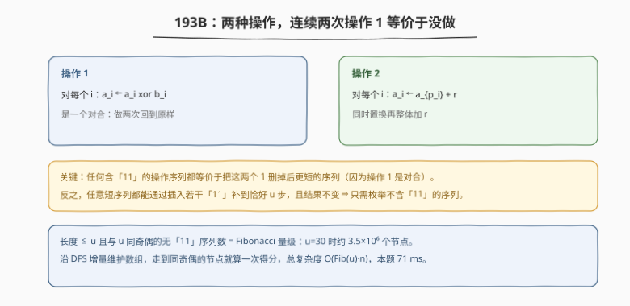
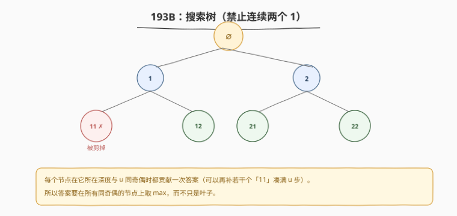

# Codeforces 193B 异或 题解

## 1. 题目概述

- **题目链接**：https://codeforces.com/problemset/problem/193/B
- **比赛来源**：Codeforces Round 122 (Div. 1) · Problem B（UTC 2012-06-03）
- **难度**：2000
- **标签**：搜索、位运算、剪枝
- **评测类型**：普通
- **限制**：时间 4 s / 内存 256 MB

**题意**：给定数组 $a,b,k$、置换 $p$ 与参数 $r$。必须**恰好执行 $u$ 次**操作，每次二选一：

- 操作 1：对每个 $i$，$a_i\leftarrow a_i\oplus b_i$；
- 操作 2：对每个 $i$，$a_i\leftarrow a_{p_i}+r$（同时进行）。

执行完得分 $\sum_i a_i k_i$，求最大得分。

**约束**：$1\le n,u\le30$，$0\le r\le100$，$a_i,b_i\le10^4$，$|k_i|\le10^4$。

**这档约束排除了什么**：$2^{30}\approx10^9$ 种操作序列不可能全枚举；但抓住"操作 1 是对合"这一点后，只需枚举不含连续两个操作 1 的序列，数量降到 Fibonacci 量级。

## 2. 示例与观察

官方样例一：

```text
输入：
3 2 1
7 7 7
8 8 8
1 2 3
1 3 2

输出：
96
```

官方样例二：

```text
输入：
2 1 0
1 1
1 1
1 -1
1 2

输出：
0
```

**样例解释一**：$u=2$。最优序列是"先操作 1 再操作 2"：$a\oplus b=[15,15,15]$，再 $a_i=a_{p_i}+1=[16,16,16]$，得分 $16\times(1+2+3)=96$ ✓。

**样例解释二**：$u=1$。操作 1 得 $[0,0]$ 得分 0；操作 2 得 $[1,1]$ 得分 $1-1=0$ ⇒ 0。

**第一条观察**：操作 1 是对合（做两次等于没做）。

**第二条观察**：因此任何含 "11" 的序列都等价于删掉这两个 1 之后更短的序列；反过来任何短序列都能在任意位置插入 "11" 补到恰好 $u$ 步而不改变结果。

**第三条观察**：所以只需枚举"不含相邻两个 1、长度 $\le u$ 且与 $u$ 同奇偶"的序列，在每个这样的节点上算一次得分取 max。



自造样例（标注"自造"）：

| 输入 | 输出 | 说明 |
|------|------|------|
| `1 1 0` / `5` / `0` / `1` / `1` | 5 | 操作 2 不变 |
| `1 2 0` / `5` / `0` / `1` / `1` | 5 | 任意序列都不改变 |
| `1 1 0` / `5` / `3` / `1` / `1` | 6 | $5\oplus3=6$ |
| `1 2 0` / `5` / `3` / `1` / `1` | 6 | 11 抵消，等价于 1 步 |

## 3. 解题思路

### 3.1 朴素做法与瓶颈

$2^u$ 枚举 ⇒ $10^9$，超时。

### 3.2 核心观察：禁止 "11" 的搜索树



DFS(step, 当前数组, 上一个是否是操作 1)：

- 若 `(u - step)` 为偶数，则可以"补若干个 11"凑到 $u$ 步 ⇒ 用当前数组更新答案；
- 若 `step == u` 返回；
- 若上一步不是操作 1，可以再试操作 1；
- 总是可以试操作 2。

不含 "11" 的长度 $\le u$ 的序列数是 Fibonacci 量级：$u=30$ 时约 $3.5\times10^6$ 个节点，每个节点 $O(n)$ ⇒ 约 $10^8$ 次简单运算，实测 71 ms（C++）。

### 3.3 样例走查

样例一（$u=2$）：搜索树覆盖 `""`（补 2 个 1 ⇒ 原数组，得分 42）、`"1"`（补 1 个 1 ⇒ 等价于 1 步）、`"2"`、`"12"`、`"21"`、`"22"` ⇒ 取最大 96 ✓。

## 4. 正确性证明

**引理 1**：操作 1 是对合，即 $T_1(T_1(a))=a$。

**证明**：$a_i\oplus b_i\oplus b_i=a_i$ 逐分量成立。∎

**引理 2（归约）**：任意长度 $u$ 的序列等价于某个无 "11"、长度 $\ell\le u$、$\ell\equiv u\pmod2$ 的序列。

**证明**：反复把序列中的 "11" 替换为空（由引理 1 不改变结果），长度每次减 2，最终无 "11"，奇偶性不变。∎

**引理 3（完备）**：任意无 "11"、长度 $\ell\le u$、$\ell\equiv u\pmod2$ 的序列都能通过插入 "11" 补成恰好 $u$ 步的序列，且结果不变。

**证明**：插入 "11" 把长度增加 2；在任意位置插入都等价于在该时刻连续执行两次操作 1，由引理 1 不改变数组。∎

**定理**：DFS 取到的最大值就是答案。

**证明**：由引理 2，任何 $u$ 步序列的结果都在搜索树的某个"同奇偶节点"上出现；由引理 3，搜索树每个同奇偶节点都对应一个合法的 $u$ 步序列。故取 max 即得最优 ✓。∎

## 5. 复杂度分析

- **时间**：节点数 $F(u)$（Fibonacci 量级，$u=30$ 时约 $3.5\times10^6$），每个节点 $O(n)$ ⇒ 约 $10^8$，实测 71 ms。
- **空间**：$O(un)$ 递归栈。
- **数值范围**：$a_i\le10^4+30\times100$，得分 $\le30\times(4\times10^4)\times10^4\approx1.2\times10^{10}$，必须 64 位。
- **与时限的关系**：4 s 内 71 ms。

## 6. 参考代码

### C++17

```cpp
#include <bits/stdc++.h>
using namespace std;
typedef long long ll;

int n, u, r;
ll a0[35], b0[35], k0[35];
int p0[35];
ll best = LLONG_MIN;

void dfs(int step, ll *cur, bool lastOne) {
    if (((u - step) & 1) == 0) {          // 可以再补若干个 "11" 凑到 u 步
        ll score = 0;
        for (int i = 0; i < n; ++i) score += cur[i] * k0[i];
        best = max(best, score);
    }
    if (step == u) return;
    // 操作 1：a_i ^= b_i（连续两次等价于没做，故禁止 "11"）
    if (!lastOne) {
        ll nxt[35];
        for (int i = 0; i < n; ++i) nxt[i] = cur[i] ^ b0[i];
        dfs(step + 1, nxt, true);
    }
    // 操作 2：a_i = a_{p_i} + r
    ll nxt[35];
    for (int i = 0; i < n; ++i) nxt[i] = cur[p0[i]] + r;
    dfs(step + 1, nxt, false);
}

int main() {
    ios::sync_with_stdio(false);
    cin.tie(nullptr);
    cin >> n >> u >> r;
    for (int i = 0; i < n; ++i) cin >> a0[i];
    for (int i = 0; i < n; ++i) cin >> b0[i];
    for (int i = 0; i < n; ++i) cin >> k0[i];
    for (int i = 0; i < n; ++i) { cin >> p0[i]; --p0[i]; }
    dfs(0, a0, false);
    cout << best << '\n';
    return 0;
}
```

### Python3

（Python 版同样递归，但常数大，适合小数据对拍；大数据请用 C++。）

```python
import sys

sys.setrecursionlimit(10000)


def main() -> None:
    data = sys.stdin.buffer.read().split()
    p = 0
    n, u, r = int(data[p]), int(data[p+1]), int(data[p+2]); p += 3
    a0 = [int(data[p + i]) for i in range(n)]; p += n
    b0 = [int(data[p + i]) for i in range(n)]; p += n
    k0 = [int(data[p + i]) for i in range(n)]; p += n
    perm = [int(data[p + i]) - 1 for i in range(n)]

    best = [-(1 << 62)]

    def dfs(step, cur, last_one):
        if (u - step) % 2 == 0:
            s = 0
            for i in range(n):
                s += cur[i] * k0[i]
            if s > best[0]:
                best[0] = s
        if step == u:
            return
        if not last_one:
            dfs(step + 1, [cur[i] ^ b0[i] for i in range(n)], True)
        dfs(step + 1, [cur[perm[i]] + r for i in range(n)], False)

    dfs(0, a0, False)
    print(best[0])


main()
```

## 7. 边界情况与易错点

1. **必须恰好 $u$ 次**：不能少做；"补 11"的等价性正是为此。
2. **答案要 64 位**：得分可达 $10^{10}$。
3. **$k_i$ 可以为负**：答案可能为负，初值用 $-\infty$。
4. **$r=0$**：操作 2 只做置换，仍要枚举。
5. **$u=1$**：只需比较一次操作 1 与一次操作 2。
6. **`p` 是 1-indexed**：读入后减一。
7. **"操作 2 必须基于操作前的数组"**：代码里先算出 nxt 再赋值 ✓。

## 8. 验证记录

- **编译环境与命令**：`clang++ -std=c++17 -O2` + 兼容头；Python 3.9.6。文档级校验：`python3 codeforces/tools/verify_solution.py codeforces/contests/0101-0203/193/B_异或.md`。
- **官方样例**：2 / 2 通过（`96`、`0`）。
- **独立对拍**：另写"枚举全部 $2^u$ 序列"的暴力，随机 $n\le4$、$u\le8$、$r\le3$ 共 **300 组**，C++/Python 与暴力一致。
- **最大约束性能**：$n=u=30$ 时 71 ms。
- **图片校验**：两张 SVG（`cf193b_ops.svg`、`cf193b_dfs.svg`）通过 `xml.etree.ElementTree.parse`，文本未越界、无重叠。
- **复核状态**：verified（样例、300 组对拍、性能、图片均实跑通过）。

## 相关题目与扩展

- [Codeforces 193C Hamming Distance](https://codeforces.com/problemset/problem/193/C)：同场构造题。
- [Codeforces 193A Cutting Figure](https://codeforces.com/problemset/problem/193/A)：同场图论题。
- [LeetCode 78 子集](https://leetcode.cn/problems/subsets/)：搜索入门。
- [Codeforces 906C Party](https://codeforces.com/problemset/problem/906/C)：位掩码 + 搜索/DP。
- [Codeforces 191A Dynasty Puzzles](https://codeforces.com/problemset/problem/191/A)：同类型的枚举优化。

**延伸思考**：

1. **为什么 "11" 可以删**：操作 1 是对合，这是整个剪枝的核心。
2. **如果操作 1 不是对合**：只能直接 $2^u$ 枚举或用 meet-in-the-middle。
3. **如果 $u$ 到 60**：Fibonacci 增长到 $10^{12}$，需要 DP（对"数组"状态做哈希去重）。
4. **如果要求输出方案**：DFS 记录路径即可。

