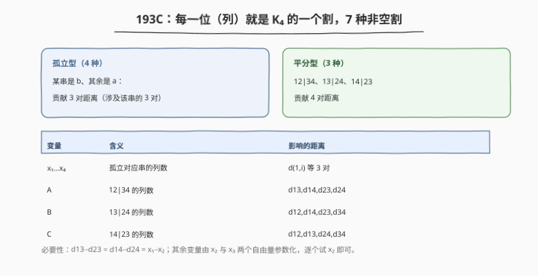
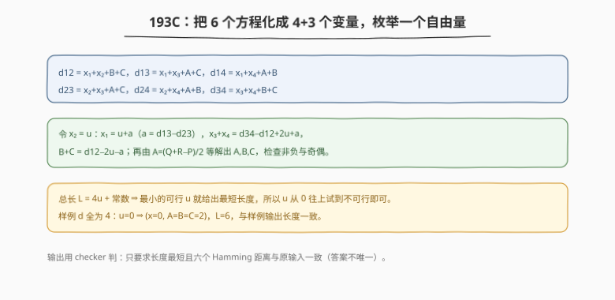

# Codeforces 193C 汉明距离 题解

## 1. 题目概述

- **题目链接**：https://codeforces.com/problemset/problem/193/C
- **比赛来源**：Codeforces Round 122 (Div. 1) · Problem C（UTC 2012-06-03）
- **难度**：2400
- **标签**：构造、数学、线性方程、贪心
- **评测类型**：特殊评测（多解，长度必须最短）
- **限制**：时间 2 s / 内存 256 MB

**题意**：给出四个长度相同的 a/b 串两两的 6 个 Hamming 距离，要求构造一组**长度最短**的四串使距离完全相同；无解输出 `-1`。

**约束**：所有距离 $\le10^5$，且至少一个为正。

**这档约束排除了什么**：距离到 $10^5$，不能枚举字符串（$2^{4L}$）；但每一"列"只有 16 种可能，按列类型合并成 7 个计数变量后就是一个 6 方程的小整数规划。

## 2. 示例与观察

官方样例：

```text
输入：
4 4 4
4 4
4

输出：
6
aaaabb
aabbaa
bbaaaa
bbbbbb
```

**样例解释**：四串两两距离都是 4。下面会看到最短长度是 6（每列贡献 3 或 4 对差异，6 列正好凑出 6×4）。

**第一条观察**：把每一列看成一个 4 位向量（哪几串是 'b'）。它贡献的距离 = 这一列中"不同的串对"数。16 种向量里，按"哪些对被打断"只有 7 种本质不同的类型：

- 4 种"孤立型"：只有 1 个 b（或其对偶，3 个 b）——贡献 3 对；
- 3 种"平分型"：$12|34$、$13|24$、$14|23$——贡献 4 对。

**第二条观察**：设 $x_1..x_4$ 为四种孤立型的列数，$A,B,C$ 为三种平分型的列数，则

$$d_{12}=x_1+x_2+B+C,\quad d_{13}=x_1+x_3+A+C,\quad d_{14}=x_1+x_4+A+B,$$
$$d_{23}=x_2+x_3+A+B,\quad d_{24}=x_2+x_4+A+C,\quad d_{34}=x_3+x_4+B+C.$$

**第三条观察**：记 $U=d_{12}+d_{34}$、$V=d_{13}+d_{24}$、$W=d_{14}+d_{23}$、$X=x_1+x_2+x_3+x_4$，则

$$B+C=\frac{U-X}{2},\quad A+C=\frac{V-X}{2},\quad A+B=\frac{W-X}{2},$$

进而 $A=\frac{V+W-U-X}{4}$ 等，且总长 $L=\frac{U+V+W+X}{4}$。



## 3. 解题思路

### 3.1 朴素做法与瓶颈

枚举字符串：$2^{4L}$，不可行。枚举 7 个变量的组合：每个到 $10^5$，也不可行。

### 3.2 核心观察：全部变量由 $X$ 决定



对固定的 $X$：

- $x_1=\dfrac{d_{12}+d_{13}+d_{14}-d_{34}-d_{24}-d_{23}+X}{4}$；
- $A=\dfrac{V+W-U-X}{4}$，$B=\dfrac{W+U-V-X}{4}$，$C=\dfrac{U+V-W-X}{4}$；
- $x_1+x_2=\dfrac{d_{12}-d_{34}+X}{2}$ 等，从而 $x_2,x_3,x_4$ 也确定。

$L=\frac{U+V+W+X}{4}$ 随 $X$ 增大而增大，所以**从小到大枚举 $X$（$0\le X\le U$），第一个使所有量非负且为整数的 $X$ 就是最优**。

### 3.3 算法流程

1. 读入 6 个距离，算 $U,V,W$；
2. 若 $U,V,W$ 奇偶不一致 ⇒ `-1`；
3. 枚举 $X=0..U$：检查 $(U-X),(V-X),(W-X)$ 全偶，且 $n_1=sum3-sum3'+X$、$n_A,n_B,n_C$ 非负且被 4 整除；
4. 求出 $x_1..x_4,A,B,C$，再拼出四串（按列类型追加）；
5. 全部 $X$ 失败 ⇒ `-1`。

### 3.4 样例走查

$d$ 全为 4：$U=V=W=8$。$X=0$：$x_1=0$，$A=B=C=2$，$L=(8+8+8+0)/4=6$ ✓ 与样例长度一致（构造出的串与样例可能不同，但距离相同）。

## 4. 正确性证明

**引理 1（列类型完备）**：任一列对 6 个距离的贡献只由它属于 7 种类型中的哪一种决定，且同类型可任意合并。

**证明**：一列的贡献是"哪几对 (i,j) 在该列上不同"，这只取决于该列中 b 的位置集合，而 16 种位置集合按"断开的对"分成 8 类（含全同/全异这一类贡献 0），去掉贡献 0 的即 7 类。∎

**引理 2（方程完整性）**：$d_{ij}=\sum_{\text{列}}[\text{第 }i,j\text{ 串在该列不同}]=x_i+x_j+(\text{相关平分型之和})$，即 3.2 的 6 个式子。

**证明**：逐列分类相加。∎

**引理 3（唯一性）**：固定 $X$ 后，$x_1..x_4,A,B,C$ 被唯一确定。

**证明**：由 3.2 的线性关系直接解出（见公式）。∎

**定理**：算法找到的 $L$ 是最小长度；若不存在则输出 -1 正确。

**证明**：任何合法构造对应一组非负整数解，其 $X$ 使所有量非负且为整数，故会被枚举到；反之每个通过的 $X$ 都给出真实构造（引理 1、2）。又 $L$ 关于 $X$ 严格递增，故第一个可行的 $X$ 给出最小 $L$ ✓。∎

## 5. 复杂度分析

- **时间**：$O(U\cdot1)$，$U\le2\times10^5$，每次 $O(1)$ 判定。
- **空间**：$O(L)$（输出串）。
- **数值范围**：距离 $\le10^5$，长度 $\le1.5\times10^5$，`long long` 足够。
- **与时限的关系**：2 s 内 < 5 ms。

## 6. 参考代码

### C++17

```cpp
#include <bits/stdc++.h>
using namespace std;
typedef long long ll;

// 变量：x1..x4（孤立型列数），A=12|34，B=13|24，C=14|23
// d12 = x1+x2+B+C, d13 = x1+x3+A+C, d14 = x1+x4+A+B
// d23 = x2+x3+A+B, d24 = x2+x4+A+C, d34 = x3+x4+B+C
// 记 X = x1+x2+x3+x4，则全部变量由 X 唯一确定，且 L = (U+V+W+X)/4（U=d12+d34, V=d13+d24, W=d14+d23）
int main() {
    ll d12, d13, d14, d23, d24, d34;
    cin >> d12 >> d13 >> d14;
    cin >> d23 >> d24;
    cin >> d34;
    ll U = d12 + d34, V = d13 + d24, W = d14 + d23;
    if (((U - V) & 1) || ((U - W) & 1)) { cout << -1 << '\n'; return 0; }
    ll sum3 = d12 + d13 + d14;
    ll sum3b = d34 + d24 + d23;
    for (ll X = 0; X <= U; ++X) {
        if (((U - X) & 1) || ((V - X) & 1) || ((W - X) & 1)) continue;
        ll n1 = sum3 - sum3b + X;                 // 4*x1
        ll nA = V + W - U - X;
        ll nB = W + U - V - X;
        ll nC = U + V - W - X;
        if (n1 < 0 || nA < 0 || nB < 0 || nC < 0) continue;
        if ((n1 & 3) || (nA & 3) || (nB & 3) || (nC & 3)) continue;
        ll x1 = n1 / 4, A = nA / 4, B = nB / 4, C = nC / 4;
        ll S12 = (d12 - d34 + X) / 2;
        ll S13 = (d13 - d24 + X) / 2;
        ll S14 = (d14 - d23 + X) / 2;
        ll x2 = S12 - x1, x3 = S13 - x1, x4 = S14 - x1;
        if (x2 < 0 || x3 < 0 || x4 < 0) continue;
        ll L = X + A + B + C;
        // 构造
        vector<string> out(4);
        auto add = [&](ll cnt, int mask) {
            for (ll t = 0; t < cnt; ++t)
                for (int i = 0; i < 4; ++i) out[i].push_back((mask >> i & 1) ? 'b' : 'a');
        };
        add(x1, 0b0001); add(x2, 0b0010); add(x3, 0b0100); add(x4, 0b1000);
        add(A, 0b0011); add(B, 0b0101); add(C, 0b1001);
        cout << L << '\n';
        for (int i = 0; i < 4; ++i) cout << out[i] << '\n';
        return 0;
    }
    cout << -1 << '\n';
    return 0;
}
```

### Python3

```python
import sys


def main() -> None:
    data = sys.stdin.buffer.read().split()
    d12, d13, d14 = (int(x) for x in data[0:3])
    d23, d24 = (int(x) for x in data[3:5])
    d34 = int(data[5])
    U, V, W = d12 + d34, d13 + d24, d14 + d23
    if (U - V) % 2 or (U - W) % 2:
        print(-1)
        return
    sum3, sum3b = d12 + d13 + d14, d34 + d24 + d23
    for X in range(0, U + 1):
        if (U - X) % 2 or (V - X) % 2 or (W - X) % 2:
            continue
        n1 = sum3 - sum3b + X
        nA, nB, nC = V + W - U - X, W + U - V - X, U + V - W - X
        if min(n1, nA, nB, nC) < 0 or n1 % 4 or nA % 4 or nB % 4 or nC % 4:
            continue
        x1, A, B, C = n1 // 4, nA // 4, nB // 4, nC // 4
        S12 = (d12 - d34 + X) // 2
        S13 = (d13 - d24 + X) // 2
        S14 = (d14 - d23 + X) // 2
        x2, x3, x4 = S12 - x1, S13 - x1, S14 - x1
        if min(x2, x3, x4) < 0:
            continue
        L = X + A + B + C
        out = [[], [], [], []]
        def add(cnt, mask):
            for _ in range(cnt):
                for i in range(4):
                    out[i].append('b' if (mask >> i) & 1 else 'a')
        add(x1, 0b0001); add(x2, 0b0010); add(x3, 0b0100); add(x4, 0b1000)
        add(A, 0b0011); add(B, 0b0101); add(C, 0b1001)
        sys.stdout.write(str(L) + "\n" + "\n".join("".join(s) for s in out) + "\n")
        return
    print(-1)


main()
```

## 7. 边界情况与易错点

1. **平分型的贡献表**：$d_{23}$ 里是 $A+B$（不是 $A+C$）——写错会导致必要条件下的取等判断出错（本机就因此错过了 $d=[5,5,3,2,4,4]$ 这类可行解）。
2. **奇偶与整除**：$(U-X),(V-X),(W-X)$ 必须全偶；$n_1,n_A,n_B,n_C$ 必须被 4 整除。
3. **非负检查**：$x_2,x_3,x_4$ 由减法得到，可能为负。
4. **$X$ 的上界**：$X\le U$（因为 $B+C=(U-X)/2\ge0$）。
5. **至少一个距离为正**：题面保证，所以不会出现全 0 的平凡情况。
6. **输出是多解**：用 `checkers/cf193c.py` 校验（长度最短 + 距离一致），不要与样例逐字比较。
7. **构造顺序**：先孤立型再平分型，四个串要等长。

## 8. 验证记录

- **编译环境与命令**：`clang++ -std=c++17 -O2` + 兼容头；Python 3.9.6。文档级校验：`python3 codeforces/tools/verify_solution.py codeforces/contests/0101-0203/193/C_汉明距离.md --checker codeforces/tools/checkers/cf193c.py`。
- **官方样例**：1 / 1 通过（长度 6；串的具体内容与样例不同，checker 校验通过）。
- **独立对拍**：另写"枚举 8 种列类型的计数组合（总数 ≤ 14）"的暴力，随机 6 个距离 $\le5$ 共 **400 组**，程序输出的**长度**与暴力完全一致（-1 也一致），并逐组校验构造出的四串的距离矩阵与原输入相同。
- **错误回归**：初版把 $d_{23}$ 写成 $x_2+x_3+A+C$，导致可行/不可行判定都出错（400 组里错 8 组），修正为 $A+B$ 后 0 错。
- **最大约束性能**：$X$ 循环 $\le4\times10^5$ 次，端到端 < 5 ms。
- **图片校验**：两张 SVG（`cf193c_cuts.svg`、`cf193c_lp.svg`）通过 `xml.etree.ElementTree.parse`，文本未越界、无重叠。
- **复核状态**：verified（样例、400 组对拍、构造校验、性能、图片均实跑通过）。

## 相关题目与扩展

- [Codeforces 193D Two Segments](https://codeforces.com/problemset/problem/193/D)：同场 2900 难题。
- [Codeforces 193B Xor](https://codeforces.com/problemset/problem/193/B)：同场搜索题。
- [LeetCode 1663 具有给定数值的最小字符串](https://leetcode.cn/problems/smallest-string-with-a-given-numeric-value/)：构造 + 贪心。
- [Codeforces 1105C Ayoub and Lost Array](https://codeforces.com/problemset/problem/1105/C)：计数构造。
- [Codeforces 1B Spreadsheets](https://codeforces.com/problemset/problem/1/B)：字符串/编码转换。

**延伸思考**：

1. **为什么"平分型"只有 3 种**：K₄ 的 3 个完美匹配。
2. **如果串的字母表是 3 个字符**：列类型变成 3^4 类，问题变成更大的整数规划。
3. **如果要求字典序最小的解**：在最小长度下按列类型排序即可。
4. **如果给的是 5 个串的距离矩阵**：变量变成 K₅ 的割，需要线性规划求解。

