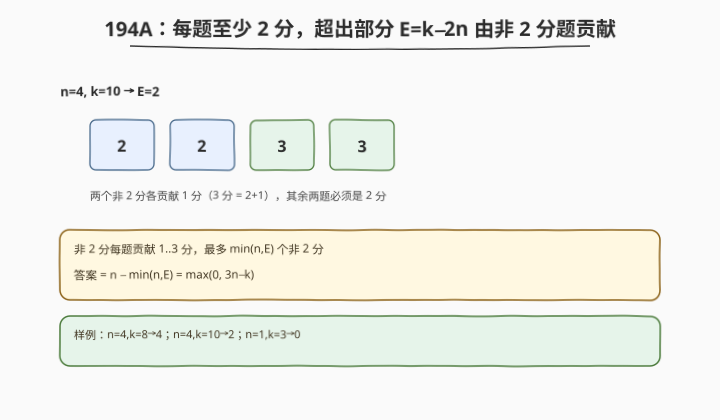
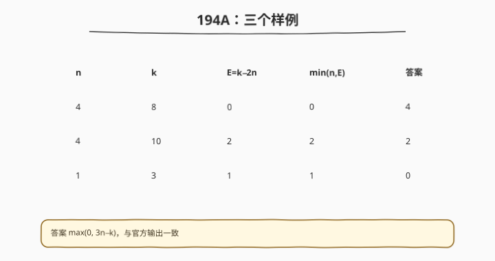

# Codeforces 194A 最少补考科目数 题解

## 1. 题目概述

- **题目链接**：https://codeforces.com/problemset/problem/194/A
- **比赛来源**：Codeforces Round 122 (Div. 2) · Problem A（UTC 2012-06-03）
- **难度**：900
- **标签**：贪心、数学、枚举
- **评测类型**：普通
- **限制**：时间 2 s / 内存 256 MB

**题意**：$n$ 门考试，每门分数是 $2..5$ 的整数，总和必须恰为 $k$。得 2 分就要补考，求最少补考科目数。输入保证存在满足总和的方案。

**约束**（原样摘自题面 `inputFormat.en`）：

- $1\le n\le50$，$1\le k\le250$。
- 保证存在一种分配使总分恰为 $k$。
- 输出一个整数。

**约束对算法的限制**：

- $n\le50$、$k\le250$：$O(nk)$ 的 DP 都能过，但本题有 $O(1)$ 公式。
- 分数范围小，答案 $\le n$。

## 2. 示例与观察

官方样例 1（输入 / 输出原样）：

```text
输入：
4 8

输出：
4
```

官方样例 2（输入 / 输出原样）：

```text
输入：
4 10

输出：
2
```

官方样例 3（输入 / 输出原样）：

```text
输入：
1 3

输出：
0
```

**样例 1**：$n=4,k=8$，每门至少 2 分，总和 $4\times2=8$，只能全是 2 分 → 4 门补考 ✓。

**样例 2**：$n=4,k=10$，比全 2 分多出 $10-8=2$ 分。每门非 2 分最多多贡献 3 分（5 分）、至少多贡献 1 分（3 分）。要让补考最少，就让尽量多的课不是 2 分：多出的 2 分可以由两门课各多 1 分（3+3）实现 → 2 门补考 ✓。

**样例 3**：$n=1,k=3$，一门 3 分 → 0 门补考 ✓。

**观察 1**：把所有课先记 2 分，总分 $2n$；多出来的 $E=k-2n$ 要分配到各门上，每门最多再加 3 分。

**观察 2**：一门课只要「加了至少 1 分」就不是 2 分（不用补考）。所以**不补考的课数**最多是 $\min(n,E)$（每门至少要多 1 分），其余都得是 2 分。

**观察 3**：$\min(n,E)$ 一定可达（把 $E$ 分成若干份 1..3 即可，因为 $E\le3n$）。

**自造样例**（标注「自造」，输出由程序实测）：

| 输入 | 输出 | 说明 |
|------|------|------|
| `1 2` | 1 | 只能 2 分 |
| `1 5` | 0 | 5 分 |
| `3 6` | 3 | 全 2 |
| `3 15` | 0 | 全 5 |

## 3. 解题思路



记 $E=k-2n$（$0\le E\le3n$）。每门课：

- 若是 2 分，多贡献 $0$；
- 否则多贡献 $1..3$。

要让「非 2 分」的课尽量多，每门至少多贡献 1，所以非 2 分的课数 $\le E$，同时 $\le n$；而 $E$ 总能分成若干个 $1..3$ 的和（因为 $E\le3n$），故恰好 $m=\min(n,E)$ 门非 2 分可实现。

答案 $=n-m=\max(0,n-E)=\max(0,3n-k)$。



## 4. 正确性证明

**引理 1**：若 $t$ 门课不是 2 分，则 $t\le E$。

**证明**：每门非 2 分至少贡献 1 分，总分超出 $2n$ 的部分为 $E$，故 $t\le E$。∎

**引理 2**：对任意 $0\le E\le3n$，存在恰有 $m=\min(n,E)$ 门非 2 分的分配。

**证明**：$m$ 门每门先分 1 分（共 $m$），剩余 $E-m\ge0$；若 $m=n$，剩余 $E-n\le2n$，每门最多再分 2 分，可行；若 $m=E$，剩余 0，可行。∎

**定理**：最少补考数 $=\max(0,3n-k)$。

**证明**：由引理 1，补考数 $\ge n-\min(n,E)$；由引理 2 可取到，故最小值为 $n-\min(n,E)=\max(0,n-E)=\max(0,3n-k)$。∎

## 5. 复杂度分析

- **时间**：$O(1)$。
- **空间**：$O(1)$。
- **数值范围**：答案 $\le50$。
- **与时限的关系**：2 s 对 $O(1)$ 运算余量在百万倍以上。实测约 2 ms。

## 6. 参考代码

### C++17

```cpp
#include <bits/stdc++.h>
using namespace std;

// 194A：每题 2..5 分，总和恰为 k。令 E = k - 2n 为「超出 2 分的总分」。
// 一个非 2 分的题最多贡献 3 分、至少 1 分，所以最多能有 min(n, E) 个非 2 分。
// 答案 = n - min(n, E) = max(0, 3n - k)。
int main() {
    int n, k;
    if (scanf("%d %d", &n, &k) != 2) return 0;
    printf("%d\n", max(0, 3 * n - k));
    return 0;
}
```

### Python3

```python
import sys


def main() -> None:
    data = sys.stdin.buffer.read().split()
    n, k = int(data[0]), int(data[1])
    sys.stdout.write(str(max(0, 3 * n - k)) + "\n")


main()
```

## 7. 边界情况与易错点

1. **$k=2n$**：全 2 分，答案 $n$（样例 1）。
2. **$k=5n$**：全 5 分，答案 0。
3. **$n=1$**：$k\le5$，答案 $k<3$ 时为 1。
4. **答案公式**：`max(0, 3n-k)`，不要写成 `n - (k-2n)`（可能为负）。
5. **保证可行**：$2n\le k\le5n$，不需要判无解。
6. **整数范围**：$n,k$ 很小，`int` 足够。
7. **多解**：答案唯一，不需要输出方案。
8. **输入只有一行两个数**，用 `scanf`/`split` 均可。

## 8. 验证记录

- **编译环境与命令**：`Apple clang 21.0.0`（`/usr/bin/g++` 是 clang 软链，无 GNU libstdc++），`clang++ -std=c++17 -O2 -Wall` 加仓库自带 `bits/stdc++.h`；正文代码仍写标准头。Python 为 `3.9.6`。验证命令：
  `python3 codeforces/tools/verify_solution.py codeforces/contests/0101-0203/194/A_最少补考科目数.md`
- **官方样例**：3 / 3 通过（`4`、`2`、`0`），C++ 与 Python 一致。
- **额外测试**：自造 $k=2n$、$k=5n$、$n=1$ 等 4 组，两种语言全部通过。
- **独立暴力对拍**：暴力用 DP 枚举每题 2..5 分，求总和为 $k$ 时最少的 2 分数；对 250 组随机数据（$n\le12$、$k\in[2n,5n]$）逐组比对，全部一致。
- **最大约束性能**：$O(1)$，端到端约 2 ms。
- **图片与公式**：2 张 SVG（`cf194a_excess.svg`、`cf194a_sample.svg`）通过 `ElementTree.parse` 与文本包围盒/重叠检查，headless Chrome 渲染确认无裁切；KaTeX 校验 0 错。
- **复核状态**：verified。

## 相关题目与扩展

- [Codeforces 194B Square](https://codeforces.com/problemset/problem/194/B)：同场 B 题，周期与 lcm。
- [Codeforces 160A Twins](https://codeforces.com/problemset/problem/160/A)：贪心入门。
- [LeetCode 1833. 雪糕的最大数量](https://leetcode.cn/problems/maximum-ice-cream-bars/)：分配问题的贪心。
- [Codeforces 230A Dragons](https://codeforces.com/problemset/problem/230/A)：排序后模拟。
- [LeetCode 976. 三角形的最大周长](https://leetcode.cn/problems/largest-perimeter-triangle/)：排序 + 贪心。

**延伸思考**：

1. **如果分数范围变成 $1..5$**：公式改成由「至少 1 分」的基准出发，答案结构类似。
2. **如果要求输出一种分配**：先给 $m$ 门各分 1 分，再把剩余均匀加到这几门上（每门不超过 3）。
3. **如果 $k$ 不保证可行**：先判 $2n\le k\le5n$。
4. **如果要求最少「非 5 分」的科目数**：对称地，答案由 $5n-k$ 决定。
5. **本质**：区间内的整数分配问题，用「先取最小、再补最多」的贪心即可。

