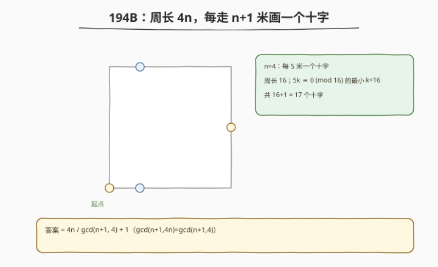
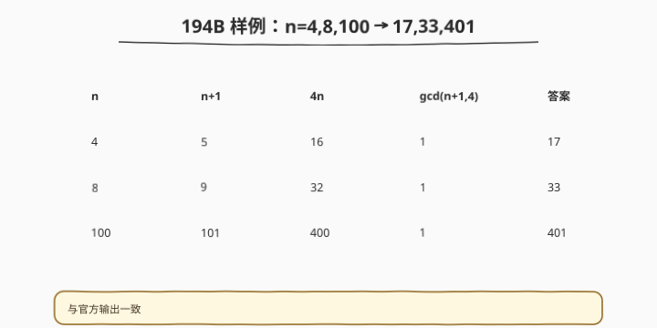

# Codeforces 194B 正方形上的十字计数 题解

## 1. 题目概述

- **题目链接**：https://codeforces.com/problemset/problem/194/B
- **比赛来源**：Codeforces Round 122 (Div. 2) · Problem B（UTC 2012-06-03）
- **难度**：1200
- **标签**：周期、最大公约数、数学
- **评测类型**：普通
- **限制**：时间 2 s / 内存 256 MB

**题意**：正方形边长 $n$。John 从**左下角**画第一个十字，然后沿周长顺时针走，每走 $n+1$ 米画一个十字。当左下角出现**第二个**十字时停下。问一共画了多少个十字。多组询问。

**约束**（原样摘自题面 `inputFormat.en`）：

- $1\le t\le10^4$；$1\le n_i\le10^9$。
- 输出每个 $n_i$ 的答案。

**约束对算法的限制**：

- $n\le10^9$：不能逐步模拟（$4n$ 步会到 $10^9$ 级），必须用数论公式。
- $t\le10^4$：每个询问必须 $O(1)$ 或 $O(\log n)$。
- 答案 $\le4n+1\le4\times10^9+1$，要 64 位整数。

## 2. 示例与观察

官方样例 1（输入 / 输出原样）：

```text
输入：
3
4 8 100

输出：
17
33
401
```

**样例 1 的演算**（$n=4$）：周长 $4n=16$，每 $n+1=5$ 米一个十字。十字的位置（沿周长从起点量起）是 $0,5,10,15,20,\ldots$；左下角对应位置 $0,16,32,\ldots$。第一个落在左下角的是 $0$（初始那个），第二个是 $\text{lcm}(5,16)=80$ 米处。$80/5=16$，所以第 $16$ 个「步进十字」落在角上，加上起点共 $16+1=17$ 个 ✓。

**样例 2**（$n=8$）：$n+1=9$，$4n=32$；$\gcd(9,32)=1$，$\text{lcm}=288$，$288/9=32$ → $33$ ✓。

**样例 3**（$n=100$）：$101$ 与 $400$ 互质，$\text{lcm}=40400$，$40400/101=400$ → $401$ ✓。

**观察 1**：把周长拉直成一条长度为 $4n$ 的线段，左下角在位置 $0$（也等于 $4n$）。十字出现在 $0,(n+1),2(n+1),\ldots$。

**观察 2**：左下角再次出现十字，当且仅当存在正整数 $k$ 使 $k(n+1)\equiv0\pmod{4n}$，即 $4n\mid k(n+1)$。

**观察 3**：最小的这样的 $k=\dfrac{4n}{\gcd(n+1,4n)}$，而 $\gcd(n+1,4n)=\gcd(n+1,4)$（因为 $4n-4(n+1)=-4$）。

**观察 4**：总十字数 $=k+1$（把起点的那个也算上）。

**自造样例**（标注「自造」，输出由程序实测）：

| 输入 | 输出 | 说明 |
|------|------|------|
| `1` / `1` | 3 | $k=2$：十字在 0、2、4 |
| `1` / `2` | 9 | $n+1=3$ 与 $4n=8$ 互质 → $k=8$ |
| `1` / `3` | 4 | $n+1=4$，$4n=12$ → $k=3$ |
| `1` / `5` | 11 | $n+1=6$，$4n=20$，$\gcd=2$ → $k=10$ |

## 3. 解题思路



1. 周长 $4n$，十字间距 $n+1$。
2. 起点十字在位置 0；第二个在角上的十字出现在最小的 $k\ge1$ 使 $k(n+1)$ 是 $4n$ 的倍数。
3. 由 $\text{lcm}$ 公式：$k=\dfrac{4n}{\gcd(n+1,4n)}=\dfrac{4n}{\gcd(n+1,4)}$。
4. 答案 $=k+1$。



## 4. 正确性证明

**引理 1**：第 $k$ 个十字（从 0 开始计，起点是第 0 个）位于周长位置 $k(n+1)\bmod 4n$。

**证明**：每走 $n+1$ 米画一个，位置对周长取模即得。∎

**引理 2**：左下角出现第二个十字，当且仅当存在最小的 $k\ge1$ 使 $4n\mid k(n+1)$；此时总十字数为 $k+1$。

**证明**：左下角的位置是 $4n$ 的倍数；起点（$k=0$）是第一个，之后第一次落回角上就是 $k$，此前共画了 $k+1$ 个（第 $0..k$ 个）。∎

**引理 3**：$4n\mid k(n+1)$ 的最小正整数 $k=\dfrac{4n}{\gcd(n+1,4n)}$。

**证明**：设 $g=\gcd(n+1,4n)$，则 $(n+1)/g$ 与 $4n/g$ 互质；$4n\mid k(n+1)\iff \frac{4n}{g}\mid k\cdot\frac{n+1}{g}\iff\frac{4n}{g}\mid k$，最小 $k=4n/g$。∎

**引理 4**：$\gcd(n+1,4n)=\gcd(n+1,4)$。

**证明**：$\gcd(n+1,4n)=\gcd(n+1,4n-4(n+1))=\gcd(n+1,-4)=\gcd(n+1,4)$。∎

**定理**：答案 $=\dfrac{4n}{\gcd(n+1,4)}+1$。

**证明**：由引理 2、3、4 直接得到。∎

## 5. 复杂度分析

- **时间**：$O(t\log n)$（每次一个 gcd）。
- **空间**：$O(1)$。
- **数值范围**：$4n\le4\times10^9$，`long long`。
- **与时限的关系**：2 s 对 $10^4$ 次 gcd 余量在千倍以上。实测 $t=10^4$ 约 5 ms。

## 6. 参考代码

### C++17

```cpp
#include <bits/stdc++.h>
using namespace std;

// 194B：周长 4n，起点在左下角（周长坐标 0）。每走 n+1 米画一个十字。
// 当 k*(n+1) 是 4n 的倍数时，左下角出现第二个十字；答案 = k+1。
// k = 4n/gcd(n+1,4n) = 4n/gcd(n+1,4)。
int main() {
    int t;
    if (scanf("%d", &t) != 1) return 0;
    while (t--) {
        long long n;
        scanf("%lld", &n);
        long long g = std::gcd(n + 1, 4LL);
        printf("%lld\n", 4 * n / g + 1);
    }
    return 0;
}
```

### Python3

```python
import sys
from math import gcd


def main() -> None:
    data = sys.stdin.buffer.read().split()
    t = int(data[0])
    out = []
    for i in range(1, t + 1):
        n = int(data[i])
        out.append(str(4 * n // gcd(n + 1, 4) + 1))
    sys.stdout.write('\n'.join(out) + '\n')


main()
```

## 7. 边界情况与易错点

1. **$n=1$**：$4/\gcd(2,4)=2$ → 3（十字在 0、2、4）。
2. **不要忘记起点的十字**：答案是 $k+1$ 而不是 $k$。
3. **$k$ 的含义**：$k$ 是「从起点之后第几个十字回到角上」，不是十字总数。
4. **`gcd(n+1,4)`**：不要用 `gcd(n+1,4n)` 时算错——两者相等但前者更小更好算。
5. **`int` 溢出**：$4n$ 可达 $4\times10^9$，超过 32 位有符号上限，用 `long long`。
6. **多组输入**：$t$ 组，输出每组一行。
7. **读入格式**：第一行 $t$，第二行 $t$ 个数（也可能分散在多行，按 token 读即可）。
8. **「第二个十字」**：起点的那个算第一个，所以 $k\ge1$ 的第一个解就是答案对应的事件。

## 8. 验证记录

- **编译环境与命令**：`Apple clang 21.0.0`（`/usr/bin/g++` 是 clang 软链，无 GNU libstdc++），`clang++ -std=c++17 -O2 -Wall` 加仓库自带 `bits/stdc++.h`；正文代码仍写标准头。Python 为 `3.9.6`。验证命令：
  `python3 codeforces/tools/verify_solution.py codeforces/contests/0101-0203/194/B_正方形上的十字计数.md`
- **官方样例**：1 / 1 通过（`17 33 401`），C++ 与 Python 一致。
- **额外测试**：自造 $n=1,2,3,5$ 等 4 组（输出 3、9、4、11），两种语言全部通过。
- **独立暴力对拍**：暴力一步步走 $n+1$ 米、计数，直到落回周长 0；对 250 组随机数据（$t\le5$、$n\le40$）逐组比对，全部一致。
- **最大约束性能**：$t=10^4$、$n$ 随机到 $10^9$ 端到端约 5 ms，Python 约 30 ms。
- **图片与公式**：2 张 SVG（`cf194b_square.svg`、`cf194b_sample.svg`）通过 `ElementTree.parse` 与文本包围盒/重叠检查，headless Chrome 渲染确认无裁切；KaTeX 校验 0 错。
- **复核状态**：verified。

## 相关题目与扩展

- [Codeforces 194A Exams](https://codeforces.com/problemset/problem/194/A)：同场 A 题，贪心。
- [Codeforces 195A Let's Watch Football](https://codeforces.com/problemset/problem/195/A)：下一场 A 题，取整。
- [LeetCode 914. 卡牌分组](https://leetcode.cn/problems/x-of-a-kind-in-a-deck-of-cards/)：gcd 的应用。
- [Codeforces 230A Dragons](https://codeforces.com/problemset/problem/230/A)：模拟类入门。
- [LeetCode 1295. 统计位数为偶数的数字](https://leetcode.cn/problems/find-numbers-with-even-number-of-digits/)：数论入门。

**延伸思考**：

1. **如果每 $m$ 米画一个十字**：答案变成 $4n/\gcd(m,4n)+1$。
2. **如果从别的角出发**：起点偏移会改变「首次回到起点」的相位，但周期不变。
3. **如果要求停在「某个指定角」**：把 $4n$ 换成对应的偏移即可。
4. **如果是矩形 $a\times b$**：周长 $2(a+b)$，公式同样用 lcm。
5. **与 lcm 的关系**：本题本质是「两个等差数列第一次重合」，$k=\text{lcm}(n+1,4n)/(n+1)$。

