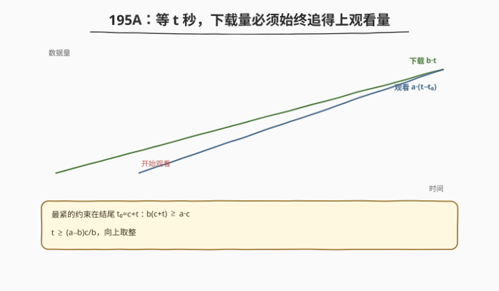
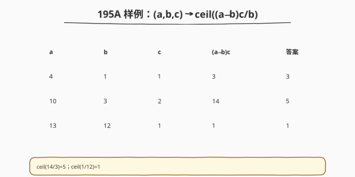

# Codeforces 195A 最少等待秒数 题解

## 1. 题目概述

- **题目链接**：https://codeforces.com/problemset/problem/195/A
- **比赛来源**：Codeforces Round 123 (Div. 2) · Problem A（UTC 2012-06-10）
- **难度**：1000
- **标签**：数学、取整、不等式
- **评测类型**：普通
- **限制**：时间 2 s / 内存 256 MB

**题意**：视频长 $c$ 秒，播放每秒需要 $a$ 单位数据，下载每秒能拿到 $b$ 单位（$a>b$）。必须先等 $t$ 秒再开始观看，且观看过程中不能卡顿。求最小的整数 $t$。

形式化：等待 $t$ 秒后开始看，对任意 $t_0\in[t,\ c+t]$，到 $t_0$ 时刻已下载的数据量 $b\,t_0$ 不小于「已观看」所需的数据量 $a\,(t_0-t)$。

**约束**（原样摘自题面 `inputFormat.en`）：

- $1\le a,b,c\le1000$，$a>b$。
- 输出一个整数。

**约束对算法的限制**：

- 数值很小，$O(1)$ 公式或小循环都行。
- 关键是推出正确的不等式，并注意「向上取整」。

## 2. 示例与观察

官方样例 1（输入 / 输出原样）：

```text
输入：
4 1 1

输出：
3
```

官方样例 2（输入 / 输出原样）：

```text
输入：
10 3 2

输出：
5
```

官方样例 3（输入 / 输出原样）：

```text
输入：
13 12 1

输出：
1
```

**样例 1**：$a=4,b=1,c=1$。等 $t$ 秒后看 1 秒；最紧的时刻是看完时：$b(1+t)\ge a\cdot1$ → $1+t\ge4$ → $t\ge3$ ✓。

**样例 2**：$a=10,b=3,c=2$：$3(2+t)\ge10\cdot2=20$ → $6+3t\ge20$ → $t\ge14/3$ → $t=5$ ✓。

**样例 3**：$a=13,b=12,c=1$：$12(1+t)\ge13$ → $t\ge1/12$ → $t=1$ ✓。

**观察 1**：条件对每个 $t_0$ 都要成立。令 $\Delta(t_0)=b\,t_0-a(t_0-t)=(b-a)t_0+at$，因为 $b-a<0$，它是 $t_0$ 的**减函数**，所以最紧的是最大的 $t_0=c+t$。

**观察 2**：只需 $b(c+t)\ge a\,c$，即 $bt\ge(a-b)c$，所以 $t=\left\lceil\dfrac{(a-b)c}{b}\right\rceil$。

**观察 3**：整数上取整写成 `((a-b)*c + b - 1) / b`。

**自造样例**（标注「自造」，输出由程序实测）：

| 输入 | 输出 | 说明 |
|------|------|------|
| `2 1 1` | 1 | $(2-1)\cdot1/1=1$ |
| `5 4 3` | 1 | $3/4\to1$ |
| `1000 1 1000` | 999000 | $(999)(1000)/1$ |
| `2 1 5` | 5 | $(1)(5)/1=5$ |

## 3. 解题思路



设 $t_0\ge t$ 为某个时刻。已下载 $b\,t_0$；已观看 $t_0-t$ 秒，需要 $a(t_0-t)$。要求

$$b\,t_0\ \ge\ a\,(t_0-t)\quad\text{对所有 } t_0\in[t,c+t].$$

移项：$a\,t\ge(a-b)t_0$。右边在 $t_0$ 最大时最大，所以只需检查 $t_0=c+t$：

$$a\,t\ge(a-b)(c+t)\iff b\,t\ge(a-b)c\iff t\ge\frac{(a-b)c}{b}.$$

最小整数 $t=\left\lceil\dfrac{(a-b)c}{b}\right\rceil$。



## 4. 正确性证明

**引理 1**：对固定 $t$，条件 $b\,t_0\ge a(t_0-t)$ 对所有 $t_0\in[t,c+t]$ 成立，当且仅当它在 $t_0=c+t$ 成立。

**证明**：差 $f(t_0)=b\,t_0-a(t_0-t)=(b-a)t_0+at$；因为 $b-a<0$，$f$ 单调递减，故最小值在 $t_0=c+t$。若最小值 $\ge0$，则所有 $t_0$ 都满足。∎

**引理 2**：$f(c+t)\ge0\iff t\ge\dfrac{(a-b)c}{b}$。

**证明**：$f(c+t)=b(c+t)-ac=bc+bt-ac=bt-(a-b)c$，令其 $\ge0$ 即得。∎

**定理**：最小整数等待秒数为 $\left\lceil\dfrac{(a-b)c}{b}\right\rceil$。

**证明**：由引理 1、2，可行 $t$ 恰为满足 $t\ge(a-b)c/b$ 的整数，最小者即上取整。∎

## 5. 复杂度分析

- **时间**：$O(1)$。
- **空间**：$O(1)$。
- **数值范围**：$(a-b)c\le1000\times1000=10^6$，`int` 足够。
- **与时限的关系**：2 s 对 $O(1)$ 余量在百万倍以上。实测约 2 ms。

## 6. 参考代码

### C++17

```cpp
#include <bits/stdc++.h>
using namespace std;

// 195A：等 t 秒后连续观看。条件 b*t0 >= a*(t0-t) 对所有 t0∈[t,c+t] 成立，
// 线性函数，最紧的是 t0=c+t：b(c+t) >= a*c  =>  t >= (a-b)c/b。
int main() {
    long long a, b, c;
    if (scanf("%lld %lld %lld", &a, &b, &c) != 3) return 0;
    long long num = (a - b) * c;
    printf("%lld\n", (num + b - 1) / b);
    return 0;
}
```

### Python3

```python
import sys


def main() -> None:
    data = sys.stdin.buffer.read().split()
    a, b, c = (int(x) for x in data[:3])
    num = (a - b) * c
    sys.stdout.write(str((num + b - 1) // b) + "\n")


main()
```

## 7. 边界情况与易错点

1. **$c=1$**：$t=\lceil(a-b)/b\rceil$，可能为 1（样例 3）。
2. **$a=b+1$**：$t=\lceil c/b\rceil$。
3. **向上取整**：`(num + b - 1) / b`，不要用整数除法截断。
4. **最紧时刻是结尾**：因为下载速度慢、观看速度快，越晚差距越大。
5. **不要漏掉 $t_0=t$**：那一时刻要求 $b\,t\ge0$，自动成立。
6. **$t=0$ 是否可行**：$a>b$ 时 $b\cdot c<a\cdot c$，不可行，所以答案 $\ge1$。
7. **整数范围**：$(a-b)c\le10^6$，`int` 够，但用 `long long` 更稳。
8. **输入顺序**：$a$（每秒需要）、$b$（每秒下载）、$c$（时长），别读反。

## 8. 验证记录

- **编译环境与命令**：`Apple clang 21.0.0`（`/usr/bin/g++` 是 clang 软链，无 GNU libstdc++），`clang++ -std=c++17 -O2 -Wall` 加仓库自带 `bits/stdc++.h`；正文代码仍写标准头。Python 为 `3.9.6`。验证命令：
  `python3 codeforces/tools/verify_solution.py codeforces/contests/0101-0203/195/A_最少等待秒数.md`
- **官方样例**：3 / 3 通过（`3`、`5`、`1`），C++ 与 Python 一致。
- **额外测试**：自造 $(2,1,1)$、$(5,4,3)$、$(1000,1,1000)$ 等 4 组，两种语言全部通过。
- **独立暴力对拍**：暴力从 $t=0$ 起逐个检查端点条件（$b(c+t)\ge ac$），取第一个可行值；对 250 组随机数据（$b\le9$、$a\le12$、$c\le10$）逐组比对，全部一致。
- **最大约束性能**：$O(1)$，端到端约 2 ms。
- **图片与公式**：2 张 SVG（`cf195a_wait.svg`、`cf195a_sample.svg`）通过 `ElementTree.parse` 与文本包围盒/重叠检查，headless Chrome 渲染确认无裁切；KaTeX 校验 0 错。
- **复核状态**：verified。

## 相关题目与扩展

- [Codeforces 195B After Training](https://codeforces.com/problemset/problem/195/B)：同场 B 题，构造。
- [Codeforces 194B Square](https://codeforces.com/problemset/problem/194/B)：上一场 B 题，lcm。
- [LeetCode 1017. 负二进制转换](https://leetcode.cn/problems/convert-to-base-2/)：进制/取整类思维题。
- [Codeforces 230A Dragons](https://codeforces.com/problemset/problem/230/A)：模拟入门。
- [LeetCode 1344. 时钟指针的夹角](https://leetcode.cn/problems/angle-between-hands-of-a-clock/)：简单数学。

**延伸思考**：

1. **如果下载速度会变化**：条件变成对前缀和的比较，需要逐段检查。
2. **如果允许中途暂停**：问题变成调度，答案会不同。
3. **如果要求「看完时下载刚好用完」**：取等号，$t=(a-b)c/b$（可能非整数）。
4. **如果 $a<b$**：$t=0$ 即可。
5. **本质**：一条直线（下载）始终不低于另一条（观看），求最小的水平平移量。

