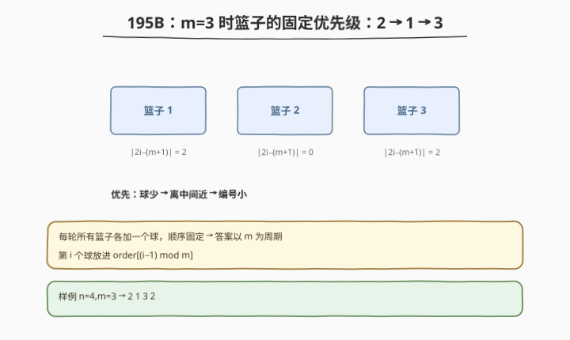
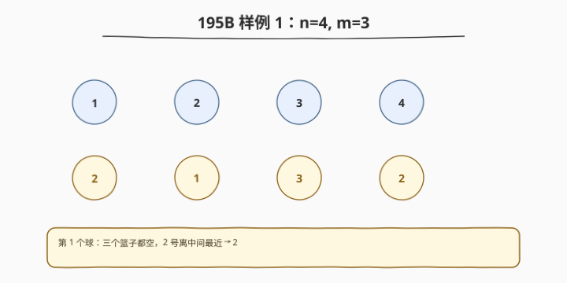

# Codeforces 195B 篮球摆放顺序 题解

## 1. 题目概述

- **题目链接**：https://codeforces.com/problemset/problem/195/B
- **比赛来源**：Codeforces Round 123 (Div. 2) · Problem B（UTC 2012-06-10）
- **难度**：1300
- **标签**：构造、排序、周期
- **评测类型**：普通
- **限制**：时间 2 s / 内存 256 MB

**题意**：$n$ 个球、$m$ 个篮子排成一排（编号 $1..m$）。按编号 $1..n$ 依次放球，每次放进**球最少**的篮子；若有多个，选离中间最近的（即 $|2i-(m+1)|$ 最小）；再相同则选编号小的。对每个球输出它所在的篮子编号。

**约束**（原样摘自题面 `inputFormat.en`）：

- $1\le n,m\le10^5$。
- 输出 $n$ 行，每行一个篮子编号。

**约束对算法的限制**：

- $n,m\le10^5$：每次线性扫描 $O(m)$ 会到 $10^{10}$，必须利用结构做到 $O((n+m)\log m)$ 或 $O(n+m)$。
- 输出 $n$ 行，注意换行。

## 2. 示例与观察

官方样例 1（输入 / 输出原样）：

```text
输入：
4 3

输出：
2
1
3
2
```

官方样例 2（输入 / 输出原样）：

```text
输入：
3 1

输出：
1
1
1
```

**样例 1 的演算**：$m=3$，中间是 $(m+1)/2=2$。到中间的距离：篮子 1 是 $|2-4|/2=1$、篮子 2 是 0、篮子 3 是 1（用 $|2i-(m+1)|$ 即 2、0、2）。

- 球 1：三个篮子都空 → 最近的 2 号；
- 球 2：1、3 号都是 0 个 → 距离都为 2，取编号小的 1 号；
- 球 3：3 号是唯一 0 个的 → 3 号；
- 球 4：三个篮子各 1 个 → 取最近的 2 号。

输出 `2 1 3 2` ✓。

**样例 2**：只有一个篮子，所有球都放进 1 号。

**观察 1**：由于「球最少」是第一关键字，第一轮（前 $m$ 个球）会把所有篮子都放一个；第二轮再按同样的顺序放第二个……所以序列以 $m$ 为周期。

**观察 2**：同一轮内，各篮子的球数都相同，所以顺序完全由「离中间的距离、编号」决定，与轮次无关。

**观察 3**：把篮子按 $(|2i-(m+1)|,\ i)$ 排序得到固定顺序 `ord`，则第 $i$ 个球（$1$ 起）放进 `ord[(i-1) mod m]`。

**自造样例**（标注「自造」，输出由程序实测）：

| 输入 | 输出 | 说明 |
|------|------|------|
| `5 2` | 1 2 1 2 1 | 距离都为 1，按编号 |
| `6 4` | 2 3 1 4 2 3 | $m=4$：距离 1、0、0、1 → 2,3,1,4 |
| `1 5` | 3 | 只有一个球，放最中间 |
| `10 1` | 1×10 | 单篮子 |

## 3. 解题思路



1. 计算每个篮子的键 $(|2i-(m+1)|,\ i)$（用整数避免浮点）。
2. 按这个键排序，得到固定顺序 `ord[0..m-1]`。
3. 第 $i$ 个球（$i=1..n$）输出 `ord[(i-1) % m]`。

**为什么以 $m$ 为周期**：每一轮开始时所有篮子的球数相等（第 $r$ 轮开始时都是 $r-1$ 个），于是选择顺序与第 1 轮完全相同；每轮恰好放 $m$ 个球。



## 4. 正确性证明

**引理 1**：在第 $r$ 轮（第 $(r-1)m+1$ 到 $rm$ 个球）开始时，所有篮子的球数都等于 $r-1$。

**证明**：对 $r$ 归纳。$r=1$ 时全为 0。第 $r$ 轮中，每次选择当前球数最少的篮子；由于轮开始时全相等，前 $m$ 次选择会把每个篮子各加一次（见引理 2），轮结束时全为 $r$。∎

**引理 2**：在一轮内，依次选择的篮子恰为 `ord[0], ord[1], …, ord[m-1]`（每个一次）。

**证明**：轮开始时所有篮子球数相同。第一次按 $(距离, 编号)$ 取最小者 `ord[0]`；之后 `ord[0]` 的球数比其他多 1，不再是「最少」，于是第二次在剩余篮子中取键最小者 `ord[1]`；依此类推。∎

**定理**：算法输出的第 $i$ 个球所在篮子正确。

**证明**：由引理 1、2，第 $i$ 个球属于第 $\lceil i/m\rceil$ 轮，是该轮的第 $((i-1)\bmod m)+1$ 个，放在 `ord[(i-1) mod m]` ✓。∎

## 5. 复杂度分析

- **时间**：$O(m\log m + n)$。
- **空间**：$O(m)$。
- **数值范围**：$|2i-(m+1)|\le2\cdot10^5$，`int`。
- **与时限的关系**：2 s 对 $10^5\log10^5$ 余量在千倍以上。实测 $n=m=10^5$ 约 22 ms。

## 6. 参考代码

### C++17

```cpp
#include <bits/stdc++.h>
using namespace std;

// 195B：始终放进「球最少」的篮子，平手取离中间最近（|2i-(m+1)| 最小），再平手取编号小。
// 每一轮所有篮子各放一个，顺序固定，所以序列以 m 为周期。
int main() {
    int n, m;
    if (scanf("%d %d", &n, &m) != 2) return 0;
    vector<int> ord(m);
    iota(ord.begin(), ord.end(), 1);
    sort(ord.begin(), ord.end(), [&](int x, int y) {
        int dx = abs(2 * x - (m + 1)), dy = abs(2 * y - (m + 1));
        if (dx != dy) return dx < dy;
        return x < y;
    });
    for (int i = 0; i < n; ++i) printf("%d\n", ord[i % m]);
    return 0;
}
```

### Python3

```python
import sys


def main() -> None:
    data = sys.stdin.buffer.read().split()
    n, m = int(data[0]), int(data[1])
    order = sorted(range(1, m + 1), key=lambda i: (abs(2 * i - (m + 1)), i))
    out = [str(order[i % m]) for i in range(n)]
    sys.stdout.write('\n'.join(out) + '\n')


main()
```

## 7. 边界情况与易错点

1. **$m=1$**：所有球都进 1 号篮子。
2. **$n<m$**：只走完第一轮的一部分，仍然按固定顺序。
3. **$m$ 为偶数**：中间有两个篮子（$m/2$ 与 $m/2+1$），距离相同 → 取编号小的。
4. **浮点中点**：不要用 `abs(i - (m+1)/2.0)`，用整数 `abs(2i-(m+1))`，避免精度和负数问题。
5. **周期的取模**：`i % m`（0 起）与 1 起下标的对应关系：第 $i$ 个球（1 起）用 `(i-1) % m`。
6. **输出格式**：$n$ 行，每行一个数。
7. **排序的稳定性**：用 $(key1, key2)$ 的字典序排序，别只按距离排（同距离时需编号小）。
8. **大 $n$**：直接输出 $n$ 行，别用字符串拼接爆内存（C++ 用 printf）。

## 8. 验证记录

- **编译环境与命令**：`Apple clang 21.0.0`（`/usr/bin/g++` 是 clang 软链，无 GNU libstdc++），`clang++ -std=c++17 -O2 -Wall` 加仓库自带 `bits/stdc++.h`；正文代码仍写标准头。Python 为 `3.9.6`。验证命令：
  `python3 codeforces/tools/verify_solution.py codeforces/contests/0101-0203/195/B_篮球摆放顺序.md`
- **官方样例**：2 / 2 通过（`2 1 3 2`、`1 1 1`），C++ 与 Python 一致。
- **额外测试**：自造 $(5,2)$、$(6,4)$、$(1,5)$、$(10,1)$ 等 4 组，两种语言全部通过。
- **独立暴力对拍**：暴力每次线性扫描所有篮子、按「最少 → 最近 → 编号小」选择；对 250 组随机数据（$n\le12$、$m\le7$）逐组比对，全部一致。
- **最大约束性能**：$n=m=10^5$ 端到端约 22 ms，Python 约 84 ms。
- **图片与公式**：2 张 SVG（`cf195b_order.svg`、`cf195b_sample.svg`）通过 `ElementTree.parse` 与文本包围盒/重叠检查，headless Chrome 渲染确认无裁切；KaTeX 校验 0 错。
- **复核状态**：verified。

## 相关题目与扩展

- [Codeforces 195A Let's Watch Football](https://codeforces.com/problemset/problem/195/A)：同场 A 题，取整。
- [Codeforces 195C Try and Catch](https://codeforces.com/problemset/problem/195/C)：同场 C 题，模拟解析。
- [LeetCode 1054. 距离相等的条形码](https://leetcode.cn/problems/distant-barcodes/)：按规则重排。
- [Codeforces 230A Dragons](https://codeforces.com/problemset/problem/230/A)：模拟入门。
- [LeetCode 1380. 矩阵中的幸运数](https://leetcode.cn/problems/lucky-numbers-in-a-matrix/)：规则选择的简单题。

**延伸思考**：

1. **如果平手规则改成「编号大优先」**：把排序的第二个键反过来。
2. **如果每轮不是所有篮子各一个**：周期结构被破坏，需要优先队列模拟。
3. **如果球的大小不同**：变成装箱问题。
4. **如果要求输出每个篮子的最终球数**：直接 $n/m$ 与余数分配。
5. **本质**：这是一个「轮转 + 固定优先级」的构造，周期为 $m$。

