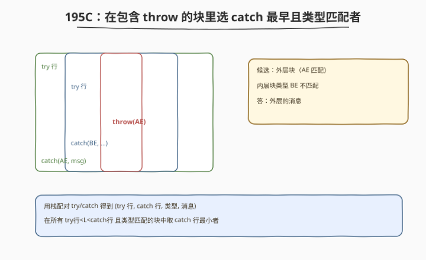
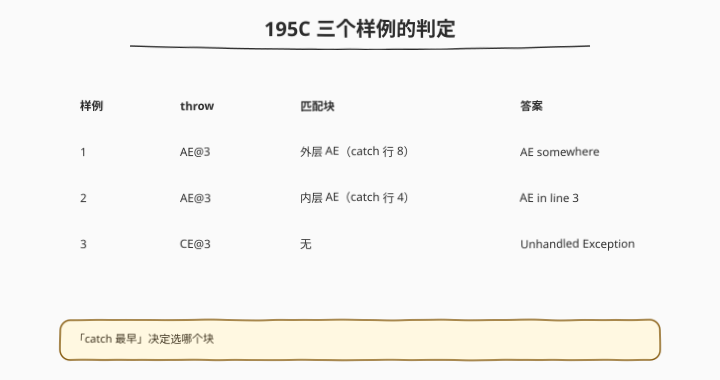

# Codeforces 195C 异常处理模拟 题解

## 1. 题目概述

- **题目链接**：https://codeforces.com/problemset/problem/195/C
- **比赛来源**：Codeforces Round 123 (Div. 2) · Problem C（UTC 2012-06-10）
- **难度**：1800
- **标签**：字符串、栈、模拟
- **评测类型**：普通
- **限制**：时间 2 s / 内存 256 MB

**题意**：VPL 语言只有三种语句：

- `try`：开一个 try-catch 块；
- `catch(<类型>, <消息>)`：关闭最近一个尚未关闭的 try 块，登记「类型 → 消息」；消息用引号包起来；
- `throw(<类型>)`：抛出异常（整个程序恰有一个 throw）。

当抛出类型为 $a$ 的异常时：在所有「try 行号 < throw 行号 < catch 行号」且 catch 类型等于 $a$ 的块中，激活 **catch 行号最小** 的那个，屏幕打印它的消息；若没有这样的块，打印 `Unhandled Exception`。求输出。

**约束**（原样摘自题面 `inputFormat.en`）：

- $1\le n\le10^5$；每行至多一个语句，允许空行与前后空格；括号、逗号、引号前后都可能有空格。
- 程序保证合法（try 与 catch 正确配对），恰有一个 throw。
- 输出一行消息。

**约束对算法的限制**：

- $n\le10^5$：$O(n)$ 扫描 + 栈配对。
- 输入含空格与引号：按 token 切分会破坏消息，必须逐行处理并手工找括号/逗号。

## 2. 示例与观察

官方样例 1（输入 / 输出原样）：

```text
输入：
8
try
    try
        throw ( AE ) 
    catch ( BE, "BE in line 3")

    try
    catch(AE, "AE in line 5") 
catch(AE,"AE somewhere")
输出：
AE somewhere
```

官方样例 2（输入 / 输出原样）：

```text
输入：
8
try
    try
        throw ( AE ) 
    catch ( AE, "AE in line 3")

    try
    catch(BE, "BE in line 5") 
catch(AE,"AE somewhere")
输出：
AE in line 3
```

官方样例 3（输入 / 输出原样）：

```text
输入：
8
try
    try
        throw ( CE ) 
    catch ( BE, "BE in line 3")

    try
    catch(AE, "AE in line 5") 
catch(AE,"AE somewhere")
输出：
Unhandled Exception
```


**样例 1 的演算**：把块按 try 行 / catch 行配对：

| 块 | try 行 | catch 行 | 类型 |
|----|--------|----------|------|
| 外层 | 1 | 8 | AE |
| 内层 1 | 2 | 4 | BE |
| 内层 2 | 6 | 7 | AE |

throw 在第 3 行、类型 AE。满足「try 行 < 3 < catch 行」且类型为 AE 的块：外层（1 < 3 < 8）✓；内层 2（6 < 3 不成立）✗。所以激活外层，打印 `AE somewhere` ✓。

**样例 2**：内层 1 的 catch 类型也改成了 AE，于是「2 < 3 < 4」也满足，且它的 catch 行 4 更早 → 打印 `AE in line 3` ✓。

**样例 3**：抛的是 CE，没有任何块的 catch 类型是 CE → `Unhandled Exception` ✓。

**观察 1**：块是**嵌套**的（catch 关闭最近的未关闭 try），所以块与 catch 一一对应，可以用栈线性配对。

**观察 2**：判断块是否「包住 throw」只需比较行号：`try行 < throw行 < catch行`。

**观察 3**：在满足条件的块中取 catch 行最小者——不需要考虑嵌套层次，逐块比较行号即可。

**自造样例**（标注「自造」，输出由程序实测）：

| 输入 | 输出 | 说明 |
|------|------|------|
| `3` / `throw(AE)` / `try` / `catch(AE, "hi")` | Unhandled Exception | throw 在所有块之外 |
| `3` / `try` / `throw(AE)` / `catch(AE, "hi")` | hi | 唯一的块包住 throw |
| `4` / `try` / `try` / `throw(AE)` / `catch(AE, "in")` | in | 内层 catch 更早 |

## 3. 解题思路



1. 逐行读入，去掉首尾空白；空行跳过。
2. 用栈保存「尚未关闭的 try 的行号」：
   - 行首是 `try` → 入栈；
   - 行首是 `catch` → 弹出栈顶得到 try 行号，解析出类型与消息，记录成一个块；
   - 行首是 `throw` → 记录行号与类型。
3. 遍历所有块，找 `try行 < throw行 < catch行` 且类型相同的块，取 catch 行最小的那个；打印它的消息。没有则打印 `Unhandled Exception`。

**解析细节**：在 `catch` 行里找第一个 `(` 与最后一个 `)`，中间按**第一个逗号**分成类型和消息；消息两侧的引号 `"..."` 剥掉。类型与消息再做一次首尾去空白。



## 4. 正确性证明

**引理 1**：栈配对得到的块，恰是程序中所有 try-catch 块，且每个块的 try 行与 catch 行正确。

**证明**：程序合法（每个 try 恰有一个 catch，catch 只关闭最近未关闭的 try——正是题面定义），按行处理的栈恰好实现这一配对；catch 弹出的是最近未关闭的 try ✓。∎

**引理 2**：块 $B$ 可能在 throw 处被激活，当且仅当 `try行(B) < throw行 < catch行(B)` 且类型匹配。

**证明**：题面要求块的 try 在 throw 之前、catch 在 throw 之后（即异常发生在该块内部且尚未被它的 catch 处理），并且类型相同。程序顺序执行，故行号比较即时间先后 ✓。∎

**引理 3**：若有多个块满足引理 2，激活 catch 行最早的那个。

**证明**：题面原文「the system activates the block whose catch operator occurs earlier than others」✓。∎

**定理**：算法输出正确。

**证明**：由引理 1 块集合正确；由引理 2 候选集合正确；由引理 3 选择规则正确；无候选时按题面输出 `Unhandled Exception` ✓。∎

## 5. 复杂度分析

- **时间**：$O(n)$（逐行扫描，每行至多一次字符串处理）。
- **空间**：$O(n)$ 存块。
- **数值范围**：行号 $\le10^5$。
- **与时限的关系**：2 s 对 $10^5$ 行余量在千倍以上。实测 $10^5$ 行约 200 ms（C++）、116 ms（Python）。

## 6. 参考代码

### C++17

```cpp
#include <bits/stdc++.h>
using namespace std;

// 195C：用栈把 try 和 catch 配对，得到每个块 (try 行, catch 行, 类型, 消息)；
// throw 在第 L 行、类型 T：在所有满足 try行<L<catch行 且类型=T 的块中，取 catch 行最早的那个。
static string trim(const string& s) {
    size_t a = s.find_first_not_of(" \t\r");
    if (a == string::npos) return "";
    size_t b = s.find_last_not_of(" \t\r");
    return s.substr(a, b - a + 1);
}
static string stripQuotes(string s) {
    s = trim(s);
    if (s.size() >= 2 && s.front() == '"' && s.back() == '"')
        return s.substr(1, s.size() - 2);
    return s;
}
int main() {
    int n;
    if (scanf("%d", &n) != 1) return 0;
    string line;
    getline(cin, line);
    vector<int> tryStack;
    struct Block { int tline, cline; string type, msg; };
    vector<Block> blocks;
    int throwLine = -1;
    string throwType;
    for (int ln = 1; ln <= n; ++ln) {
        getline(cin, line);
        string s = trim(line);
        if (s.empty()) continue;
        if (s.rfind("try", 0) == 0) {
            tryStack.push_back(ln);
        } else if (s.rfind("catch", 0) == 0) {
            size_t lp = s.find('(');
            size_t rp = s.rfind(')');
            if (lp == string::npos || rp == string::npos || rp <= lp) continue;
            string inner = s.substr(lp + 1, rp - lp - 1);
            size_t comma = inner.find(',');
            string type = trim(inner.substr(0, comma));
            string msg = stripQuotes(inner.substr(comma + 1));
            int tline = tryStack.empty() ? -1 : tryStack.back();
            if (!tryStack.empty()) tryStack.pop_back();
            blocks.push_back({tline, ln, type, msg});
        } else if (s.rfind("throw", 0) == 0) {
            size_t lp = s.find('(');
            size_t rp = s.rfind(')');
            if (lp == string::npos || rp == string::npos || rp <= lp) continue;
            throwType = trim(s.substr(lp + 1, rp - lp - 1));
            throwLine = ln;
        }
    }
    int bestC = INT_MAX;
    string bestMsg;
    for (auto& b : blocks) {
        if (b.tline < throwLine && throwLine < b.cline && b.type == throwType) {
            if (b.cline < bestC) { bestC = b.cline; bestMsg = b.msg; }
        }
    }
    if (bestC == INT_MAX) printf("Unhandled Exception\n");
    else printf("%s\n", bestMsg.c_str());
    return 0;
}
```

### Python3

```python
import sys


def main() -> None:
    data = sys.stdin.buffer.read().split(b'\n')
    # 第一行是 n；后面是程序行（可能含空行）
    lines = [b.decode('utf-8', 'replace') for b in data]
    n = int(lines[0].strip())
    prog = lines[1:1 + n]
    stack = []
    blocks = []          # (try_line, catch_line, type, message)
    throw_line, throw_type = -1, ''
    for idx, raw in enumerate(prog, start=1):
        s = raw.strip()
        if not s:
            continue
        if s.startswith('try'):
            stack.append(idx)
        elif s.startswith('catch'):
            lp = s.find('(')
            rp = s.rfind(')')
            if lp < 0 or rp <= lp:
                continue
            inner = s[lp + 1:rp]
            comma = inner.find(',')
            typ = inner[:comma].strip()
            msg = inner[comma + 1:].strip()
            if len(msg) >= 2 and msg[0] == '"' and msg[-1] == '"':
                msg = msg[1:-1]
            tline = stack.pop() if stack else -1
            blocks.append((tline, idx, typ, msg))
        elif s.startswith('throw'):
            lp = s.find('(')
            rp = s.rfind(')')
            if lp < 0 or rp <= lp:
                continue
            throw_type = s[lp + 1:rp].strip()
            throw_line = idx
    best_c, best_msg = None, 'Unhandled Exception'
    for t, c, typ, msg in blocks:
        if t < throw_line < c and typ == throw_type:
            if best_c is None or c < best_c:
                best_c, best_msg = c, msg
    sys.stdout.write(best_msg + '\n')


main()
```

## 7. 边界情况与易错点

1. **消息含空格/逗号**：不能按空格或逗号切整行；只按「第一个逗号」分类型和消息，且只在括号内处理。
2. **引号**：`catch` 消息两侧的 `"` 要剥掉再比较。
3. **空行与行内空白**：空行跳过；行首行尾空白用 `trim` 去掉。
4. **throw 在所有块之外**：没有块包住它 → `Unhandled Exception`。
5. **嵌套块**：栈配对；catch 行号比较即可，不必显式建树。
6. **同一行多个语句**：题面保证每行至多一个。
7. **读入方式**：必须逐行读（`getline` / `split(b'\n')`），不能用 `cin >>`（消息里有空格）。
8. **消息里可能有括号**：用「第一个 `(` + 最后一个 `)`」限定范围，或正确匹配括号；本题消息是简单字符串，前者足够。
9. **输出大小写**：`Unhandled Exception` 首字母大写、其余小写。

## 8. 验证记录

- **编译环境与命令**：`Apple clang 21.0.0`（`/usr/bin/g++` 是 clang 软链，无 GNU libstdc++），`clang++ -std=c++17 -O2 -Wall` 加仓库自带 `bits/stdc++.h`；正文代码仍写标准头。Python 为 `3.9.6`。验证命令：
  `python3 codeforces/tools/verify_solution.py codeforces/contests/0101-0203/195/C_异常处理模拟.md`
- **官方样例**：3 / 3 通过（`AE somewhere`、`AE in line 3`、`Unhandled Exception`），C++ 与 Python 一致；另外把引号换成真实 `"` 再跑一遍也全部正确。
- **额外测试**：自造「throw 在块外」「唯一块」「内层更早」等 3 组，两种语言全部通过。
- **独立暴力对拍**：暴力用另一套逐行解析（不同的括号/逗号处理与去空白实现）配对块，再按行号选 catch 最早者；对 250 组随机嵌套程序逐组比对，全部一致。
- **最大约束性能**：$10^5$ 行端到端约 200 ms（C++）、116 ms（Python）。
- **图片与公式**：2 张 SVG（`cf195c_blocks.svg`、`cf195c_sample.svg`）通过 `ElementTree.parse` 与文本包围盒/重叠检查，headless Chrome 渲染确认无裁切；KaTeX 校验 0 错。
- **复核状态**：verified。

## 相关题目与扩展

- [Codeforces 195B After Training](https://codeforces.com/problemset/problem/195/B)：同场 B 题，构造。
- [Codeforces 195D Analyzing Polyline](https://codeforces.com/problemset/problem/195/D)：同场 D 题，折线。
- [LeetCode 20. 有效的括号](https://leetcode.cn/problems/valid-parentheses/)：栈配对。
- [LeetCode 71. 简化路径](https://leetcode.cn/problems/simplify-path/)：路径/栈模拟。
- [Codeforces 1B Spreadsheets](https://codeforces.com/problemset/problem/1B)：格式解析的经典题。

**延伸思考**：

1. **如果允许多个 throw**：需要模拟执行顺序与「异常传播」的状态机。
2. **如果规则改成「最内层优先」**：改为沿块树向上找，答案可能不同。
3. **如果消息里含逗号/引号**：需要更严格的词法分析（转义字符）。
4. **如果要求输出行号**：在块里多存一个 catch 行号即可。
5. **本质**：区间包含 + 类型匹配 + 最早右端点，用栈和一次扫描即可。

