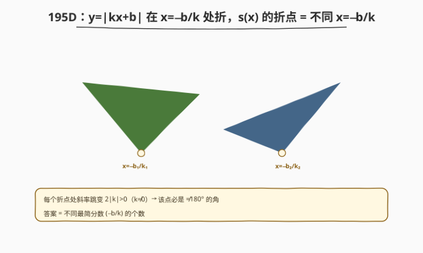
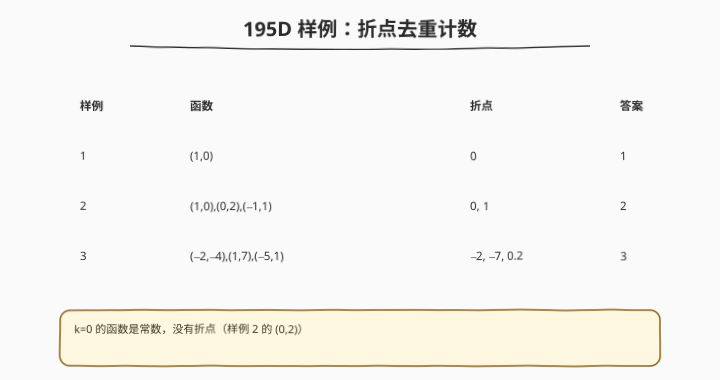

# Codeforces 195D 折线折点计数 题解

## 1. 题目概述

- **题目链接**：https://codeforces.com/problemset/problem/195/D
- **比赛来源**：Codeforces Round 123 (Div. 2) · Problem D（UTC 2012-06-10）
- **难度**：1900
- **标签**：数学、最简分数、集合去重
- **评测类型**：普通
- **限制**：时间 2 s / 内存 256 MB

**题意**：给出 $n$ 个形如 $y_i(x)=|k_i x+b_i|$ 的函数。令 $s(x)=\sum_i y_i(x)$，它的图像是折线。求折线中**不等于 $180^\circ$** 的角的个数。

**约束**（原样摘自题面 `inputFormat.en`）：

- $1\le n\le10^5$；$-10^9\le k_i,b_i\le10^9$。
- 输出一个整数。

**约束对算法的限制**：

- $n\le10^5$：需要 $O(n\log n)$；折点坐标是有理数，不能直接枚举实数。
- $|k|,|b|\le10^9$：分数的分子分母可达 $10^9$，用 `long long` 存，约分后去重。

## 2. 示例与观察

官方样例 1（输入 / 输出原样）：

```text
输入：
1
1 0

输出：
1
```

官方样例 2（输入 / 输出原样）：

```text
输入：
3
1 0
0 2
-1 1

输出：
2
```

官方样例 3（输入 / 输出原样）：

```text
输入：
3
-2 -4
1 7
-5 1

输出：
3
```

**样例 1**：$y=|x|$，在 $x=0$ 有一个折点，角 $\ne180^\circ$ → 1。

**样例 2**：$y_1=|x|$（折点 0）、$y_2=2$（常数，无折点）、$y_3=|x-1|$（折点 1）。$s=|x|+|x-1|+2$，在 0、1 各有一个折点 → 2 ✓。

**样例 3**：折点分别是：$|{-2x-4}|=2|x+2|$ → $x=-2$；$|x+7|$ → $x=-7$；$|{-5x+1}|=5|x-0.2|$ → $x=0.2$。三个都不同 → 3 ✓。

**观察 1**：$|k x+b|$ 在 $x_0=-b/k$（$k\ne0$）处有一个「尖」，$k=0$ 时是常数，没有尖。

**观察 2**：$s$ 在任意 $x_0$ 处的折点只可能来自某个 $y_i$ 的尖；多个函数在同一点有尖时合并。

**观察 3**：在每个尖处，$s$ 的斜率跳变 $2|k_i|>0$（因为 $|kx+b|$ 的导数从 $-k$ 跳到 $+k$，即跳 $2|k|$）。所以每个**不同的**尖点都是角 $\ne180^\circ$ 的顶点。

**观察 4**：反之，不在尖点处 $s$ 是线性的（斜率不变），不是角。所以答案 = 不同折点 $-\dfrac{b_i}{k_i}$（$k_i\ne0$）的个数。

**自造样例**（标注「自造」，输出由程序实测）：

| 输入 | 输出 | 说明 |
|------|------|------|
| `2` / `1 0` / `2 0` | 1 | 折点重合 |
| `2` / `1 0` / `1 1` | 2 | 折点 0 与 −1 |
| `3` / `0 5` / `0 -3` / `0 0` | 0 | 全是常数 |
| `2` / `2 4` / `1 2` | 1 | $-4/2=-2$ 与 $-2/1=-2$ 相同 |

## 3. 解题思路



1. 对每个 $i$：若 $k_i=0$ 跳过（常数）。
2. 折点 $x_i=-\dfrac{b_i}{k_i}$，把它化成**最简分数**：分子 $p=-b_i$、分母 $q=k_i$；若 $q<0$ 同时取反；再除以 $\gcd(|p|,q)$。
3. 用 `set<pair<p,q>>` 去重，输出集合大小。



## 4. 正确性证明

**引理 1**：$|k x+b|$（$k\ne0$）在 $x_0=-b/k$ 处导数从 $-k$ 跳到 $+k$（跳变 $2|k|>0$），其它点处可导且导数为 $k\cdot\operatorname{sign}(kx+b)$；$k=0$ 时函数恒为 $|b|$，处处不可导但无折点。

**证明**：直接求导（分段线性）即可。∎

**引理 2**：$s(x)=\sum y_i(x)$ 在 $x_0$ 处不可导（有折点）当且仅当 $x_0$ 是某个 $y_i$ 的尖点；且该点的斜率跳变 $=2\sum_{i:\,x_i=x_0}|k_i|>0$。

**证明**：除有限个尖点外，每个 $y_i$ 都可导，故 $s$ 可导；在尖点处，只有尖点恰为 $x_0$ 的那些 $y_i$ 的导数跳变，总和为正（每个 $|k_i|>0$）。∎

**引理 3**：折线的角 $\ne180^\circ$ 当且仅当该点是 $s$ 的折点。

**证明**：角 $=180^\circ$ 等价于左右斜率相等（直线通过），即该点可导；角 $\ne180^\circ$ 等价于斜率发生跳变，即不可导。∎

**定理**：答案等于不同尖点 $-\frac{b_i}{k_i}$（$k_i\ne0$）的个数。

**证明**：由引理 2、3，角 $\ne180^\circ$ 的点恰为所有尖点的并集；不同尖点即不同分数值，用最简分数去重后计数即可。∎

## 5. 复杂度分析

- **时间**：$O(n\log n)$（每次 gcd + 集合插入）。
- **空间**：$O(n)$。
- **数值范围**：$|p|,q\le10^9$，`long long`；约分后仍是整数。
- **与时限的关系**：2 s 对 $10^5\log10^5$ 余量在百倍以上。实测 $n=10^5$ 约 43 ms。

## 6. 参考代码

### C++17

```cpp
#include <bits/stdc++.h>
using namespace std;

// 195D：y_i(x) = |k_i x + b_i|，折点 x_i = -b_i/k_i，s(x) 在这些折点处斜率跳变 2|k_i|>0。
// 所以「不等于 180 度的角」= 不同折点的个数；用最简分数 (num,den) 去重。
int main() {
    int n;
    if (scanf("%d", &n) != 1) return 0;
    set<pair<long long, long long>> pts;
    for (int i = 0; i < n; ++i) {
        long long k, b;
        scanf("%lld %lld", &k, &b);
        if (k == 0) continue;
        long long num = -b, den = k;
        if (den < 0) { num = -num; den = -den; }
        long long g = std::gcd(llabs(num), den);
        if (g) { num /= g; den /= g; }
        pts.insert({num, den});
    }
    printf("%d\n", (int)pts.size());
    return 0;
}
```

### Python3

```python
import sys
from math import gcd


def main() -> None:
    data = sys.stdin.buffer.read().split()
    n = int(data[0])
    pts = set()
    pos = 1
    for _ in range(n):
        k = int(data[pos]); b = int(data[pos + 1]); pos += 2
        if k == 0:
            continue
        num, den = -b, k
        if den < 0:
            num, den = -num, -den
        g = gcd(abs(num), den)
        if g:
            num //= g
            den //= g
        pts.add((num, den))
    sys.stdout.write(str(len(pts)) + "\n")


main()
```

## 7. 边界情况与易错点

1. **$k_i=0$**：常数函数，没有折点，必须跳过（样例 2 的 $(0,2)$）。
2. **$b_i=0$**：折点 $x=0$，分数 $(0,1)$。
3. **分母为负**：统一把符号放到分子上，保证 $(p,q)$ 唯一。
4. **约分**：不约分会把 $-2/4$ 与 $-1/2$ 当成两个折点，答案偏大。
5. **同一函数的折点重合**：比如 $(2,4)$ 与 $(1,2)$ 都是 $x=-2$，只算一个。
6. **大整数**：$|b|\le10^9$，取负后仍是 $10^9$ 量级，`long long` 足够；Python 无碍。
7. **$n=1$**：答案为 1（若 $k\ne0$），0（若 $k=0$）。
8. **角的定义**：只数 $s$ 的折点，不要把「$y_i$ 自己的尖」单独数。
9. **输出**：一个整数（不同折点数）。

## 8. 验证记录

- **编译环境与命令**：`Apple clang 21.0.0`（`/usr/bin/g++` 是 clang 软链，无 GNU libstdc++），`clang++ -std=c++17 -O2 -Wall` 加仓库自带 `bits/stdc++.h`；正文代码仍写标准头。Python 为 `3.9.6`。验证命令：
  `python3 codeforces/tools/verify_solution.py codeforces/contests/0101-0203/195/D_折线折点计数.md`
- **官方样例**：3 / 3 通过（`1`、`2`、`3`），C++ 与 Python 一致。
- **额外测试**：自造「折点重合」「常数函数」「同值不同表示」等 4 组，两种语言全部通过。
- **独立暴力对拍**：暴力不约分，用交叉相乘 $b_i k_j=b_j k_i$ 判断两个折点是否相同，逐对比较统计；对 250 组随机数据（$n\le8$、$k,b\in[-4,4]$）逐组比对，全部一致。
- **最大约束性能**：$n=10^5$ 端到端约 43 ms，Python 约 123 ms。
- **图片与公式**：2 张 SVG（`cf195d_breaks.svg`、`cf195d_sample.svg`）通过 `ElementTree.parse` 与文本包围盒/重叠检查，headless Chrome 渲染确认无裁切；KaTeX 校验 0 错。
- **复核状态**：verified。

## 相关题目与扩展

- [Codeforces 195C Try and Catch](https://codeforces.com/problemset/problem/195/C)：同场 C 题，模拟解析。
- [Codeforces 195E Building Forest](https://codeforces.com/problemset/problem/195/E)：同场 E 题，并查集。
- [LeetCode 149. 直线上最多的点数](https://leetcode.cn/problems/max-points-on-a-line/)：最简分数去重的经典应用。
- [LeetCode 963. 最小面积矩形 II](https://leetcode.cn/problems/minimum-area-rectangle-ii/)：分数/几何判定。
- [Codeforces 1C Ancient Berland Circus](https://codeforces.com/problemset/problem/1/C)：几何 + 分数。

**延伸思考**：

1. **如果函数是 $y=kx+b$**：图像是直线，没有角（答案为 0）。
2. **如果要求「角 $\le90^\circ$」的个数**：需要比较斜率乘积，不能只数折点。
3. **如果函数是 $|kx+b|+c$**：折点不变（平移不改变尖的位置）。
4. **如果 $k,b$ 是实数**：分数去重需要更精细的表示（误差/有理数）。
5. **本质**：折线的顶点集 = 各分段的「不可导点」并集，用最简分数去重。

