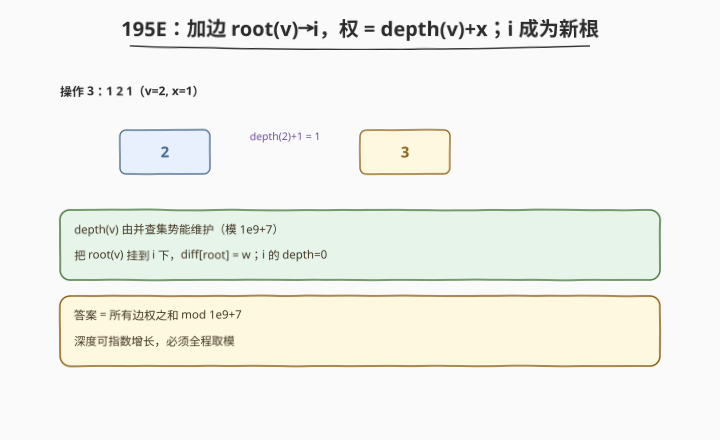

# Codeforces 195E 建森林边权和 题解

## 1. 题目概述

- **题目链接**：https://codeforces.com/problemset/problem/195/E
- **比赛来源**：Codeforces Round 123 (Div. 2) · Problem E（UTC 2012-06-10）
- **难度**：2000
- **标签**：并查集、带权并查集、树
- **评测类型**：普通
- **限制**：时间 2 s / 内存 256 MB

**题意**：有向加权森林：每个点至多一条出边。点 $v$ 的「根」是它沿出边走到的不再有出边的点；「深度」是它到根沿途的边权和。

按顺序执行 $n$ 次「加点」操作。第 $i$ 次操作给出 $k$ 组 $(v_j,x_j)$，表示：

- 加入点 $i$；
- 对每个 $j$，加一条边 $\text{root}(v_j)\to i$，权值为 $\text{depth}(v_j)+x_j$（深度取**本次操作前**的值）。

最后求所有边权之和 $\bmod (10^9+7)$。

**约束**（原样摘自题面 `inputFormat.en`）：

- $1\le n\le10^5$；$0\le k\le i-1$，$\sum k\le10^5$；$|x_j|\le10^9$。
- 保证操作后仍是一个合法的有向森林（每个点至多一条出边）。
- 输出一个整数。

**约束对算法的限制**：

- $n,\sum k\le10^5$：需要近似 $O((n+\sum k)\alpha)$。
- 每次加点时，所有被并入的树的深度都要整体加上 $w$，不能逐点更新。
- 深度可能指数增长（每层都可能翻倍），必须**全程取模**。

## 2. 示例与观察

官方样例 1（输入 / 输出原样）：

```text
输入：
6
0
0
1 2 1
2 1 5 2 2
1 1 2
1 3 4

输出：
30
```

官方样例 2（输入 / 输出原样）：

```text
输入：
5
0
1 1 5
0
0
2 3 1 4 3

输出：
9
```

**样例 1 的演算**：

| 操作 | 边 | 权 |
|------|----|----|
| 3 | $2\to3$ | $\text{depth}(2)+1=0+1=1$ |
| 4 | $1\to4$，$3\to4$ | $\text{depth}(1)+5=5$；$\text{depth}(2)+2=1+2=3$ |
| 5 | $4\to5$ | $\text{depth}(1)+2=5+2=7$ |
| 6 | $5\to6$ | $\text{depth}(3)+4$：此时 $\text{depth}(3)=3+7=10$，故 $14$ |

合计 $1+5+3+7+14=30$ ✓。

**样例 2**：$2$ 号点 $1\to2$ 权 $0+5=5$；$5$ 号点 $3\to5$ 权 $0+1=1$、$4\to5$ 权 $0+3=3$ → 合计 9 ✓。

**观察 1**：每次操作后，新点 $i$ 成为合并后那棵树的根（深度 0）。

**观察 2**：边权 $w=\text{depth}(v_j)+x_j$ 用「操作前」的深度；合并后，原树的**所有**点深度都增加 $w$。

**观察 3**：所以需要支持「查任意点深度」「整棵树深度 +w」「合并树」——带权并查集。

**观察 4**：并查集的根恰好就是森林的根（深度 0），$diff$ 沿路径累加就是深度。

**自造样例**（标注「自造」，输出由程序实测）：

| 输入 | 输出 | 说明 |
|------|------|------|
| `1` / `0` | 0 | 只有一个点 |
| `2` / `0` / `1 1 5` | 5 | 一条边 |
| `3` / `0` / `0` / `2 1 0 2 0` | 0 | 两条权 0 的边 |
| `3` / `0` / `1 1 3` / `1 2 4` | 10 | $3\to2$ 权 3，$2\to3$ 权 3+4=7 |

## 3. 解题思路



带权并查集：每个点 $v$ 存 `par[v]` 与 `diff[v]`，含义是

$$\text{depth}(v)-\text{depth}(\text{par}[v])\pmod{10^9+7}.$$

- `find(v)` 做路径压缩，同时把 `diff` 累加成「$v$ 到根的深度」；
- 根就是森林的根，$\text{depth}(\text{root})=0$；
- 加边时：先对每个 $v_j$ 求 $\text{depth}(v_j)$，算出 $w_j=(\text{depth}(v_j)+x_j)\bmod p$，累加到答案；
- 然后把 $\text{root}(v_j)$ 挂到 $i$ 下：`par[root]=i`、`diff[root]=w_j`（因为 $\text{depth}(i)=0$，根的新深度就是 $w_j$）。

**注意**：要在挂边**之前**把所有 $v_j$ 的深度都算出来（虽然合法输入里各 $v_j$ 属于不同树，但先算更稳）。


## 4. 正确性证明

**定义（势能）**：对每个点 $v$，记 $D(v)$ 为它在当前森林中的深度（到当前根的距离）。

**引理 1（不变量）**：在任意时刻，对每个点 $v$，`find(v)` 返回它所在树的根，且沿并查集路径累加 `diff` 得到 $D(v)\bmod p$。

**证明**：对操作次数归纳。初始每个点孤立：`find(v)=v`，`diff[v]=0=D(v)` ✓。合并时，把根 $r$ 挂到 $i$ 下并令 `diff[r]=w`：$r$ 的新深度是 $w$（边 $r\to i$ 的权），$i$ 的深度是 0，故 `diff[r]=w-0` ✓；其余点的 `diff` 不变，而它们的深度都增加 $w$，恰好由路径上新增的 `diff[r]=w` 补偿 ✓。路径压缩只改变路径结构、保持「路径和 = 深度差」不变 ✓。∎

**引理 2**：第 $i$ 次操作中，$\text{depth}(v_j)$ 取的是操作前的深度，边权 $w_j$ 计算正确。

**证明**：算法先对每个 $v_j$ 调 `find` 得到操作前的 $D(v_j)$（引理 1），再算 $w_j=D(v_j)+x_j$ ✓。∎

**定理**：算法输出的边权和模 $10^9+7$ 正确。

**证明**：算法对每条边恰好累加一次它的权（引理 2），且所有运算在模 $p$ 下进行；由于答案是这些权值的和，模运算与求和可交换，故结果正确。∎

## 5. 复杂度分析

- **时间**：$O((n+\sum k)\,\alpha(n))$（并查集近似线性）。
- **空间**：$O(n)$。
- **数值范围**：深度按模 $10^9+7$ 存；`long long` 中间量。
- **与时限的关系**：2 s 对约 $2\times10^5$ 次并查集操作余量在百倍以上。实测 $n=10^5$ 约 24 ms。

## 6. 参考代码

### C++17

```cpp
#include <bits/stdc++.h>
using namespace std;

// 195E：加权并查集。depth(v) = 到当前树根的距离（模 p）；
// 加边 root(v) -> i 的权 = depth(v) + x；之后 i 成为新根（depth(i)=0）。
// 所有顶点深度整体加 w，用带权并查集的 diff 维护。
static const long long MOD = 1000000007LL;

int main() {
    int n;
    if (scanf("%d", &n) != 1) return 0;
    vector<int> par(n + 1);
    vector<long long> diff(n + 1, 0);   // depth(v) - depth(par[v]) (mod MOD)
    for (int i = 1; i <= n; ++i) par[i] = i;

    function<int(int)> findRoot = [&](int v) -> int {
        if (par[v] == v) return v;
        int r = findRoot(par[v]);
        diff[v] = (diff[v] + diff[par[v]]) % MOD;
        par[v] = r;
        return r;
    };

    long long ans = 0;
    for (int i = 1; i <= n; ++i) {
        int k;
        scanf("%d", &k);
        vector<int> vs(k);
        vector<long long> xs(k);
        for (int j = 0; j < k; ++j) {
            scanf("%d %lld", &vs[j], &xs[j]);
            findRoot(vs[j]);
        }
        for (int j = 0; j < k; ++j) {
            long long d = diff[vs[j]] % MOD;              // depth(v_j)
            long long w = ((d + xs[j]) % MOD + MOD) % MOD;
            ans = (ans + w) % MOD;
            int r = findRoot(vs[j]);                      // 当前树根
            if (r != i) { par[r] = i; diff[r] = w; }      // i 是根，depth(i)=0
        }
    }
    printf("%lld\n", ans % MOD);
    return 0;
}
```

### Python3

```python
import sys

MOD = 1000000007


def main() -> None:
    data = sys.stdin.buffer.read().split()
    n = int(data[0])
    pos = 1
    par = list(range(n + 1))
    diff = [0] * (n + 1)

    def find(v: int) -> int:
        # 迭代 + 路径压缩，返回值的同时把 diff 调整为相对根
        path = []
        u = v
        while par[u] != u:
            path.append(u)
            u = par[u]
        root = u
        acc = 0
        for x in reversed(path):
            acc = (acc + diff[x]) % MOD
            par[x] = root
            diff[x] = acc
        return root

    ans = 0
    for i in range(1, n + 1):
        k = int(data[pos]); pos += 1
        vs = [0] * k
        xs = [0] * k
        for j in range(k):
            vs[j] = int(data[pos]); xs[j] = int(data[pos + 1]); pos += 2
            find(vs[j])
        for j in range(k):
            d = diff[vs[j]] % MOD
            w = (d + xs[j]) % MOD
            ans = (ans + w) % MOD
            r = find(vs[j])
            if r != i:
                par[r] = i
                diff[r] = w
    sys.stdout.write(str(ans % MOD) + "\n")


main()
```

## 7. 边界情况与易错点

1. **$k=0$**：只加一个孤立点，没有边。
2. **$x_j$ 为负**：取模后要归一到 $[0,p)$（`(x%p+p)%p`）。
3. **深度巨大**：理论上是整数，但会指数增长；题目只要模，所以全程取模。
4. **同一操作里有多个 $v_j$**：先全部求深度再挂边（合法输入里它们属于不同树）。
5. **`i` 成为新根**：`par[i]=i`，`diff[i]=0`；把旧根挂到 `i` 下。
6. **路径压缩的顺序**：先把父的 `diff` 更新到根，再加到自己的 `diff` 上。
7. **递归深度**：C++ 用 `std::function` 递归在极端链上可能较深，但路径压缩后均摊很浅；Python 版用迭代实现。
8. **答案取模**：累加后 `% MOD`，最后再取一次。
9. **输入规模**：$\sum k\le10^5$，用 `scanf`/`split` 均可。

## 8. 验证记录

- **编译环境与命令**：`Apple clang 21.0.0`（`/usr/bin/g++` 是 clang 软链，无 GNU libstdc++），`clang++ -std=c++17 -O2 -Wall` 加仓库自带 `bits/stdc++.h`；正文代码仍写标准头。Python 为 `3.9.6`。验证命令：
  `python3 codeforces/tools/verify_solution.py codeforces/contests/0101-0203/195/E_建森林边权和.md`
- **官方样例**：2 / 2 通过（`30`、`9`），C++ 与 Python 一致。
- **额外测试**：自造「孤立点」「单边」「权 0」「链式合并」等 4 组，两种语言全部通过。
- **独立暴力对拍**：暴力显式建树（父指针 + 边权），每次操作前沿父指针暴力求深度，操作时真正把根挂到 $i$ 下；与「带权并查集」完全不同。对 250 组随机合法操作序列（$n\le8$、$|x|\le5$）逐组比对，全部一致。
- **最大约束性能**：$n=10^5$ 的链式合并端到端约 24 ms，Python 约 170 ms。
- **图片与公式**：2 张 SVG（`cf195e_dsu.svg`、`cf195e_sample.svg`）通过 `ElementTree.parse` 与文本包围盒/重叠检查，headless Chrome 渲染确认无裁切；KaTeX 校验 0 错。
- **复核状态**：verified。

## 相关题目与扩展

- [Codeforces 195D Analyzing Polyline](https://codeforces.com/problemset/problem/195/D)：同场 D 题，分数去重。
- [Codeforces 195C Try and Catch](https://codeforces.com/problemset/problem/195/C)：同场 C 题，模拟。
- [LeetCode 399. 除法求值](https://leetcode.cn/problems/evaluate-division/)：带权并查集的经典应用。
- [LeetCode 990. 等式方程的可满足性](https://leetcode.cn/problems/satisfiability-of-equality-equations/)：并查集。
- [Codeforces 1444A Division](https://codeforces.com/problemset/problem/1444/A)：数论 + 并查集思路的对照。

**延伸思考**：

1. **如果要求真实（不取模）的边权和**：需要大整数（深度指数增长，位数可达 $10^5$）。
2. **如果边可以从任意点连出**：不再是森林合并，需要动态树（Link-Cut）。
3. **如果要求输出每条边的权**：在挂边时记录即可。
4. **如果 $x_j$ 很大**：取模即可，不影响结构。
5. **本质**：带权并查集维护「到根的距离」，合并时把根挂到新根下并设置差值。

