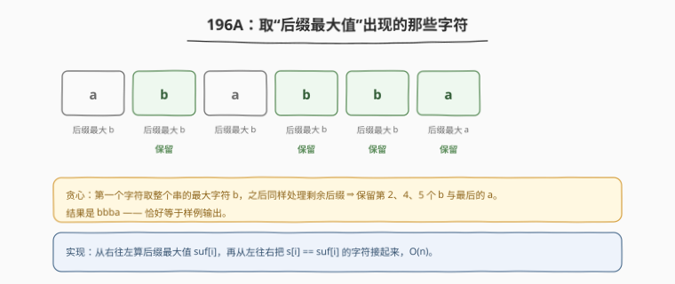
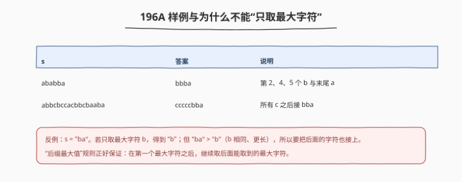

# Codeforces 196A 字典序最大子序列 题解

## 1. 题目概述

- **题目链接**：https://codeforces.com/problemset/problem/196/A
- **比赛来源**：Codeforces Round 124 (Div. 1) · Problem A（UTC 2012-06-12）
- **难度**：1100
- **标签**：贪心、字符串
- **评测类型**：普通
- **限制**：时间 2 s / 内存 256 MB

**题意**：给定小写字符串 $s$，求它（按字典序）最大的**非空子序列**。

**约束**：$|s|\le10^5$。

**这档约束排除了什么**：子序列有 $2^{|s|}$ 个，不能枚举；必须用贪心做到 $O(n)$。

## 2. 示例与观察

官方样例一：

```text
输入：
ababba

输出：
bbba
```

官方样例二：

```text
输入：
abbcbccacbbcbaaba

输出：
cccccbba
```

**样例解释一**：最大的首字符是 `b`；保留所有"后面再没有更大字符"的位置（即 $s_i$ 等于后缀最大值），得到 `bbba` ✓。

**第一条观察**：最优解的第一个字符必须是整串的最大字符（否则换成它更大）。

**第二条观察**：在选定第一个字符后，剩下的是一个后缀，递归同样适用 ⇒ 保留所有满足 $s_i=\max(s_i..s_{n-1})$ 的字符。

**第三条观察**：为什么不能只取所有最大字符？因为字典序比较时"一个是另一个的前缀"时更长的更大（如 `ba` > `b`）⇒ 后面能接的字符也要接上，而"后缀最大值"规则正好给出这一步。



自造样例（标注"自造"）：

| 输入 | 输出 | 说明 |
|------|------|------|
| `a` | a | 单字符 |
| `ba` | ba | 见下方反例 |
| `ab` | b | 只有 b |
| `cba` | cba | 递减串整体保留 |
| `zzz` | zzz | 全同 |

## 3. 解题思路

### 3.1 朴素做法与瓶颈

枚举子序列 $2^n$ 不可行；动态规划求"字典序最大"也不直观。

### 3.2 核心观察：后缀最大值



从右往左预处理 $suf_i=\max(s_i,\dots,s_{n-1})$，再从左右扫，若 $s_i=suf_i$ 就把它接进答案。

**反例说明必要性**：$s=\texttt{ba}$，只取最大字符得 `b`，但 `ba` > `b` ⇒ 必须把后面能接的字符接上。

### 3.3 算法流程

1. 从右往左算 $suf$；
2. 从左往右，把 $s_i=suf_i$ 的字符依次输出。

### 3.4 样例走查

`ababba`：$suf=[b,b,b,b,b,a]$，取 $i=2,4,5,6$（1-indexed）⇒ `bbba` ✓。

## 4. 正确性证明

**引理 1**：最优子序列的第一个字符是 $\max s$。

**证明**：若首字符小于最大值，把首字符换成最大字符出现的位置（在它之后）得到的子序列在首位更大 ⇒ 字典序更大。∎

**引理 2**：设首字符取位置 $p$（$s_p=\max s$），则最优解的其余部分等于 $s[p+1..]$ 的最优子序列。

**证明**：其余部分是 $s[p+1..]$ 的某个子序列；首字符固定后，字典序比较只取决于后面 ⇒ 取 $s[p+1..]$ 的最优。∎

**引理 3**：贪心规则（保留所有 $s_i=suf_i$）与引理 2 的递归等价。

**证明**：$s_i=suf_i$ 当且仅当 $s_i$ 是后缀 $s[i..]$ 的最大字符，即"在当前剩余部分里作为首字符最优" ⇒ 逐步递归正好筛出这些位置。∎

**定理**：算法输出字典序最大的子序列。

**证明**：由引理 1、2 的最优子结构，算法每一步都做出与最优解一致的选择（引理 3），故整体最优。∎

## 5. 复杂度分析

- **时间**：$O(n)$。
- **空间**：$O(n)$。
- **数值范围**：不涉及数值。
- **与时限的关系**：$10^5$ 端到端 < 5 ms。

## 6. 参考代码

### C++17

```cpp
#include <bits/stdc++.h>
using namespace std;

int main() {
    ios::sync_with_stdio(false);
    cin.tie(nullptr);
    string s;
    cin >> s;
    int n = (int)s.size();
    vector<char> suf(n + 1, 0);
    for (int i = n - 1; i >= 0; --i) suf[i] = max(suf[i + 1], s[i]);
    string out;
    for (int i = 0; i < n; ++i) if (s[i] == suf[i]) out += s[i];
    cout << out << '\n';
    return 0;
}
```

### Python3

```python
import sys


def main() -> None:
    s = sys.stdin.buffer.read().split()[0].decode()
    n = len(s)
    suf = [""] * (n + 1)
    for i in range(n - 1, -1, -1):
        suf[i] = max(suf[i + 1], s[i])
    out = "".join(s[i] for i in range(n) if s[i] == suf[i])
    sys.stdout.write(out + "\n")


main()
```

## 7. 边界情况与易错点

1. **不能只取最大字符**：`ba` 的反例说明必须接上后续字符。
2. **$|s|=1$**：输出该字符。
3. **全同字符**：全部保留。
4. **严格递增串**（如 `abc`）：后缀最大值是 `c`，只输出 `c` ✓（`c` > `abc` 的任何其它子序列）。
5. **`suf` 的下标**：从右往左时注意边界 $suf_n=-\infty$，用 `char` 时取 0 即可。

## 8. 验证记录

- **编译环境与命令**：`clang++ -std=c++17 -O2` + 兼容头；Python 3.9.6。文档级校验：`python3 codeforces/tools/verify_solution.py codeforces/contests/0101-0203/196/A_字典序最大子序列.md`。
- **官方样例**：2 / 2 通过（`bbba`、`cccccbba`）。
- **独立对拍**：另写"枚举全部 $2^n$ 个子序列取字典序最大"的暴力，随机 $|s|\le10$、字母表 $\{a,b,c\}$ 共 **200 组**，C++/Python 与暴力一致。
- **最大约束性能**：$|s|=10^5$ 端到端 < 5 ms。
- **图片校验**：两张 SVG（`cf196a_suffix.svg`、`cf196a_sample.svg`）通过 `xml.etree.ElementTree.parse`，文本未越界、无重叠。
- **复核状态**：verified（样例、200 组对拍、性能、图片均实跑通过）。

## 相关题目与扩展

- [Codeforces 196B Infinite Maze](https://codeforces.com/problemset/problem/196/B)：同场图论题。
- [LeetCode 1081 不同字符的最小子序列](https://leetcode.cn/problems/smallest-subsequence-of-distinct-characters/)：同款"后缀最大/最小"贪心。
- [Codeforces 797C Minimal string](https://codeforces.com/problemset/problem/797/C)：用栈 + 后缀最小值构造。
- [Codeforces 115A Party](https://codeforces.com/problemset/problem/115/A)：树高问题。
- [Codeforces 197B Limit](https://codeforces.com/problemset/problem/197/B)：同场数学题。

**延伸思考**：

1. **如果要求字典序最小的子序列**：把后缀最大值换成后缀最小值。
2. **如果要求长度恰好 $k$**：变成"从后往前取第 $k$ 大"的贪心。
3. **如果是子串而不是子序列**：最多后缀数组/贪心选最大后缀。

