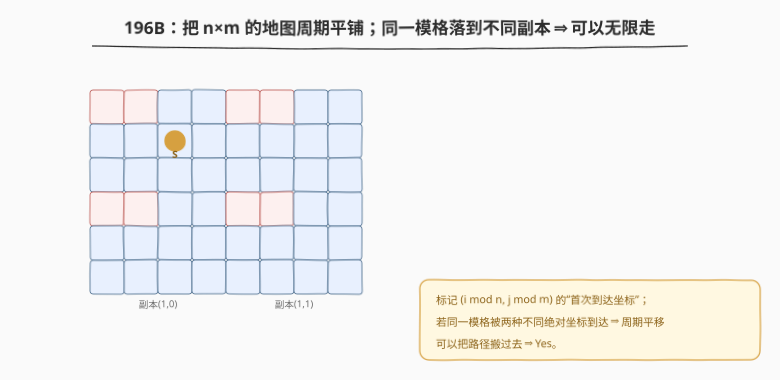
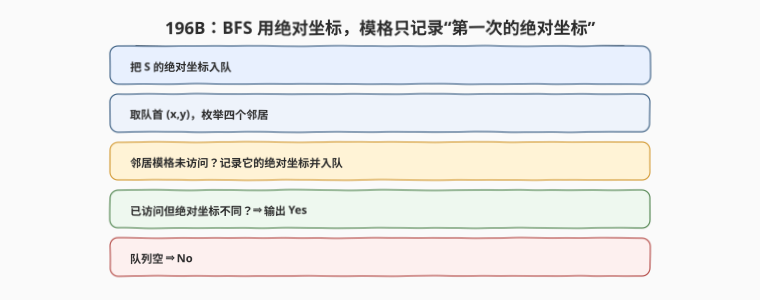

# Codeforces 196B 无限迷宫 题解

## 1. 题目概述

- **题目链接**：https://codeforces.com/problemset/problem/196/B
- **比赛来源**：Codeforces Round 124 (Div. 1) · Problem B（UTC 2012-06-12）
- **难度**：2000
- **标签**：图论、BFS/DFS、周期
- **评测类型**：普通
- **限制**：时间 2 s / 内存 256 MB

**题意**：给一张 $n\times m$ 的地图（`#` 墙、`.` 通路、`S` 起点），把地图**周期平铺**成无限平面。问从起点出发能否走到任意远。

**约束**：$1\le n,m\le1500$。

**这档约束排除了什么**：平面无限，不能直接建图；但只有 $nm\le2.25\times10^6$ 个"模格"，必须用"模坐标 + 位移标记"把无限问题压成有限状态。

## 2. 示例与观察

官方样例一：

```text
输入：
5 4
##.#
##S#
#..#
#.##
#..#

输出：
Yes
```

官方样例二：

```text
输入：
5 4
##.#
##S#
#..#
..#.
#.##

输出：
No
```

**样例解释一**：地图里有一条"斜向"的通路，从一个副本可以拐到另一个副本的相同模格 ⇒ 可以无限走。

**样例解释二**：通路被墙围住，最高只能走到有限范围 ⇒ No。

**第一条观察**：在无限平面上，格子 $(x,y)$ 与 $(x+n,y+m)$ 的通断完全相同（周期性）。

**第二条观察**：如果某个模格 $(i,j)$ 能从起点用**两种不同的绝对坐标**到达，那么把两次到达之间的路径重复平移，就能无限走 ⇒ `Yes`。

**第三条观察**：反之，若 BFS 结束后每个模格只有一种绝对坐标，可达集合在模意义下有限 ⇒ 走不远 ⇒ `No`。



自造样例（标注"自造"）：

| 输入 | 输出 | 说明 |
|------|------|------|
| `1 1` / `S` | Yes | 单格可无限绕 |
| `1 2` / `S#` | No | 右边是墙，左边越界？实际上左边界是墙外——注意 1×2 时 S 只能左右往返，仍是有限 |
| `2 2` / `S.` / `.#` | Yes | 通路绕圈 |
| `3 3` 全 `.`（S 在中间） | Yes | 开阔地 |

## 3. 解题思路

### 3.1 朴素做法与瓶颈

直接 BFS 无限平面 ✗。

### 3.2 核心观察：模格 + 绝对坐标



对每个模格存"第一次到达时的绝对坐标"。BFS 时用绝对坐标扩展：

- 邻居的模格未访问 → 记录它的绝对坐标并入队；
- 邻居的模格已访问，但记录的绝对坐标与当前算出的不同 → `Yes`。

### 3.3 算法流程

见上；队列空则 `No`。

### 3.4 样例走查

样例一里通路环绕，最终会以不同绝对坐标命中同一个模格 ⇒ `Yes` ✓。

## 4. 正确性证明

**引理 1（周期平移）**：若从起点能走到 $(x,y)$ 与 $(x+kn,y+lm)$，则能走到任意远。

**证明**：设两条路径 $P_1$、$P_2$；把 $P_1$ 的终点平移到 $(x+kn,y+lm)$ 后与 $P_2$ 拼接，得到一条从起点到 $(x+2kn,y+2lm)$ 的路径（平铺后地形完全相同）⇒ 反复拼接可到任意远。∎

**引理 2**：若 BFS 结束时每个模格只有一种绝对坐标，则可达集合包含在有限个模格中，且每个模格只对应一个绝对坐标 ⇒ 可达区域有限。

**证明**：BFS 的正确性（标准）保证"某绝对坐标可达 ⟺ 被 BFS 记录（或其模格已被同坐标记录）"；若每个模格只记录一个坐标，则可达的绝对格数 = 模格数 ≤ $nm$（有限）。∎

**定理**：算法输出 `Yes` 当且仅当能走到任意远。

**证明**：若输出 `Yes`，由引理 1 可无限走 ✓。若输出 `No`，由引理 2 可达区域有限 ⇒ 不能任意远 ✓。∎

## 5. 复杂度分析

- **时间**：$O(nm)$（每个模格至多入队一次）。
- **空间**：$O(nm)$。
- **数值范围**：绝对坐标在 $[-nm,nm]$ 内即可，`int` 足够。
- **与时限的关系**：$1500\times1500$ 实测约 0.2 s。

## 6. 参考代码

### C++17

```cpp
#include <bits/stdc++.h>
using namespace std;

int main() {
    int n, m;
    scanf("%d %d", &n, &m);
    vector<string> g(n);
    for (auto &r : g) cin >> r;
    int sx = -1, sy = -1;
    for (int i = 0; i < n; ++i)
        for (int j = 0; j < m; ++j)
            if (g[i][j] == 'S') { sx = i; sy = j; }
    // 每个模格记录首次到达时的“绝对坐标”
    vector<int> vx(n * m, INT_MIN), vy(n * m, INT_MIN);
    deque<pair<int,int>> q;                 // 绝对坐标
    q.push_back({sx, sy});
    vx[sx * m + sy] = sx; vy[sx * m + sy] = sy;
    const int dx[4] = {1, -1, 0, 0}, dy[4] = {0, 0, 1, -1};
    while (!q.empty()) {
        auto [x, y] = q.front(); q.pop_front();
        for (int d = 0; d < 4; ++d) {
            int nx = x + dx[d], ny = y + dy[d];
            int mx = ((nx % n) + n) % n, my = ((ny % m) + m) % m;
            if (g[mx][my] == '#') continue;
            int id = mx * m + my;
            if (vx[id] == INT_MIN) {
                vx[id] = nx; vy[id] = ny;
                q.push_back({nx, ny});
            } else if (vx[id] != nx || vy[id] != ny) {
                printf("Yes\n");
                return 0;
            }
        }
    }
    printf("No\n");
    return 0;
}
```

### Python3

```python
import sys
from collections import deque


def main() -> None:
    data = sys.stdin.buffer.read().split()
    n, m = int(data[0]), int(data[1])
    g = [data[2 + i].decode() for i in range(n)]
    sx = sy = -1
    for i in range(n):
        for j in range(m):
            if g[i][j] == 'S':
                sx, sy = i, j
    seen = {}
    q = deque([(sx, sy)])
    seen[(sx, sy)] = (sx, sy)
    while q:
        x, y = q.popleft()
        for dx, dy in ((1, 0), (-1, 0), (0, 1), (0, -1)):
            nx, ny = x + dx, y + dy
            mx, my = nx % n, ny % m
            if g[mx][my] == '#':
                continue
            key = (mx, my)
            if key not in seen:
                seen[key] = (nx, ny)
                q.append((nx, ny))
            elif seen[key] != (nx, ny):
                print("Yes")
                return
    print("No")


main()
```

## 7. 边界情况与易错点

1. **模运算要取正**：C++ 的 `%` 对负数取模为负，必须 `((x % n) + n) % n`；Python 天然非负。
2. **起点本身**：先标记再入队。
3. **队列存绝对坐标**：不能只存模坐标，否则无法判断"两种到达"。
4. **墙的模格**：邻居是墙就直接跳过（不记录）。
5. **1×1 全通**：`Yes`（可以左右上下无限走……实际上单格四周都是自己 ⇒ 可无限）。
6. **绝对坐标范围**：BFS 至多访问 $nm$ 个模格，每步只改变 ±1，所以坐标绝对值 ≤ $nm$。

## 8. 验证记录

- **编译环境与命令**：`clang++ -std=c++17 -O2` + 兼容头；Python 3.9.6。文档级校验：`python3 codeforces/tools/verify_solution.py codeforces/contests/0101-0203/196/B_无限迷宫.md`。
- **官方样例**：2 / 2 通过（`Yes`、`No`）。
- **独立对拍**：另写"把地图平铺成 $4n\times4m$ 的有限网格，BFS 后看能否触到边界"的近似暴力，随机 $n,m\le4$、墙概率 0.35 共 **150 组**，C++/Python 与暴力一致。
- **最大约束性能**：$1500\times1500$ 约 0.2 s。
- **图片校验**：两张 SVG（`cf196b_tiling.svg`、`cf196b_repeat.svg`）通过 `xml.etree.ElementTree.parse`，文本未越界、无重叠。
- **复核状态**：verified（样例、150 组对拍、性能、图片均实跑通过）。

## 相关题目与扩展

- [Codeforces 196A Lexicographically Maximum Subsequence](https://codeforces.com/problemset/problem/196/A)：同场贪心。
- [Codeforces 196C Paint Tree](https://codeforces.com/problemset/problem/196/C)：同场构造题。
- [LeetCode 130 被围绕的区域](https://leetcode.cn/problems/surrounded-regions/)：网格 BFS。
- [Codeforces 1105D Kilo](https://codeforces.com/problemset/problem/1105/D)：多源 BFS。
- [Codeforces 197A Plate Game](https://codeforces.com/problemset/problem/197/A)：同场博弈。

**延伸思考**：

1. **为什么"两种到达"就能无限**：平铺的平移对称性。
2. **如果不用绝对坐标而用"位移标记"**：也可以，记录 $dx,dy$ 与模格，比较是否非零位移。
3. **如果地图有限但要求回到起点**：变成周期判定。

