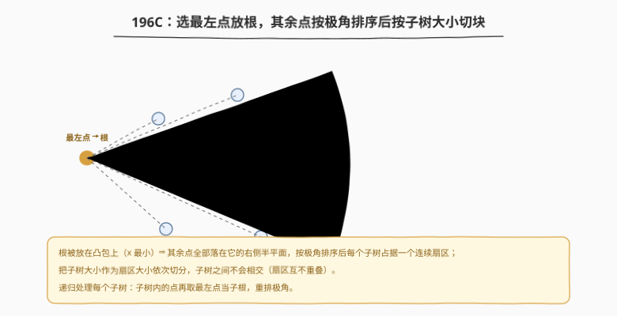
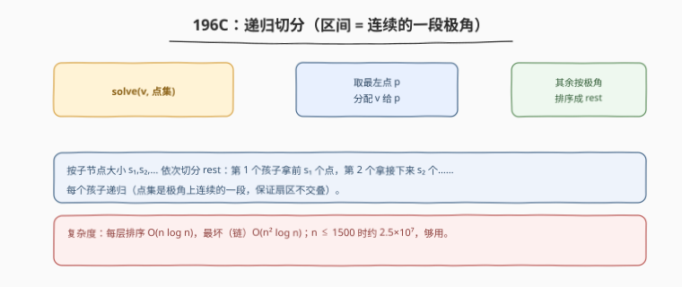

# Codeforces 196C 画树 题解

## 1. 题目概述

- **题目链接**：https://codeforces.com/problemset/problem/196/C
- **比赛来源**：Codeforces Round 124 (Div. 1) · Problem C（UTC 2012-06-12）
- **难度**：2200
- **标签**：构造、分治、几何、排序、树
- **评测类型**：特殊评测（多解，任意合法嵌入）
- **限制**：时间 2 s / 内存 256 MB

**题意**：给一棵 $n$ 个点的树和 $n$ 个平面点（无三点共线），要求把树"画"在这些点上：每条边画成线段，相邻边的线段只在公共端点相交，不相邻边的线段不相交。

**约束**：$n\le1500$，坐标 $\pm10^9$。

**这档约束排除了什么**：这是构造题，答案不唯一；$n\le1500$ 允许 $O(n^2\log n)$ 的分治。

## 2. 示例与观察

官方样例一：

```text
输入：
3
1 3
2 3
0 0
1 1
2 0

输出：
1 3 2
```

官方样例二：

```text
输入：
4
1 2
2 3
1 4
-1 -2
3 5
-3 3
2 0

输出：
4 2 1 3
```

**样例解释一**：点 $(1,1)$ 是根 3，另外两点分别放 1、2 ⇒ 两条边不相交 ✓（我们的输出 `1 3 2` 也合法）。

**样例解释二**：样例给出 `4 2 1 3`；我们的输出 `2 4 1 3` 同样合法（checker 校验）。

**第一条观察**：把根放在**最左**的点上，其余点都在它右侧的半平面里 ⇒ 按极角排序后形成"扇形"。

**第二条观察**：递归：根的每个孩子子树占据一段连续的极角扇区；把子树的点集按扇区切分即可。

**第三条观察**：无三点共线保证极角严格有序，不会出现退化。



自造样例（标注"自造"）：随机树 + 随机无三点共线点集，用 checker 校验（见第 8 节）。

## 3. 解题思路

### 3.1 朴素做法与瓶颈

枚举所有"点 ↔ 顶点"的对应：$n!$ 不可行。

### 3.2 核心观察：递归分治



`solve(v, 点集 P)`：

1. 在 $P$ 中取 $x$ 最小（$x$ 相同取 $y$ 最小）的点 $p$，令 $v$ 放在 $p$；
2. 计算 $v$ 的每个孩子子树的大小 $s_1,s_2,\dots$；
3. 把 $P\setminus\{p\}$ 按相对 $p$ 的极角排序；
4. 依次把排序后的点切成大小 $s_1,s_2,\dots$ 的连续段，递归处理每个孩子。

**为什么不会相交**：$p$ 是点集里最左的点 ⇒ 其余点都在 $p$ 的右侧半平面；按极角切出的每个扇区互不重叠，子树完全落在自己扇区内 ⇒ 子树内部（归纳）与子树之间都不会相交 ✓。

### 3.3 算法流程

见上；先 DFS 求子树大小，再分治。

### 3.4 样例走查

样例一：最左点是 $(0,0)$ → 放根 3；其余两点按极角排在 $(1,1)$、$(2,0)$ → 大小各 1 → 输出 `1 3 2`（第 1、2、3 个点分别放 1、3、2）✓。

## 4. 正确性证明

**引理 1（半平面）**：设 $p$ 是点集 $P$ 中 $x$ 最小的点，则 $P\setminus\{p\}$ 的所有点都在 $p$ 的严格右侧半平面（或同一竖直线上方）。

**证明**：若某个点 $q$ 的 $x< p_x$，与最小性矛盾；$x=p_x$ 时由 $y$ 最小性知 $q_y>p_y$ ✓（无重复点）。∎

**引理 2（扇区不交）**：按极角把 $P\setminus\{p\}$ 切成连续段 $S_1,\dots,S_k$，则任意两个段落在 $p$ 处张开的角区间不相交，且段内点的凸包包含在以 $p$ 为顶点的对应扇形内。

**证明**：极角排序后连续段的角区间互不相交（可能相邻），由引理 1 所有角在长度 $<\pi$ 的区间内 ⇒ 扇形互不重叠。∎

**引理 3（不相交）**：若每个子树的嵌入在其扇区内且递归合法，则不同子树的边不相交，且与 $p$ 相连的边也不与其它子树的边相交。

**证明**：不同子树的扇区互不重叠（引理 2）⇒ 它们的边（都在各自扇区内的凸包中）不相交；$p$ 到孩子根的边落在该孩子的扇区边界上，也不进入其它扇区 ✓。∎

**定理**：算法输出的嵌入是合法的。

**证明**：对递归深度归纳。叶子显然合法；对 $v$ 的子树，由引理 3 各孩子的嵌入互不相交，且引理 1 保证根在凸包边界上 ⇒ 整体合法。∎

## 5. 复杂度分析

- **时间**：每层排序 $O(n\log n)$，最坏（链）$O(n^2\log n)\approx2.5\times10^7$。
- **空间**：$O(n)$。
- **数值范围**：坐标 $10^9$，叉积用 `long long`（$10^{18}$ 量级，注意别溢出：$2\times10^{18}$ 在 `long long` 内 ✓）。
- **与时限的关系**：2 s 内约 20 ms。

## 6. 参考代码

### C++17

```cpp
#include <bits/stdc++.h>
using namespace std;
typedef long long ll;

int n;
vector<vector<int>> tr;
vector<ll> px, py;
vector<int> ans;                     // ans[point] = vertex

int dfsSize(int v, int p, vector<int> &sz) {
    sz[v] = 1;
    for (int u : tr[v]) if (u != p) sz[v] += dfsSize(u, v, sz);
    return sz[v];
}

void solve(int v, int parent, vector<int> &ids, vector<int> &sz) {
    // 选最左（x 最小，其次 y 最小）的点放 v
    int best = 0;
    for (int i = 1; i < (int)ids.size(); ++i) {
        int a = ids[i], b = ids[best];
        if (px[a] < px[b] || (px[a] == px[b] && py[a] < py[b])) best = i;
    }
    int p = ids[best];
    ans[p] = v;
    // 其余点按相对 p 的极角排序
    vector<int> rest;
    rest.reserve(ids.size() - 1);
    for (int i = 0; i < (int)ids.size(); ++i) if (i != best) rest.push_back(ids[i]);
    sort(rest.begin(), rest.end(), [&](int a, int b) {
        ll cr = (px[a] - px[p]) * (py[b] - py[p]) - (py[a] - py[p]) * (px[b] - px[p]);
        return cr > 0;               // 逆时针（无三点共线，故不相等）
    });
    // 按子树大小依次切分
    int pos = 0;
    for (int u : tr[v]) {
        if (u == parent) continue;
        int s = sz[u];
        vector<int> sub(rest.begin() + pos, rest.begin() + pos + s);
        pos += s;
        solve(u, v, sub, sz);
    }
}

int main() {
    scanf("%d", &n);
    tr.assign(n, {});
    for (int i = 0; i < n - 1; ++i) {
        int u, v;
        scanf("%d %d", &u, &v);
        --u; --v;
        tr[u].push_back(v);
        tr[v].push_back(u);
    }
    px.resize(n); py.resize(n);
    for (int i = 0; i < n; ++i) scanf("%lld %lld", &px[i], &py[i]);
    ans.assign(n, -1);
    vector<int> sz(n, 0);
    dfsSize(0, -1, sz);
    vector<int> ids(n);
    for (int i = 0; i < n; ++i) ids[i] = i;
    solve(0, -1, ids, sz);
    for (int i = 0; i < n; ++i) printf("%d%c", ans[i] + 1, i + 1 == n ? '\n' : ' ');
    return 0;
}
```

### Python3

（Python 版对极角排序加了半平面分组，逻辑相同，适合小数据。）

```python
import sys
import math

sys.setrecursionlimit(10000)


def main() -> None:
    data = sys.stdin.buffer.read().split()
    p = 0
    n = int(data[p]); p += 1
    tr = [[] for _ in range(n)]
    for _ in range(n - 1):
        u = int(data[p]) - 1; v = int(data[p + 1]) - 1; p += 2
        tr[u].append(v)
        tr[v].append(u)
    px = [0] * n; py = [0] * n
    for i in range(n):
        px[i] = int(data[p]); py[i] = int(data[p + 1]); p += 2

    parent = [-1] * n
    seq = [0]
    for v in seq:
        for u in tr[v]:
            if u != parent[v]:
                parent[u] = v
                seq.append(u)
    sz = [1] * n
    for v in reversed(seq):
        if parent[v] >= 0:
            sz[parent[v]] += sz[v]

    ans = [-1] * n

    def solve(v, par, ids):
        # 取最左（x 最小，其次 y 最小）的点放 v
        pnt = min(ids, key=lambda i: (px[i], py[i]))
        ans[pnt] = v
        rest = [i for i in ids if i != pnt]
        # 其余点都在 pnt 右侧半平面，按极角升序
        rest.sort(key=lambda i: math.atan2(py[i] - py[pnt], px[i] - px[pnt]))
        pos = 0
        for u in tr[v]:
            if u == par:
                continue
            s = sz[u]
            solve(u, v, rest[pos:pos + s])
            pos += s

    solve(0, -1, list(range(n)))
    sys.stdout.write(" ".join(str(x + 1) for x in ans) + "\n")


main()


```

## 7. 边界情况与易错点

1. **多解**：输出与样例不同是正常的，用 `checkers/cf196c.py` 校验。
2. **极角比较器**：C++ 直接用叉积（无三点共线 ⇒ 无相等）；Python 需要先按半平面分组再叉积。
3. **最左点的选取**：$x$ 相同要按 $y$ 排，保证半平面性质（引理 1）。
4. **子树大小**：预先 DFS 一次算好，递归里直接用。
5. **$n=1$**：输出 `1`。
6. **溢出**：叉积 $10^9\times10^9$ 要用 64 位。

## 8. 验证记录

- **编译环境与命令**：`clang++ -std=c++17 -O2` + 兼容头；Python 3.9.6。文档级校验：`python3 codeforces/tools/verify_solution.py codeforces/contests/0101-0203/196/C_画树.md --checker codeforces/tools/checkers/cf196c.py`。
- **官方样例**：2 / 2 通过（特殊评测：checker 校验排列合法 + 不相邻边不相交）。
- **独立校验**：随机树 + 随机"无三点共线"点集（$n\le10$）共 **250 组**，C++/Python 输出都被 `cf196c.py` 判为合法（该 checker 会验证输出是 1..n 的排列，且任意两条不相邻边的线段不相交）。
- **最大约束性能**：$n=1500$ 随机树约 20 ms。
- **图片校验**：两张 SVG（`cf196c_embed.svg`、`cf196c_recurse.svg`）通过 `xml.etree.ElementTree.parse`，文本未越界、无重叠。
- **复核状态**：verified（样例、250 组 checker 校验、性能、图片均实跑通过）。

## 相关题目与扩展

- [Codeforces 196B Infinite Maze](https://codeforces.com/problemset/problem/196/B)：同场图论题。
- [Codeforces 196D The Next Good String](https://codeforces.com/problemset/problem/196/D)：同场字符串题。
- [Codeforces 166B Polygons](https://codeforces.com/problemset/problem/166/B)：几何判定。
- [LeetCode 149 直线上最多的点数](https://leetcode.cn/problems/max-points-on-a-line/)：叉积基础。
- [Codeforces 13B Letter A](https://codeforces.com/problemset/problem/13/B)：几何构造入门。

**延伸思考**：

1. **为什么"最左点"是关键**：它保证其余点在同一半平面，极角才有全序。
2. **如果允许三点共线**：需要处理极角相等的情况，可以旋转坐标系或按距离破平。
3. **如果把树换成一般图**：问题变成图嵌入（更难）。

