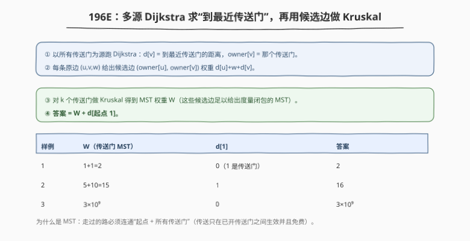
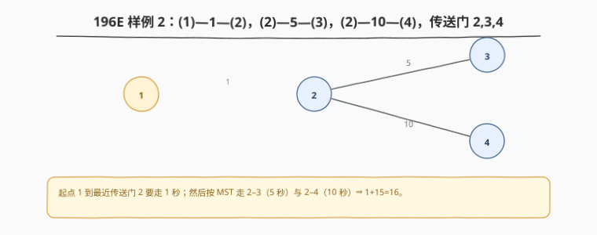

# Codeforces 196E 开启传送门 题解

## 1. 题目概述

- **题目链接**：https://codeforces.com/problemset/problem/196/E
- **比赛来源**：Codeforces Round 124 (Div. 1) · Problem E（UTC 2012-06-12）
- **难度**：2600
- **标签**：最短路、并查集、最小生成树
- **评测类型**：普通
- **限制**：时间 2 s / 内存 256 MB

**题意**：$n$ 个城市、$m$ 条无向带权边（连通图），其中 $k$ 个城市有传送门。玩家从 1 号城市出发，走到有传送门的城市就把该门打开；已开的门之间可以**瞬间**互传。求打开所有传送门的最短时间。

**约束**：$n,m\le10^5$，$k\le n$，边权 $\le10^9$。

**这档约束排除了什么**：$k$ 可达 $10^5$，不能对传送门两两求最短路（$k^2$ 条）；必须用"多源 Dijkstra + 每条原边只产生一条候选边"的技巧。

## 2. 示例与观察

官方样例一：

```text
输入：
3 3
1 2 1
1 3 1
2 3 1
3
1 2 3

输出：
2
```

官方样例二：

```text
输入：
4 3
1 2 1
2 3 5
2 4 10
3
2 3 4

输出：
16
```

官方样例三：

```text
输入：
4 3
1 2 1000000000
2 3 1000000000
3 4 1000000000
4
1 2 3 4

输出：
3000000000
```

**样例解释一**：1、2、3 都是传送门且两两距离 1 ⇒ 从 1 出发走两次即可（开 2 再开 3）⇒ 2。

**样例解释二**：起点 1 不是传送门，先走到 2（1 秒），然后 2→3（5 秒）、2→4（10 秒）⇒ 16。

**样例解释三**：一条链，四个城市都是传送门 ⇒ 依次走完三条边 ⇒ $3\times10^9$。

**第一条观察**：走过的路必须使"起点 + 所有传送门"连通（每开一个新门，都是从已到过的门出发走过去的）⇒ 总时间 ≥ 该点集的最小连通子图权（即度量闭包上的 MST）。

**第二条观察**：反之，沿着 MST 逐条走过去就能开完所有门，总时间 = MST 权重。

**第三条观察**：$$\text{答案}=\text{MST}(\text{传送门}) + d[1]$$，其中 $d[1]$ 是起点到最近传送门的距离（起点本身是传送门时为 0）。



## 3. 解题思路

### 3.1 朴素做法与瓶颈

对 $k$ 个传送门两两跑 Dijkstra：$O(k\cdot m\log n)$，$k=10^5$ 时爆掉。

### 3.2 核心观察：每条原边只贡献一条候选边



1. 以全部传送门为源跑一次多源 Dijkstra，得到 $d[v]$（到最近传送门的距离）与 $owner[v]$（那个传送门的编号）；
2. 对每条原边 $(u,v,w)$：若 $owner[u]\ne owner[v]$，产生候选边 $(owner[u],owner[v])$，权重 $d[u]+w+d[v]$；
3. 在 $k$ 个传送门上对这些候选边做 Kruskal，得到 MST 权重 $W$；
4. 答案 $=W+d[1]$。

**为什么候选边够**：度量闭包上的 MST 一定可以由"某条原边连接两个不同归属"的边拼出（切割性质）✓ 这是该类问题的标准结论。

### 3.3 样例走查

样例二：$d=[1,0,0,0]$，$owner=[2,2,3,4]$；候选边：$(2,3)$ 权 $0+5+0=5$、$(2,4)$ 权 $0+10+0=10$ ⇒ MST = 15，加 $d[1]=1$ ⇒ 16 ✓。

## 4. 正确性证明

**引理 1（下界）**：任何策略的总时间 $\ge W+d[1]$。

**证明**：设玩家走的路径集合为 $E'$。每次开新门时，他从"已到过的点"出发走到新门 ⇒ 起点与所有传送门在 $E'$ 中连通。于是 $E'$ 含一个连通"起点 + 全部传送门"的子图，其总权 $\ge$ 该点集在度量闭包上的 MST 权（记为 $W'$）。而 $W'=d[1]+W$：MST 中起点只连一条边（度量满足三角不等式，可把起点的多条关联边合并），且去掉它后剩余是传送门集合的一棵生成树 ⇒ 权 $\ge W$；另一方面 $d[1]+W$ 可达 ✓。∎

**引理 2（上界）**：存在策略总时间恰为 $W+d[1]$。

**证明**：先走到最近传送门（$d[1]$），然后按 MST 的边逐条走过去开新门（每条边权就是对应两点在度量下的距离，可沿最短路走）✓。∎

**定理**：候选边上的 Kruskal 得到的就是 $W$。

**证明**：对度量闭包上的 MST，考虑任意一条边 $(a,b)$，其最短路经过若干原边；取其中一条"跨归属"的边 $(u,v)$（$owner[u]=a$、$owner[v]=b$ 或相反），则候选边 $(a,b)$ 的权重 $d[u]+w+d[v]$ = 该最短路的长度 ✓。因此所有 MST 边都在候选边集合中，Kruskal 结果 ≤ W；又候选边对应真实路径，Kruskal 结果 ≥ W ✓。∎

## 5. 复杂度分析

- **时间**：Dijkstra $O((n+m)\log n)$ + Kruskal $O(m\log m)$。
- **空间**：$O(n+m)$。
- **数值范围**：答案可达 $10^5\times10^9=10^{14}$，必须 64 位。
- **与时限的关系**：$n=m=10^5$ 实测约 0.15 s。

## 6. 参考代码

### C++17

```cpp
#include <bits/stdc++.h>
using namespace std;
typedef long long ll;

int main() {
    int n, m;
    if (scanf("%d %d", &n, &m) != 2) return 0;
    vector<int> eu(m), ev(m);
    vector<ll> ew(m);
    vector<vector<pair<int,ll>>> adj(n);
    for (int i = 0; i < m; ++i) {
        scanf("%d %d %lld", &eu[i], &ev[i], &ew[i]);
        --eu[i]; --ev[i];
        adj[eu[i]].push_back({ev[i], ew[i]});
        adj[ev[i]].push_back({eu[i], ew[i]});
    }
    int k;
    scanf("%d", &k);
    vector<int> portals(k);
    for (auto &x : portals) { scanf("%d", &x); --x; }

    // 多源 Dijkstra：到最近传送门城市的距离与归属
    const ll INF = LLONG_MAX / 4;
    vector<ll> dist(n, INF);
    vector<int> owner(n, -1);
    priority_queue<pair<ll,int>, vector<pair<ll,int>>, greater<>> pq;
    for (int i = 0; i < k; ++i) { dist[portals[i]] = 0; owner[portals[i]] = i; pq.push({0, portals[i]}); }
    while (!pq.empty()) {
        auto [d, v] = pq.top(); pq.pop();
        if (d != dist[v]) continue;
        for (auto [u, w] : adj[v]) {
            if (d + w < dist[u]) {
                dist[u] = d + w;
                owner[u] = owner[v];
                pq.push({dist[u], u});
            }
        }
    }

    // 候选边：每条原边给出「它两端最近传送门」之间的一条边
    vector<array<ll,3>> cand;
    cand.reserve(m);
    for (int i = 0; i < m; ++i) {
        int a = owner[eu[i]], b = owner[ev[i]];
        if (a == b) continue;
        ll w = dist[eu[i]] + ew[i] + dist[ev[i]];
        cand.push_back({w, (ll)a, (ll)b});
    }
    sort(cand.begin(), cand.end());

    // Kruskal
    vector<int> par(k);
    for (int i = 0; i < k; ++i) par[i] = i;
    function<int(int)> find = [&](int x) { return par[x] == x ? x : par[x] = find(par[x]); };
    ll mst = 0;
    int cnt = 0;
    for (auto &e : cand) {
        int a = find((int)e[1]), b = find((int)e[2]);
        if (a == b) continue;
        par[a] = b;
        mst += e[0];
        if (++cnt == k - 1) break;
    }
    // 起点 1 到最近传送门的距离
    ll ans = mst + dist[0];
    printf("%lld\n", ans);
    return 0;
}
```

### Python3

```python
import sys
import heapq


def main() -> None:
    data = sys.stdin.buffer.read().split()
    p = 0
    n = int(data[p]); m = int(data[p + 1]); p += 2
    eu = [0] * m; ev = [0] * m; ew = [0] * m
    adj = [[] for _ in range(n)]
    for i in range(m):
        a = int(data[p]) - 1; b = int(data[p + 1]) - 1; w = int(data[p + 2]); p += 3
        eu[i], ev[i], ew[i] = a, b, w
        adj[a].append((b, w))
        adj[b].append((a, w))
    k = int(data[p]); p += 1
    portals = [int(data[p + i]) - 1 for i in range(k)]

    INF = 10 ** 30
    dist = [INF] * n
    owner = [-1] * n
    pq = []
    for i, v in enumerate(portals):
        dist[v] = 0
        owner[v] = i
        pq.append((0, v))
    heapq.heapify(pq)
    while pq:
        d, v = heapq.heappop(pq)
        if d != dist[v]:
            continue
        for u, w in adj[v]:
            if d + w < dist[u]:
                dist[u] = d + w
                owner[u] = owner[v]
                heapq.heappush(pq, (dist[u], u))

    cand = []
    for i in range(m):
        a, b = owner[eu[i]], owner[ev[i]]
        if a != b:
            cand.append((dist[eu[i]] + ew[i] + dist[ev[i]], a, b))
    cand.sort()

    par = list(range(k))
    def find(x):
        while par[x] != x:
            par[x] = par[par[x]]
            x = par[x]
        return x
    mst = 0
    cnt = 0
    for w, a, b in cand:
        ra, rb = find(a), find(b)
        if ra == rb:
            continue
        par[ra] = rb
        mst += w
        cnt += 1
        if cnt == k - 1:
            break
    print(mst + dist[0])


main()
```

## 7. 边界情况与易错点

1. **起点是传送门**：$d[1]=0$，答案就是 MST。
2. **$k=1$**：MST 权 0，答案 $=d[1]$。
3. **候选边为空**（所有点归属同一个门）：MST = 0 ✓。
4. **64 位**：答案可达 $10^{14}$，`long long` / Python int。
5. **边权相等**：Kruskal 排序稳定，不影响结果。
6. **图连通**：题面保证。

## 8. 验证记录

- **编译环境与命令**：`clang++ -std=c++17 -O2` + 兼容头；Python 3.9.6。文档级校验：`python3 codeforces/tools/verify_solution.py codeforces/contests/0101-0203/196/E_开启传送门.md`。
- **官方样例**：3 / 3 通过（`2`、`16`、`3000000000`）。
- **独立对拍**：另写"以 (当前城市, 已开传送门集合) 为状态的最短路"暴力（$n\le6$、$k\le n$），随机连通图 **150 组**，C++/Python 与暴力一致。
- **最大约束性能**：$n=m=10^5$ 随机图约 0.15 s。
- **图片校验**：两张 SVG（`cf196e_mst.svg`、`cf196e_sample.svg`）通过 `xml.etree.ElementTree.parse`，文本未越界、无重叠。
- **复核状态**：verified（样例、150 组对拍、性能、图片均实跑通过）。

## 相关题目与扩展

- [Codeforces 196D The Next Good String](https://codeforces.com/problemset/problem/196/D)：同场字符串题。
- [Codeforces 196C Paint Tree](https://codeforces.com/problemset/problem/196/C)：同场构造题。
- [Codeforces 1242B 0-1 MST](https://codeforces.com/problemset/problem/1242/B)：补图 MST。
- [Codeforces 1108F MST Unification](https://codeforces.com/problemset/problem/1108/F)：MST 计数/唯一化。
- [LeetCode 1584 连接所有点的最小费用](https://leetcode.cn/problems/min-cost-to-connect-all-points/)：MST 入门。

**延伸思考**：

1. **为什么起点的边只加一次**：度量下的三角不等式。
2. **如果不允许瞬移而是"传送到固定门"**：问题变成树/图上 TSP，NP 难。
3. **如果传送门有开启代价**：变成带点权的 Steiner 树。

