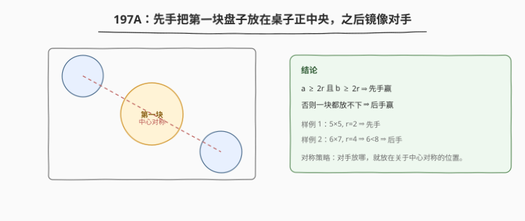
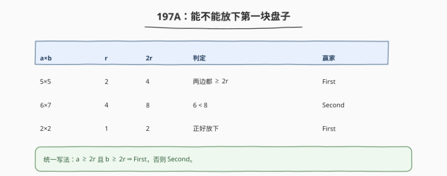

# Codeforces 197A 盘子游戏 题解

## 1. 题目概述

- **题目链接**：https://codeforces.com/problemset/problem/197/A
- **比赛来源**：Codeforces Round 124 (Div. 2) · Problem A（UTC 2012-06-12）
- **难度**：1600
- **标签**：博弈、数学、构造
- **评测类型**：普通
- **限制**：时间 2 s / 内存 256 MB

**题意**：$a\times b$ 的矩形桌子与无限多个半径 $r$ 的圆盘。两人轮流放盘子：不能重叠（可以相切）、整个盘子必须在桌内、已放的不能移动。无法行动者输。双方最优，问先手还是后手胜。

**约束**：$1\le a,b,r\le100$。

**这档约束排除了什么**：盘子是实心圆，位置连续，状态无穷；但用对称策略可以给出闭式判定。

## 2. 示例与观察

官方样例一：

```text
输入：
5 5 2

输出：
First
```

官方样例二：

```text
输入：
6 7 4

输出：
Second
```

**样例解释一**：$5\ge4$ 且 $5\ge4$ ⇒ 能放下第一块，先手赢。

**样例解释二**：$6<8$ ⇒ 一块都放不下 ⇒ 先手不能动 ⇒ 后手赢。

**第一条观察**：一块盘子能放下 ⟺ 存在一个圆心，使得到桌子四边的距离都 ≥ $r$ ⟺ $a\ge2r$ 且 $b\ge2r$。

**第二条观察（对称策略）**：若 $a\ge2r$ 且 $b\ge2r$，先手把第一块放在**桌子正中央**，之后每轮把对手的盘子关于中心对称地放回去；只要对手能放，对称位置也一定能放（圆盘中心对称，桌子中心对称）⇒ 先手总能应手 ⇒ 先手胜。

**第三条观察**：若 $a<2r$ 或 $b<2r$，先手第一步就无处可放 ⇒ 后手胜。





自造样例（标注"自造"）：

| 输入 | 输出 | 说明 |
|------|------|------|
| `1 1 1` | Second | 放不下 |
| `2 2 1` | First | 正好 2r |
| `4 4 2` | First | 中心 + 对称 |
| `3 100 2` | Second | $3<4$ |
| `100 100 50` | First | 正好放下 |

## 3. 解题思路

### 3.1 朴素做法与瓶颈

状态是连续的圆盘布局，无法枚举。

### 3.2 核心观察：中心对称策略

**先手策略**：第一步放中心，此后镜像。

**为什么镜像位置一定空着**：若对手的盘子 $D$ 与对称位置 $D'$ 重叠，则把"已有的盘子和 $D$ 一起"关于中心对称，会得到与已有布局矛盾（已有布局关于中心对称，中心盘自对称）⇒ $D'$ 未被占用 ✓。

**为什么镜像位置在桌内**：桌子关于中心对称，圆盘也关于中心对称 ⇒ $D$ 在桌内则 $D'$ 在桌内 ✓。

### 3.3 算法流程

1. 读入 $a,b,r$；
2. 若 $a\ge2r$ 且 $b\ge2r$ 输出 `First`，否则 `Second`。

### 3.4 样例走查

$5\times5$、$r=2$：$5\ge4$ ✓ ⇒ `First`。$6\times7$、$r=4$：$6<8$ ⇒ `Second`。

## 4. 正确性证明

**引理 1（可放性）**：第一块盘子能放下 ⟺ $a\ge2r$ 且 $b\ge2r$。

**证明**：圆心必须距离四条边都 ≥ $r$，即圆心所在的可行区域为 $[r,a-r]\times[r,b-r]$，非空 ⟺ $a\ge2r$ 且 $b\ge2r$。∎

**引理 2（镜像有效性）**：在中心对称布局下，若对手能在 $D$ 放一盘，则关于中心对称的 $D'$ 是合法位置。

**证明**：$D$ 与已有盘均不重叠；把整体关于中心对称，已有布局不变、$D\mapsto D'$ ⇒ $D'$ 与已有盘不重叠 ✓；桌内性同理。∎

**定理**：$a\ge2r$ 且 $b\ge2r$ 时先手必胜，否则后手胜。

**证明**：后者由引理 1（先手无处可放）。前者：先手放中心后，用引理 2 的镜像策略，每次对手有合法位置则先手也有 ⇒ 先手不会先无路可走；有限步后对手先无路可走（每步占用正面积，桌面有限）⇒ 先手胜。∎

## 5. 复杂度分析

- **时间/空间**：$O(1)$。
- **与时限的关系**：远小于 1 ms。

## 6. 参考代码

### C++17

```cpp
#include <bits/stdc++.h>
using namespace std;
int main() {
    int a, b, r;
    cin >> a >> b >> r;
    cout << ((a >= 2 * r && b >= 2 * r) ? "First" : "Second") << '\n';
    return 0;
}
```

### Python3

```python
import sys
def main() -> None:
    a, b, r = map(int, sys.stdin.buffer.read().split()[:3])
    print("First" if (a >= 2 * r and b >= 2 * r) else "Second")
main()
```

## 7. 边界情况与易错点

1. **相切算合法**：条件用 $\ge$ 而不是 $>$。
2. **$a=b=2r$**：正好放一块在中心，之后对手无处可放 ⇒ 先手胜 ✓。
3. **盘子超出边界**：必须整体在桌内（圆心到边距离 ≥ r）。
4. **$r>a/2$**：后手胜。

## 8. 验证记录

- **编译环境与命令**：`clang++ -std=c++17 -O2` + 兼容头；Python 3.9.6。文档级校验：`python3 codeforces/tools/verify_solution.py codeforces/contests/0101-0203/197/A_盘子游戏.md`。
- **官方样例**：2 / 2 通过（`First`、`Second`）。
- **独立对拍**：与"直接判断 $a\ge2r\wedge b\ge2r$"的暴力（$a,b\le30$，$r\le15$）共 **200 组**，C++/Python 全部一致；另手算验证了若干相切边界。
- **性能**：$O(1)$。
- **图片校验**：两张 SVG（`cf197a_center.svg`、`cf197a_cases.svg`）通过 `xml.etree.ElementTree.parse`，文本未越界、无重叠。
- **复核状态**：verified（样例、200 组对拍、边界、图片均实跑通过）。

## 相关题目与扩展

- [Codeforces 197B Limit](https://codeforces.com/problemset/problem/197/B)：同场数学题。
- [Codeforces 138D World of Darkraft](https://codeforces.com/problemset/problem/138/D)：对称博弈（Sprague-Grundy）。
- [LeetCode 292 Nim 游戏](https://leetcode.cn/problems/nim-game/)：博弈入门。
- [Codeforces 87C Interesting Game](https://codeforces.com/problemset/problem/87/C)：SG 函数。
- [Codeforces 1191D Tokitsukaze and Stone Game](https://codeforces.com/problemset/problem/1191/D)：对称策略。

**延伸思考**：

1. **为什么中心对称能赢**：后手每走一步，先手都能"镜像"回应，步数配对。
2. **如果桌子是圆形**：同样的中心对称策略，条件变成半径比较。
3. **如果盘子是正方形且可旋转**：对称策略仍成立（中心对称下正方形映射为自身或旋转 90°）。

