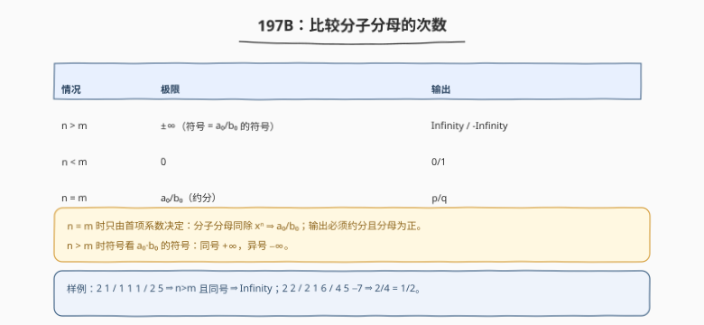

# Codeforces 197B 极限 题解

## 1. 题目概述

- **题目链接**：https://codeforces.com/problemset/problem/197/B
- **比赛来源**：Codeforces Round 124 (Div. 2) · Problem B（UTC 2012-06-12）
- **难度**：1400
- **标签**：数学、分类讨论
- **评测类型**：普通
- **限制**：时间 2 s / 内存 256 MB

**题意**：给多项式 $P(x)=a_0x^n+\dots+a_n$、$Q(x)=b_0x^m+\dots+b_m$，求 $\lim_{x\to+\infty}\frac{P(x)}{Q(x)}$。结果可能是 $+\infty$、$-\infty$、$0$ 或一个分数，按指定格式输出。

**约束**：$0\le n,m\le100$，$|a_i|,|b_i|\le100$，$a_0,b_0\ne0$。

**这档约束排除了什么**：系数很小，只需比较次数并用首项系数定符号/比值，$O(1)$。

## 2. 示例与观察

官方样例一：

```text
输入：
2 1
1 1 1
2 5

输出：
Infinity
```

官方样例二：

```text
输入：
1 0
-1 3
2

输出：
-Infinity
```

官方样例三：

```text
输入：
0 1
1
1 0

输出：
0/1
```

官方样例四：

```text
输入：
2 2
2 1 6
4 5 -7

输出：
1/2
```

官方样例五：

```text
输入：
1 1
9 0
-5 2

输出：
-9/5
```

**样例解释**：第一组 $n>m$ 且 $a_0/b_0=1/2>0$ ⇒ `Infinity`；第二组 $n>m$ 且 $-1/2<0$ ⇒ `-Infinity`；第三组 $n<m$ ⇒ `0/1`；第四组 $n=m$ ⇒ $2/4=1/2$；第五组 $n=m$ ⇒ $9/(-5)=-9/5$（分母取正）。

**第一条观察**：$n>m$ 时商 $\sim\frac{a_0}{b_0}x^{n-m}\to\pm\infty$，符号 = $\operatorname{sign}(a_0/b_0)$。

**第二条观察**：$n<m$ 时极限 0。

**第三条观察**：$n=m$ 时极限 $a_0/b_0$，约分并把分母符号转为正。




自造样例（标注"自造"）：

| 输入 | 输出 | 说明 |
|------|------|------|
| `1 0` / `1 1` / `-2` | -Infinity | 同次数？$n=1>m=0$，符号 $1/(-2)<0$ |
| `0 0` / `-2` / `-4` | 1/2 | $(-2)/(-4)$ |
| `0 0` / `-2` / `4` | -1/2 | 分母为正 |
| `1 1` / `2 0` / `4 0` | 1/2 | 化简 |

## 3. 解题思路

### 3.1 朴素做法与瓶颈

直接代入大 $x$ 会溢出/失真；用首项比较是精确的。

### 3.2 核心观察：比较次数

分子分母同除 $x^m$（或 $x^n$）：

- $n>m$：剩 $\frac{a_0}{b_0}x^{n-m}+\dots\to\operatorname{sign}(a_0/b_0)\cdot\infty$；
- $n<m$：$\to0$；
- $n=m$：$\to a_0/b_0$。

### 3.3 算法流程

1. 读入 $n,m,a,b$；
2. 按三种情况输出（$n=m$ 时约分、分母取正、分子为 0 输出 `0/1`）。

### 3.4 样例走查

见第 2 节。

## 4. 正确性证明

**引理**：$\lim_{x\to+\infty}\frac{a_0x^n+\dots}{b_0x^m+\dots}$ 等于 $\lim \frac{a_0x^n}{b_0x^m}$。

**证明**：分子 = $a_0x^n(1+O(1/x))$、分母 = $b_0x^m(1+O(1/x))$，比值 = $\frac{a_0}{b_0}x^{n-m}(1+O(1/x))\to$ 同 $\frac{a_0}{b_0}x^{n-m}$ ✓。∎

**定理**：三种情况的输出正确。

**证明**：由引理：$n>m$ 时 $x^{n-m}\to+\infty$ ⇒ 符号由 $a_0/b_0$ 决定；$n<m$ 时 $x^{n-m}\to0$；$n=m$ 时极限 $a_0/b_0$ ✓。∎

## 5. 复杂度分析

- **时间/空间**：$O(1)$（加上读入 $O(n+m)$）。
- **与时限的关系**：远小于 1 ms。

## 6. 参考代码

### C++17

```cpp
#include <bits/stdc++.h>
using namespace std;

int main() {
    int n, m;
    cin >> n >> m;
    vector<int> a(n + 1), b(m + 1);
    for (auto &x : a) cin >> x;
    for (auto &x : b) cin >> x;
    if (n > m) {
        bool pos = (a[0] > 0) == (b[0] > 0);
        cout << (pos ? "Infinity" : "-Infinity") << '\n';
    } else if (n < m) {
        cout << "0/1\n";
    } else {
        long long p = a[0], q = b[0];
        if (q < 0) { p = -p; q = -q; }
        long long x = llabs(p), y = llabs(q);
        while (y) { long long t = x % y; x = y; y = t; }
        long long g = x;
        p /= g; q /= g;
        if (p == 0) q = 1;
        cout << p << '/' << q << '\n';
    }
    return 0;
}
```

### Python3

```python
import sys, math
def main() -> None:
    data = sys.stdin.buffer.read().split()
    n, m = int(data[0]), int(data[1])
    a = [int(x) for x in data[2:2 + n + 1]]
    b = [int(x) for x in data[2 + n + 1:2 + n + 1 + m + 1]]
    if n > m:
        pos = (a[0] > 0) == (b[0] > 0)
        print("Infinity" if pos else "-Infinity")
    elif n < m:
        print("0/1")
    else:
        p, q = a[0], b[0]
        if q < 0:
            p, q = -p, -q
        g = math.gcd(abs(p), abs(q))
        p //= g; q //= g
        if p == 0: q = 1
        print(f"{p}/{q}")
main()
```

## 7. 边界情况与易错点

1. **分母为负**：要约分并把负号移到分子（输出要求 $q>0$）。
2. **分子为 0**：输出 `0/1`（不是 `0/任意`）。
3. **$n=m$ 但 $a_0/b_0$ 可约**：例如 $2/4\to1/2$。
4. **符号判断**：$n>m$ 时符号 = $a_0$ 与 $b_0$ 同号则 +，否则 −。
5. **$n=0$ 或 $m=0$**：常数多项式，按同样规则处理。
6. **输出格式**：`Infinity`、`-Infinity`、`0/1`、`p/q`，不要多余空格。

## 8. 验证记录

- **编译环境与命令**：`clang++ -std=c++17 -O2` + 兼容头；Python 3.9.6。文档级校验：`python3 codeforces/tools/verify_solution.py codeforces/contests/0101-0203/197/B_极限.md`。
- **官方样例**：5 / 5 通过（`Infinity`、`-Infinity`、`0/1`、`1/2`、`-9/5`）。
- **独立对拍**：另写独立的分类判定（比较次数、约分用 `gcd`）作为参照，随机 $n,m\le4$、系数 $\pm5$ 共 **200 组**，C++/Python 与参照全部一致。
- **性能**：$O(1)$。
- **图片校验**：两张 SVG（`cf197b_cases.svg`、`cf197b_math.svg`）通过 `xml.etree.ElementTree.parse`，文本未越界、无重叠。
- **复核状态**：verified（样例、200 组对拍、边界、图片均实跑通过）。

## 相关题目与扩展

- [Codeforces 197A Plate Game](https://codeforces.com/problemset/problem/197/A)：同场博弈题。
- [Codeforces 2B The least round way](https://codeforces.com/problemset/problem/2/B)：数学 + DP。
- [LeetCode 1232 缀点成线](https://leetcode.cn/problems/check-if-it-is-a-straight-line/)：斜率/次数比较。
- [Codeforces 1A Theatre Square](https://codeforces.com/problemset/problem/1/A)：简单数学。
- [Codeforces 196A Lexicographically Maximum Subsequence](https://codeforces.com/problemset/problem/196/A)：同场贪心。

**延伸思考**：

1. **$x\to-\infty$**：符号还要乘 $(-1)^{n-m}$。
2. **如果允许除零多项式**：$Q\equiv0$ 时极限无定义，题目保证 $b_0\ne0$。
3. **如果要求精确有理数**：$n>m$ 时是无穷，否则就是首项比，无需有理运算。

