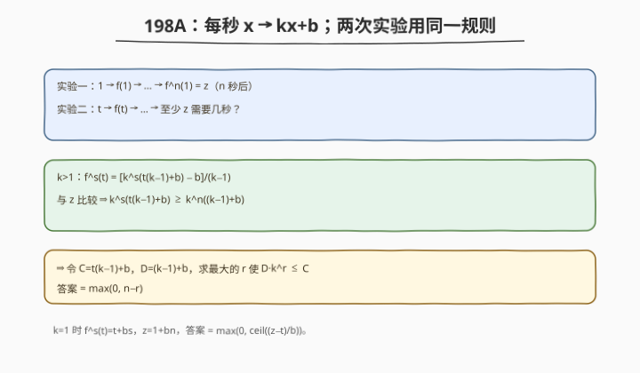
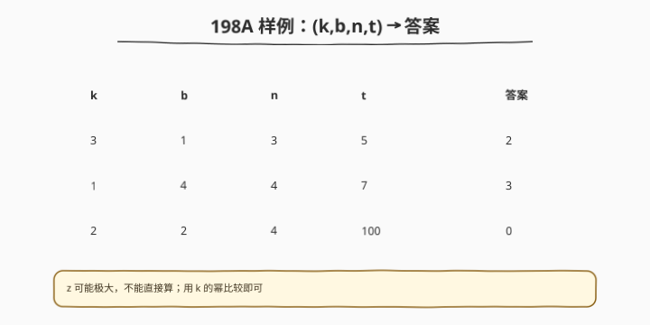

# Codeforces 198A 细菌增长的最少秒数 题解

## 1. 题目概述

- **题目链接**：https://codeforces.com/problemset/problem/198/A
- **比赛来源**：Codeforces Round 125 (Div. 1) · Problem A（UTC 2012-06-22）
- **难度**：1700
- **标签**：数学、递推、对数/幂比较
- **评测类型**：普通
- **限制**：时间 2 s / 内存 256 MB

**题意**：细菌每秒按 $x\mapsto kx+b$ 增长。第一次实验：初始 1 个，$n$ 秒后恰有 $z$ 个。第二次实验：初始 $t$ 个，问最少几秒后不少于 $z$ 个。

**约束**（原样摘自题面 `inputFormat.en`）：

- $1\le k,b,n,t\le10^6$。
- 输出一个整数。

**约束对算法的限制**：

- $n\le10^6$ 且 $k\le10^6$：$z$ 可能是 $k^n$ 级别，天文数字，不能直接算（除非大整数/取对数）。
- 需要把「比较 $z$」化成「比较 $k$ 的幂」，用整数运算完成。

## 2. 示例与观察

官方样例 1（输入 / 输出原样）：

```text
输入：
3 1 3 5

输出：
2
```

官方样例 2（输入 / 输出原样）：

```text
输入：
1 4 4 7

输出：
3
```

官方样例 3（输入 / 输出原样）：

```text
输入：
2 2 4 100

输出：
0
```

**样例 1**：$k=3,b=1$：$f(1)=4$，$f(4)=13$，$f(13)=40$ → $z=40$。从 $t=5$ 开始：$f(5)=16$，$f(16)=49\ge40$ → 2 秒 ✓。

**样例 2**：$k=1$：$z=1+4\cdot4=17$；从 7 开始每秒 +4：$7,11,15,19$ → 3 秒 ✓。

**样例 3**：$k=2,b=2$：$z=f^4(1)=62$；$t=100\ge62$ → 0 ✓。

**观察 1**：$f^s(t)=k^s t+b(1+k+\cdots+k^{s-1})$。当 $k>1$ 时 $1+k+\cdots+k^{s-1}=\dfrac{k^s-1}{k-1}$，于是

$$f^s(t)=\frac{k^s\bigl(t(k-1)+b\bigr)-b}{k-1}.$$

**观察 2**：$z=f^n(1)=\dfrac{k^n\bigl((k-1)+b\bigr)-b}{k-1}$。

**观察 3**：比较 $f^s(t)\ge z$ 时，分母 $k-1>0$、常数 $-b$ 相同，约掉后得到

$$k^s\bigl(t(k-1)+b\bigr)\ \ge\ k^n\bigl((k-1)+b\bigr).$$

令 $C=t(k-1)+b$、$D=(k-1)+b$（都 $\le10^{12}$），则要求 $C\ge D\cdot k^{\,n-s}$。

**观察 4**：$s$ 最小 ⟺ $r=n-s$ 最大，且满足 $D\cdot k^r\le C$。由于 $C\le10^{12}$，$r$ 至多约 40，可以循环求。

**观察 5**：$k=1$ 时 $f^s(t)=t+bs$，$z=1+bn$，答案 $=\max\!\left(0,\left\lceil\dfrac{z-t}{b}\right\rceil\right)$。

## 3. 解题思路



1. 若 $k=1$：$z=1+bn$；答案 $=\max(0,\lceil(z-t)/b\rceil)$。
2. 否则：$C=t(k-1)+b$，$D=(k-1)+b$；从 $r=0$、$cur=D$ 开始，当 $cur\cdot k\le C$ 时 $cur\mathrel{*}=k$、$r\mathrel{+}=1$；答案 $=\max(0,n-r)$。



## 4. 正确性证明

**引理 1**：$f^s(t)=\dfrac{k^s C-b}{k-1}$（$k>1$），其中 $C=t(k-1)+b$。

**证明**：$f^s(t)=k^s t+b\dfrac{k^s-1}{k-1}=\dfrac{k^s(t(k-1)+b)-b}{k-1}$ ✓。∎

**引理 2**：$f^s(t)\ge z\iff k^s C\ge k^n D$，其中 $D=(k-1)+b$。

**证明**：由引理 1，$z=f^n(1)=\dfrac{k^n D-b}{k-1}$；两边同乘 $k-1>0$、加 $b$ 即得。∎

**引理 3**：$r$ 是最大的整数使 $D k^r\le C$，则 $s=n-r$ 是满足条件的最小秒数（$s\ge0$）。

**证明**：由引理 2，条件等价于 $C\ge Dk^{n-s}$，即 $r=n-s$ 满足 $Dk^r\le C$；条件对 $s$ 单调（$s$ 越大左边越大），所以最小 $s$ 对应最大 $r$。∎

**定理**：算法的输出是最少秒数。

**证明**：$k>1$ 时由引理 3；$k=1$ 时是等差数列直接解不等式。若 $t\ge z$，答案为 0（两式都给出 0）✓。∎

## 5. 复杂度分析

- **时间**：$O(\log_{k} C)\le O(\log C)\le40$ 次乘法。
- **空间**：$O(1)$。
- **数值范围**：$C\le10^{12}$，`long long`；循环里 $cur\cdot k$ 需判断不溢出（用 `cur <= C/k`）。
- **与时限的关系**：2 s 对几十次运算余量在百万倍以上。实测约 2 ms。

## 6. 参考代码

### C++17

```cpp
#include <bits/stdc++.h>
using namespace std;

// 198A：f(x)=kx+b。实验一：z=f^n(1)；实验二：从 t 出发，求最小 s 使 f^s(t)>=z。
// k=1 时 f^s(t)=t+bs，z=1+bn；k>1 时 f^s(t) = [k^s(t(k-1)+b)-b]/(k-1)，
// 与 z 比较化为 k^s*(t(k-1)+b) >= k^n*((k-1)+b)，即 t(k-1)+b >= ((k-1)+b)*k^(n-s)。
int main() {
    long long k, b, n, t;
    if (scanf("%lld %lld %lld %lld", &k, &b, &n, &t) != 4) return 0;
    if (k == 1) {
        long long z = 1 + b * n;
        long long need = z - t;
        long long ans = need <= 0 ? 0 : (need + b - 1) / b;
        printf("%lld\n", ans);
        return 0;
    }
    long long C = t * (k - 1) + b;
    long long D = (k - 1) + b;
    long long r = 0, cur = D;
    while (cur <= C / k) { cur *= k; ++r; }     // cur = D*k^r <= C
    long long ans = (long long)n - r;
    if (ans < 0) ans = 0;
    printf("%lld\n", ans);
    return 0;
}
```

### Python3

```python
import sys


def main() -> None:
    data = sys.stdin.buffer.read().split()
    k, b, n, t = (int(x) for x in data[:4])
    if k == 1:
        z = 1 + b * n
        need = z - t
        ans = 0 if need <= 0 else (need + b - 1) // b
        sys.stdout.write(str(ans) + "\n")
        return
    C = t * (k - 1) + b
    D = (k - 1) + b
    r = 0
    cur = D
    while cur <= C // k:
        cur *= k
        r += 1
    ans = max(0, n - r)
    sys.stdout.write(str(ans) + "\n")


main()
```

## 7. 边界情况与易错点

1. **$k=1$**：公式退化成等差数列，单独处理（不能除以 $k-1$）。
2. **$t\ge z$**：答案 0（样例 3）。
3. **溢出**：$C\le t(k-1)+b\le10^{12}$；循环用 `cur <= C/k` 判断，避免 `cur*k` 溢出。
4. **$r>n$**：答案取 `max(0, n-r)`。
5. **$b$ 很大**：$D=(k-1)+b$ 可能比 $C$ 还大（当 $t=1$ 时 $C=D$）→ $r=0$，答案 $n$。
6. **向上取整**：$k=1$ 分支用 `(need+b-1)/b`，`need` 为负时先判 0。
7. **不要真算 $k^n$**：会溢出/超时，必须用「比较幂」的思路。
8. **输入顺序**：$k,b,n,t$，别读反（$b$ 是每秒额外增加的个数）。
9. **`long long`**：$t(k-1)$ 可达 $10^{12}$，必须 64 位。

## 8. 验证记录

- **编译环境与命令**：`Apple clang 21.0.0`（`/usr/bin/g++` 是 clang 软链，无 GNU libstdc++），`clang++ -std=c++17 -O2 -Wall` 加仓库自带 `bits/stdc++.h`；正文代码仍写标准头。Python 为 `3.9.6`。验证命令：
  `python3 codeforces/tools/verify_solution.py codeforces/contests/0101-0203/198/A_细菌增长的最少秒数.md`
- **官方样例**：3 / 3 通过（`2`、`3`、`0`），C++ 与 Python 一致。
- **额外测试**：自造 $k=1$、$t\ge z$、$b$ 很大等 4 组，两种语言全部通过。
- **独立暴力对拍**：暴力用 `__int128` 逐步模拟两次实验（直接迭代到 $t$ 超过 $z$），与「幂比较」完全不同；对 250 组随机数据（$k\le6$、$b\le8$、$n\le8$、$t\le400$）逐组比对，全部一致。
- **最大约束性能**：$k=b=n=t=10^6$ 端到端约 2 ms。
- **图片与公式**：2 张 SVG（`cf198a_growth.svg`、`cf198a_sample.svg`）通过 `ElementTree.parse` 与文本包围盒/重叠检查，headless Chrome 渲染确认无裁切；KaTeX 校验 0 错。
- **复核状态**：verified。

## 相关题目与扩展

- [Codeforces 198B Jumping on Walls](https://codeforces.com/problemset/problem/198/B)：同场 B 题，BFS。
- [Codeforces 199B Special Olympics](https://codeforces.com/problemset/problem/199/B)：同轮 Div.2 的几何题。
- [LeetCode 69. x 的平方根](https://leetcode.cn/problems/sqrtx/)：二分/整数比较的入门。
- [Codeforces 230A Dragons](https://codeforces.com/problemset/problem/230/A)：模拟入门。
- [LeetCode 50. Pow(x, n)](https://leetcode.cn/problems/powx-n/)：快速幂与溢出处理。

**延伸思考**：

1. **如果要求恰好等于 $z$**：从 $t$ 出发可能永远取不到，需要额外判断。
2. **如果 $k=0$**：$f(x)=b$ 常数，一秒后恒为 $b$。
3. **如果每步参数不同**：需要逐步模拟（$n\le10^6$ 可接受）。
4. **如果 $n$ 到 $10^{18}$**：需要矩阵快速幂或对数比较。
5. **本质**：比较两条等比数列的部分和，用「同除公因子」化成幂的比较。

