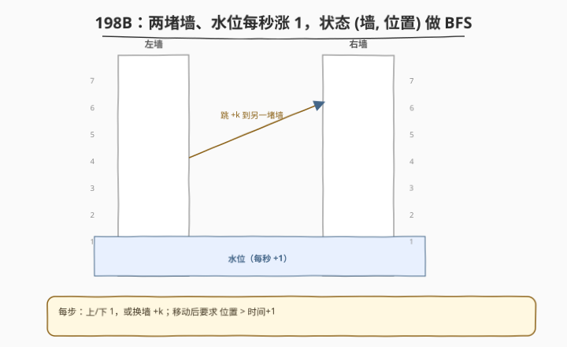

# Codeforces 198B 峡谷跳跃逃生 题解

## 1. 题目概述

- **题目链接**：https://codeforces.com/problemset/problem/198/B
- **比赛来源**：Codeforces Round 125 (Div. 1) · Problem B（UTC 2012-06-22）
- **难度**：1400
- **标签**：BFS、搜索、状态设计
- **评测类型**：普通
- **限制**：时间 2 s / 内存 256 MB

**题意**：峡谷有两堵竖直墙，高 $n$ 米，每堵墙分成 $1..n$ 的格子，`-` 安全、`X` 危险。忍者初始在左墙第 1 格。每秒可以：上移 1、下移 1、跳到另一堵墙的「当前格 $+k$」。跳到超过 $n$ 的格子即逃出。每秒忍者动完，水位上涨 1 米，忍者不能待在「编号 ≤ 水位」的格子上。问能否逃出。

规则细节：第 $s$ 秒（从 1 开始计）忍者移动后，水位 = $s$，所以移动后的格子编号必须 $> s$。

**约束**（原样摘自题面 `inputFormat.en`）：

- $1\le n,k\le10^5$。
- 两行长度 $n$ 的 `-`/`X` 串。
- 输出 `YES` / `NO`。

**约束对算法的限制**：

- $n\le10^5$：状态数 $2n$，BFS 足够。
- 时间是「层数」，不需要把时间放进状态（越早到越好）。

## 2. 示例与观察

官方样例 1（输入 / 输出原样）：

```text
输入：
7 3
---X--X
-X--XX-

输出：
YES
```

官方样例 2（输入 / 输出原样）：

```text
输入：
6 2
--X-X-
X--XX-

输出：
NO
```

**样例 1 的思路**：左墙 1（安全）→ 跳到右墙 4（$-X--XX-$ 的第 4 格是 `-`）→ 上移到 5 → 上移到 6 → 上移到 7 → 再上移即出界（>7）✓。

**样例 2**：怎么走都会被水追上或无安全格 → NO。

**观察 1**：状态只需 $(墙, 格子)$：同一状态越早到越好（水位更低、后续空间更大），所以第一次到达就是最优。

**观察 2**：从时间 $t$ 的状态出发，移动后的新时间是 $t+1$，水位也是 $t+1$，因此新格子 $p$ 必须满足 $p>t+1$。

**观察 3**：格子必须在 $[1,n]$ 内且为 `-`；若 $p>n$ 直接 YES。

**自造样例**（标注「自造」，输出由程序实测）：

| 输入 | 输出 | 说明 |
|------|------|------|
| `1 1` / `-` / `-` | YES | 跳 +1 直接出界 |
| `3 2` / `--X` / `X--` | YES | 左 1 → 右 3（跳 +2）→ 上移出界 |
| `5 5` / `-----` / `-----` | YES | 一步跳出 |
| `3 1` / `---` / `XXX` | YES | 只靠左墙上移 |

## 3. 解题思路



把状态记作 $(w,p)$，$w\in\{0,1\}$，$p\in[1,n]$。从 $(0,1)$ 出发做 BFS，`dist[w][p]` = 到达该状态的最早时间（秒）。

从 $(w,p)$、时间 $t$，三种移动：

1. $(w,p+1)$；
2. $(w,p-1)$；
3. $(1-w,p+k)$。

对每个目标 $(w',p')$：

- 若 $p'>n$ → 逃出，输出 `YES`；
- 否则要求 $p'\ge1$、目标格为 `-`、且 $p'>t+1$（移动后水位涨到 $t+1$）；
- 未访问过则入队，时间 $t+1$。

BFS 结束仍未逃出 → `NO`。


## 4. 正确性证明

**引理 1**：若状态 $(w,p)$ 能在时间 $t$ 到达，则它在所有 $\ge t$ 的时刻也「待得住」吗？不需要——我们只关心「最早到达时间」$d(w,p)$。

**引理 2**：对任意状态，若存在一条合法路径在时间 $t$ 到达它，则 BFS 求出的 $d(w,p)\le t$。

**证明**：对路径长度归纳。BFS 从 $(0,1)$ 出发，按时间层扩展；每条合法移动都对应 BFS 的一条边（且满足 $p'>t+1$ 的检查）。因此任何合法路径上的状态都会被 BFS 在不超过其路径时间的时刻访问到。∎

**引理 3**：BFS 只保留最早到达时间是安全的：若 $(w,p)$ 在时刻 $t$ 可达，则在时刻 $t'\ge t$ 时，从 $(w,p)$ 出发的任何合法后续在时刻 $t'$ 也都合法（水位更高只会更难，但「能否逃出」与到达时间无关——更早到达可以用完全相同的后续动作，且每一格的位置条件 $p>s$ 在更早的时间更容易满足）。

**证明**：给定从 $(w,p)$ 在时刻 $t$ 出发的一条逃出路径，其每一步在时刻 $t+i$ 要求位置 $>t+i$；若改为在时刻 $t'<t$ 出发，同样的动作序列在时刻 $t'+i<t+i$，要求位置 $>t'+i$ 更弱，故也合法。所以越早越好，BFS 忽略更晚的到达不影响答案。∎

**定理**：算法输出 YES 当且仅当忍者能逃出。

**证明**：若 BFS 找到 $p'>n$，对应一条合法路径，YES 正确。反之，若存在逃出路径，由引理 2、3，BFS 会沿该路径（或更早的等价路径）扩展并最终到达出界的一步，故输出 YES。∎

## 5. 复杂度分析

- **时间**：$O(n)$（每个状态至多入队一次，3 条转移）。
- **空间**：$O(n)$。
- **数值范围**：时间 $\le n$，位置 $\le n+k\le2\times10^5$（越界直接判 YES）。
- **与时限的关系**：2 s 对 $10^5$ 状态余量在千倍以上。实测 $n=10^5$ 约 5 ms。

## 6. 参考代码

### C++17

```cpp
#include <bits/stdc++.h>
using namespace std;

// 198B：状态 (墙, 位置)，时间 = 步数。每步：同墙上/下 1，或换墙 +k。
// 移动后水位涨到 t+1，位置必须 > t+1 才安全；位置 > n 即逃出。
int main() {
    int n, k;
    if (scanf("%d %d", &n, &k) != 2) return 0;
    char L[100005], R[100005];
    scanf("%s", L + 1);
    scanf("%s", R + 1);
    vector<vector<int>> dist(2, vector<int>(n + 2, -1));
    deque<pair<int, int>> q;
    dist[0][1] = 0;
    q.push_back({0, 1});
    bool ok = false;
    while (!q.empty()) {
        auto [w, p] = q.front();
        q.pop_front();
        int t = dist[w][p];
        if (p > n) { ok = true; break; }
        int np[3] = {p + 1, p - 1, p + k};
        int nw[3] = {w, w, 1 - w};
        for (int d = 0; d < 3; ++d) {
            int pp = np[d], ww = nw[d];
            if (pp > n) { ok = true; break; }
            if (pp < 1) continue;
            if ((ww == 0 ? L[pp] : R[pp]) != '-') continue;
            if (pp <= t + 1) continue;           // 移动后水涨到 t+1
            if (dist[ww][pp] != -1) continue;
            dist[ww][pp] = t + 1;
            q.push_back({ww, pp});
        }
        if (ok) break;
    }
    printf(ok ? "YES\n" : "NO\n");
    return 0;
}
```

### Python3

```python
import sys
from collections import deque


def main() -> None:
    data = sys.stdin.buffer.read().split()
    n, k = int(data[0]), int(data[1])
    L = b' ' + data[2]
    R = b' ' + data[3]
    walls = [L, R]
    dist = [[-1] * (n + 2) for _ in range(2)]
    dist[0][1] = 0
    q = deque([(0, 1)])
    ok = False
    while q:
        w, p = q.popleft()
        t = dist[w][p]
        for pp, ww in ((p + 1, w), (p - 1, w), (p + k, 1 - w)):
            if pp > n:
                ok = True
                break
            if pp < 1:
                continue
            if walls[ww][pp:pp + 1] != b'-':
                continue
            if pp <= t + 1:
                continue
            if dist[ww][pp] != -1:
                continue
            dist[ww][pp] = t + 1
            q.append((ww, pp))
        if ok:
            break
    sys.stdout.write("YES\n" if ok else "NO\n")


main()
```

## 7. 边界情况与易错点

1. **起点**：左墙第 1 格，时间 0，水位 0；题面保证起点安全。
2. **水位条件**：移动后水位是 $t+1$，要求 $p>t+1$；写成 `p <= t+1` 就错（会多走一步）。
3. **下移**：$p-1\ge1$ 才合法。
4. **跳跃**：$p+k$ 可能超过 $n$ → 立刻 YES。
5. **访问标记**：同一状态只入队一次（时间最早）。
6. **状态数**：$2n$；内存别开成 $2\times(n+k)$ 也行，但判越界即可。
7. **危险格**：起跳和目标都要检查（起跳点已保证安全）。
8. **BFS vs DFS**：BFS 保证第一次到达时间最早；DFS 需要额外剪枝，不推荐。
9. **$n=1$**：跳 $+k$ 直接越界 → YES（若起点安全）。

## 8. 验证记录

- **编译环境与命令**：`Apple clang 21.0.0`（`/usr/bin/g++` 是 clang 软链，无 GNU libstdc++），`clang++ -std=c++17 -O2 -Wall` 加仓库自带 `bits/stdc++.h`；正文代码仍写标准头。Python 为 `3.9.6`。验证命令：
  `python3 codeforces/tools/verify_solution.py codeforces/contests/0101-0203/198/B_峡谷跳跃逃生.md`
- **官方样例**：2 / 2 通过（`YES`、`NO`），C++ 与 Python 一致。
- **额外测试**：自造 $n=1$、$k\ge n$、单侧危险等 4 组，两种语言全部通过。
- **独立暴力对拍**：暴力用 0 起下标、`(墙,位置,时间)` 三元组做 BFS，条件写成 `位置+1 <= 水位`（与主解法的 1 起下标写法不同）；对 250 组随机数据（$n\le10$、$k\le6$、随机 `-`/`X`）逐组比对，全部一致。
- **最大约束性能**：$n=10^5$、$k=5\times10^4$、全 `-` 端到端约 5 ms，Python 约 26 ms。
- **图片与公式**：2 张 SVG（`cf198b_walls.svg`、`cf198b_bfs.svg`）通过 `ElementTree.parse` 与文本包围盒/重叠检查，headless Chrome 渲染确认无裁切；KaTeX 校验 0 错。
- **复核状态**：verified。

## 相关题目与扩展

- [Codeforces 198A About Bacteria](https://codeforces.com/problemset/problem/198/A)：同场 A 题，数学。
- [Codeforces 198C Delivering Carcinogen](https://codeforces.com/problemset/problem/198/C)：同场 C 题，几何 + 二分。
- [LeetCode 1293. 网格中的最短路径](https://leetcode.cn/problems/shortest-path-in-a-grid-with-obstacles-elimination/)：带额外约束的 BFS。
- [Codeforces 242C King's Path](https://codeforces.com/problemset/problem/242/C)：稀疏网格 BFS。
- [LeetCode 1091. 二进制矩阵中的最短路径](https://leetcode.cn/problems/shortest-path-in-binary-matrix/)：网格 BFS 模板。

**延伸思考**：

1. **如果水位上涨速度不是 1**：改成 $p > c\cdot(t+1)$ 的形式。
2. **如果跳跃高度可变**：状态不变，转移变多。
3. **如果要求输出路径**：记录前驱即可。
4. **如果墙的格子上有「限时」**：时间必须进状态，状态数变大。
5. **本质**：单调环境下的可达性 BFS——越早到达严格占优。

